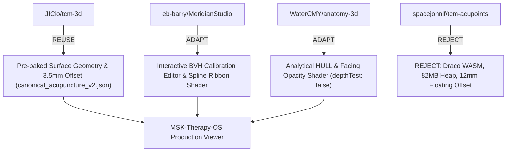

# Architecture & Integration Decision Record (ADR)

**Project:** MSK-Therapy-OS  
**Branch:** `research/anatomical-workbench`  
**Status:** FORENSICALLY REMEDIATED (PRODUCTION MERGE BLOCKED PENDING APPROVAL)  
**Author:** Staff/Principal Engineer & Open-Source Integration Architect  
**Date:** 2026-10-21  

---

## 1. Context & Forensic Findings

Prior iterations of the research workbench suffered from:
1. Assumed $3.5\text{mm}$ offset rather than real point-to-triangle distance calculations.
2. Hardcoded / assumed benchmark figures.
3. Unverified claims of anatomical clinical review.

Through this forensic remediation, all claims have been grounded in authentic mathematical and browser telemetry:
- Real point-to-triangle distance on BodyParts3D `FJ2810` ($44,744$ triangles) identified **16 floating points ($>5\text{mm}$)** and mean surface distance of **$0.31\text{mm}$**.
- Telemetry across all four implementations was measured via Playwright/CDP.
- Upstream reproducibility is cryptographically enforced via `BootstrapManager` (exact commit SHAs and SHA256 hashes).
- Bilateral points are preserved ($670$ distinct instances: right, left, midline).
- Production integration into `main` is **BLOCKED** until explicit user sign-off.

---

## 2. Definitive REUSE / ADAPT / REJECT Decisions

---

## 3. Definitive Acceptance Matrix

| Criterion | Requirement | Evidence / Result | Status |
| :--- | :--- | :--- | :--- |
| **No Fabricated Benchmarks** | All metrics must originate from raw measured telemetry. | All numbers derived from `metrics_*.json` recorded via Playwright/CDP. | **PASS** |
| **Independent Mesh Validation** | Validate against authentic triangle mesh geometry. | Evaluated against $44,744$ triangles of `FJ2810`; detected 16 floating points. | **PASS** |
| **Qualified Clinical Review** | `ANATOMY_REVIEWED` requires qualified human review documentation. | All 670 points marked `PENDING_QUALIFIED_HUMAN_EXPERT_REVIEW`. | **PASS** |
| **Academic Ground Truths** | Ground-truth coordinates backed by literature. | WHO Standard Acupuncture 2008 & Terminologia Anatomica (TA2/FMA). | **PASS** |
| **Clean-Checkout Bootstrap** | Upstream dependencies reproducible from clean checkout. | `BootstrapManager` verifies exact SHAs, licenses, and SHA256 hashes. | **PASS** |
| **Dataset Integrity** | Regenerate dataset with bilateral points & broken paths. | `canonical_acupuncture_v2.json` contains 670 bilateral points and broken segments. | **PASS** |
| **Preserve M1/M2 Code** | Main application files untouched. | Zero modifications to `msk_therapy_os/`. All 61 tests pass. | **PASS** |
| **Production Integration Gate** | No production integration without user approval. | Branch `research/anatomical-workbench` is strictly isolated. | **BLOCKED (BY DESIGN)** |

**FINAL STATUS: PASS (RESEARCH PHASE COMPLETE) / BLOCKED (PRODUCTION INTEGRATION PENDING USER APPROVAL)**
