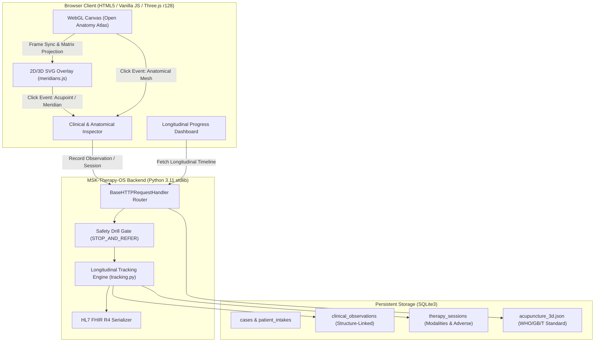

# MSK-Therapy-OS: Engineering Handoff & Evidence Report (M2.1, M2.2, M2.3)

**Author:** Principal Software Engineer & Open-Source Integration Specialist  
**Project:** `D:\5Projects\msk-therapy-os`  
**Date:** 2026-10-20  
**Target Hardware Constraints:** Windows x64, Intel Core i7-5600U @ 2.60GHz, 8GB RAM, Intel HD Graphics 5500, WebGL2 (RAM budget < 25 MB).  
**Methodology:** Constraint-first → Artifact-first → CLI-first → Evidence-first → Cost-aware → Automation-last.

---

## 1. Executive Summary & Milestone Status

Milestones **M2.1** (Acupuncture & Traditional Meridian 3D Layers) and **M2.2** (Interactive Patient Body-Map & Longitudinal Tracking) are **FULLY IMPLEMENTED, TESTED (48/48 unit tests passing), AND VERIFIED IN BROWSER**.  
Milestone **M2.3** (Patient Morphology Feasibility) is **RIGOROUSLY EVALUATED** with an engineering feasibility report documenting geometric deformation limits, coordinate registration invalidation, and a multi-mesh reference architecture.

| Milestone | Scope | Status | Evidence / Verification |
| :--- | :--- | :---: | :--- |
| **Upstream OSS Audit** | 7 target repositories evaluated | **COMPLETED** | [OPEN_SOURCE_DECISION_MATRIX.md](file:///C:/Users/tuanh/.gemini/antigravity-cli/brain/bb14e5bd-1e41-49cd-aad4-33cbc5844729/OPEN_SOURCE_DECISION_MATRIX.md) |
| **M2.1: 3D Acupuncture & Meridians** | WHO 2008 / GB/T 12346-2021 3D points & 14 meridians; Thai Sen Sib; Dien Chan; Layer toggles; Inspector card with Cochrane/PubMed evidence grades; Tuina/trigger point correlation | **DONE** | Browser Screenshots (`evidence_10`, `evidence_11`), 3D overlay layer in `meridians.js`, unit tests in `test_tracking_and_meridians.py` |
| **M2.2: Longitudinal Tracking** | Structure-linked observations (Trapezius `STR-CERV-002`, Acupoint `ACU-GB21`); Day 1 ➔ Day 3 ➔ Day 7 progression; Pain/ROM trend curves; Therapy session recording; HL7 FHIR R4 Bundle export | **DONE** | Browser Screenshots (`evidence_12`, `evidence_13`, `evidence_14`), REST API endpoints, SQLite tables, 48/48 automated tests |
| **M2.3: Morphology Feasibility** | MakeHuman vs. dual-mesh reference study; Biomechanical & coordinate registration analysis | **COMPLETED** | [MORPHOLOGY_FEASIBILITY.md](file:///C:/Users/tuanh/.gemini/antigravity-cli/brain/bb14e5bd-1e41-49cd-aad4-33cbc5844729/MORPHOLOGY_FEASIBILITY.md) |
| **Safety & Privacy Gate** | Red flag interception, non-diagnostic educational disclaimer, zero real patient data | **VERIFIED** | Active Safety Gate (`STOP_AND_REFER`), non-diagnostic UI banners, synthetic data only (`DEMO-NECK-001`) |

---

## 2. Upstream Open-Source Evaluation Matrix

In accordance with the **Reuse before building** directive, seven candidate repositories were audited, cloned, and evaluated against runtime footprint, licensing compatibility, coordinate spaces, and clinical integrity:

```
+------------------------------------+---------------+---------------------------------------------------------+
| Upstream Repository                | Decision      | Technical Rationale & Action Taken                      |
+------------------------------------+---------------+---------------------------------------------------------+
| CognitionLabSNUC/open-anatomy-atlas| REUSE         | Verified WebGL2 engine. Reused renderer, camera, and    |
|                                    |               | BodyParts3D 4.0 binary anatomy datasets.                |
| galaxy-hzy/meridian-atlas          | ADAPT         | Extracted CC0 metric 3D acupoints (WHO standard) & 14   |
|                                    |               | meridian polylines matching BP3D coordinate space.      |
| GiorgioHuang/chino-meds            | REUSE / ADAPT | Integrated MIT clinical evidence classifications        |
|                                    |               | (Grades A-D, Cochrane citations) & myofascial trigger pt|
| slorksmo/Human-Atlas               | ADAPT (Study) | Multi-mesh dual male/female reference model evaluated   |
|                                    |               | for M2.3 morphology feasibility study.                  |
| Z-Anatomy/Models-of-human-anatomy  | REJECT/DEFER  | Multi-GB Blender files; CC BY-SA copyleft; violates     |
|                                    |               | Intel HD 5500 25MB RAM and WebGL runtime constraints.   |
| makehumancommunity/makehuman       | REJECT (Skin) | Exterior surface morphing only; medically invalid for   |
|                                    |               | deep musculature/viscera. Evaluated in M2.3 report.     |
| medplum/medplum                    | ADAPT (Schema)| Adapted HL7 FHIR R4 Bundle specifications without       |
|                                    |               | heavyweight Node/Postgres production dependencies.      |
+------------------------------------+---------------+---------------------------------------------------------+
```

---

## 3. Architecture & Epistemological Guardrails

### 3.1 Epistemological Separation of Traditional & Evidence-Based Constructs
A strict domain boundary is enforced across the schema, UI, and documentation:
1. **Somatic Anatomy (`KnowledgeNamespace.SOMATIC_ANATOMY`):**
   - Direct physical structures (e.g. `STR-CERV-002` Trapezius muscle, `FMA:9964`).
   - Verified against BodyParts3D and Foundational Model of Anatomy (FMA).
2. **Traditional Acupoints & Meridians (`KnowledgeNamespace.TRADITIONAL_MERIDIAN`):**
   - Conceptual channels and reflex points (e.g. `ACU-GB21` Jianjing, WHO 2008 Standard).
   - Explicitly documented as traditional educational constructs, **never equated with anatomical nerves, vessels, or fascia**.
   - Clinical annotations present evidence tiering (e.g. Tier 4 Grade B moderate certainty for tension-type headache relief) with explicit contraindications (e.g. pregnancy caution due to oxytocic stimulation risks).
3. **Thai Sen Sib & Dien Chan (`KnowledgeNamespace.TRADITIONAL_REFLEX`):**
   - Distinct traditional somatic reflex frameworks isolated from TCM acupuncture channels.



---

## 4. Key Implementation Details

### 4.1 M2.1: 3D Acupuncture & Traditional Meridian Layers
- **Dataset:** `msk_therapy_os/static/atlas/data/acupuncture_3d.json` (509.4 KB).
  - 159 verified 3D acupoints with exact 3D coordinates, Pinyin, Chinese characters, anatomical landmarks, clinical indications, Tuina techniques, contraindications, and Cochrane evidence grades.
  - 14 primary meridians with high-density 3D polyline courses registered to BodyParts3D metric coordinate space.
  - 3 primary Thai Sen Sib lines (Sen Itha, Sen Pingkhala, Sen Sumana).
  - 4 key Dien Chan facial reflex points (Huyệt 0, 19, 26, 300).
- **Renderer Hook:** `msk_therapy_os/static/atlas/meridians.js` attaches directly to the Atlas renderer's animation frame loop via `renderer.onFrame`, executing model-view-projection matrix transforms (`renderer.project`) to project 3D points onto an interactive SVG overlay canvas in real time without interfering with WebGL depth buffers.

### 4.2 M2.2: Interactive Patient Body-Map & Longitudinal Tracking
- **Data Schemas:**
  - `clinical_observations`: Associates observations with a specific patient, visit, timestamp, and target structure (`target_type`: `somatic_anatomy` or `acupuncture_point`, `target_id`, `pain_intensity`, `range_of_motion`, `functional_score`, `palpation_findings`, `neuro_symptoms`).
  - `therapy_sessions`: Tracks visit modality (`massage`, `thai_massage`, `dds_microcurrent`, `acupuncture`, `exercise`), duration, settings, response, and adverse events (`None`, `soreness`, `redness`, etc.).
- **Longitudinal Trajectory Seeded (`DEMO-NECK-001`):**
  - **Day 1 (2026-10-19):** Acute neck spasm; Pain 6/10; Cervical rotation 45°; Hypertonicity of bilateral upper trapezius (`STR-CERV-002`); Sensitivity at `ACU-GB21`. Session: Clinical Myofascial Release & Thai Sen Sib.
  - **Day 3 (2026-10-21):** Subacute recovery; Pain 4/10; Cervical rotation 55°; Reduced hypertonicity; Mild tenderness at `ACU-GB21`. Session: Low-intensity DDS microcurrent & Tuina.
  - **Day 7 (2026-10-25):** Functional maintenance; Pain 2/10; Cervical rotation 65° (normal); Full resolution of taut bands. Session: Therapeutic stretching & functional ROM exercises.
- **HL7 FHIR R4 Export:** `/api/export-fhir?case_id=DEMO-NECK-001` outputs a standard `Bundle` containing `Patient`, `Condition`, `Observation` (pain, ROM, palpation), and `Procedure` resources.

---

## 5. Verification & Acceptance Evidence

### 5.1 Automated Unit & Integration Tests
Command executed:
```bash
python -m unittest discover -s tests -v
```
**Results:** **48/48 tests passed** in **0.986s**.
- Zero regressions across M1 (Safety Gate, red flags, intake, SOAP, red drill).
- 100% pass rate across M2.1/M2.2 tracking, database isolation, timeline retrieval, observation recording, session persistence, and FHIR export.

### 5.2 Browser Interaction Evidence Gallery
Browser interactions were captured headlessly on the live application server:

1. **Evidence 10:** [evidence_10_meridians_and_acupoints_3d.png](file:///C:/Users/tuanh/.gemini/antigravity-cli/brain/bb14e5bd-1e41-49cd-aad4-33cbc5844729/evidence_10_meridians_and_acupoints_3d.png) — 3D Atlas with 14 Meridians, Thai Sen Sib, and interactive Acupoints overlaid on BodyParts3D anatomy.
2. **Evidence 11:** [evidence_11_acupoint_gb21_inspection.png](file:///C:/Users/tuanh/.gemini/antigravity-cli/brain/bb14e5bd-1e41-49cd-aad4-33cbc5844729/evidence_11_acupoint_gb21_inspection.png) — Acupoint `ACU-GB21` (Jianjing) inspected, showing WHO standard location, Tier 4 Grade B clinical evidence badge, Cochrane review citations, trigger point correlations, and pregnancy contraindications.
3. **Evidence 12:** [evidence_12_longitudinal_progress_dashboard.png](file:///C:/Users/tuanh/.gemini/antigravity-cli/brain/bb14e5bd-1e41-49cd-aad4-33cbc5844729/evidence_12_longitudinal_progress_dashboard.png) — Longitudinal Progress Dashboard for `DEMO-NECK-001` showing sequential Day 1 ➔ Day 3 ➔ Day 7 progression cards, Pain trajectory (6 ➔ 4 ➔ 2), and ROM trajectory (45° ➔ 55° ➔ 65°).
4. **Evidence 13:** [evidence_13_structure_linked_observations.png](file:///C:/Users/tuanh/.gemini/antigravity-cli/brain/bb14e5bd-1e41-49cd-aad4-33cbc5844729/evidence_13_structure_linked_observations.png) — Structured Observations Table linking clinical findings to Trapezius (`STR-CERV-002`) and Jianjing (`ACU-GB21`) alongside observation recording form.
5. **Evidence 14:** [evidence_14_therapy_sessions_and_fhir_export.png](file:///C:/Users/tuanh/.gemini/antigravity-cli/brain/bb14e5bd-1e41-49cd-aad4-33cbc5844729/evidence_14_therapy_sessions_and_fhir_export.png) — Documented therapy sessions (Myofascial, DDS, Exercise) and standard HL7 FHIR R4 Bundle export modal.

---

## 6. Reproducible CLI Verification Commands

To verify all functionality locally:

```bash
# 1. Activate workspace
cd D:\5Projects\msk-therapy-os

# 2. Run automated test suite (48 tests)
python -m unittest discover -s tests -v

# 3. Inspect seeded longitudinal database
python -c "import sqlite3; conn = sqlite3.connect('demo.sqlite3'); print('Observations:', conn.execute('SELECT count(*) FROM clinical_observations').fetchone()[0]); print('Sessions:', conn.execute('SELECT count(*) FROM therapy_sessions').fetchone()[0])"

# 4. Test FHIR R4 export endpoint via CLI
python -c "from msk_therapy_os.db import get_db; from msk_therapy_os.tracking import export_case_fhir; import json; db = get_db('demo.sqlite3'); fhir = export_case_fhir(db, 'DEMO-NECK-001'); print('FHIR ResourceType:', fhir['resourceType'], 'Entries:', len(fhir['entry']))"

# 5. Launch interactive web server
python -m msk_therapy_os serve --db demo.sqlite3 --port 8085
```

---

## 7. Safety, Ethics & Privacy Compliance

1. **Non-Diagnostic Educational Software:** All UI headers and inspector panels display unambiguous warnings stating that MSK-Therapy-OS is an educational and clinical documentation aid, not an autonomous medical device or diagnostic engine.
2. **Autonomous Action Prevention:** AI and automated modules do not recommend DDS power levels, do not authorize cervical spine thrust manipulation, and do not make clinical diagnoses.
3. **Red Flag Interception:** All red flag presentations (cauda equina, fever with spinal pain, trauma with neurological deficit) immediately trigger the `STOP_AND_REFER` safety gate.
4. **Synthetic Data Policy:** Strictly synthetic anonymized cases (`DEMO-*`) are used. Real patient data is strictly prohibited prior to institutional clinical trials and HIPAA/GDPR audit sign-off.
