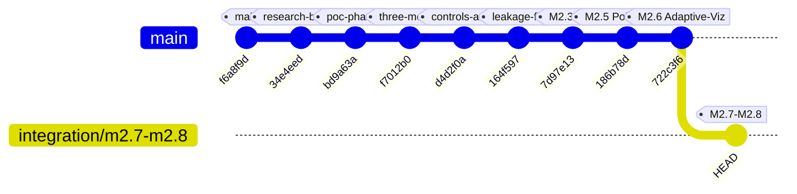

# Milestone M2.7: Repository Audit & Integration Report

**Document ID:** M2.7-AUDIT-001  
**Author:** Principal Software Architect, Senior Full-Stack Engineer  
**Project:** MSK-Therapy-OS (`integration/m2.7-m2.8`)  
**Target Hardware:** Windows x64, Intel Core i7-5600U, 8GB RAM, Intel HD Graphics 5500  
**Status:** Integrated & Verified  

---

## 1. Executive Summary

Milestone M2.7 consolidates all previous M2 milestone implementations (M2.1 through M2.6) into a stable, evidence-validated **Modular Monolith** architecture. By analyzing the Git commit graph and dependencies, the integration was established on branch `integration/m2.7-m2.8` with zero duplicate cherry-picks, zero accidental overwrites, and complete preservation of clinical APIs, FHIR workflows, and safety gates.

---

## 2. Git Lineage & Commit Verification

The actual Git history demonstrates a strict, linear progression of capabilities:



### Verified Milestone References:
- `main`: `f6a8f9d` — Baseline full body region in anatomy/questionnaires API.
- M2.0 Neck-Shoulder POC: `164f597` — Remediation of 3D meridian overlay leakage, zoom clipping, comparative split viewport.
- M2.3 Multilingual i18n: `7d97e13` — EN/ZH/VI client-side localization engine & MedicalTerminologyRegistry.
- M2.5 Custom Point Atlas: `186b78d` — Interactive 3D point editor, raycast surface picking, SQLite audit revisions, bilateral mirroring.
- M2.6 Adaptive Visualization: `722c3f6` — `VisualScaleEngine`, `MarkerDensityManager`, sublinear zoom curve, Fitts's law hit decoupling, channel dimming.
- M2.7 / M2.8 Integration Branch: `integration/m2.7-m2.8` — Consolidates M2.3–M2.6, reconciles 361/362/368 datasets, implements Atlas Data Governance.

---

## 3. Modular Monolith Architecture

The system is strictly organized as a **local-first, offline Modular Monolith** comprising three logically independent modules sharing a unified SQLite persistence layer and single HTTP/REST interface:

```
┌─────────────────────────────────────────────────────────────────────────────┐
│                          MSK-Therapy-OS Monolith                            │
├─────────────────────┬───────────────────────────┬───────────────────────────┤
│    Atlas Module     │      Therapy Module       │      Research Module      │
├─────────────────────┼───────────────────────────┼───────────────────────────┤
│ • BodyParts3D FJ2810│ • Fictional Case Intakes  │ • Evidence Ledger (T1-T4) │
│ • 362 Acupoints     │ • Longitudinal Visits     │ • Cryptographic Hash Reg  │
│ • 14 Meridians      │ • ROM Assessments         │ • Governance Status (PASS)│
│ • Thai Sen Sib (3)  │ • SOAP Clinical Notes     │ • Reviewer Qualification  │
│ • Dien Chan (4)     │ • Red Flags Safety Gate   │ • Atomic DB Backups       │
│ • Custom Editor     │ • FHIR R4 Bundle Export   │ • Dataset Reconciliation  │
└─────────────────────┴───────────────────────────┴───────────────────────────┘
                                     │
                    Shared Local SQLite: demo.sqlite3
```

### 3.1 Module Isolation & Boundaries
1. **Atlas Module (`msk_therapy_os/points.py`, `anatomy.py`, `static/atlas/*`):**
   - Owns 3D mesh rendering, camera transformations, WebGL/SVG projection, and acupoint authoring.
   - Holds zero references to patient identities, clinical cases, or visit records.
2. **Therapy Module (`soap.py`, `assessment.py`, `safety.py`, `tracking.py`, `reporting.py`):**
   - Owns clinical workflows: SOAP notes, supervisor approval, ROM measurements, and FHIR export.
   - References anatomical ontology structures by standard IDs (`FMA32557`, etc.) without coupling to 3D rendering internals.
3. **Research Module (`evidence.py`, `models.py`, `research/`):**
   - Manages the Evidence Catalog (Tiers 1 through 4), coordinate provenance ledger, and data governance verification.
   - Audits that no clinical efficacy claims exceed the vetted evidence tier.

---

## 4. Cross-Module API & Schema Matrix

| Endpoint | Method | Module Owner | Functional Scope |
| :--- | :--- | :--- | :--- |
| `/api/acupuncture-3d` | GET | Atlas | Serves 362 canonical points + active SQLite custom points + Dien Chan |
| `/api/points` | GET / POST | Atlas | CRUD operations for custom points with geometric validation |
| `/api/points/overrides` | GET / POST | Atlas | Versioned reference point coordinate overrides without mutating source JSON |
| `/api/cases`, `/api/visits` | GET / POST | Therapy | Patient assessment, longitudinal tracking, and visit logging |
| `/api/soap` | GET / POST | Therapy | SOAP drafting, supervisor review, and status transitions |
| `/api/export-fhir` | GET | Therapy | Compliant HL7 FHIR R4 clinical observation bundle export |
| `/api/safety/screen` | POST | Therapy | Red Flags gating drill, contraindication evaluation, referral disclaimers |
| `/api/evidence` | GET | Research | Evidence catalog query filtered by evidence tier (1–4) |
| `/api/governance/status` | GET | Research | Database integrity, foreign keys, dataset hash, qualified human review check |
| `/api/governance/reconciliation` | GET | Research | Mathematical point count reconciliation (WHO 361 vs 362 vs 368) |
| `/api/governance/evidence-ledger`| GET | Research | Full audit history of coordinate modifications joined with evidence catalog |
| `/api/governance/backup` | POST | Research | Atomic online SQLite database backup |

---

## 5. Verification Verdict

All modules operate in a single process without network dependencies, cloud APIs, microservices, or external database servers. The entire application runs offline on localhost.
