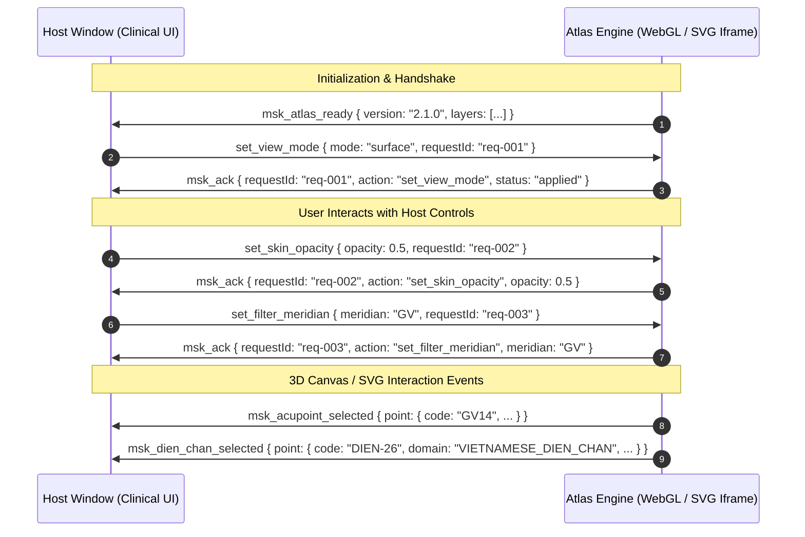

# M2 Render State & IPC Protocol Contract

**Project:** MSK-Therapy-OS  
**Scope:** Host Application (`index.html`) ⇄ 3D Anatomical Atlas Iframe (`atlas/index.html`)  
**Specification Version:** 2.1.0  
**Status:** IMPLEMENTED & AUDITED  

---

## 1. Architectural Overview

MSK-Therapy-OS isolates high-performance WebGL 3D rendering and SVG overlay vector mathematics within a sandboxed `iframe` (`#atlasFrame`) to protect the main clinical host DOM from WebGL context loss, garbage collection stalls, and style collisions.

Communication between the **Host Context** (`index.html` / `app.js`) and the **Atlas Engine** (`atlas/app.js`, `atlas/gl.js`, `atlas/meridians.js`) is governed by an asynchronous, bidirectional, typed `postMessage` protocol featuring deterministic request tracking, state acknowledgment (`msk_ack`), and domain-separated selection event routing.



---

## 2. Inbound Host Commands (`Host` → `Atlas`)

All commands posted from the host window to `#atlasFrame.contentWindow` must adhere to the following schema:

```typescript
interface AtlasCommandMessage<T = Record<string, any>> {
  action: string;
  requestId?: string; // Deterministic tracking ID (e.g., "req-1729510000000-01")
  payload?: T;
  [key: string]: any;  // Flattened payload properties for backward compatibility
}
```

### 2.1 Command Specifications

| Action | Parameters | Expected Atlas Behavior | Acknowledgment Payload |
| :--- | :--- | :--- | :--- |
| `set_skin_opacity` | `opacity: number` (0.0 to 1.0) | Sets `gl.skinOpacity`. If `alpha > 0.005`, enables `catOn['skin'] = true` and submits skin vertices to WebGL pipeline. If `alpha <= 0.005`, sets `catOn['skin'] = false`. Calls `applyVisibility()` and redraws scene. | `{ type: "msk_ack", requestId, action: "set_skin_opacity", opacity: number }` |
| `set_filter_meridian` | `meridian: string` ("all", "GV", "CV", "BL", etc.) | Filters rendered meridian paths and acupoint markers to matching `meridian_code`. Automatically sets `showMeridians = true` and `showPoints = true`. Auto-rotates camera (`yaw = 0.0` for anterior CV, `yaw = Math.PI` for posterior GV/BL). | `{ type: "msk_ack", requestId, action: "set_filter_meridian", meridian: string, showMeridians: true, showPoints: true }` |
| `toggle_meridians` | `enabled: boolean` | Toggles rendering of 14 classical meridian pathways (`#groupMeridians`). | `{ type: "msk_ack", requestId, action: "toggle_meridians", enabled: boolean }` |
| `toggle_acupoints` | `enabled: boolean` | Toggles rendering of 362 WHO standard acupuncture markers (`#groupPoints`). | `{ type: "msk_ack", requestId, action: "toggle_acupoints", enabled: boolean }` |
| `toggle_thai_sen_sib` | `enabled: boolean` | Toggles rendering of 3 Thai Sen Sib lines (`#groupThai`). | `{ type: "msk_ack", requestId, action: "toggle_thai_sen_sib", enabled: boolean }` |
| `toggle_dien_chan` | `enabled: boolean` | Toggles rendering of 4 Vietnamese Dien Chan facial reflex points (`#groupDienChan`). | `{ type: "msk_ack", requestId, action: "toggle_dien_chan", enabled: boolean }` |
| `set_view_mode` | `mode: "surface" \| "musculoskeletal" \| "comparative"` | Configures viewport layout and category visibility. `surface` forces skin visible; `musculoskeletal` hides skin; `comparative` splits viewport 50/50 with dual projection. | `{ type: "msk_ack", requestId, action: "set_view_mode", mode: string }` |
| `toggle_surface_reference`| `enabled: boolean` | Toggles translucent ghost skin reference overlay in musculoskeletal mode. | `{ type: "msk_ack", requestId, action: "toggle_surface_reference", enabled: boolean }` |
| `select_point` | `code: string` | Frames camera to acupoint coordinates and displays selection halo. | `{ type: "msk_ack", requestId, action: "select_point", code: string }` |
| `select_dien_chan` | `code: string` | Frames camera to facial coordinates (`[0, 1.65, 0.05]`) and emits `msk_dien_chan_selected`. | `{ type: "msk_ack", requestId, action: "select_dien_chan", code: string }` |
| `set_camera_view` | `view: "front" \| "back" \| "left" \| "right" \| "reset"` | Sets preset camera `yaw` and `pitch` angles. | `{ type: "msk_ack", requestId, action: "set_camera_view", view: string }` |

---

## 3. Outbound Atlas Events (`Atlas` → `Host`)

Messages dispatched from `#atlasFrame` to the host window (`window.parent.postMessage`) fall into three functional categories:

### 3.1 Handshake & Command Acknowledgments (`msk_ack`)

```json
{
  "type": "msk_ack",
  "requestId": "req-1729512345678-01",
  "action": "set_skin_opacity",
  "opacity": 0.5,
  "timestamp": 1729512345680
}
```
*Guarantees observable confirmation of state changes to the host, preventing stale UI state and dead buttons.*

### 3.2 WHO Acupuncture Point Selection (`msk_acupoint_selected`)

Dispatched when a user clicks any standard WHO acupuncture marker (`#groupPoints circle.acu-marker`):

```json
{
  "type": "msk_acupoint_selected",
  "point": {
    "code": "GB21",
    "name_en": "Jianjing",
    "name_zh": "肩井",
    "meridian_code": "GB",
    "position": [-0.145, 1.488, -0.042],
    "normal": [-0.21, 0.88, -0.42],
    "region": "shoulder",
    "registration_status": "VERIFIED_ANATOMICAL_ANCHOR",
    "anatomical_landmarks": "Midpoint between C7 spinous process and acromion apex.",
    "depth_mm": 15.0,
    "danger_structures": ["Apical pleura", "Trapezius deeper branch", "Suprascapular nerve"],
    "clinical_indications": ["Neck rigidity", "Trapezius spasm", "Shoulder tension"],
    "who_standard_confirmed": true
  }
}
```

### 3.3 Vietnamese Dien Chan Reflex Selection (`msk_dien_chan_selected`)

Dispatched when a user clicks a Vietnamese Dien Chan facial reflex marker (`#groupDienChan circle.dien-chan-marker`).  
**Crucial Architectural Requirement:** Must **never** route through the WHO point lookup dictionary or be conflated with WHO peripheral meridian points.

```json
{
  "type": "msk_dien_chan_selected",
  "point": {
    "code": "DIEN-26",
    "name": "Huyệt 26 (Ấn đường reflex / Nasion)",
    "position": [0.0, 1.685, 0.088],
    "indication": "An thần, hạ sốt, điều hòa tim mạch, giảm co thắt cơ vùng cổ vai gáy do stress",
    "target_region": "head_face",
    "source": "Bùi Quốc Châu Facial Reflexology (1980)",
    "domain": "VIETNAMESE_DIEN_CHAN",
    "dataset_notice": "4 available records — incomplete educational dataset (Reflexology/Non-WHO)",
    "registration_status": "SURFACE_REGISTERED_FACIAL_FJ2810",
    "clinical_review_status": "UNVERIFIED",
    "limitations": "Facial reflex projections are traditional somatotopic representations and must not be conflated with WHO peripheral acupuncture points."
  }
}
```

---

## 4. Error Handling and Resilience

1. **Iframe Ready State Guard:**  
   The Host UI queues any early commands in `_pendingAtlasCommands = []` until the initial `msk_atlas_ready` handshake is received or `#atlasFrame.contentDocument.readyState === 'complete'`.
2. **Missing Feature Graceful Degradation:**  
   If an unrecognized action is received by the Atlas, it returns `{ type: "msk_ack", requestId, error: "UNKNOWN_ACTION", action }` rather than silently failing.
3. **Cross-Origin PostMessage Safety:**  
   Target origins are restricted to `window.location.origin` in production environments, with fallback to `'*'` strictly during local prototype testing on `127.0.0.1`.
