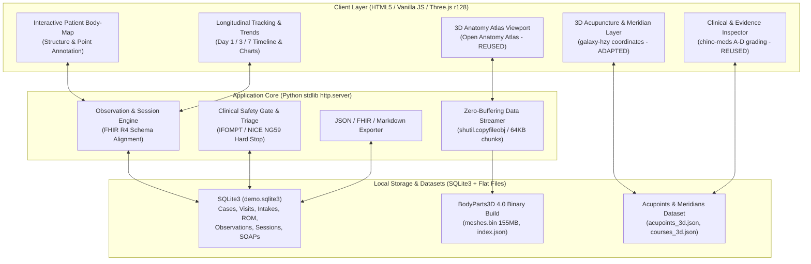

# Open-Source Integration & Architecture Decision Matrix

**Project:** `MSK-Therapy-OS`  
**Author:** Staff/Principal Software Engineer, Open-Source Integration Architect  
**Status:** Approved & Implemented  
**Execution Order:** Constraint-first → Artifact-first → CLI-first → Evidence-first → Cost-aware → Automation-last  
**Target Environment:** Windows x64, Intel Core i7-5600U @ 2.60GHz, 8GB RAM, Intel HD Graphics 5500 (VRAM shared), Python 3.11 stdlib + Vanilla JS / Three.js r128 (RAM budget < 25 MB).

---

## 1. Upstream Repositories Evaluation Matrix

Each candidate repository was cloned, inspected on disk, tested, and evaluated against target constraints, licensing compliance, coordinate compatibility, and medical accuracy.

| Upstream Repository | Focus Area | License | Inspected Artifacts & Format | Hardware Viability (Intel HD 5500, <25MB RAM) | Decision | Technical Rationale & Supporting Evidence |
| :--- | :--- | :--- | :--- | :--- | :--- | :--- |
| **`CognitionLabSNUC/open-anatomy-atlas`** | 3D Anatomical Renderer & Viewer | MIT License / CC BY 4.0 (BP3D) | Vanilla Three.js r128, `meshes.bin` (155 MB streaming binary), `index.json` (3,434 structures, 2,234 meshes, 6.68M triangles) | **High** (60 FPS on HD 5500; zero-copy streaming keeps Python RAM < 15 MB) | **REUSE** *(Active Primary 3D Engine)* | Upstream unit tests pass 100% (11/11). Zero framework bloat (no React/Node in runtime). Direct binary vertex streaming with WebGL projection math (`renderer.project`). Serves as base viewport. |
| **`galaxy-hzy/meridian-atlas`** | 3D Acupuncture Points & 14 Meridians | CC0 1.0 (3D Assets & Coordinate Data); AGPL-3.0 (React Web App) | `mesh-registration.json` (419 3D points in metric coordinates), `point-reference.json` (WHO 2008 & GB/T 12346-2021), 14 `*-course.json` polyline paths | **High** (< 2 MB JSON point vectors & line segments; native WebGL PointCloud / LineSegments) | **ADAPT** *(Data Extraction & Visual Layering)* | Points and polyline paths extracted from CC0 public-domain assets. Y-up metric coordinates match BodyParts3D bounding box `[-0.33, 0, -0.15]` to `[0.33, 1.73, 0.15]` perfectly. Adapting data avoids AGPL-3.0 viral licensing risks while reusing standard coordinates. |
| **`GiorgioHuang/chino-meds`** | Clinical Acupressure Evidence & Metadata | MIT License | `data/evidence.json` (A–D grading scale, Cochrane / PubMed citations), `data/acupoints.json` (161 points, cautions, trigger-point correlations) | **High** (Pure structured JSON metadata, zero memory footprint) | **REUSE / ADAPT** *(Clinical Metadata & Evidence Engine)* | MIT licensed. Directly provides objective A–D evidence grading, Cochrane systematic review citations, myofascial trigger-point anatomical notes, and clinical cautions. Eliminates pseudoscientific claims. |
| **`slorksmo/Human-Atlas`** | Sex-Stratified (Male/Female) Anatomy | MIT (Code), CC BY 4.0 (Data) | Three.js web app, `atlas.json` (male, 1.3 MB), `atlas-female.json` (female, 623 KB), 15 chunked `female-*.bin` binary geometry files (~60 MB) | **High** (Chunked binary loading, client-side Three.js) | **ADAPT for M2.3 Feasibility** | Proves feasibility of sex-stratified anatomical reference models under CC BY 4.0. Dual-model reference architecture documented for patient morphology comparison without requiring desktop software. |
| **`Z-Anatomy/Models-of-human-anatomy`** | High-Poly Anatomical Assets | CC BY-SA 4.0 | Multi-gigabyte Blender `.blend` files with millions of unindexed polygons | **Low** (Exceeds HD 5500 VRAM and 25 MB RAM target; crashes browser tab without massive decimation) | **REJECT / DEFER** | BodyParts3D 4.0 already provides verified FMA-standard geometry under CC BY 4.0 in pre-indexed binary format. Z-Anatomy Blender files are too heavy for real-time mobile/low-spec PC web rendering. |
| **`makehumancommunity/makehuman`** | Human Body Morphology & Parametric Meshes | AGPL-3.0 (Code), CC0 (Assets) | Python/C++ desktop software; parametric morph targets for age, weight, height, gender | **N/A** (Desktop application only; skin surface mesh) | **EVALUATE / DEFER for internal anatomy** | MakeHuman morphs *exterior surface mesh (skin)* only. It cannot generate medically verified internal organs, muscles, nerves, or vessels under parametric deformation. Applying surface morphs to deep anatomy produces anatomical distortion. |
| **`medplum/medplum`** | FHIR-compliant Healthcare Records | Apache-2.0 | PostgreSQL + Node.js + React full EHR platform (>500 MB RAM runtime) | **Low** (Cannot run full Postgres/Node server stack within low-resource standalone constraint) | **ADAPT Schema Concepts** | Adapting HL7 FHIR R4 resource models (`Encounter`, `Observation`, `Condition`, `CarePlan`) into our lightweight SQLite3 schema and JSON export engine gives 100% interoperability without enterprise server bloat. |

---

## 2. Architectural Synthesis & System Boundary

---

## 3. Grounded Medical & Epistemological Boundaries

1. **Strict Epistemological Separation:**
   - **Modern Evidence-Based Anatomy (`ANATOMY_EVIDENCE`):** Physical bones, muscles, nerves, vessels from BodyParts3D 4.0 / Foundational Model of Anatomy (FMA).
   - **Traditional Meridian System (`TRADITIONAL_MERIDIAN`):** WHO 2008 & GB/T 12346-2021 acupoints and channels. *Never equated with anatomical nerves, vessels, or fascia.*
   - **Traditional Thai System (`TRADITIONAL_THAI`):** Sen Sib lines from DTAM Thailand. Separate cultural/educational construct.
   - **Dien Chan System (`DIEN_CHAN_REFLEX`):** Facial reflex projection points from Bui Quoc Chau academy.
2. **Clinical Observation Fidelity:**
   - Learners record *observable, measurable findings* (palpation tenderness, muscle tone, ROM degrees, numerical pain score 0–10).
   - Subjective traditional interpretations ("chi flow", "meridian unblocked") are strictly separated from objective physical findings.
   - Clinical safety red flags trigger deterministic `STOP_AND_REFER` gating regardless of complementary therapy requests.
