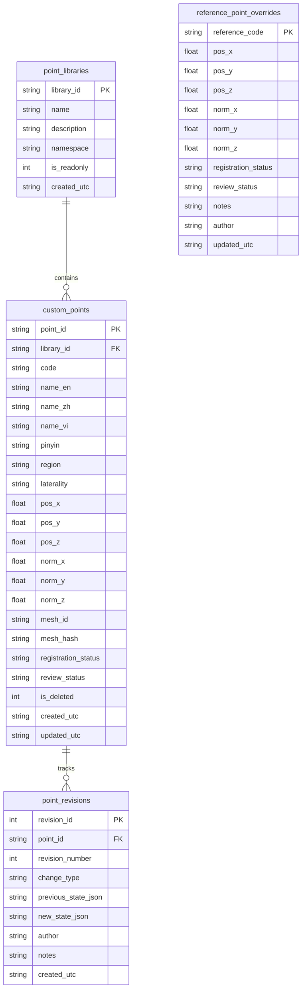

# Point Data Schema, SQLite Persistence, and Migration Specification

**Document Version:** 2.5.0  
**Target Architecture:** MSK-Therapy-OS Milestone M2.5  
**Data Standards:** WHO WPRO 2008 Standard Point Locations, BodyParts3D 4.0 (CC BY-SA 2.1 JP)  
**Database Engine:** SQLite 3.x (with Foreign Key Integrity & WAL mode)

---

## 1. Relational Schema Architecture

The relational persistence schema is structured into four primary tables in SQLite (`demo.sqlite3`), segregating canonical baselines from user customizations to protect official datasets from destructive alteration.



---

## 2. Table Definitions & DDL Specifications

### 2.1 `point_libraries`
Categorizes point collections into distinct standardized namespaces and user authoring spaces.

```sql
CREATE TABLE IF NOT EXISTS point_libraries (
    library_id TEXT PRIMARY KEY,
    name TEXT NOT NULL,
    description TEXT,
    namespace TEXT NOT NULL,
    is_readonly INTEGER NOT NULL DEFAULT 0,
    created_utc TEXT NOT NULL DEFAULT (strftime('%Y-%m-%dT%H:%M:%SZ', 'now'))
);
```

**Seed Libraries:**
- `lib_who_classical`: WHO standard 362 peripheral points (`is_readonly = 1`).
- `lib_extra`: Classical extra points (HN/CA/UE/LE, `is_readonly = 1`).
- `lib_thai_sen`: Traditional Thai Sen Sib pathways (`is_readonly = 1`).
- `lib_dien_chan`: Vietnamese facial reflexology projection points (`is_readonly = 1`).
- `lib_msk_landmarks`: Palpable musculoskeletal bony anchors (`is_readonly = 1`).
- `lib_custom_user`: User-created and mirrored custom points (`is_readonly = 0`).

---

### 2.2 `custom_points`
Stores custom acupoints, trigger loci, and mirrored somatic points.

```sql
CREATE TABLE IF NOT EXISTS custom_points (
    point_id TEXT PRIMARY KEY,
    library_id TEXT NOT NULL REFERENCES point_libraries(library_id),
    code TEXT NOT NULL,
    name_en TEXT NOT NULL,
    name_zh TEXT,
    name_vi TEXT,
    pinyin TEXT,
    aliases_json TEXT,
    system_classification TEXT NOT NULL DEFAULT 'user_custom',
    region TEXT NOT NULL,
    laterality TEXT NOT NULL DEFAULT 'bilateral',
    pos_x REAL NOT NULL,
    pos_y REAL NOT NULL,
    pos_z REAL NOT NULL,
    norm_x REAL NOT NULL DEFAULT 0.0,
    norm_y REAL NOT NULL DEFAULT 0.0,
    norm_z REAL NOT NULL DEFAULT 1.0,
    mesh_id TEXT NOT NULL DEFAULT 'FJ2810',
    mesh_hash TEXT NOT NULL DEFAULT 'FJ2810_V4.0_CCBYSA',
    face_index INTEGER,
    barycentric_json TEXT,
    registration_distance REAL NOT NULL DEFAULT 0.0,
    registration_status TEXT NOT NULL DEFAULT 'SURFACE_REGISTERED_FJ2810',
    review_status TEXT NOT NULL DEFAULT 'PENDING_EXPERT_REVIEW',
    indications_json TEXT,
    cautions_json TEXT,
    tuina_method TEXT,
    notes TEXT,
    author TEXT NOT NULL DEFAULT 'Clinical Educator',
    created_utc TEXT NOT NULL DEFAULT (strftime('%Y-%m-%dT%H:%M:%SZ', 'now')),
    updated_utc TEXT NOT NULL DEFAULT (strftime('%Y-%m-%dT%H:%M:%SZ', 'now')),
    is_deleted INTEGER NOT NULL DEFAULT 0,
    CONSTRAINT chk_finite_pos CHECK (
        pos_x = pos_x AND pos_y = pos_y AND pos_z = pos_z AND
        pos_x BETWEEN -2.0 AND 2.0 AND
        pos_y BETWEEN -0.5 AND 2.5 AND
        pos_z BETWEEN -2.0 AND 2.0
    )
);

CREATE INDEX IF NOT EXISTS idx_custom_points_code ON custom_points(code);
CREATE INDEX IF NOT EXISTS idx_custom_points_lib ON custom_points(library_id);
CREATE INDEX IF NOT EXISTS idx_custom_points_active ON custom_points(library_id, is_deleted);
```

---

### 2.3 `point_revisions` (Audit Trail)
Maintains an immutable, chronologically ordered log of every change (creation, relocation, metadata update, deletion, reversion).

```sql
CREATE TABLE IF NOT EXISTS point_revisions (
    revision_id INTEGER PRIMARY KEY AUTOINCREMENT,
    point_id TEXT NOT NULL,
    revision_number INTEGER NOT NULL,
    change_type TEXT NOT NULL, -- 'CREATE', 'UPDATE_COORDS', 'UPDATE_METADATA', 'DELETE', 'REVERT'
    previous_state_json TEXT,
    new_state_json TEXT NOT NULL,
    author TEXT NOT NULL,
    notes TEXT,
    created_utc TEXT NOT NULL DEFAULT (strftime('%Y-%m-%dT%H:%M:%SZ', 'now'))
);

CREATE INDEX IF NOT EXISTS idx_point_revisions_lookup ON point_revisions(point_id, revision_number);
```

---

### 2.4 `reference_point_overrides`
Protects official WHO canonical datasets (`acupuncture_3d.json`) from in-place mutation. If a user nudges a canonical point (e.g., GV14), the offset is stored as a versioned override in this table:

```sql
CREATE TABLE IF NOT EXISTS reference_point_overrides (
    reference_code TEXT PRIMARY KEY,
    pos_x REAL NOT NULL,
    pos_y REAL NOT NULL,
    pos_z REAL NOT NULL,
    norm_x REAL,
    norm_y REAL,
    norm_z REAL,
    face_index INTEGER,
    registration_status TEXT NOT NULL DEFAULT 'SURFACE_REGISTERED_FJ2810',
    review_status TEXT NOT NULL DEFAULT 'PENDING_EXPERT_REVIEW',
    notes TEXT,
    author TEXT NOT NULL DEFAULT 'Clinical Specialist',
    created_utc TEXT NOT NULL DEFAULT (strftime('%Y-%m-%dT%H:%M:%SZ', 'now')),
    updated_utc TEXT NOT NULL DEFAULT (strftime('%Y-%m-%dT%H:%M:%SZ', 'now'))
);
```

---

## 3. Cryptographic SHA-256 Dataset Schema (v2.5.0)

For portable backup, clinical sharing, and peer-review audits, datasets are exported in standard Schema v2.5 JSON format with cryptographic verification:

```json
{
  "schema_version": "2.5.0",
  "dataset_id": "DS-CUSTOM-POINTS-20261021",
  "exported_utc": "2026-10-21T18:15:00Z",
  "generator": "MSK-Therapy-OS 2.5 (Meridian Studio Engine)",
  "reference_mesh": {
    "mesh_id": "FJ2810",
    "mesh_hash": "FJ2810_V4.0_CCBYSA",
    "description": "BodyParts3D 4.0 Standard Skin Geometry"
  },
  "library": {
    "library_id": "lib_custom_user",
    "name": "Custom User Point Library"
  },
  "points_count": 2,
  "points": [
    {
      "point_id": "PT-CUST-S1234-1792601234",
      "code": "CUST-S1234",
      "name_en": "Right Infraspinatus Locus",
      "name_zh": "冈下肌压痛点",
      "name_vi": "Điểm Dưới Gai Phải",
      "region": "shoulder",
      "laterality": "right",
      "position": [0.1250, 1.4200, -0.0650],
      "normal": [0.245, 0.312, -0.918],
      "registration_status": "GEOMETRY_VERIFIED",
      "review_status": "PENDING_EXPERT_REVIEW",
      "notes": "Created via Meridian Studio 3D surface raycaster."
    }
  ],
  "sha256_checksum": "f94a540c46e6bfd1d368e7343e06cf8438120b601f0fa236d97c76255755fe59"
}
```

### Checksum Calculation Specification
1. The `points` array is canonicalized:
   - Points are sorted by `code` in ascending lexicographical order.
   - For each point object, keys are strictly sorted and JSON-serialized without whitespace (`separators=(',', ':')`).
2. The canonical payload string is hashed with SHA-256:
   $$\text{sha256\_checksum} = \text{SHA256}(\text{canonical\_payload})$$
3. On import, the server recalculates the SHA-256 hash across the points array:
   - If the calculated hash matches `sha256_checksum`, the bundle is accepted.
   - If the hash differs (e.g. coordinates tampered by 0.1mm), the import is rejected with HTTP 400 (`CHECKSUM_MISMATCH`).
   - If `mesh_hash` does not match `FJ2810_V4.0_CCBYSA`, the import is rejected with HTTP 400 (`INCOMPATIBLE_MESH_GEOMETRY`).

---

## 4. API Endpoint Contract

| Method | Endpoint | Description |
|---|---|---|
| `GET` | `/api/points?library_id=...&region=...` | List custom points with optional library/region filter. |
| `GET` | `/api/points/{point_id}` | Retrieve single point by code or point_id. |
| `POST` | `/api/points` | Create new custom point with coordinate bounds check. |
| `POST` | `/api/points/{point_id}/update` | Update coordinates, normal, or metadata; logs revision. |
| `POST` | `/api/points/{point_id}/delete` / `DELETE /api/points/{point_id}` | Soft-delete point (`is_deleted = 1`); logs revision. |
| `POST` | `/api/points/{point_id}/restore` | Restores soft-deleted point (`is_deleted = 0`). |
| `GET` | `/api/points/{point_id}/revisions` | Get revision history array for a point. |
| `POST` | `/api/points/{point_id}/revert` | Revert point to a historical revision number. |
| `GET` | `/api/points/overrides` | List active canonical reference point overrides. |
| `POST` | `/api/points/overrides/{code}` | Save or update override for canonical reference point. |
| `DELETE` | `/api/points/overrides/{code}` | Delete override, restoring reference point to baseline. |
| `GET` | `/api/points/export?library_id=...` | Export library bundle with SHA-256 digest. |
| `POST` | `/api/points/import` | Validate and import JSON library bundle. |
