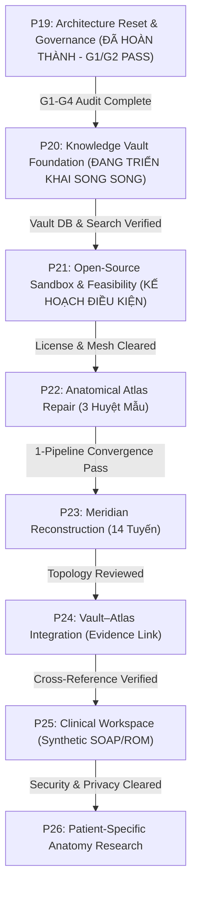

# MSK-Therapy-OS — Strategic Technical Roadmap
## Gated Architectural Progression: P19 Through P26

**Tài liệu ID:** `MSK-STRAT-P19-P26`  
**Phiên bản:** `1.0.0-GATED`  
**Ngày phê duyệt:** 2026-11-01  
**Phân loại:** `ENGINEERING_RESEARCH_ONLY`  
**Nguyên tắc cốt lõi:** **GATE-DRIVEN IMPLEMENTATION** — Tuyệt đối không nhảy cóc qua cột mốc tiếp theo khi các điều kiện chặn (Hard Blockers) của cột mốc hiện tại chưa được giải quyết và nghiệm thu bằng chứng.

---

### Bảng Lộ Trình Phân Tầng Có Điều Kiện (Gated Roadmap Matrix)

| Cột Mốc (Milestone) | Phạm vi kỹ thuật được phép triển khai | Tiêu chí mở khóa (Gate In) | Điểm chặn bắt buộc (Hard Blockers / Gate Out) | Giới hạn tuyệt đối (Prohibitions) |
|---|---|---|---|---|
| **P19: Architecture Reset & Governance** | Kiểm toán toàn diện module, nguồn dữ liệu, truy vết sai lệch LI4, ST36, KI3; ma trận xung đột; ADR cách ly | Hoàn thành baseline P18; test suite 100% PASS | Toàn bộ 5 deliverable P19 phải có dữ liệu đo đạc thực tế; G1-G4 được lập bảng | **CẤM** viết lại resolver; CẤM đảo dấu trục tọa độ hàng loạt; CẤM tự phong ANATOMICAL VERIFIED |
| **P20: Knowledge Vault Foundation** | Triển khai kho tri thức Markdown + SQLite độc lập; FTS5; trích xuất claims, citations; lưu giữ các quan điểm mâu thuẫn | P19 baseline được xác nhận; không ảnh hưởng tới runtime Atlas | Bộ test P20 (nhập, tìm kiếm tiếng Việt, mâu thuẫn, backup) đạt 100% PASS | **CẤM** lưu dữ liệu bệnh nhân thật (Zero PHI); CẤM tự động sinh claim AI rồi gán nhãn đúng |
| **P21: Upstream Modules Feasibility** | Đánh giá repo nguồn mở (Human Atlas, `tcm-3d`, Three-Mesh-BVH); kiểm tra license và chạy trong sandbox dev cô lập | P19 và P20 hoàn tất nghiệm thu kỹ thuật; có bản đăng ký upstream feasibility | License code/data không minh bạch; không tương thích Windows Intel HD 5500 $\rightarrow$ **REJECT/DEFER** | **CẤM** clone thẳng vào production runtime; CẤM chấp nhận các asset có điều khoản cấm thương mại ngầm |
| **P22: Anatomical Atlas Repair** | Thống nhất **MỘT** pipeline giải tọa độ cho 3 huyệt mẫu (LI4, ST36, KI3); sửa lỗi lệch trục X; chiếu mặt da thật | P21 đã chọn được mesh hoặc thư viện BVH phù hợp; có tiêu chuẩn mốc xương | Chưa có sự đồng thuận của chuyên gia giải phẫu $\rightarrow$ chỉ gắn nhãn `ENGINEERING_BENCHMARK` | **CẤM** mở rộng ồ ạt 362 huyệt khi chưa chứng minh thành công sai lệch $< 15$mm trên 3 huyệt mẫu |
| **P23: Meridian Reconstruction** | Tái cấu trúc đồ thị đường kinh 3D bám sát giải phẫu da; phân biệt rõ nhánh nông và nhánh sâu | P22 hoàn thành việc chuẩn hóa tọa độ các huyệt kiểm soát (control points) | Không có thẩm định từng tuyến từ hội đồng chuyên môn $\rightarrow$ giữ nguyên hiển thị tham khảo | **CẤM** tuyên bố đường spline trên mặt da là đường dẫn truyền thần kinh hoặc giải phẫu chứng minh |
| **P24: Vault–Atlas Integration** | Click vào huyệt trên 3D mở popover trích dẫn y văn, chỉ định, chống chỉ định, quan điểm mâu thuẫn từ Vault | P20 Knowledge Vault và P22/P23 Atlas đã vận hành ổn định | Không được hiển thị các claim `UNREVIEWED` hoặc `CONTESTED` dưới dạng khuyến cáo điều trị | **CẤM** phát sinh chẩn đoán tự động; CẤM kê đơn phác đồ huyệt độc quyền |
| **P25: Clinical Workspace** | Hoàn thiện SOAP note, ROM, lượng giá kết quả trên dữ liệu tổng hợp (synthetic); kiểm tra quyền RBAC và mã hóa | P24 hoàn thành; toàn bộ hạ tầng bảo mật dữ liệu vượt qua kiểm toán an toàn | Dữ liệu bệnh nhân thật bị **KHÓA CHẶT** cho tới khi có hội đồng đạo đức, consent, mã hóa AES-256 | **CẤM** kết nối mạng ngoài; CẤM thu thập PII/PHI khi chưa có phê duyệt pháp lý |
| **P26: Patient-Specific Anatomy** | Nghiên cứu co giãn mô hình theo tỷ lệ cơ thể cá nhân (chiều cao, tỷ lệ chi, độ gù vẹo cột sống) | P25 đã hoàn thiện khung quản trị lâm sàng | Mô hình nghiên cứu không tự động áp dụng tọa độ huyệt cho can thiệp lâm sàng | **CẤM** suy ra vị trí huyệt thật từ tỷ lệ chung để hướng dẫn châm kim xâm lấn |

---

### Kế Hoạch Ứng Phó Rủi Ro & Cơ Chế Hoàn Nguyên (Rollback Strategy)

1. **Nguyên tắc "Fail-Closed":** Bất kỳ chuyển đổi hoặc dữ liệu mới nào không vượt qua được kiểm toán toàn vẹn hoặc bị phát hiện sai lệch hệ quy chiếu sẽ tự động chuyển sang trạng thái ngắt kết nối (`DISABLED` / `UNAVAILABLE`), giữ nguyên luồng dự phòng đã biết an toàn.
2. **Snapshot độc lập:** Mọi bước chuyển đổi milestone đều được bảo vệ bằng snapshot Git branch và SQLite online backup API riêng biệt.
3. **Phân ranh dữ liệu tuyệt đối:** Knowledge Vault (P20), Atlas 3D (P19/P22), và Clinical Workspace (P25) sử dụng 3 kho lưu trữ dữ liệu tách biệt vật lý để đảm bảo việc nâng cấp hoặc rollback ở một khối không gây ảnh hưởng dây chuyền đến các khối còn lại.
