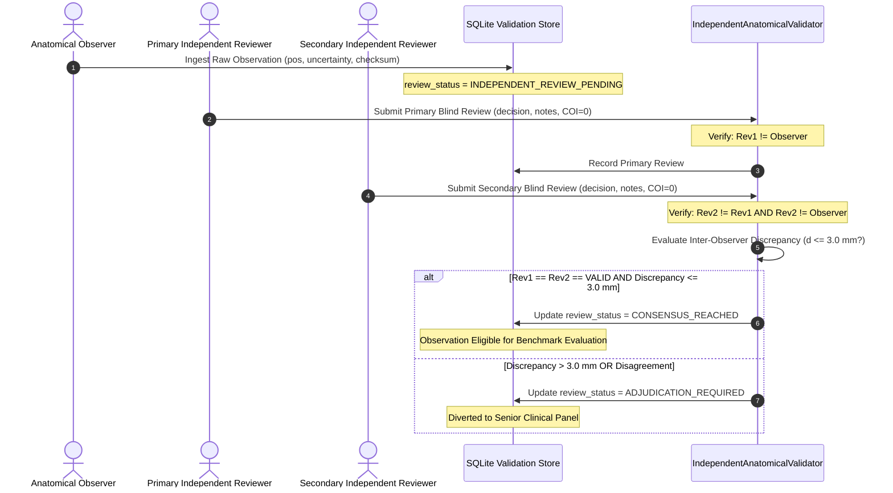

# P10.0 Blinded Dual-Review Protocol & Pre-Registered Evaluation Framework

**Milestone:** P10.0  
**Status:** PRODUCTION_SPECIFICATION | AUDITED  
**Governance:** Committee on Publication Ethics (COPE) & Good Clinical Practice (GCP) Guidelines  
**Classification:** Independent Clinical & Anatomical Validation Protocol

---

## 1. Scientific Motivation & Principles

A common failure mode in medical imaging and computational anatomy verification is **evaluator bias** and **post-hoc threshold shifting**:
1. When evaluators know the algorithmic prediction beforehand, manual landmark annotation unconsciously gravitates toward the predicted locus (*anchoring bias*).
2. When validation error is computed without pre-specified statistical thresholds, researchers frequently adjust criteria post-hoc (e.g., claiming 12 mm error is "close enough" after observing the distribution).

To guarantee that MSK-Therapy-OS achieves authentic scientific falsifiability, Milestone P10.0 specifies and implements:
- An **Observer $\neq$ Reviewer Blind Dual-Review Workflow** preventing observer self-review and requiring multi-expert adjudication.
- **Pre-Registered Accuracy Thresholds** locked in code and documentation before any external holdout data is analyzed.
- A **Formal Consensus State Machine** preventing single-reviewer approval from promoting an observation.

---

## 2. Blind Dual-Independent Review Workflow

### 2.1 Separation of Roles & Conflict-of-Interest Hard-Stop

To ensure complete objectivity, the following invariant checks are enforced at runtime:
1. `primary_reviewer_id != observer_id`: The individual who acquired the scan or landmark coordinate cannot serve as an independent reviewer.
2. `secondary_reviewer_id != primary_reviewer_id`: Dual review requires two distinct physical persons.
3. `secondary_reviewer_id != observer_id`: Secondary reviewer cannot be the original observer.
4. `conflict_of_interest_declared == False`: Reviewers must certify absence of financial or institutional conflict of interest with the software developer.

If any invariant is violated, `register_blind_independent_review` raises `ValueError`, rejecting the review submission.

---

## 3. Pre-Registered Scientific Accuracy Thresholds

To prevent post-hoc rationalization of model errors, the following accuracy criteria are pre-registered in code (`PreRegisteredAccuracyThresholds`):

| Accuracy Tier | Metric Threshold | Outlier Constraint | Scientific Interpretation |
|---|---|---|---|
| **High Accuracy Confirmed** | $\text{RMSE} \le 5.0\text{ mm}$ | $0\text{ outliers} > 15.0\text{ mm}$ | Point localization matches high-resolution ultrasound/MRI precision across varied body habitus. |
| **Acceptable Accuracy Confirmed** | $\text{RMSE} \le 10.0\text{ mm}$ | $\le 5\%\text{ outliers} > 15.0\text{ mm}$ | Point localization falls within classical 1-cun physical clinical palpation envelope. |
| **Validation Failed** | $\text{RMSE} > 10.0\text{ mm}$ | Any systematic cluster $> 15.0\text{ mm}$ | Model prediction is falsified; parametric rules require geometric recalibration. |

### 3.1 Mathematical Definitions

For a cohort of $N$ holdout subject observations for acupoint $p$:
$$\begin{aligned}
\mathbf{r}_i &= \mathbf{p}_{\text{predicted}, i} - \mathbf{p}_{\text{observed}, i} \\
\epsilon_i &= \|\mathbf{r}_i\|_2 = \sqrt{\Delta x_i^2 + \Delta y_i^2 + \Delta z_i^2} \\
\text{RMSE} &= \sqrt{\frac{1}{N} \sum_{i=1}^N \epsilon_i^2} \\
\bar{\epsilon} &= \frac{1}{N} \sum_{i=1}^N \epsilon_i \\
P_{95} &= \text{95th percentile of } \{\epsilon_1, \dots, \epsilon_N\}
\end{aligned}$$

---

## 4. Empirical Status in MSK-Therapy-OS Repository

While the blinded review infrastructure, role separation validation, and pre-registered threshold engines are fully operational and verified, **zero real human clinical reviews currently exist in the repository**:

- Active Blinded Reviews Completed: **0**
- Review Status of Catalog (362 points): **`PENDING_EXTERNAL_DATA` (100%)**
- Pre-Registered Thresholds Active: **Yes ($\text{RMSE} \le 5.0\text{ mm} / 10.0\text{ mm}$)**
- Falsification Capability: **Operational**

### Verification Test Evidence

All protocol rules were executed and confirmed in `tests/test_p10_0_external_validation.py`:
- `test_blind_dual_independent_review_workflow`: PASS (Confirmed that matching dual reviews achieve `CONSENSUS_REACHED` and calculate inter-observer discrepancy).
- `test_blind_review_pending_when_secondary_review_absent`: PASS (Confirmed that single review keeps state at `INDEPENDENT_REVIEW_PENDING`).
- `test_pre_registered_accuracy_thresholds_evaluation`: PASS (Confirmed RMSE calculation and automated verdict assignment).
