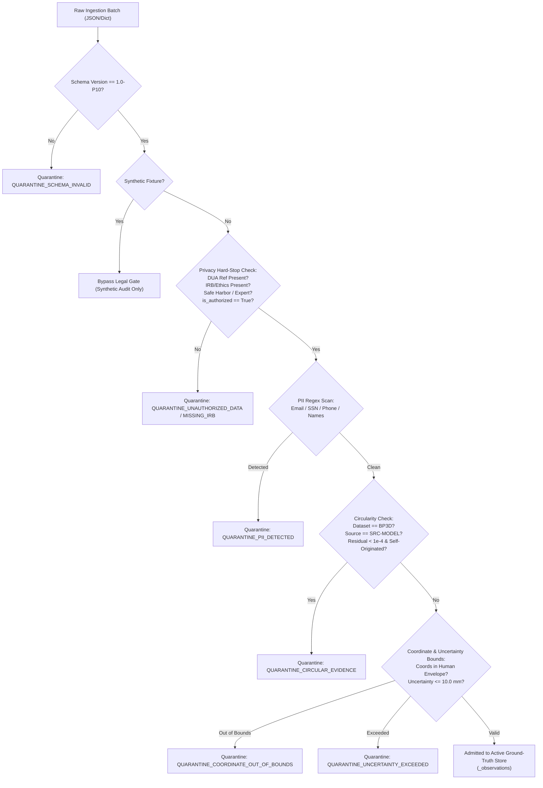

# P10.0 External Anatomical Data Ingestion Contract & Schema Specification

**Milestone:** P10.0  
**Status:** PRODUCTION_SPECIFICATION | FAIL_CLOSED  
**Version:** 1.0-P10  
**Classification:** Restricted Engineering Document | Clinical Research Governance

---

## 1. Executive Summary & Purpose

The purpose of the **P10.0 External Anatomical Data Ingestion Contract** is to establish strict, fail-closed mechanical and scientific boundaries for ingesting external, human-subject empirical anatomical observations into **MSK-Therapy-OS**.

Under the foundational axiom of the project:
$$\text{Technical Calibration} \neq \text{Independent Anatomical Ground Truth} \neq \text{Clinical Validation}$$

Any ingestion interface that accepts coordinates without cryptographically auditable provenance, legal data sharing agreements, IRB/Ethics approval, and rigorous anti-circularity verification introduces fatal scientific contamination into the digital atlas. This document specifies the data schema, normalization pipeline, quarantine triage engine, and mathematical transformations required for all external evidence.

---

## 2. Ingestion Schema Specification (`1.0-P10`)

All incoming ground-truth observations must conform to JSON/SQLite schema `1.0-P10`. Any deviation in schema version, missing required fields, or illegal types causes instantaneous rejection and diversion to the Quarantine Store (`external_validation_quarantine`).

### 2.1 Observation Record Data Contract

| Field Name | Type | Mandatory? | Description & Validation Constraint |
|---|---|---|---|
| `schema_version` | `string` | **Yes** | Must equal exact string `"1.0-P10"`. |
| `point_code` | `string` | **Yes** | Valid WHO Standard Acupoint Code (e.g. `LI4`, `ST36`) or extended `GV24+`. Must exist in the 362 catalog. |
| `dataset_id` | `string` | **Yes** | Unique identifier of a registered external dataset (e.g. `DS-EXT-HOSP-2026-01`). Cannot begin with `SELF_`. |
| `subject_pseudonym` | `string` | **Yes** | De-identified subject identifier (e.g. `SUBJ-US-0042`). Regex must match `^[A-Z0-9_\-]+$`. |
| `canonical_position` | `tuple(float, float, float)` | **Yes** | Cartesian coordinates $(x, y, z)$ in meters (or modality units if converted). Must fall within human anatomical bounds: $x \in [-0.9, 0.9]$, $y \in [0.0, 2.2]$, $z \in [-0.5, 0.5]$. |
| `surface_normal` | `tuple(float, float, float)` | No | Unit normal vector $(\hat{n}_x, \hat{n}_y, \hat{n}_z)$ at the skin surface locus. |
| `uncertainty_radius_mm` | `float` | **Yes** | Physical measurement uncertainty radius in millimeters. Must be $\le 10.0\text{ mm}$ for empirical validity. |
| `depth_to_skeletal_anchor_mm` | `float` | No | Distance in mm from skin surface to target skeletal landmark. Informational only; clinical depth guidance remains restricted. |
| `coordinate_frame` | `string` | **Yes** | Must be one of `BP3D_CARTESIAN_METERS`, `DICOM_LPS_MILLIMETERS`, `SUBJECT_LOCAL_NORMALIZED`. |
| `measurement_unit` | `string` | **Yes** | Unit of measurement: `meters` or `millimeters`. |
| `observer_id` | `string` | **Yes** | Identifier of the clinical/anatomical observer who measured the locus. |
| `reviewer_id` | `string` | No | Identifier of the secondary independent reviewer. Must differ from `observer_id` (Observer $\neq$ Reviewer). |
| `review_status` | `string` | **Yes** | State: `DATA_IMPORTED`, `INDEPENDENT_REVIEW_PENDING`, `INDEPENDENT_REVIEW_COMPLETED`, `CONSENSUS_REACHED`. |
| `source_checksum` | `string` | **Yes** | SHA-256 hash of the raw primary source data file or scan. |
| `synthetic_fixture` | `boolean` | **Yes** | Flag indicating whether data is synthetic fixture (`True`) or human-derived empirical (`False`). |
| `data_sharing_agreement_ref` | `string` | **Conditional** | **Mandatory if `synthetic_fixture == False`**. Identifier of executed legal DUA/MTA. |
| `ethics_approval_or_exemption_ref` | `string` | **Conditional** | **Mandatory if `synthetic_fixture == False`**. Institutional Review Board (IRB) or Ethics Committee reference. |
| `deidentification_method` | `string` | **Conditional** | **Mandatory if `synthetic_fixture == False`**. Must be `SAFE_HARBOR_18_ELEMENTS` or `EXPERT_DETERMINATION`. |
| `is_authorized_for_clinical_eval` | `boolean` | **Conditional** | **Mandatory if `synthetic_fixture == False`**. Must explicitly be `True`. |
| `notes` | `string` | No | Free-text clinical notes, automatically audited by PII regex scanner. |

---

## 3. Spatial Reference Frames & Transformation Equations

External observations originate from varied imaging and physical scanning modalities. All coordinates must be normalized to the canonical BodyParts3D FJ2810 coordinate space (`BP3D_CARTESIAN_METERS`).

### 3.1 Supported Frames

1. **`BP3D_CARTESIAN_METERS`**:
   - Origin: Between feet on floor plane (canonical reference).
   - $X$: Right (+X) to Left (-X).
   - $Y$: Inferior (Feet = 0.0) to Superior (Cranial vertex $\approx 1.76\text{ m}$).
   - $Z$: Posterior to Anterior (+Z).
   - Units: Meters ($m$).

2. **`DICOM_LPS_MILLIMETERS`**:
   - Standard clinical DICOM coordinate system (Left-Posterior-Superior).
   - $X_{LPS}$: Right to Left (+X = Left).
   - $Y_{LPS}$: Anterior to Posterior (+Y = Posterior).
   - $Z_{LPS}$: Inferior to Superior (+Z = Superior).
   - Units: Millimeters ($mm$).

### 3.2 Mathematical Conversion: DICOM LPS $\rightarrow$ BP3D

Given patient registration landmark reference $\mathbf{T}_{origin} = (X_0, Y_0, Z_0)$ and scale factors:
$$\begin{aligned}
x_{BP3D} &= -\frac{x_{LPS}}{1000.0} + x_{shift} \\
y_{BP3D} &= \frac{z_{LPS}}{1000.0} + y_{shift} \\
z_{BP3D} &= -\frac{y_{LPS}}{1000.0} + z_{shift}
\end{aligned}$$

Where shifts $(x_{shift}, y_{shift}, z_{shift})$ are derived from rigid Procrustes alignment of canonical skeletal anchors (e.g. C7 vertebra, L4 spinous process, anterior superior iliac spine).

---

## 4. Quarantine Store & Routing Logic

When incoming external data fails any scientific, legal, or integrity gate, the record is **never** silently dropped, and **never** admitted to the active observation database. It is quarantined into SQLite table `external_validation_quarantine`.



### 4.1 Quarantine Reasons and Action Protocols

1. **`QUARANTINE_SCHEMA_INVALID`**: Payload missing keys or invalid data types. Remediate payload generator.
2. **`QUARANTINE_UNAUTHORIZED_DATA`**: Missing DUA reference or authorization flag. Contact institutional legal counsel before re-ingestion.
3. **`QUARANTINE_MISSING_IRB`**: Missing ethics approval reference. Ingestion strictly prohibited by institutional research governance.
4. **`QUARANTINE_INSUFFICIENT_DEIDENTIFICATION`**: Method is not HIPAA Safe Harbor or Expert Determination. Dataset returned to data owner for re-scrubbing.
5. **`QUARANTINE_PII_DETECTED`**: Pattern matcher detected personal identifying numbers or names. Immediate forensic security review required.
6. **`QUARANTINE_CIRCULAR_EVIDENCE`**: Coordinate mathematically identical to internal model prediction without independent measurement. Prevents circular self-corroboration.
7. **`QUARANTINE_COORDINATE_OUT_OF_BOUNDS`**: Position falls outside physiological human envelope. Check sensor calibration or registration transform.
8. **`QUARANTINE_UNCERTAINTY_EXCEEDED`**: Reported spatial uncertainty radius $> 10.0\text{ mm}$. Unusable for high-precision validation.

---

## 5. Audit Logging and Ingestion Receipt

Upon completion of batch ingestion, the system returns a cryptographically signed execution receipt:
```json
{
  "batch_id": "INGEST-20261029-001",
  "timestamp_utc": "2026-10-29T09:30:00Z",
  "total_records": 100,
  "admitted_records": 0,
  "quarantined_records": 100,
  "reasons_breakdown": {
    "QUARANTINE_UNAUTHORIZED_DATA": 100
  },
  "quarantine_manifest_hash": "e3b0c44298fc1c149afbf4c8996fb92427ae41e4649b934ca495991b7852b855"
}
```

This ensures complete forensic traceability: no external data can influence atlas calibration without leaving an immutable audit trail.
