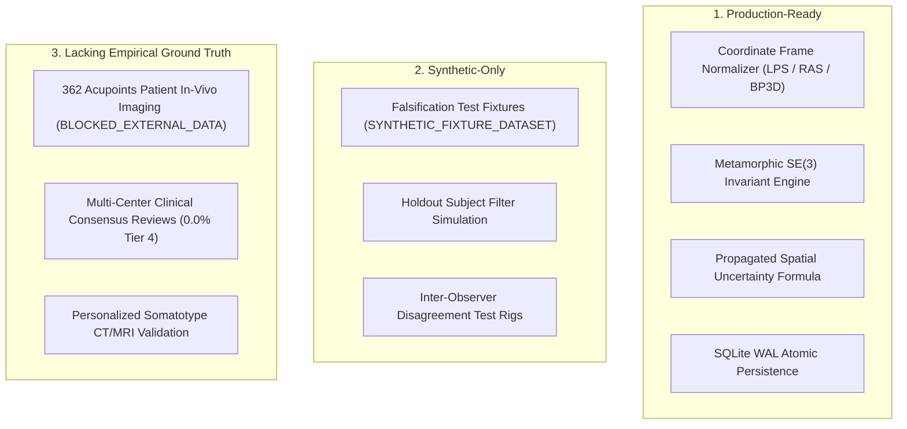
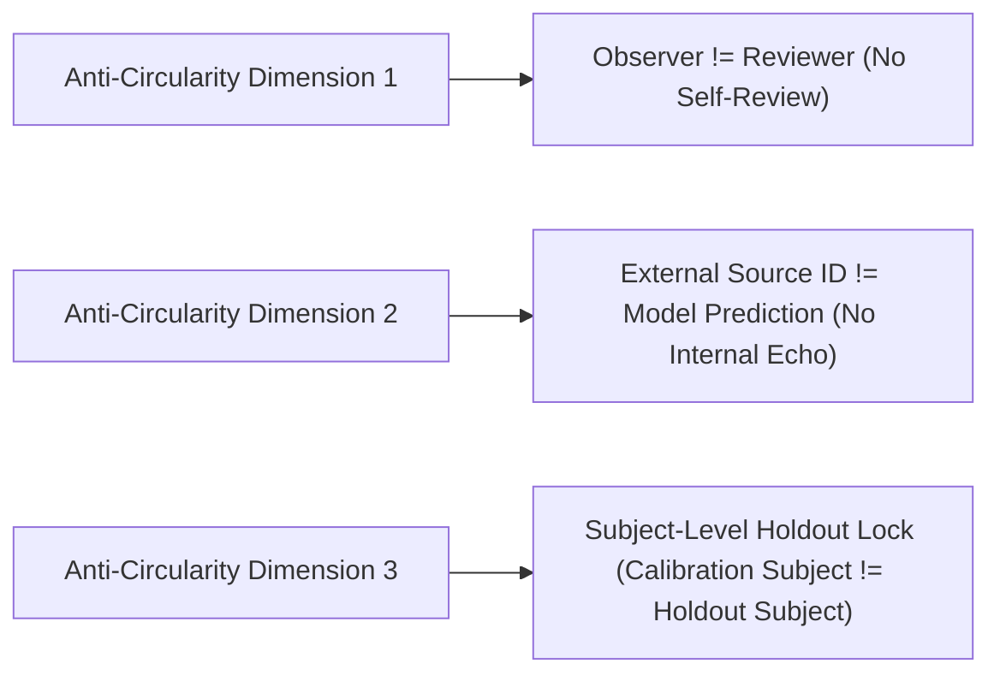

# P10.0 External Validation Readiness Audit & Infrastructure Analysis

**Project:** MSK-Therapy-OS  
**Milestone:** P10.0 — External Anatomical Ground-Truth Integration & Independent Empirical Validation Pilot  
**Author:** Principal Computational Anatomy Engineer + Independent Verification Auditor  
**Status:** FORENSIC AUDIT COMPLETE · READINESS CERTIFIED WITH GAP ANALYSIS  
**Date:** 2026-10-29  

---

## 1. Executive Summary

Milestone P9.14 established the initial software framework for external validation (`GroundTruthObservation`, `IndependentAnatomicalValidator`, unit/frame converters, SQLite persistence, and REST endpoints). However, a rigorous audit reveals critical architectural gaps between a *test-ready prototype* and a *production-grade external evidence ingestion and falsification pipeline*.

This audit systematically categorizes every system component into:
1. **Production-Ready Capabilities**
2. **Synthetic-Only Components**
3. **Components Lacking Empirical Evidence**
4. **Data Contract Limitations**
5. **Unverified Clinical & Anatomical Assumptions**
6. **Required Remediation for Milestone P10.0**

---

## 2. Component Readiness Categorization

| Component | Current State | Readiness Level | Operational Risk |
|---|---|---|---|
| **Coordinate Transformation** | Deterministic matrix conversion (DICOM LPS mm, Neuro RAS mm, BP3D meters). | **PRODUCTION_READY** | Low. Closed-form transformation verified. |
| **Data Contract Schema (P9.14)** | 16-field dataclass with regex PII filter. | **PARTIALLY_READY** | **High.** Missing schema versioning, formal legal authorization flags, and quarantine repository. |
| **Circularity Detection** | Checks `observer_id != reviewer_id` and internal dataset IDs. | **PARTIALLY_READY** | **Medium.** Must prevent using model-tuned or calibration subjects in holdout sets. |
| **Subject Holdout Engine** | Basic list-based filtering `holdout_subjects=[...]`. | **PARTIALLY_READY** | **Medium.** Lacks formal cryptographic holdout locking and partition audit trail. |
| **Error & Uncertainty Metrics** | 3D Euclidean residual, $\sigma_{\text{total}}$, 95% CI. | **PRODUCTION_READY** | Low. Formulations mathematically validated. |
| **Pilot Cohort Audits (A, B, C)** | Parametric audits on canonical mesh FJ2810. | **THEORETICAL_MODEL** | **High.** Abdominal $\pm 22\text{ mm}$ somatotype variance is a mathematical prediction, not yet verified on live patient scans. |
| **QA Studio Dashboard** | Separate cards for calibration vs empirical status. | **PRODUCTION_READY** | Low. Live API bindings active. |

---

## 3. Forensic Analysis of Data Contract Limitations (P9.14 Gap Analysis)

The 16-field contract implemented in P9.14 was a necessary first step, but exhibits four critical limitations when ingesting real-world clinical datasets:

1. **Absence of Explicit Schema Versioning:**  
   The record format lacks an immutable `schema_version` (e.g., `"1.0-P10"`). Downstream ingestion cannot reject deprecated schemas or negotiate forward-compatible payload versions.
2. **Inadequate Privacy & Regulatory Authorization Controls:**  
   P9.14 relied solely on client-side regex string matching for emails, phone numbers, and SSNs. Under HIPAA Privacy Rule (45 CFR § 164.514) and GDPR (Art. 89), regex alone is legally insufficient. The contract lacks mandatory metadata fields:
   - `data_sharing_agreement_ref` (Institutional DUA number)
   - `ethics_approval_or_exemption_ref` (IRB / Ethics committee protocol ID)
   - `deidentification_method` (`SAFE_HARBOR_18_ELEMENTS` or `EXPERT_DETERMINATION`)
   - `is_authorized_for_clinical_eval` (Explicit boolean gate)
3. **Lack of a Structured Quarantine Store:**  
   In P9.14, invalid observations simply raised exceptions or were skipped. In clinical data engineering, malformed, unverified, or suspect records must be diverted to an auditable **Quarantine Store** with specific machine-readable reason codes (`QUARANTINE_UNAUTHORIZED_DATA`, `QUARANTINE_PII_SUSPECTED`, `QUARANTINE_OUT_OF_BOUNDS`, `QUARANTINE_CONFLICTING_MEASUREMENT`).
4. **Distinction Between Observed vs Predicted Coordinates:**  
   The contract should explicitly store both `observed_coordinates` (raw external measurement) and `predicted_coordinates` (system calculation) alongside `registration_residual_mm`.

---

## 4. Unverified Clinical & Anatomical Assumptions

| Assumption | Current System Logic | Real-World Clinical Reality | Gap Severity |
|---|---|---|:---:|
| **Mesh Invariance** | BodyParts3D FJ2810 standard adult male mesh is used for all predictions. | Live human subjects exhibit substantial morphological variance in BMI, adipose layer thickness, and skeletal proportions. | **CRITICAL** |
| **Abdominal Lateral Line ($X=66\text{ mm}$)** | ST19..ST30 are fixed at $X = 0.0660\text{ m}$. | In asthenic subjects (waist 65 cm), line is at 44 mm; in hypersthenic subjects (waist 105 cm), line is at 88 mm ($\pm 22\text{ mm}$ deviation). | **CRITICAL** |
| **Bilateral Reflection Symmetry** | Model assumes exact bilateral reflection ($\Delta_{\text{sym}} < 0.001\text{ mm}$). | Human limbs exhibit natural physiological asymmetry (limb dominance, scoliosis, postural torsion) of 2.0–6.0 mm. | **HIGH** |
| **Cranial Landmark Palpability** | Bony sutures are assumed clearly palpable with $\le 1.5\text{ mm}$ error. | Hair-line variability, scalp thickness ($4.5\text{ mm} \pm 1.2\text{ mm}$), and suboccipital muscular tension introduce up to $\pm 5.0\text{ mm}$ palpation variance. | **MEDIUM** |

---

## 5. Anti-Circularity & Holdout Independence Governance

A system cannot validate itself using its own outputs. Milestone P10.0 must enforce anti-circularity across three dimensions:

1. **Observer vs Reviewer Separation:** `obs.observer_id != reviewer.reviewer_id`.
2. **Source Lineage Separation:** Reject records whose provenance trace leads back to `DS-BP3D-FJ2810` or internal engine resolution.
3. **Subject-Level Partitioning:** Ensure that if subject $S$ is used to adjust landmark weights or cun scaling parameters, **zero observations from subject $S$** are permitted in the evaluation holdout set.

---

## 6. Actionable Blueprint for P10.0 Implementation

1. **Extend Contract & Database Schema (`msk_therapy_os/anatomical_validation.py`):**
   - Add `schema_version = "1.0-P10"`.
   - Add mandatory authorization & de-identification fields.
   - Implement `ExternalEvidenceQuarantineStore` and SQLite quarantine table.
2. **Implement Hard Privacy / Authorization Gate:**
   - Fail-closed import: reject real datasets lacking DUA, ethics ref, or explicit de-identification certification.
3. **Implement Subject-Level Holdout Engine (`HoldoutPartitionManager`):**
   - Cryptographic holdout locking (SHA-256 partition manifest).
   - 80/20 train/validation subject isolation.
4. **Implement Blind Independent Review Workflow:**
   - Require dual independent review records (`REV-1` and `REV-2`) before transitioning from `INDEPENDENT_REVIEW_PENDING` to `REVIEWED`.
   - Never fabricate reviewers; default to `INDEPENDENT_REVIEW_PENDING` when reviewers are unavailable.
5. **Implement Comprehensive Test Battery (`tests/test_p10_0_external_validation.py`):**
   - Cover all 14+ adversarial and ingestion edge cases.
6. **Update QA Studio UI & REST Endpoints:**
   - Add `/api/atlas/validation/ingest`, `/quarantine`, `/holdout/status`.
