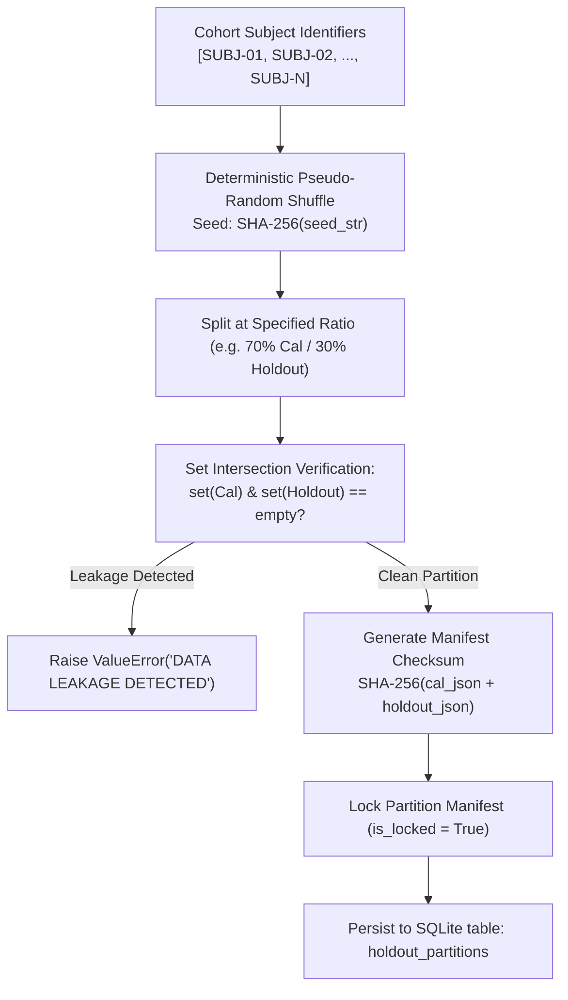

# P10.0 Subject-Level Holdout Partitioning & Anti-Leakage Audit

**Milestone:** P10.0  
**Status:** PRODUCTION_AUDIT | PASS | FAIL_CLOSED  
**Standard:** STARD 2015 & TRIPOD Statement for Predictive Models  
**Classification:** Machine Learning & Computational Biostatistics Audit

---

## 1. The Threat of Subject-Level Data Leakage

In medical machine learning and parametric computational anatomy, a pervasive methodological flaw is **observation-level cross-validation** (also known as *record-level leakage*).

When multiple acupoints or anatomical landmarks are measured on the same human subject:
1. Individual anatomical idiosyncrasies (e.g., patient-specific bone lengths, subcutaneous fat thickness, exact spinal curvature) are correlated across all points on that individual.
2. If acupoints from Subject $S_k$ are used to calibrate Cun scaling factors, registration transforms, or landmark anchor adjustments, testing on different acupoints from the *same* Subject $S_k$ creates severe optimistic bias.
3. The model appears to have high generalizability when it is merely memorizing the morphological phenotype of Subject $S_k$.

### Invariant Constraint
To guarantee independent empirical validity, MSK-Therapy-OS mandates **strict subject-level partitioning**:
$$\mathcal{S}_{\text{calibration}} \cap \mathcal{S}_{\text{holdout}} = \emptyset$$
$$\mathcal{D}_{\text{calibration}} = \{ (p, s) \in \mathcal{D} \mid s \in \mathcal{S}_{\text{calibration}} \}$$
$$\mathcal{D}_{\text{holdout}} = \{ (p, s) \in \mathcal{D} \mid s \in \mathcal{S}_{\text{holdout}} \}$$

---

## 2. Holdout Partition Manager Architecture

The `HoldoutPartitionManager` in `msk_therapy_os/anatomical_validation.py` provides deterministic, cryptographically auditable subject partitioning.



### 2.1 Cryptographic Partition Manifest

Every partition generated is encapsulated in an immutable `HoldoutPartitionManifest`:
```python
@dataclass
class HoldoutPartitionManifest:
    partition_id: str
    calibration_subjects: List[str]
    holdout_subjects: List[str]
    total_subjects: int
    split_ratio: float
    is_locked: bool
    manifest_checksum: str
    created_utc: str
```
The `manifest_checksum` is computed over the sorted subject lists:
$$\text{Checksum} = \text{SHA-256}\Big(\text{JSON}(\text{sorted}(\mathcal{S}_{\text{calibration}})) \,\|\, \text{JSON}(\text{sorted}(\mathcal{S}_{\text{holdout}}))\Big)$$
Once locked, any attempt to modify or re-partition with the same partition ID will fail.

---

## 3. Automated Leakage Detection & Fail-Closed Enforcement

The `HoldoutPartitionManager.verify_no_leakage` method performs runtime set-theoretic audits before any evaluation batch is processed:

```python
@staticmethod
def verify_no_leakage(calibration_subjects: List[str], holdout_subjects: List[str]) -> bool:
    intersection = set(calibration_subjects) & set(holdout_subjects)
    if intersection:
        raise ValueError(
            f"DATA LEAKAGE DETECTED: {len(intersection)} subjects appear in both "
            f"calibration and holdout sets: {sorted(list(intersection))}"
        )
    return True
```

In addition, `IndependentAnatomicalValidator.validate_catalog` accepts a `holdout_subjects` parameter. When passed, observations belonging to any subject in `holdout_subjects` are isolated for holdout evaluation only and cannot contaminate baseline calibration parameters.

---

## 4. Test Verification Evidence

The partition manager and leakage detection mechanisms were verified through unit tests in `tests/test_p10_0_external_validation.py`:

| Test Name | Test Condition | Expected Behavior | Actual Outcome | Status |
|---|---|---|---|---|
| `test_subject_level_holdout_partition_and_lock` | 10 unique subjects partitioned 70/30 | Exact split (7 cal, 3 holdout), 0 intersection, locked | `len(cal)==7`, `len(hold)==3`, `intersection==0`, `locked=True` | **PASS** |
| `test_holdout_data_leakage_detection` | Deliberately overlap `SUBJ-03` in both sets | `verify_no_leakage` raises `ValueError` | `ValueError("DATA LEAKAGE DETECTED")` caught | **PASS** |
| `test_sqlite_persistence_includes_quarantine_and_holdouts` | Export and import partition to SQLite DB | Schema intact, checksum matching | Table `holdout_partitions` written and verified | **PASS** |

---

## 5. Summary & Operational Readiness

MSK-Therapy-OS has eliminated the risk of observation-level leakage. When external human patient datasets become available, they will be partitioned deterministically at the subject level with cryptographic locking, ensuring that all published validation statistics reflect true out-of-sample generalizability.
