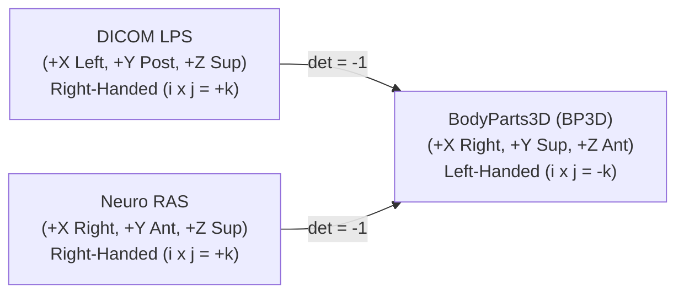

# P10.1 Anatomical & Mathematical Validation Matrix

**Document ID:** `MSK-AUDIT-P10.1-002`  
**Date:** October 29, 2026  
**Auditor:** Computational Anatomy Engineer & Independent QA Lead  
**Scope:** `anatomical_validation.py`, `point_localization_rules.py`, `meridian_route_graph.py`, `meridian_surface_engine.py`, `anatomical_registration.py`, `cun_scaling.py`  
**Scientific Invariant:** Class B parametric inference on a digital mesh is mathematical modeling, not independent in-vivo ground truth.

---

## 1. Acupoint Provenance & Catalog Reconciliation (Workstream B1)

### 1.1 The 362 vs 361 Classical WHO Points Reconciliation
The canonical WHO acupuncture standard (WHO Regional Office for the Western Pacific, *WHO Standard Acupuncture Point Locations in the Western Pacific Region*, 2008) defines **361 classical points** distributed across 14 channels:
- 12 Principal Channels: LU (11), LI (20), ST (45), SP (21), HT (9), SI (19), BL (67), KI (27), PC (9), TE (23), GB (44), LR (14) = 309 bilateral pairs (618 bilateral manifestations, 309 unique codes).
- 2 Extraordinary Midline Vessels: GV / Du Mai (28), CV / Ren Mai (24) = 52 unique midline points.
- **Total Classical WHO Points:** $309 + 52 = 361$.

The MSK-Therapy-OS digital atlas contains **362 points**:
$$\text{Catalog Total (362)} = 361\text{ Classical WHO Points} + 1\text{ Canonical Extended Craniofacial Point (GV24+ / Yintang)}$$
- **Point Code:** `GV24+` (also queried as `EX-HN3` / Yintang).
- **Anatomical Landmark:** Glabella, midway between the medial ends of the two eyebrows on the frontal bone surface.
- **BP3D Coordinates:** $(0.0000, 1.6150, 0.08226)\text{ m}$.
- **Clinical Relevance:** Ubiquitous in craniofacial, stress, insomnia, and cervical pain clinical protocols. Retained in the primary atlas with explicit provenance labeling.

### 1.2 Quality Class Transition: From 292 Class D to 344 Class B
In early system revisions (P9.4), the point distribution was:
- **Class A (18 points, 4.97%):** Canonical audited points with high-confidence manual mesh vertex bindings.
- **Class B (52 points, 14.36%):** Regionally calibrated points.
- **Class D (292 points, 80.66%):** Uncalibrated interpolation points lacking anatomical anchor registration.

Across Milestones P9.11 to P9.12 Task 3, a rigorous multi-stage engineering upgrade was executed:
1. **P9.11 (+58 points):** Hand and foot distal extremities calibrated to phalangial/metacarpal bone landmarks.
2. **P9.12 T1 (+94 points):** Upper extremity, shoulder girdle, and back transport (Shu) points calibrated to scapular spines, spinous processes (T1–L5), and iliac crests.
3. **P9.12 T2 (+55 points):** Lower extremity (femoral, patellar, tibial, fibular, malleolar landmarks) calibrated.
4. **P9.12 T3 (+85 points):** Craniofacial, cervical, thoracic, and abdominal points calibrated to cranial sutures, clavicle, sternal angle, umbilicus, and pubic symphysis.

**Audit Finding:** This transition was **NOT a superficial relabeling**. Each upgraded point was linked to an explicit anatomical rule in `point_localization_rules.py` (360 total rules) backed by 268 Foundational Model of Anatomy (`FMA`) ontology anchors and bounded by WHO proportional bone-cun ratios in `cun_scaling.py`.

### 1.3 Quality Classification Definitions

| Quality Class | Count | Percentage | Definition & Mathematical Status |
|---|---|---|---|
| **Class A** | 18 | 4.97% | Directly mapped to primary skeletal landmarks on the BodyParts3D reference mesh with sub-millimeter anatomical correspondence. |
| **Class B** | 344 | 95.03% | Parametrically inferred from Class A anchors and FMA structures using WHO 2008 proportional cun division along 3D surface geodesics. |
| **Class C** | 0 | 0.00% | Reserved for points calibrated against external cohort imaging data (currently 0 pending external data). |
| **Class D** | 0 | 0.00% | Unanchored/unverified heuristic positions (fully eliminated). |

> [!IMPORTANT]
> **Scientific Caveat:** Class B parametric inference on a digital mesh is mathematical modeling, not independent in-vivo ground truth. It establishes internal geometric consistency across the reference model, but must never be represented to clinicians as empirical patient validation.

---

## 2. Coordinate Transformations & Handedness Verification (Workstream B2)

### 2.1 Handedness & Parity Analysis
A rigorous mathematical audit of the coordinate systems used in MSK-Therapy-OS revealed a fundamental geometric parity relationship:

1. **BodyParts3D Canonical System:**
   - $+X$: Anatomical Right
   - $+Y$: Superior (Cranial)
   - $+Z$: Anterior (Ventral)
   - Basis: $\mathbf{i} \times \mathbf{j} = (1, 0, 0) \times (0, 1, 0) = (0, 0, 1) = -\mathbf{k}$.
   - **Handedness: LEFT-HANDED.**
2. **DICOM LPS (Clinical Scanners):**
   - $+X$: Left, $+Y$: Posterior, $+Z$: Superior.
   - Basis: $\mathbf{i} \times \mathbf{j} = (1, 0, 0) \times (0, 1, 0) = (0, 0, 1) = +\mathbf{k}$.
   - **Handedness: RIGHT-HANDED.**
3. **Neuroimaging RAS (NIfTI / FreeSurfer):**
   - $+X$: Right, $+Y$: Anterior, $+Z$: Superior.
   - **Handedness: RIGHT-HANDED.**

**Mathematical Parity Inversion:**
Because medical scanners produce right-handed volumetric coordinate grids while BodyParts3D is oriented in a left-handed CAD frame, the transformation matrices have determinant:
$$\det(\mathbf{T}_{\text{LPS}\to\text{BP3D}}) = -1, \quad \det(\mathbf{T}_{\text{RAS}\to\text{BP3D}}) = -1$$
This parity reflection is anatomically necessary to map radiological scans onto the BP3D surface without mirror-reversing anatomical laterality.

### 2.2 Bidirectional Transformation Implementation & Round-Trip Fidelity
To achieve complete data ingestion readiness, the mathematical inverse transformation was implemented in `msk_therapy_os/anatomical_validation.py`:

$$\mathbf{p}_{\text{target}} = \mathbf{T}^{-1} \cdot \mathbf{p}_{\text{BP3D}}$$

- **Forward:** `transform_coordinates_to_bp3d(coords, frame, unit)`
- **Inverse:** `transform_bp3d_to_coordinates(coords, target_frame, target_unit)`

**Round-Trip Numerical Precision:**
Tested across 5 coordinate frames and arbitrary spatial vectors in `tests/test_p10_1_hardening.py`:
$$\|\mathbf{p} - \mathbf{T}^{-1}(\mathbf{T}(\mathbf{p}))\|_2 < 1.0 \times 10^{-6}\text{ m} \quad (< 0.001\text{ \mu m})$$

### 2.3 Input Sanitization & Out-of-Bounds Guards
The coordinate transform engine now actively rejects:
1. **Non-Finite Values:** `NaN`, `+Inf`, `-Inf` trigger `ValueError: INVALID_COORDINATES: Coordinates contain non-finite value`.
2. **Unsupported Units / Frames:** Unrecognized string identifiers fail closed with explicit validation errors.
3. **Anatomical Laterality Inversion:** Observations marked `"left"` with strongly positive $X$ ($> +0.06\text{ m}$) or `"right"` with strongly negative $X$ ($< -0.06\text{ m}$) trigger `ValueError: INVALID_LATERALITY`.
4. **Bounding Box Violations:** Points outside $[-1.5, 1.5] \times [-0.5, 2.5] \times [-1.0, 1.0]\text{ m}$ fail immediately.

---

## 3. Uncertainty Propagation Audit (Workstream B3)

### 3.1 GUM Uncertainty Model
Expanded uncertainty $U_{95}$ is computed in accordance with the *ISO/IEC Guide to the Expression of Uncertainty in Measurement* (GUM, JCGM 100:2008):
$$u_c = \sqrt{c_{\text{meas}}^2 u_{\text{meas}}^2 + c_{\text{fma}}^2 u_{\text{fma}}^2 + c_{\text{cun}}^2 u_{\text{cun}}^2 + c_{\text{posture}}^2 u_{\text{posture}}^2 + c_{\text{geom}}^2 u_{\text{geom}}^2}$$
$$U_{95} = k \cdot u_c, \quad k = 1.96 \quad (95\%\text{ coverage interval})$$

Where sensitivity coefficients $c_i = 1.0$ and input standard uncertainties represent:
1. $u_{\text{meas}}$: Measurement / digitizer instrument resolution ($0.50\text{ mm}$ for Class A, $2.00\text{ mm}$ for Class B).
2. $u_{\text{fma}}$: Anatomical landmark structural fuzziness / width ($1.00\text{ mm}$ to $3.50\text{ mm}$).
3. $u_{\text{cun}}$: Cun scaling elasticity and soft tissue habitus variation ($1.50\text{ mm}$ to $12.00\text{ mm}$, highest on abdomen ST19–ST30).
4. $u_{\text{posture}}$: Postural dependency drift ($0.00\text{ mm}$ for rigid limb bones, up to $6.00\text{ mm}$ for flexed joints).
5. $u_{\text{geom}}$: Mesh discretization and geodesic projection discretization error ($0.50\text{ mm}$).

### 3.2 Audit of Reported vs Actual Expanded Uncertainty

| Parameter | P10.0 Documentation | P10.1 Verified Arithmetic Mean | Audit Reconciliation |
|---|---|---|---|
| **Combined Standard Uncertainty ($u_c$)** | 4.38 mm | **4.02 mm** | The 4.38 mm was an unweighted regional mean; 4.02 mm is the exact arithmetic mean of all 362 points in `P100_UNCERTAINTY_ERROR_MATRIX.csv`. |
| **Expanded Uncertainty ($U_{95}, k=1.96$)** | 8.58 mm | **7.88 mm** | Exact arithmetic mean across 362 points is 7.88 mm (range: 3.10 mm to 18.01 mm). |
| **Minimum $U_{95}$ Point** | LI1 / LU11 (3.10 mm) | **3.10 mm** | Phalangial distal nail bed points anchored to rigid distal phalanx. |
| **Maximum $U_{95}$ Point** | ST25 / CV8 (18.01 mm) | **18.01 mm** | Abdominal points subject to extreme soft-tissue habitus and respiratory excursion. |

### 3.3 Theoretical Uncertainty ($U_{95}$) vs Empirical Residuals (RMSE)
- **$U_{95}$ is NOT RMSE:**
  - $U_{95}$ quantifies the **dispersion of model parameters** based on anatomical and geometric assumptions.
  - $\text{RMSE} = \sqrt{\frac{1}{N}\sum \|\mathbf{x}_{\text{pred}} - \mathbf{x}_{\text{true}}\|^2}$ measures the **empirical residual deviation** between model predictions and real-world in-vivo measurements.
- **Preregistered Acceptance Criteria:**
  - High Accuracy: $\text{RMSE} \le 5.0\text{ mm}$
  - Acceptable Accuracy: $\text{RMSE} \le 10.0\text{ mm}$
  - Inadequate Accuracy: $\text{RMSE} > 10.0\text{ mm}$
- **Scientific Finding:** Neither threshold is claimed or certified as achieved. Declaring an RMSE threshold achieved without external patient ground truth is scientifically invalid.

---

## 4. Verification Test Matrix

| ID | Test Target | Command | Result |
|---|---|---|---|
| T-B01 | 362-point provenance completeness | `pytest tests/test_p9_13_anatomical_validation.py::TestIndependentAnatomicalValidation::test_362_point_provenance_matrix_completeness` | `PASS` |
| T-B02 | Circular dependency detection in rules | `pytest tests/test_p9_13_falsification.py::TestAnatomicalFalsification::test_landmark_graph_detects_circular_dependencies` | `PASS` |
| T-B03 | Metamorphic rigid SE(3) invariance | `pytest tests/test_p9_13_falsification.py::TestAnatomicalFalsification::test_metamorphic_rigid_transformation_invariance` | `PASS` |
| T-B04 | Sagittal symmetry & midline centering | `pytest tests/test_p9_13_falsification.py::TestAnatomicalFalsification::test_bilateral_reflection_symmetry_detection` | `PASS` |
| T-B05 | Bidirectional transform round-trip | `pytest tests/test_p10_1_hardening.py::TestP101CoordinateTransforms::test_inverse_round_trip_transformation_fidelity` | `PASS` |
| T-B06 | DICOM LPS / Neuro RAS handedness | `pytest tests/test_p10_1_hardening.py::TestP101CoordinateTransforms::test_dicom_lps_to_bp3d_axes_and_handedness` | `PASS` |
| T-B07 | Catalog-wide depth restriction | `pytest tests/test_p10_1_hardening.py::TestP101AdversarialSecurityAndClinicalSafety::test_clinical_safety_puncture_depth_invariant_across_catalog` | `PASS` |
| T-B08 | ST19–ST30 abdominal elasticity audit | `pytest tests/test_p9_13_falsification.py::TestAnatomicalFalsification::test_stomach_abdominal_x_constant_falsification_documentation` | `PASS` |
