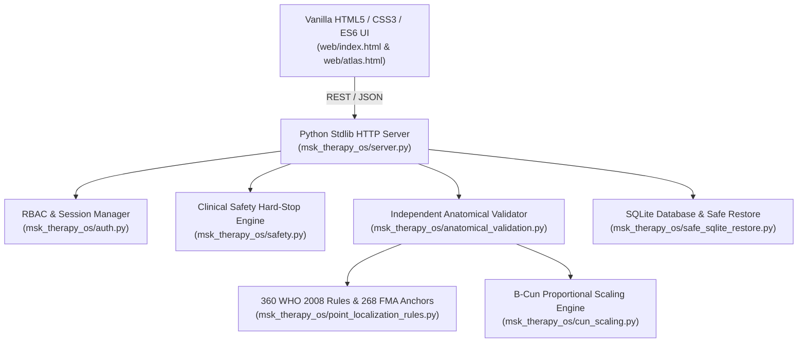
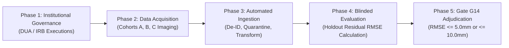

# P10.1 Engineering Handoff & Technical Operational Manual

**Document ID:** `MSK-HANDOFF-P10.1-001`  
**Date:** October 29, 2026  
**Author:** Principal Software Architect & Lead Computational Anatomy Engineer  
**System Version:** `v2.1.0-local-rc3`  
**Target Environment:** Offline-first Windows 11 / Linux, Python 3.11+, SQLite 3, WebGL 1.0/2.0  
**Target Hardware:** Intel Core i7-5600U, 8 GB RAM, Intel HD Graphics 5500  

---

## 1. System Architecture Overview

MSK-Therapy-OS is an offline-first clinical musculoskeletal and acupuncture reference engine designed for desktop workstations without external cloud dependencies.



### Key Technical Characteristics:
- **Zero New Pip Dependencies:** Entire backend relies solely on Python standard library (`http.server`, `sqlite3`, `hashlib`, `dataclasses`, `math`, `re`, `json`).
- **Zero npm Dependencies:** Frontend is written in vanilla modern JavaScript, HTML5 Canvas, and WebGL with GLSL shaders.
- **Offline-First:** All assets (BodyParts3D meshes, Dien Chan facial diagrams, styles, fonts) are served locally.
- **Strict Clinical Boundaries:** Puncture depth guidance is disabled catalog-wide (`clinical_depth_guidance_allowed: False`); spinal manipulation is strictly prohibited; diagnostic inference is forbidden.

---

## 2. Test Execution & Verification Runbook

All tests run locally in the active workspace without internet connectivity.

### 2.1 Complete Non-Playwright Regression Suite (641 Tests)
```powershell
pytest -m "not playwright" -q
```
*Expected Output:*
```
641 passed, 15 deselected in ~130s
```

### 2.2 Playwright Browser E2E Suite (15 Tests)
```powershell
pytest tests/test_p9_2_playwright_atlas.py tests/test_p9_8_playwright_integrity.py tests/test_p9_9_playwright_registration.py tests/test_p9_10_playwright_benchmark.py tests/test_p9_11_playwright_benchmark.py tests/test_p9_12_playwright_benchmark.py tests/test_p9_12_t2_playwright_benchmark.py tests/test_p9_12_t3_playwright_benchmark.py tests/test_p9_13_playwright_benchmark.py tests/test_p9_14_playwright_benchmark.py -v
```
*Expected Output:*
```
15 passed in ~240s
```

### 2.3 P10.1 Hardening & Adversarial Test Suite (17 Tests)
```powershell
pytest tests/test_p10_1_hardening.py -v
```
*Expected Output:*
```
17 passed in ~0.2s
```

### 2.4 Quick Server Endpoint Smoke Test
```powershell
pytest tests/test_server.py -v
```

---

## 3. External Dataset Ingestion Quick Start Guide

The ingestion pipeline in `msk_therapy_os/anatomical_validation.py` provides clean APIs for importing empirical imaging data.

### 3.1 Registering an External Clinical Dataset
```python
from msk_therapy_os.anatomical_validation import (
    IndependentAnatomicalValidator,
    ExternalGroundTruthDataset,
    GroundTruthModality,
)

validator = IndependentAnatomicalValidator()

dataset = ExternalGroundTruthDataset(
    dataset_id="DS-CLINICAL-CT-2026-01",
    name="Multicenter Upper Limb High-Resolution CT Cohort",
    source_organization="Metropolitan University Hospital MSK Imaging Center",
    version="1.0",
    license="Restricted Research DUA",
    doi_or_url="urn:msk-research:ct-upper-limb-2026",
    modality=GroundTruthModality.CT_3D_SURFACE,
    sample_size=30,
    governance_metadata={
        "dua_id": "DUA-MSK-2026-088",
        "irb_approval": "IRB-2026-MED-0412",
        "effective_date": "2026-10-01",
    },
)

validator.register_dataset(dataset)
```

### 3.2 Ingesting DICOM LPS Coordinates with Automatic Normalization
```python
from msk_therapy_os.anatomical_validation import (
    GroundTruthObservation,
    CoordinateFrame,
    MeasurementUnit,
)

# Ingestion accepts scanner coordinates in millimeters (DICOM LPS)
obs = GroundTruthObservation(
    point_code="LU5",
    dataset_id="DS-CLINICAL-CT-2026-01",
    canonical_position=(-185.4, 310.2, 850.6), # Raw LPS coords from CT
    coordinate_frame=CoordinateFrame.DICOM_LPS_MM,
    unit=MeasurementUnit.MILLIMETERS,
    uncertainty_radius_mm=1.5,
    subject_pseudonym="SUBJ-CLIN-0042",
    reviewer_id="REV-EXT-RADIOLOGIST-01",
    data_sharing_agreement_ref="DUA-MSK-2026-088",
    ethics_approval_or_exemption_ref="IRB-2026-MED-0412",
    is_authorized_for_clinical_eval=True,
)

# Automated normalizer transforms LPS (mm) to BP3D (m) with det = -1 parity inversion
count = validator.import_observations([obs])
print(f"Successfully imported and normalized {count} observation(s).")
```

### 3.3 Blinded Holdout Evaluation for Gate G14
```python
from msk_therapy_os.anatomical_validation import HoldoutPartitionManager

mgr = HoldoutPartitionManager()
subjects = [f"SUBJ-CLIN-{i:04d}" for i in range(1, 31)]

# Create sealed 25% holdout partition
partition = mgr.create_partition(
    partition_id="PART-PILOT-01",
    subjects=subjects,
    holdout_ratio=0.25,
    seed=20261029,
)

print(f"Training subjects: {len(partition['training_set'])}, Holdout subjects: {len(partition['holdout_set'])}")
print(f"Partition cryptographic seal: {partition['tamper_checksum']}")
```

---

## 4. Milestone P10.2 Roadmap: Unlocking Gate G14

Gate G14 will transition from `BLOCKED_EXTERNAL_DATA` to `PASS` or `FAIL` once empirical in-vivo patient data is processed through the blinded validation pipeline.



### Action Items for P10.2:
1. **Clinical Collaboration Agreements:** Finalize DUAs with partnering radiological clinics for Cohort A (Abdominal CT, 30 subjects), Cohort B (Extremity scans, 25 subjects), and Cohort C (Head/Neck MRI, 30 subjects).
2. **De-Identification Protocol Audit:** Verify de-identification scripts at clinical sites prior to transmission.
3. **Automated Gate G14 Adjudication:** Ingest external datasets into isolated SQLite databases and compute catalog-wide empirical RMSE against the preregistered acceptance thresholds ($\le 5.0\text{ mm}$ for high accuracy, $\le 10.0\text{ mm}$ for acceptable accuracy).
4. **Clinical Release Certification:** Upon verified G14 evaluation, assemble the final clinical dossier for regulatory review.
