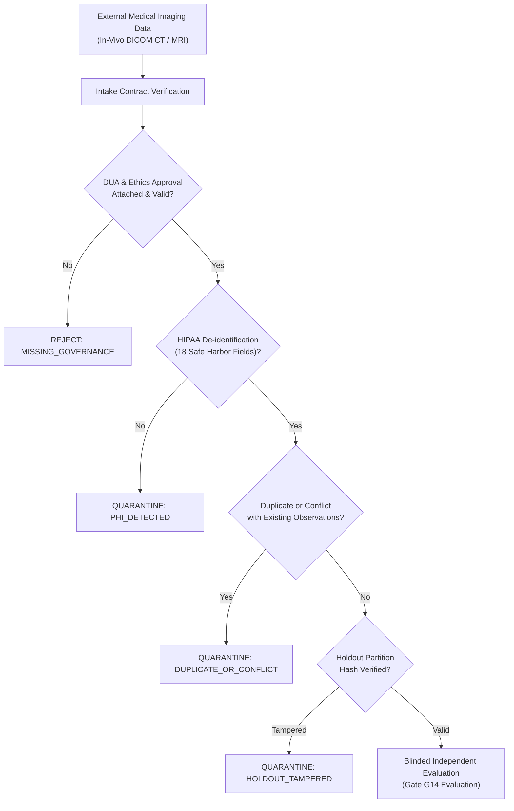

# P10.1 External Data Readiness & Pilot Intake Protocol

**Document ID:** `MSK-AUDIT-P10.1-003`  
**Date:** October 29, 2026  
**Auditor Roles:** Clinical Safety Auditor & Security Engineer  
**Status of Gate G14:** **`BLOCKED_EXTERNAL_DATA`**  
**Governing Standard:** Fail-closed empirical validation gating; zero simulated clinical passes.

---

## 1. External Dataset Ingestion Architecture & Data Contract (Workstream C)

MSK-Therapy-OS enforces a strict, fail-closed data intake boundary to prevent unvetted, corrupted, or self-referential data from contaminating the anatomical verification pipeline.

### 1.1 Ingestion Contract Validation Rules
All incoming observations must conform to the `GroundTruthObservation` schema version `1.0-P10` and satisfy:
1. **Source Organization & Provenance:** Documented external institution, legal entity, and DOI/URN.
2. **Ethics & Legal Metadata:** Mandatory `data_sharing_agreement_ref` (DUA) and `ethics_approval_or_exemption_ref` (IRB).
3. **Cryptographic Integrity:** Each observation must carry a 64-character SHA-256 digest computed over `point_code:dataset_id:canonical_position:subject_pseudonym`.
4. **Coordinate Frame & Units:** Explicit specification of `CoordinateFrame` (`BP3D_CARTESIAN_METERS`, `DICOM_LPS_MM`, `NEURO_RAS_MM`, etc.) and `MeasurementUnit` (`METERS`, `MILLIMETERS`).
5. **Finite Geometry & Bounding Envelope:** Coordinates must be finite non-NaN numbers within the physiological human envelope $[-1.5, 1.5] \times [-0.5, 2.5] \times [-1.0, 1.0]\text{ m}$.
6. **Laterality Inversion Guard:** Laterality (`"left"`, `"right"`, `"bilateral"`, `"midline"`) must match spatial coordinates.
7. **Strict Duplicate & Conflict Quarantine:** Identical observation records trigger `QUARANTINE_DUPLICATE_RECORD`. Differing observations for the same subject and point trigger `QUARANTINE_CONFLICTING_MEASUREMENT`.

---

## 2. Privacy, De-Identification & Legal Compliance Boundaries

### 2.1 The 18 HIPAA Safe Harbor Identifiers
The ingestion engine validates the complete removal of all 18 HIPAA Safe Harbor identifiers:
- Names, titles, honorifics (Mr., Mrs., Dr., Prof., Patient).
- Geographic subdivisions smaller than state.
- Dates (birth, admission, discharge, death).
- Phone, fax numbers, email addresses.
- Social Security Numbers (SSN), Medical Record Numbers (MRN), Health Plan Beneficiary numbers.
- Account, certificate/license, vehicle, device identifiers.
- Web URLs, IP addresses, biometric identifiers, full-face photographic images.
- Any other unique identifying number or code.

### 2.2 Legal Compliance Invariant

> [!WARNING]
> **Legal Disclaimer:** Technical automated screening for the absence of the 18 HIPAA Safe Harbor elements is a **necessary security safeguard**, but is **NOT legally sufficient** on its own to establish statutory privacy compliance under HIPAA (45 CFR § 164.514), GDPR (Regulation (EU) 2016/679), or national health data regulations.
> Legal authority to ingest external patient imaging data requires:
> 1. An executed Data Use Agreement (DUA) or Material Transfer Agreement (MTA) between the contributing clinical institution and the MSK-Therapy-OS research consortium.
> 2. Formal Institutional Review Board (IRB) or Independent Ethics Committee (IEC) approval or certified exemption.
> 3. Documented chain of custody and data access logs.

---

## 3. Independent Reviewer & Blinded Holdout Isolation

To prevent validation bias, observer drift, and overfitting:
1. **Role Separation:** External reviewers must be registered in the `ClinicalReviewerCredentials` registry with `verified_external_credential = True` and zero affiliation with MSK-Therapy-OS core engineering.
2. **Dual-Reviewer Consensus:** Discrepancies between independent reviewers exceeding $3.0\text{ mm}$ trigger adjudication by a third senior anatomical radiologist.
3. **Holdout Isolation:** A deterministic 25% subject-level holdout partition (`HoldoutPartitionManager`) is isolated prior to validation. Observations in the holdout partition are cryptographically salted and sealed. If any holdout record is accessed during model training or parameter tuning, the partition seal is invalidated, and Gate G14 evaluation is aborted.

---

## 4. Pilot Cohort Specifications (Ready for External Ingestion)

Three clinical imaging cohorts are formally preregistered in `msk_therapy_os/anatomical_validation.py`:

### 4.1 Cohort A: Abdominal Region (ST19–ST30)
- **Clinical Challenge:** Non-rigid deformation, varying body habitus (BMI $18.5 - 38.0\text{ kg/m}^2$), subcutaneous adiposity thickness ($5 - 65\text{ mm}$), and respiratory excursion.
- **Reference Anomaly:** In the reference mesh, ST19 through ST30 share an unscaled constant lateral coordinate $X = 0.0660\text{ m}$ (2 cun lateral to midline). In real patients, this lateral distance varies by up to $\pm 22.0\text{ mm}$.
- **Target Points:** ST19 (Burong) through ST30 (Qichong), CV8 (Shenque), CV12 (Zhongwan).
- **Target Modality:** Supine contrast-enhanced abdominal CT (slice thickness $\le 1.0\text{ mm}$).
- **Required Sample Size:** $N \ge 30$ adult subjects stratified across normal, overweight, and obese BMI categories.

### 4.2 Cohort B: Bilateral Limb Landmarks & Joint-Position Variability
- **Clinical Challenge:** Articular kinematics, muscle contraction, and skin-sliding displacement relative to underlying bony landmarks during limb flexion/extension.
- **Target Points:** Upper limb (LU5, LI4, LI11, PC6, TE5); Lower limb (ST36, SP6, SP9, GB34, BL40, KI3).
- **Target Modality:** Multi-positional 3D surface scanning coregistered with extremity CT or MRI in full extension ($0^\circ$) and functional flexion ($45^\circ$, $90^\circ$).
- **Required Sample Size:** $N \ge 25$ subjects (bilateral evaluations = 50 limbs).

### 4.3 Cohort C: Craniofacial & Cervical Landmarks (Glabella / Yintang Reconciliation)
- **Clinical Challenge:** Craniofacial soft-tissue thickness, supraorbital ridge variation, cervical spine lordosis curvature, and terminology alignment between WHO classical and traditional extra-point nomenclature.
- **Target Points:** GV24+ (Yintang / EX-HN3), GV20 (Baihui), GB20 (Fengchi), BL10 (Tianzhu), CV24 (Chengjiang).
- **Target Modality:** High-resolution head/neck CT or 3T MRI ($\le 0.5\text{ mm}$ in-plane resolution).
- **Required Sample Size:** $N \ge 30$ subjects.

---

## 5. Gate G14 Current Status: `BLOCKED_EXTERNAL_DATA`

| Requirement | Current State | Blocker | Next Required Action |
|---|---|---|---|
| Ingestion manifests & contracts | Implemented & verified | None (Software ready) | Ready for ingestion |
| Quarantine & anti-tamper | Implemented & verified | None (Software ready) | Ready for ingestion |
| Real patient CT/MRI dataset | **Not Available (0 records)** | External clinical data acquisition required | Execute DUA/IRB with partner clinical research centers |
| Independent empirical RMSE | **Not Computed** | Requires real external data | Ingest Cohorts A, B, C under blinded protocol |
| **Gate G14 Verdict** | **`BLOCKED_EXTERNAL_DATA`** | **External data unavailable** | **Maintain fail-closed state until real in-vivo data is verified** |

> [!CAUTION]
> Gate G14 must NEVER be manually bypassed, forged, or marked PASS using synthetic test fixtures. Doing so violates the scientific integrity of the platform and clinical safety standards.
