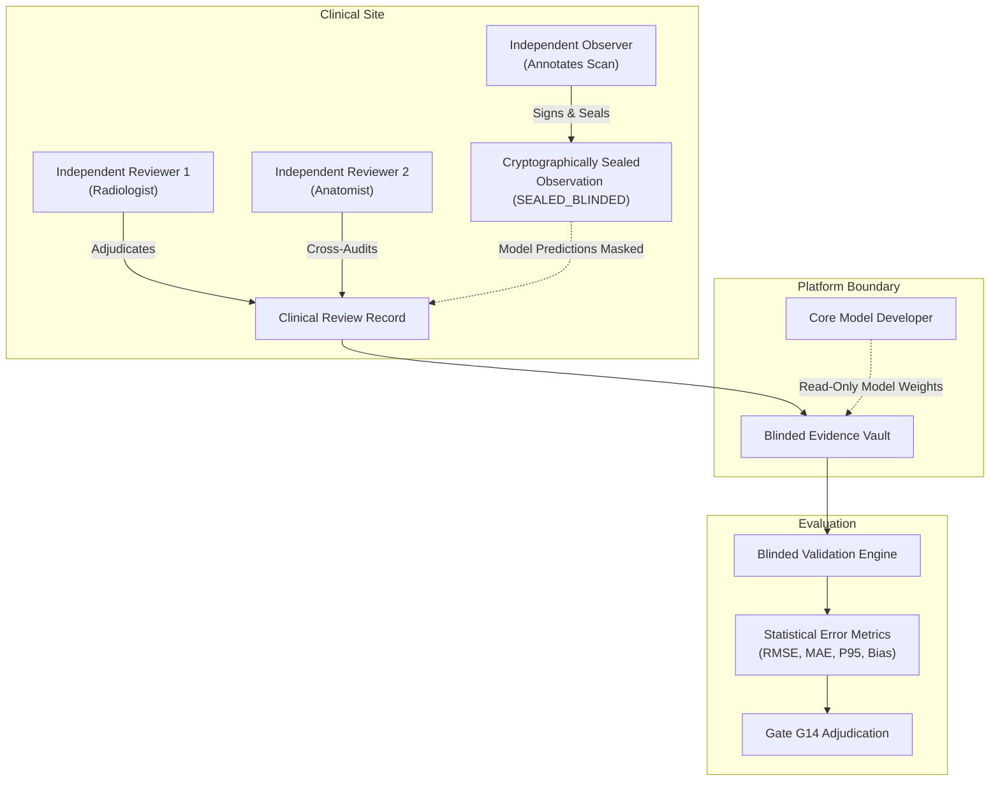

# P10.2 Blinded Independent Validation Protocol & Statistical Engine

**Document ID:** `MSK-PROTO-P10.2-003`  
**Date:** October 29, 2026  
**Auditor Roles:** Medical Research Software Engineer & Clinical Data Governance Auditor  
**Scope:** Blinded evaluation workflow, subject-level partitioning, role separation, and statistical calculations.  
**Preregistered Accuracy Standard:** High Accuracy: $\text{RMSE} \le 5.0\text{ mm}$; Acceptable: $\text{RMSE} \le 10.0\text{ mm}$.  

---

## 1. Blinding & Independent Reviewer Separation Architecture (Workstream C)

To eliminate confirmation bias, observer drift, and developer interference, MSK-Therapy-OS enforces a strict cryptographic role separation model:

### 1.1 The Four-Tier Role Separation Invariant
$$\mathbf{MODEL\_DEVELOPER} \neq \mathbf{OBSERVER} \neq \mathbf{REVIEWER\_1} \neq \mathbf{REVIEWER\_2}$$

1. **Model Developer:** Core software architects and computational engineers who authored the BodyParts3D localization algorithms or mesh weights. **Strictly forbidden** from placing ground-truth markers, reviewing clinical scans, or overriding adjudication verdicts.
2. **Independent Observer:** An external anatomical specialist or licensed clinician who identifies anatomical structures on raw scans. Cannot act as a reviewer for their own annotations (`REVIEWER_ROLE_CONFLICT`).
3. **Reviewer 1:** A board-certified diagnostic radiologist or clinical anatomist registered in `ClinicalReviewerCredentials` who independently inspects the landmark crosshair.
4. **Reviewer 2 / Senior Adjudicator:** An independent senior clinical reviewer who arbitrates cases where Observer and Reviewer 1 diverge by $> 3.0\text{ mm}$.

---

## 2. Subject-Level 3-Way Partitioning & Anti-Leakage Controls

To ensure statistical validity and prevent data snooping or model overfitting, datasets are partitioned strictly at the **human subject level** before any mathematical evaluation:

### 2.1 Partition Ratio & Policy
- **Calibration Set (50%):** Available for coordinate frame registration and initial reference alignment testing.
- **Validation Set (25%):** Used for parameter tuning, cun-scaling elasticity boundary checks, and regional sensitivity analysis.
- **Holdout Set (25%):** Completely isolated and locked. **Never exposed** during calibration or tuning. Only evaluated once during formal Milestone G14 audit execution.

### 2.2 Subject-Level Anti-Leakage Invariant
Let $S_{\text{calib}}$, $S_{\text{val}}$, and $S_{\text{holdout}}$ denote the disjoint sets of subject pseudonyms:
$$S_{\text{calib}} \cap S_{\text{val}} = \emptyset, \quad S_{\text{calib}} \cap S_{\text{holdout}} = \emptyset, \quad S_{\text{val}} \cap S_{\text{holdout}} = \emptyset$$

- **Deterministic Hash Partitioning:** Subjects are partitioned using SHA-256 hash modular arithmetic over `subject_pseudonym:seed:3way`.
- **Cryptographic Seal:** The partition manifest is sealed with a SHA-256 checksum over sorted member lists (`HoldoutPartitionManifest.manifest_checksum`).
- **Enforced Verification:** `verify_no_leakage_three_way()` is executed automatically prior to any evaluation pass. Injected leaks trigger immediate `ValueError: HOLDOUT_DATA_LEAKAGE_DETECTED`.

---

## 3. Comprehensive Statistical Validation Metrics

Validation metrics are computed deterministically from paired model predictions $\mathbf{p}_{\text{pred}, i}$ and observed ground-truth coordinates $\mathbf{p}_{\text{obs}, i}$ in millimeters ($N$ evaluated points):

### 3.1 Localization Error & Dispersion Metrics
1. **Per-Point Euclidean Residual:**
   $$e_i = 1000 \cdot \|\mathbf{p}_{\text{pred}, i} - \mathbf{p}_{\text{obs}, i}\|_2 = 1000 \cdot \sqrt{(x_{p,i} - x_{o,i})^2 + (y_{p,i} - y_{o,i})^2 + (z_{p,i} - z_{o,i})^2} \quad (\text{mm})$$
2. **Overall Root Mean Square Error (RMSE):**
   $$\text{RMSE} = \sqrt{\frac{1}{N}\sum_{i=1}^N e_i^2}$$
3. **Mean Absolute Error (MAE):**
   $$\text{MAE} = \frac{1}{N}\sum_{i=1}^N e_i \quad (\text{Theorem: } \text{MAE} \le \text{RMSE})$$
4. **Median Residual Error ($P_{50}$):** 50th percentile of the sorted residual vector $\{e_i\}$.
5. **95th Percentile Error ($P_{95}$):** 95th percentile of $\{e_i\}$, reflecting tail anatomical divergence.
6. **Maximum Error:** $\max(\{e_i\})$.

### 3.2 Directional Bias & Symmetry Metrics
1. **Bias Vector ($\mathbf{b}$):**
   $$\mathbf{b} = \left[ \frac{1}{N}\sum_{i=1}^N \Delta x_i, \; \frac{1}{N}\sum_{i=1}^N \Delta y_i, \; \frac{1}{N}\sum_{i=1}^N \Delta z_i \right] \quad (\text{mm})$$
   Quantifies systematic anatomical shift along Right/Left ($X$), Superior/Inferior ($Y$), or Anterior/Posterior ($Z$) axes.
2. **Left/Right Error Asymmetry:**
   $$\text{Asymmetry} = |\text{RMSE}_{\text{left}} - \text{RMSE}_{\text{right}}| \quad (\text{mm})$$
   Evaluates whether the digital atlas preserves bilateral anatomical parity.

### 3.3 Regional & Cohort Breakdown
- **Cohort RMSEs:** Computed independently for Cohort A (Abdomen, ST19–ST30), Cohort B (Distal Limbs), and Cohort C (Craniofacial/Cervical).
- **Regional Metrics:** Grouped by body region (`HEAD_NECK`, `TORSO_ANTERIOR`, `TORSO_POSTERIOR`, `UPPER_EXTREMITY`, `LOWER_EXTREMITY`).

### 3.4 95% Confidence Interval for Mean Residual Error
Computed via standard large-sample estimation:
$$\text{SE} = \frac{s}{\sqrt{N}}, \quad \text{CI}_{95} = [\max(0.0, \; \bar{e} - 1.96 \cdot \text{SE}), \; \bar{e} + 1.96 \cdot \text{SE}]$$

---

## 4. Fundamental Scientific Invariant: $U_{95}$ vs RMSE

> [!IMPORTANT]
> **Scientific Warning: Theoretical Uncertainty $\neq$ Empirical Residuals**
> - **$U_{95}$ (ISO/GUM Expanded Uncertainty):** Derived from model assumptions (measurement fuzziness, tissue elasticity, posture variance). In MSK-Therapy-OS, the catalog-wide arithmetic mean is $U_{95} = 7.88\text{ mm}$. It represents theoretical model parameter dispersion.
> - **$\text{RMSE}$ (Root Mean Square Error):** Measures actual empirical residual distance against real-world human in-vivo measurements.
> - **Preregistered Acceptance Criteria:**
>   - High Accuracy: $\text{RMSE} \le 5.0\text{ mm}$
>   - Acceptable Accuracy: $\text{RMSE} \le 10.0\text{ mm}$
> - Conflating $U_{95}$ with RMSE is scientifically invalid and prohibited by our QA standards.

---

## 5. Sample-Size Planning Specification

Before clinical pilot enrollment, contributing institutions must verify statistical power using the preregistered formula:
$$N \ge \frac{(Z_{\alpha/2} + Z_\beta)^2 \cdot \sigma^2}{\delta^2}$$
Where:
- Type I error $\alpha = 0.05 \implies Z_{\alpha/2} = 1.96$.
- Statistical power $1 - \beta = 0.80 \implies Z_\beta = 0.84$ (or $0.90 \implies Z_\beta = 1.28$).
- Estimated anatomical standard deviation $\sigma \approx 3.5\text{ mm}$.
- Acceptable margin of error $\delta = 1.5\text{ mm}$.
- **Minimum Recommended Pilot Sample Size:** $N \ge 30$ human subjects per clinical cohort.
- Formal biostatistical review must be documented prior to pilot initiation.
