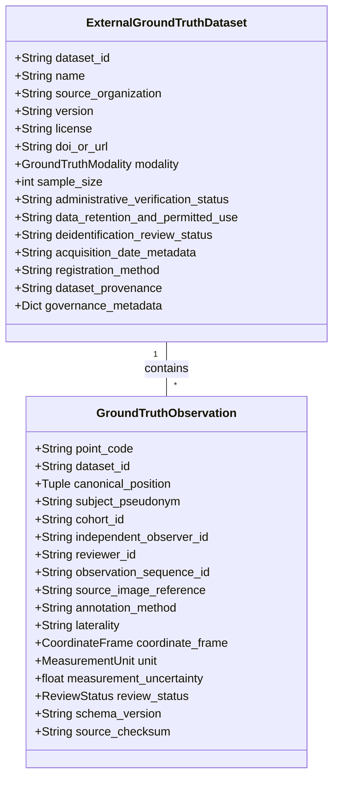
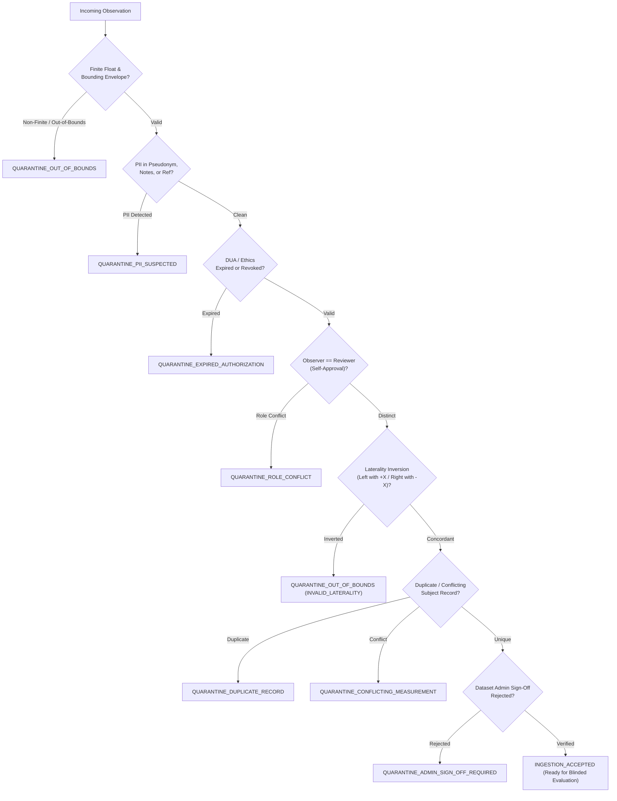

# P10.2 External Data Contract Specification (Schema 1.1-P10)

**Document ID:** `MSK-SPEC-P10.2-002`  
**Date:** October 29, 2026  
**Author:** Principal Software Architect & Medical Research Software Engineer  
**Schema Version:** `1.1-P10` (Fully backward-compatible with `1.0-P10`)  
**Standard:** Structured Empirical Anatomical Landmark Intake Standard  

---

## 1. Specification Scope & Architectural Boundary

The MSK-Therapy-OS production core operates under strict offline-first, zero-new-dependency constraints (Python standard library + SQLite; vanilla HTML5/WebGL).

### 1.1 Preprocessing Boundary Invariant
$$\text{Raw DICOM / NIfTI Volumes} \xrightarrow{\text{Authorized Clinical Workstation}} \text{Structured Landmark Ingestion Schema 1.1-P10} \xrightarrow{\text{Secure Intake}} \text{MSK-Therapy-OS Core}$$

- **No Heavy Imaging Dependencies in Core:** The platform intentionally avoids bundling heavy external C-extensions or imaging stacks (e.g. `pydicom`, `SimpleITK`, `nibabel`) into the core workstation runtime.
- **Preprocessing Boundary:** Raw DICOM/NIfTI medical imaging series are processed at the contributing clinical institution using validated radiological viewing workstations (e.g. OsiriX, Horos, 3D Slicer, Radiant). Independent expert radiologists extract skeletal landmarks, identify acupoints using validated multi-expert consensus protocols, and export structured 3D coordinates in accordance with the `1.1-P10` Data Contract.

---

## 2. Ingestion Schema Architecture (Version 1.1-P10)

### 2.1 Dataset-Level Metadata Elements (`ExternalGroundTruthDataset`)

| Field | Type | Mandatory? | Validation Rule / Allowed Values | Description |
|---|---|---|---|---|
| `dataset_id` | String | Yes | Alphanumeric + hyphens (`DS-[A-Z0-9-]+`) | Unique institutional dataset identifier. |
| `name` | String | Yes | Length $\ge 5$ characters | Descriptive study or dataset title. |
| `source_organization` | String | Yes | Non-empty string | Contributing medical center, university, or imaging lab. |
| `version` | String | Yes | SemVer or version string (e.g. `1.1`) | Dataset release iteration. |
| `license` | String | Yes | Non-empty string | Permitted research license or restricted DUA designation. |
| `doi_or_url` | String | Yes | Valid URL or URN format | Permanent identifier or archive location. |
| `modality` | Enum | Yes | `CT_3D_SURFACE`, `MRI_VOLUMETRIC`, `SURFACE_SCAN_3D`, etc. | Physical sensor modality used for data capture. |
| `sample_size` | Integer | Yes | $N \ge 1$ for clinical data ($0$ for synthetic fixtures) | Number of independent human subjects included. |
| `administrative_verification_status`| String | Yes | `PENDING_ADMIN_SIGN_OFF`, `VERIFIED_ADMIN_SIGNED_OFF`, `REJECTED` | Institutional governance review status. |
| `data_retention_and_permitted_use` | String | Yes | e.g. `RESEARCH_ONLY_5_YEARS` | Statutory retention limit and permitted use scope. |
| `deidentification_review_status` | String | Yes | `VERIFIED_DEIDENTIFIED`, `PENDING_AUDIT` | External privacy audit confirmation. |
| `acquisition_date_metadata` | String | Optional | De-identified format: `YYYY-Q#` (e.g. `2026-Q1`) | Coarse time interval without specific dates (HIPAA Safe Harbor). |
| `registration_method` | String | Yes | `RIGID_PROCRUSTES`, `AFFINE_LANDMARK`, `SURFACE_ICP` | Mathematical coordinate alignment algorithm. |
| `dataset_provenance` | String | Yes | Non-empty lineage description | Documented origin, scanners, and calibration logs. |

### 2.2 Observation-Level Metadata Elements (`GroundTruthObservation`)

| Field | Type | Mandatory? | Validation Rule / Allowed Values | Description |
|---|---|---|---|---|
| `point_code` | String | Yes | Must match catalog code (e.g. `ST36`, `LI4`, `GV24+`) | Canonical acupuncture point or landmark code. |
| `dataset_id` | String | Yes | Must match registered `ExternalGroundTruthDataset` | Parent dataset identifier. |
| `canonical_position` | Tuple[3] | Yes | 3 finite floating-point values in human envelope | 3D Cartesian coordinates $(X, Y, Z)$ in meters. |
| `subject_pseudonym` | String | Yes | Regex `^SUBJ-[A-Z0-9-]+$`, length $\ge 3$ | Random salted alphanumeric pseudonym (no patient MRN). |
| `cohort_id` | String | Optional | `COHORT_A_ABDOMEN`, `COHORT_B_EXTREMITIES`, `COHORT_C_CRANIOFACIAL` | Specific preregistered pilot study arm. |
| `independent_observer_id` | String | Yes | Registered credential ID (`OBS-[A-Z0-9-]+`) | Identifier of the qualified specialist who placed marker. |
| `reviewer_id` | String | Optional | Registered credential ID (`REV-[A-Z0-9-]+`) | Identifier of the second-look reviewer (must $\neq$ observer). |
| `observation_sequence_id` | String | Optional | Monotonic sequence token | Time-order indicator within a multi-session study. |
| `source_image_reference` | String | Optional | De-identified slice/series UID (no PHI) | Anonymized radiological series or mesh scan UID. |
| `annotation_method` | String | Yes | `EXPERT_CROSSHAIR`, `MULTI_EXPERT_CONSENSUS`, `PALPATION_COREPORT` | Protocol used to localize landmark. |
| `laterality` | String | Yes | `left`, `right`, `bilateral`, `midline` | Anatomical laterality (validated against $X$-sign). |
| `coordinate_frame` | Enum | Yes | `BP3D_CARTESIAN_METERS`, `DICOM_LPS_MM`, `NEURO_RAS_MM`, etc. | Reference frame of raw input coordinates. |
| `unit` | Enum | Yes | `meters`, `millimeters` | Measurement distance scale. |
| `measurement_uncertainty` | Float | Yes | Strictly $> 0.0\text{ mm}$ (typically $0.5 - 5.0\text{ mm}$) | Single-observer digitizer or contouring uncertainty ($u_{\text{meas}}$). |
| `review_status` | Enum | Yes | `SEALED_BLINDED`, `DATA_IMPORTED`, `REVIEWED`, `REJECTED` | Blinding and verification status. |
| `source_checksum` | String | Yes | 64-character hexadecimal SHA-256 digest | SHA-256 digest over `point:dataset:coords:subject`. |
| `schema_version` | String | Yes | `1.1-P10` (or `1.0-P10` legacy) | Contract specification iteration. |

---

## 3. Strict Rejection & Quarantine Rules

Any observation violating contract rules is automatically intercepted, denied entry into the active verification matrix, and assigned an explicit machine-readable rejection code in `QuarantinedObservation`:

---

## 4. Independent Expert Annotation Procedure

To avoid arbitrary landmark placement, contributing clinical partners must follow this standardized localization workflow:
1. **Skeletal Landmark Acquisition:** The observer must first identify the underlying primary osseous landmark (FMA anchor) defined in WHO 2008 (e.g. tibial tuberosity, radial styloid, acromion angle).
2. **Surface Normal Projection:** The landmark position is projected outward along the surface normal vector to the exterior skin contour.
3. **Proportional Cun Measurement:** If the point is rule-derived (Class B), bone-cun division must be measured along the 3D curved surface distance using the anatomical landmarks specified in `point_localization_rules.py`.
4. **Dual-Reviewer Blinding:** Observer 1 places the landmark crosshair. Observer 2 independently places a crosshair on a blinded copy of the scan. If inter-observer discrepancy exceeds $3.0\text{ mm}$, a third senior adjudicator reviews both crosshairs.
5. **Cryptographic Sealing:** Once finalized, the observation is marked `SEALED_BLINDED`. Model predictions remain completely hidden from reviewers until all observations in the cohort are locked.
