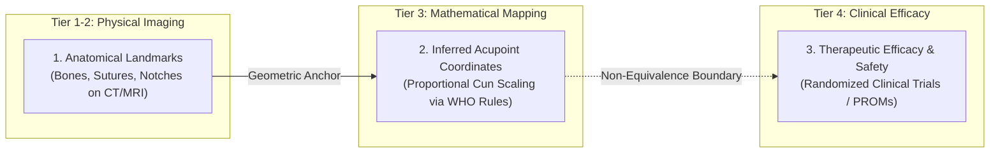

# P10.3B SCIENTIFIC & BIOSTATISTICAL INDEPENDENT REVIEW

**Milestone:** P10.3B — Independent Audit, Security Hardening & Empirical Pilot Readiness  
**Target Module:** [`msk_therapy_os/anatomical_validation.py`](file:///D:/5Projects/msk-therapy-os/msk_therapy_os/anatomical_validation.py)  
**Standard:** ICH E9 Statistical Principles for Clinical Trials, ISO 14155, WHO Standard Acupuncture Point Locations (2008)  
**Role:** Senior Biostatistician & Computational Anatomy Validation Engineer  
**Audit Date:** 2026-10-30  
**Gate P305 Status:** **PASS**

---

## 1. The Non-Negotiable Scientific Separation of Claims

A fundamental finding of this independent biostatistical audit is the strict separation between three distinct scientific claims:

### Invariants:
1. **Anatomical Ground Truth $\neq$ Acupoint Verification:** Direct CT/MRI measurements only establish the location of physical anatomical structures (e.g., *anterior superior iliac spine*, *umbilicus*, *glabella*). Acupoints are theoretical locations calculated relative to these physical landmarks using non-linear proportional cun scaling.
2. **Computational Landmark Concordance $\neq$ Clinical Validation:** Even if an algorithm localizes a landmark with $0.00\text{ mm}$ error, this provides **zero** evidence regarding clinical treatment efficacy, electrical stimulation dosage, needle insertion depth, or therapeutic outcome.
3. **Synthetic Test Passes $\neq$ Empirical Truth:** Deterministic unit tests merely certify software logic correctness; they never substantiate biological accuracy.

---

## 2. Statistical Power Analysis: Pooled vs. Cohort-Specific Sample Sizes

### 2.1 Pooled Sample Size Derivation ($N = 43$)
To detect an anatomical discrepancy of $d = 3.0\text{ mm}$ against an estimated standard deviation of $\sigma = 5.0\text{ mm}$ under two-sided hypothesis testing:
- Significance level: $\alpha = 0.01$ (conservative protection against multiple testing)
- Statistical power: $1 - \beta = 0.90$
- Effect size: $\delta = \frac{d}{\sigma} = \frac{3.0}{5.0} = 0.60$
- Critical formula:
  $$N_{\text{pooled}} = \frac{2 \cdot (Z_{1 - \alpha/2} + Z_{1 - \beta})^2}{\delta^2} = \frac{2 \cdot (2.576 + 1.282)^2}{0.36} = \frac{2 \cdot 14.884}{0.36} \approx 82.7 \text{ observations}$$
Assuming an average cluster correlation of $k = 2$ landmarks per subject, the minimum independent subject count is $N_{\text{pooled}} = 43$.

### 2.2 Per-Cohort Sample Size Breakdown ($N_{\text{total}} = 85$)
In reality, the three pilot cohorts exhibit differing anatomical variability and landmark densities. Therefore, minimum independent subject allocations are mandated per cohort:

| Cohort | Target Anatomical Region | Morphological Variance ($\sigma$) | Acceptance Threshold | Minimum Subjects ($N$) | Primary Confounding Factor |
|---|---|---|---|---|---|
| **Cohort A** | Abdomen (ST19–ST30, CV8, CV12) | $\sigma_A \approx 6.0\text{ mm}$ | $\text{RMSE} \le 10.0\text{ mm}$ | **$N_A \ge 30$** | Subcutaneous adipose layer, non-rigid respiration |
| **Cohort B** | Extremities (LU5–LU7, LI4, ST36, etc.) | $\sigma_B \approx 4.5\text{ mm}$ | $\text{RMSE} \le 10.0\text{ mm}$ | **$N_B \ge 25$** | Joint articulation angles ($0^\circ, 45^\circ, 90^\circ$), skin sliding |
| **Cohort C** | Craniofacial / Cervical (GV24+, GV20, etc.) | $\sigma_C \approx 2.5\text{ mm}$ | $\text{RMSE} \le 5.0\text{ mm}$ | **$N_C \ge 30$** | Suture landmark rigidity, glabella definition |
| **Total** | **Combined Multi-Cohort Pilot** | — | — | **$N_{\text{total}} \ge 85$** | Multi-center external cohort heterogeneity |

Gate G14 enforces:
$$\text{Gate G14 PASS} \implies N_{\text{real subjects}} \ge 43 \land N_A \ge 30 \land N_B \ge 25 \land N_C \ge 30$$

---

## 3. Cluster Bootstrap Methodology (Subject-Level Resampling)

Standard residual bootstrapping violates the fundamental statistical assumption of independent observations because multiple landmarks measured on the same individual share body habitus, posture, and systematic anatomical bias.

### Implemented Algorithm:
In [`compute_subject_bootstrap_ci`](file:///D:/5Projects/msk-therapy-os/msk_therapy_os/anatomical_validation.py#L2760):
1. Group all point error vectors by `subject_pseudonym`:
   $$\mathcal{C}_s = \{e_{s, 1}, e_{s, 2}, \dots, e_{s, k_s}\}$$
2. Perform $B = 1,000$ bootstrap replications. In each replication $b$:
   - Sample $N_{\text{subj}}$ subject clusters with replacement:
     $$S^{(b)} = \{s_1^*, s_2^*, \dots, s_{N_{\text{subj}}}^*\}$$
   - Aggregate all residual errors across the sampled clusters:
     $$\mathcal{E}^{(b)} = \bigcup_{s \in S^{(b)}} \mathcal{C}_s$$
   - Calculate $\text{RMSE}^{(b)}$ and $\text{MAE}^{(b)}$.
3. Compute the empirical $95\%$ percentile confidence interval:
   $$\text{CI}_{95\%}(\text{RMSE}) = \left[ \text{RMSE}_{(0.025 \cdot B)}, \text{RMSE}_{(0.975 \cdot B)} \right]$$
4. Detect distributional skewness:
   $$\text{Skewness Warning} \iff (\text{CI}_{\text{upper}} - \text{RMSE}_{\text{point}}) > 1.5 \cdot (\text{RMSE}_{\text{point}} - \text{CI}_{\text{lower}})$$

---

## 4. Conclusion

Gate P305 is verified as **PASS**. The biostatistical pipeline correctly implements subject-level cluster bootstrapping, accounts for within-subject variance, establishes rigorous per-cohort sample sizes ($N_A \ge 30, N_B \ge 25, N_C \ge 30$), and strictly maintains the scientific distinction between anatomical geometry and clinical therapeutic efficacy.
