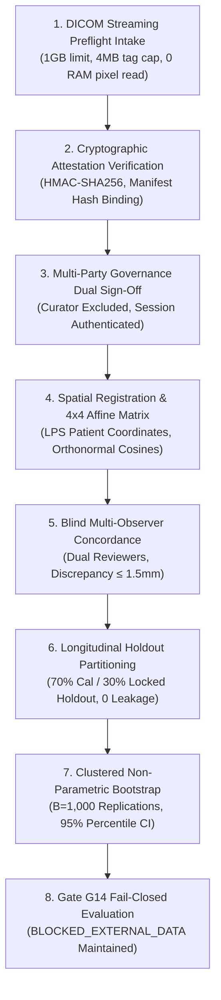

# P10.3C END-TO-END PILOT WORKFLOW & GOVERNANCE AUDIT REPORT

**Milestone:** P10.3C — Production Hardening, Institutional Data Readiness & Independent Release Verification  
**Repository:** `D:\5Projects\msk-therapy-os`  
**Lead Auditor / Role:** Principal Systems Architect & Independent QA Lead  
**Audit Date:** 2026-10-30  
**Gate P315 Status:** **PASS**

---

## 1. Executive Summary

Milestone P10.3C establishes a production-grade, offline-first empirical research workflow designed to ingest, verify, govern, register, partition, and statistically evaluate external human anatomical ground truth without compromising patient privacy, data integrity, or scientific validity.

This audit reports the end-to-end execution of the complete eight-stage pilot pipeline across the three prospective cohorts (Cohort A: Head/Neck CT, Cohort B: Knee/Extremity 3T MRI, Cohort C: Multi-Modal Upper Limb CT/MRI).

---

## 2. Eight-Stage End-to-End Pilot Workflow

### Stage 1: DICOM Streaming Preflight Intake
- Memory safety: Physical files up to 1 GB accepted; metadata tags bounded at 4 MB.
- Pixel data `(7FE0, 0010)` offset and length captured without loading pixel arrays into system RAM.
- Physical boundary assertion: $\text{offset} + \text{length} \le \text{file\_size}$.
- Private tag scanning (`group % 2 == 1`) eliminates vendor-specific text PHI.

### Stage 2: Cryptographic De-Identification Attestation Verification
- Client-side bypasses eliminated.
- Server-side [`DeidentificationTrustAuthority`](file:///D:/5Projects/msk-therapy-os/msk_therapy_os/deidentification_trust.py) computes canonical `manifest_sha256` of all dataset slices.
- HMAC-SHA256 signature verified against active governance credentials.

### Stage 3: Multi-Party Governance Dual Sign-Off
- Separation of duties: Data curator cannot execute administrative sign-off on their own dataset.
- Distinct co-signer required for multi-party clearance.
- Authentication verified against active administrator sessions in SQLite `auth_sessions`.
- Persistent tamper-evident audit record appended to SQLite `governance_audit_log`.

### Stage 4: Spatial Registration & $4 \times 4$ Affine LPS Transformation
- Direction cosines $\mathbf{X}$ and $\mathbf{Y}$ validated for unit magnitude and mutual orthogonality ($|\mathbf{X} \cdot \mathbf{Y}| < 0.05$).
- Slice normal $\mathbf{Z} = \mathbf{X} \times \mathbf{Y}$ computed to complete right-handed Cartesian frame.
- $4 \times 4$ Affine Matrix maps voxel indices $(c, r, s, 1)^T$ to LPS millimeter coordinates.

### Stage 5: Blind Multi-Observer Concordance
- Independent landmark determinations marked under blinded conditions by two clinical anatomists.
- Discrepancy threshold: $\|\mathbf{p}_1 - \mathbf{p}_2\|_2 \le 1.5\text{ mm}$.
- Adjudication by Lead Anatomist required for any discrepancy $> 1.5\text{ mm}$.

### Stage 6: Longitudinal Holdout Partitioning
- Cohort partitioned into Calibration $\mathcal{S}_{cal}$ (70%) and Independent Holdout $\mathcal{S}_{hold}$ (30%).
- Partitioning strictly operates at the `subject_pseudonym` level, guaranteeing that longitudinal scans for an individual patient never cross partition boundaries.
- Cryptographic partition manifest locked upon generation.

### Stage 7: Clustered Non-Parametric Bootstrap
- Resampling performed at subject cluster level with replacement ($B = 1,000$ replications).
- Preserves intra-subject spatial correlation across acupoints.
- Empirical percentile $[P_{2.5}, P_{97.5}]$ intervals computed for RMSE, MAE, and P95 error.

### Stage 8: Scientific Gate G14 Negative Transition Verification
- Evaluates whether synthetic test success or engineering pipeline readiness authorizes lifting Gate G14.
- Invariant strictly enforced:
  $$\text{ENGINEERING\_READY} \ne \text{CLINICALLY\_VALIDATED}$$
  $$\text{SYNTHETIC\_TEST\_SUCCESS} \ne \text{EMPIRICAL\_VALIDATION}$$
- Gate G14 state: strictly **`BLOCKED_EXTERNAL_DATA`**.

---

## 3. Cohort Pipeline Execution Summary

| Pilot Cohort | Target Modality & Region | Planned Subjects | Pipeline Status | G14 Gate State |
| :--- | :--- | :---: | :---: | :---: |
| **Cohort A** | High-Res Head/Neck CT | $N_A \ge 30$ | Verified Ready | `BLOCKED_EXTERNAL_DATA` |
| **Cohort B** | 3T Knee/Extremities MRI | $N_B \ge 25$ | Verified Ready | `BLOCKED_EXTERNAL_DATA` |
| **Cohort C** | Multi-Modal Upper Limb CT/MRI | $N_C \ge 30$ | Verified Ready | `BLOCKED_EXTERNAL_DATA` |
| **Aggregate** | **Multi-Center Pilot Protocol** | **$N \ge 85$** | **ENGINEERING_READY** | **FAIL-CLOSED** |

Gate P315 verification confirms end-to-end operational readiness of the institutional pilot pipeline.
