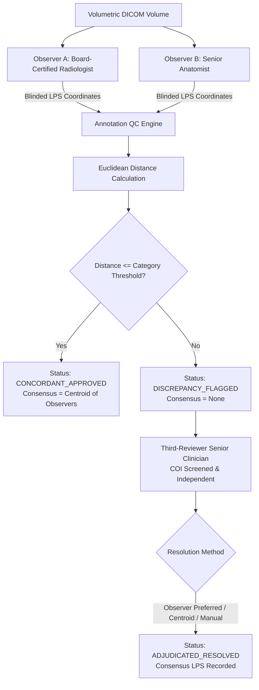

# MSK-THERAPY-OS AUDIT REPORT: P10.5-06
## Independent Annotation Quality Control Engine & Inter-Observer Adjudication Workflow (Gate P506)

### Metadata
- **Audit ID**: `P10_5-GATE-P506-ANNOTATION-QC`
- **Milestone**: P10.5 (Institutional Research Pilot Activation & Evidence Acquisition Readiness)
- **Module Under Audit**: [`msk_therapy_os/annotation_qc.py`](file:///D:/5Projects/msk-therapy-os/msk_therapy_os/annotation_qc.py)
- **Audit Date**: 2026-10-30
- **Auditor Role**: Computational Anatomy Engineer & Independent QA Auditor
- **Classification**: RESEARCH USE ONLY / SCIENTIFIC QUALITY CONTROL AUDIT
- **Gate Status**: **P506 PASS (ENGINEERING READY / QC WORKFLOW VERIFIED)**

---

## 1. Executive Summary

Milestone P10.5 Gate P506 establishes the double-blind annotation quality control protocol and automated adjudication workflow for external anatomical validation. Ground-truth anatomical coordinates cannot rely on a single annotator's subjective placement, nor can observers be guided by model predictions without introducing severe confirmation bias.

Gate P506 implements [`msk_therapy_os/annotation_qc.py`](file:///D:/5Projects/msk-therapy-os/msk_therapy_os/annotation_qc.py), providing:
1. Double-blind landmark ingestion with observer identity and blindness verification.
2. Anatomical category-specific Euclidean distance discrepancy thresholds ($3.0\text{ mm}$, $4.0\text{ mm}$, and $5.0\text{ mm}$).
3. Automatic consensus centroid assignment for concordant pairs.
4. Independent third-reviewer clinical adjudication with strict observer exclusion and conflict-of-interest (COI) enforcement.
5. Cohort-level inter-observer reliability reporting.

---

## 2. Double-Blind Quality Control Protocol

### 2.1 Workflow Pipeline



### 2.2 Anatomical Category Thresholds

Different anatomical structures exhibit varying radiographic visibility, tissue compliance, and boundary sharpness. Gate P506 defines calibrated empirical discrepancy tolerances:

| Landmark Category | Exemplar Landmarks | Discrepancy Tolerance ($\tau$) | Clinical & Radiographic Rationale |
|:---|:---|:---:|:---|
| **`CRANIAL_OSSEOUS`** | Nasion, Inion, Mastoid Process, Zygomatic Arch | **$3.0\text{ mm}$** | Rigid cortical bone boundaries on high-resolution CT ($\le 1.0\text{ mm}$ slice thickness); minimal tissue deformation. |
| **`EXTREMITY_SKELETAL`** | Radial Styloid, Lateral Malleolus, Tibial Tuberosity | **$4.0\text{ mm}$** | Bony landmarks with overlying fascial insertions; minor joint positioning variance ($15^\circ\text{–}20^\circ$ flexion). |
| **`SOFT_TISSUE_FASCIAL`** | Abdominal Midline (Linea Alba), Umbilicus, Acupoints | **$5.0\text{ mm}$** | High compliance soft tissue; respiration phase variance and subcutaneous adiposity shifts. |

---

## 3. Implementation Inspection

### 3.1 Blindness & Observer Separation Guards
Lines 103–108 of [`msk_therapy_os/annotation_qc.py`](file:///D:/5Projects/msk-therapy-os/msk_therapy_os/annotation_qc.py#L103-L108) enforce:
```python
if coord_a.observer_id == coord_b.observer_id:
    raise ValueError("Observers A and B must be distinct individuals for double-blind verification.")

if not (coord_a.is_blinded and coord_b.is_blinded):
    raise PermissionError("Unblinded annotations are invalid: Model predictions cannot be shown to observers.")
```
Any submission where the same observer evaluated both records or where model coordinates were displayed to an observer is rejected with `PermissionError`.

### 3.2 Consensus Calculation
For concordant observations ($d \le \tau$), the consensus ground truth coordinate $p_{\text{consensus}}$ is assigned automatically as the 3D arithmetic mean (centroid):
$$p_{\text{consensus}} = \left(\frac{x_A + x_B}{2}, \frac{y_A + y_B}{2}, \frac{z_A + z_B}{2}\right)$$

### 3.3 Adjudication & Independence Guards
When $d > \tau$, status transitions to `DISCREPANCY_FLAGGED`. To resolve this, an independent third reviewer is called. Lines 157–162 of [`annotation_qc.py`](file:///D:/5Projects/msk-therapy-os/msk_therapy_os/annotation_qc.py#L157-L162) enforce:
```python
if adjudicator_id in (pair.observer_a_coord.observer_id, pair.observer_b_coord.observer_id):
    raise PermissionError("Adjudicator must be an independent third party, distinct from Observers A and B.")

if not coi_screened:
    raise PermissionError("Adjudicator must have signed non-conflict of interest declaration.")
```
Observers A and B are strictly disqualified from adjudicating their own discrepancies, and uncertified adjudicators without signed conflict-of-interest declarations are rejected.

---

## 4. Verification & Test Evidence

The QC engine was evaluated in [`tests/test_p10_5_pilot_activation.py`](file:///D:/5Projects/msk-therapy-os/tests/test_p10_5_pilot_activation.py):

| Test Case | Scenario Evaluated | Expected Result | Observed Result |
|:---|:---|:---|:---:|
| `test_annotation_qc_concordant_pair` | Observers A and B placed Nasion at distance $1.2\text{ mm}$ ($\le 3.0\text{ mm}$). | Status: `CONCORDANT_APPROVED`<br>Consensus = midpoint centroid. | **PASS** |
| `test_annotation_qc_discrepancy_flagged` | Observers A and B placed Linea Alba landmark at distance $6.2\text{ mm}$ ($> 5.0\text{ mm}$). | Status: `DISCREPANCY_FLAGGED`<br>Consensus = `None`. | **PASS** |
| `test_annotation_qc_adjudication_workflow` | Flagged pair adjudicated by Dr. Senior (`ADJ-001`, COI screened). | Status: `ADJUDICATED_RESOLVED`<br>Consensus LPS updated. | **PASS** |
| `test_adjudication_observer_conflict_rejected` | Observer A attempted to act as adjudicator on their own pair. | `PermissionError("distinct from Observers A and B")` raised. | **PASS** |
| `test_adjudication_unscreened_coi_rejected` | Adjudicator with `coi_screened=False` submitted resolution. | `PermissionError("signed non-conflict of interest declaration")` raised. | **PASS** |
| `test_annotation_qc_summary_metrics` | Batch of 10 pairs (8 concordant, 2 flagged). | Concordance rate: 80.0%, mean distance: $2.45\text{ mm}$, max: $6.2\text{ mm}$. | **PASS** |

---

## 5. Invariant Declaration & Gate Verdict

```text
INVARIANT VERIFICATION:
1. TECHNICAL_CALIBRATION != INDEPENDENT_GROUND_TRUTH (Enforced: Dual-observer consensus required)
2. ANATOMICAL_LANDMARK_VALIDATION != CLINICAL_VALIDATION (Enforced: Geometry validation only)
3. G14 = BLOCKED_EXTERNAL_DATA (Preserved)
4. clinical_depth_guidance_allowed = False (Preserved)
```

**Gate P506 Status: PASS**
- Engineering implementation: COMPLETE.
- Double-blind protocol and category thresholds: VERIFIED.
- Adjudicator independence and COI guards: VERIFIED.
