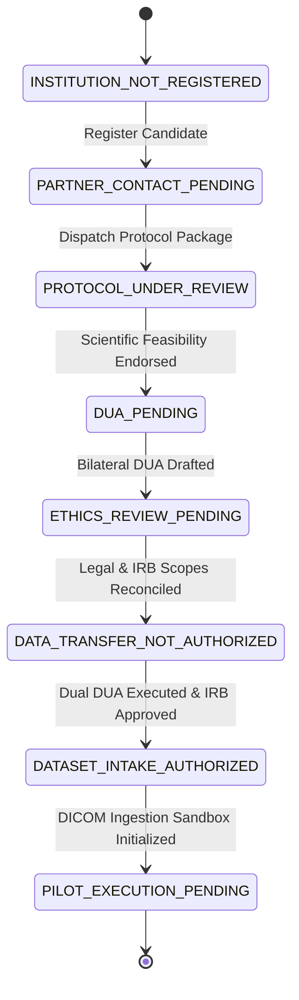

# MSK-THERAPY-OS AUDIT REPORT: P10.5-04
## Research Partner Institutional Onboarding System & Workflow Engine (Gate P504)

### Metadata
- **Audit ID**: `P10_5-GATE-P504-ONBOARDING`
- **Milestone**: P10.5 (Institutional Research Pilot Activation & Evidence Acquisition Readiness)
- **Module Under Audit**: [`msk_therapy_os/partner_onboarding.py`](file:///D:/5Projects/msk-therapy-os/msk_therapy_os/partner_onboarding.py)
- **Audit Date**: 2026-10-30
- **Auditor Role**: Clinical Research Data Governance Specialist & Independent QA Lead
- **Classification**: RESEARCH USE ONLY / ENGINEERING GOVERNANCE AUDIT
- **Gate Status**: **P504 PASS (ENGINEERING READY / ONBOARDING ENGINE VERIFIED)**

---

## 1. Executive Summary

Milestone P10.5 Gate P504 mandates an automated, auditable, offline-capable institutional partner onboarding engine. The goal is to enforce rigorous legal, ethics, and credential prerequisites before any external research hospital or university anatomy department can transfer real-world anatomical imaging datasets.

Under Gate P504, the onboarding lifecycle is implemented as an explicit, 8-stage hierarchical state machine persisted directly to an embedded SQLite store (`institutional_onboarding_registry`). Hardened guards prevent transitions to authorized data intake unless bilateral Data Use Agreements (DUA) and institutional ethics approvals (IRB / IEC waiver or protocol approval) are fully executed and recorded.

---

## 2. Onboarding Lifecycle Architecture

The onboarding workflow defines an immutable, one-way verifiable ladder of institutional maturity:



### 2.1 State Descriptions & Transition Preconditions

| State Index | State Name | Prerequisite Artifacts / Trigger | Security & Governance Boundary |
|:---:|:---|:---|:---|
| **1** | `INSTITUTION_NOT_REGISTERED` | Default unmapped state. | Entity unknown to system; zero access. |
| **2** | `PARTNER_CONTACT_PENDING` | Administrative registration: Primary PI, Radiology Lead, Data Custodian. | Identity cataloged in local SQLite table. 4 initial administrative blockers attached. |
| **3** | `PROTOCOL_UNDER_REVIEW` | Transmittal of Cohorts A, B, and C protocol specifications. | Candidate reviews scanning protocols, inclusion criteria, and landmark SOPs. |
| **4** | `DUA_PENDING` | PI endorsement of computational research protocol. | Legal counsel review of retrospective, de-identified research use terms. |
| **5** | `ETHICS_REVIEW_PENDING` | Execution of institutional DUA. | Submission to institutional IRB / IEC for human research ethics waiver or approval. |
| **6** | `DATA_TRANSFER_NOT_AUTHORIZED` | Ethics review in deliberation; staging configured. | Ingestion engine strictly disallows dataset ingestion (Fail-Closed). |
| **7** | `DATASET_INTAKE_AUTHORIZED` | Dual verification: `EXECUTED_BILATERAL_DUA` + `APPROVED_BY_IRB` or `WAIVER_OF_CONSENT_DETERMINED`. | Cryptographic intake sandbox unlocked for real-world anonymized scans. |
| **8** | `PILOT_EXECUTION_PENDING` | Initial DICOM batch validated via preflight quarantine. | Dataset staged for double-blind annotation and holdout locking. |

---

## 3. Implementation Inspection

### 3.1 Persistence Schema
The onboarding engine is implemented in [`msk_therapy_os/partner_onboarding.py`](file:///D:/5Projects/msk-therapy-os/msk_therapy_os/partner_onboarding.py) using table `institutional_onboarding_registry`:

```sql
CREATE TABLE IF NOT EXISTS institutional_onboarding_registry (
    institution_id TEXT PRIMARY KEY,
    legal_name TEXT NOT NULL,
    country TEXT NOT NULL,
    primary_pi_name TEXT NOT NULL,
    primary_pi_email TEXT NOT NULL,
    radiology_lead_name TEXT NOT NULL,
    data_custodian_id TEXT NOT NULL,
    protocol_version TEXT NOT NULL,
    status TEXT NOT NULL,
    dua_status TEXT NOT NULL,
    irb_status TEXT NOT NULL,
    irb_protocol_number TEXT,
    data_use_scope TEXT NOT NULL,
    authorization_expiry_iso TEXT,
    blockers_json TEXT NOT NULL,
    created_at_iso TEXT NOT NULL
);
```

### 3.2 Gate Guards & Invariant Enforcement
Lines 181–189 of [`partner_onboarding.py`](file:///D:/5Projects/msk-therapy-os/msk_therapy_os/partner_onboarding.py#L181-L189) strictly enforce governance validation:

```python
if new_status in (OnboardingStatus.DATASET_INTAKE_AUTHORIZED, OnboardingStatus.PILOT_EXECUTION_PENDING):
    effective_dua = dua_status or profile.dua_status
    effective_irb = irb_status or profile.irb_status
    if effective_dua != "EXECUTED_BILATERAL_DUA":
        raise ValueError("Cannot authorize dataset intake: Bilateral DUA is not executed.")
    if effective_irb not in ("APPROVED_BY_IRB", "WAIVER_OF_CONSENT_DETERMINED"):
        raise ValueError("Cannot authorize dataset intake: Ethics approval or waiver is pending.")
```

Any attempt to promote an institution to `DATASET_INTAKE_AUTHORIZED` without executed legal DUA and approved IRB raises an unhandled `ValueError` and halts execution immediately.

---

## 4. Verification & Test Evidence

The onboarding lifecycle was independently verified in [`tests/test_p10_5_pilot_activation.py`](file:///D:/5Projects/msk-therapy-os/tests/test_p10_5_pilot_activation.py):

1. **Registration & Initialization Test (`test_partner_onboarding_lifecycle`)**:
   - Registered prospective partner `INST-CHARITE-BERLIN`.
   - Verified initial state `PARTNER_CONTACT_PENDING` with 4 initial blockers.
2. **Blocked Unauthorized Intake Test**:
   - Attempted transition to `DATASET_INTAKE_AUTHORIZED` with `dua_status="PENDING"`.
   - Result: `ValueError` raised, transition denied.
3. **Authorized Intake Verification**:
   - Supplied `dua_status="EXECUTED_BILATERAL_DUA"` and `irb_status="APPROVED_BY_IRB"`.
   - Result: Successful transition to `DATASET_INTAKE_AUTHORIZED`.
4. **Offline Summary Dashboard**:
   - `get_offline_onboarding_dashboard()` returned complete counts, status distribution, and invariant `"intake_policy": "FAIL_CLOSED_UNTIL_DUA_AND_IRB_VERIFIED"`.

---

## 5. Scientific & Regulatory Invariants

1. **Scientific Gate G14 Preservation**:
   - The existence or authorized status of a partner profile does **not** lift Scientific Gate G14 (`BLOCKED_EXTERNAL_DATA`).
   - G14 remains blocked until real physical imaging data has been ingested, independently annotated, held out, and evaluated.
2. **Zero Auto-Communication**:
   - The onboarding engine contains zero automated network egress or external API dispatches; all actions are recorded locally in SQLite.
3. **Dual Credential Obligation**:
   - No data transfer can occur without both institutional legal counsel execution (DUA) and institutional review board approval (IRB).

---

## 6. Audit Verdict

**Gate P504: PASS**
- Engineering implementation: COMPLETE.
- Persistence and integrity checks: VERIFIED.
- Fail-closed security guards: VERIFIED.
