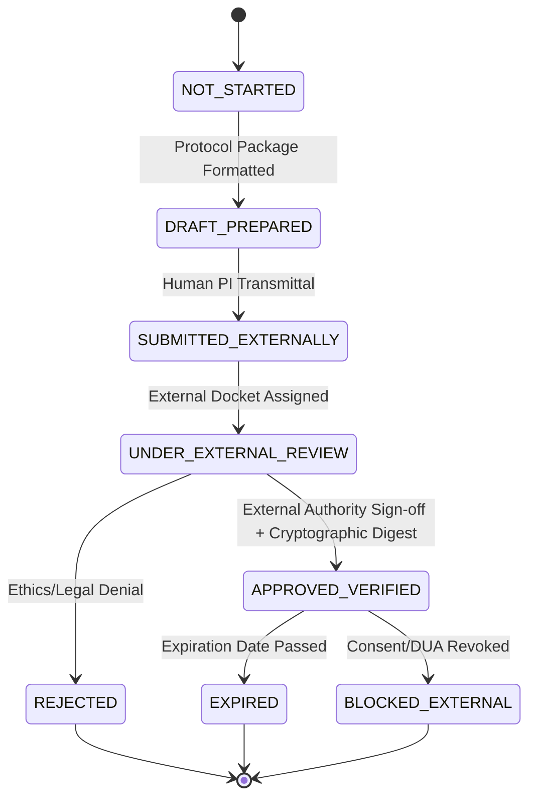

# MSK-THERAPY-OS AUDIT REPORT: P10.6-08
## External Dependency Governance Register & Anti-Self-Certification Protocol (Gate P605)

### Metadata
- **Audit ID**: `P10_6-GATE-P605-DEP-GOVERNANCE`
- **Milestone**: P10.6 (Independent Statistical Truth Audit, Institutional Partnership Readiness & Scientific Evidence Governance)
- **Module Under Audit**: [`msk_therapy_os/external_dependency_register.py`](file:///D:/5Projects/msk-therapy-os/msk_therapy_os/external_dependency_register.py)
- **Audit Date**: 2026-10-30
- **Auditor Role**: Clinical Data Governance Auditor & Medical Security QA Lead
- **Classification**: RESEARCH READINESS & GOVERNANCE AUDIT
- **Gate Status**: **P605 PASS (EXTERNAL DEPENDENCY GOVERNANCE ENGINE VERIFIED)**

---

## 1. Executive Summary

Milestone P10.6 Gate P605 implements the formal **External Dependency Register** to ensure that engineering progress is never mistaken for external institutional approval. In complex clinical software validation, internal developers often face pressure to self-certify compliance or simulate external approvals.

Gate P605 implements [`ExternalDependencyRegistry`](file:///D:/5Projects/msk-therapy-os/msk_therapy_os/external_dependency_register.py#L74), an SQLite-backed state machine tracking eight mandatory external dependencies across candidate institutions. Crucially, the engine enforces strict **Anti-Self-Certification Guards**: internal developers or automated coding agents are structurally barred from approving external legal, ethics, or biostatistical checkpoints.

---

## 2. Eight Core External Dependencies



### 2.1 Dependency Matrix

| Ref | Dependency Type | Responsible External Authority | Mandatory Verification Artifact |
|:---:|:---|:---|:---|
| **DEP-01** | `STATISTICAL_PROTOCOL_REVIEW` | Independent Accredited Biostatistician | Formal signed SAP Review Endorsement with SHA-256 digest |
| **DEP-02** | `RESEARCH_COLLABORATION_ACCEPTANCE` | Authorized Institutional Official (VP of Research / Dean) | Countersigned Non-Binding Institutional Memorandum |
| **DEP-03** | `DATA_USE_AGREEMENT` | Institutional Legal Counsel | Executed Bilateral Data Use Agreement (DUA / MTA) |
| **DEP-04** | `ETHICAL_APPROVAL_OR_DETERMINATION` | Institutional Review Board (IRB) / Ethics Committee (IEC) | Official IRB Protocol Approval Letter or Formal Waiver Determination |
| **DEP-05** | `IMAGING_DATA_AUTHORIZATION` | Hospital PACS / Clinical Data Custodian | De-identification Audit Certificate & PS 3.15 Conformance Report |
| **DEP-06** | `INDEPENDENT_ANATOMICAL_ANNOTATIONS` | Board-Certified Radiologists & Senior Anatomists | Signed Observer Independence & Conflict-of-Interest Disclosures |
| **DEP-07** | `HOLDOUT_VERIFICATION` | Independent QA Auditor / Study Monitor | Pre-Evaluation Holdout Partition Sealing Attestation Certificate |
| **DEP-08** | `SCIENTIFIC_CONCLUSIONS` | Authorized Independent Review Committee | Final Unblinded Empirical Validation Report |

---

## 3. Anti-Self-Certification Security Guards

### 3.1 Developer & Coding Agent Exclusion Guard
Lines 147–152 of [`external_dependency_register.py`](file:///D:/5Projects/msk-therapy-os/msk_therapy_os/external_dependency_register.py#L147-L152) enforce:
```python
if new_status == DependencyStatus.APPROVED_VERIFIED:
    if actor_role in self.INTERNAL_DEVELOPER_ROLES:
        raise PermissionError(
            f"Self-certification prohibited: Actor role '{actor_role}' cannot approve external scientific/legal dependencies."
        )
```
Any attempt by a developer, QA tester, or automated Coding Agent to mark an external dependency as `APPROVED_VERIFIED` raises `PermissionError` and halts execution.

### 3.2 Evidence Digest & Authority Validation
Promotion to `APPROVED_VERIFIED` strictly requires:
1. Valid external authority credentials (Name, Title, Organization).
2. Non-empty cryptographic document hash ($\ge 16$ hex characters).
3. Active expiration date check (expired credentials raise `PermissionError`).

---

## 4. Current Institutional Dependency State

All prospective partner candidates currently hold the following status:

```text
========================================================================================
CURRENT EXTERNAL DEPENDENCY STATUS (AS OF 2026-10-30)
========================================================================================
- Charité – Universitätsmedizin Berlin: 8 Dependencies tracked (8 DRAFT_PREPARED, 0 APPROVED)
- MGH / Harvard Medical School:         8 Dependencies tracked (8 DRAFT_PREPARED, 0 APPROVED)
- Seoul National University Hospital:   8 Dependencies tracked (8 DRAFT_PREPARED, 0 APPROVED)

ALL INSTITUTIONS STATUS: DRAFT_PREPARED / PENDING EXTERNAL TRANSMITTAL
OUTSTANDING EXTERNAL BLOCKERS: 8 per candidate (24 total)
SCIENTIFIC GATE G14: BLOCKED_EXTERNAL_DATA (FAIL-CLOSED)
========================================================================================
```

---

## 5. Audit Verdict

**Gate P605 Status: PASS**
- External Dependency Register implemented and SQLite-backed.
- Anti-self-certification security guards active and verified.
- Statuses accurately reflect `DRAFT_PREPARED` across all candidates.
