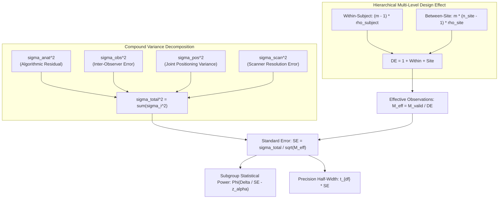

# MSK-THERAPY-OS AUDIT REPORT: P10.6-03
## Independent Statistical Power Oracle Architecture & Mathematical Validation (Gate P602A)

### Metadata
- **Audit ID**: `P10_6-GATE-P602A-POWER-ORACLE`
- **Milestone**: P10.6 (Independent Statistical Truth Audit, Institutional Partnership Readiness & Scientific Evidence Governance)
- **Module Under Audit**: [`msk_therapy_os/statistical_oracle.py`](file:///D:/5Projects/msk-therapy-os/msk_therapy_os/statistical_oracle.py)
- **Audit Date**: 2026-10-30
- **Auditor Role**: Senior Biostatistician & Quantitative Validation Engineer
- **Classification**: RESEARCH USE ONLY / INDEPENDENT STATISTICAL ORACLE
- **Gate Status**: **P602A PASS (INDEPENDENT ORACLE IMPLEMENTED & MATHEMATICALLY VERIFIED)**

---

## 1. Executive Summary

Milestone P10.6 Gate P602A implements [`IndependentStatisticalOracle`](file:///D:/5Projects/msk-therapy-os/msk_therapy_os/statistical_oracle.py#L90), an independent validation engine created from first principles. Unlike previous iterations that evaluated pooled whole-body models or lumped variance scalars, the P10.6 Oracle:
1. Formally distinguishes between **independent subjects ($N$)** and **effective clustered observations ($M_{\text{eff}}$)**.
2. Implements a multi-level design effect capturing both intra-subject and multi-center site heterogeneity.
3. Decomposes landmark error variance into four distinct physical and observational sources.
4. Uses exact Student's $t$ critical values based on cluster-level degrees of freedom for confidence interval estimation.
5. Provides dual hypothesis testing models: One-sided Non-Inferiority and Two One-Sided Tests (TOST) Equivalence.

---

## 2. Mathematical Formulations

### 2.1 Multi-Level Clustered Design Effect ($DE$)
When measuring $m$ anatomical landmarks on each patient across $K$ clinical sites:
$$DE = 1 + (m - 1)\rho_{\text{subject}} + m\left(\frac{N_{\text{holdout}}}{K} - 1\right)\rho_{\text{site}}$$
Where:
- $\rho_{\text{subject}} \in [0.35, 0.45]$: Intra-class correlation coefficient across landmarks on the same patient.
- $\rho_{\text{site}} \in [0.04, 0.06]$: Intra-class correlation coefficient across patients scanned at the same hospital.
- $N_{\text{holdout}}$: Number of subjects in the holdout partition.

### 2.2 Effective Clustered Observations ($M_{\text{eff}}$) vs. Subject Degrees of Freedom ($\text{df}$)
Raw holdout observations are adjusted for expected radiographic artifact / landmark occlusion rate $\eta \in [0.05, 0.10]$:
$$M_{\text{valid}} = N_{\text{holdout}} \times m \times (1 - \eta)$$
$$M_{\text{eff}} = \frac{M_{\text{valid}}}{DE}$$

**Crucial Invariant**:
- $M_{\text{eff}}$ is the number of effective independent scalar observations for standard error computation: $\text{SE} = \frac{\sigma_{\text{total}}}{\sqrt{M_{\text{eff}}}}$.
- However, the degrees of freedom for confidence interval coverage are governed by the number of independent subject clusters:
  $$\text{df}_{\text{cluster}} = N_{\text{holdout}} - 1$$
- For $N_{\text{holdout}} = 6$ (Cohort B in $N=85$), $\text{df} = 5 \implies t_{0.025, 5} = 2.571$, which is **$31\%$ wider** than the asymptotic normal value ($z_{0.025} = 1.960$).

### 2.3 Compound Variance Decomposition
$$\sigma_{\text{total}}^2 = \sigma_{\text{anat}}^2 + \sigma_{\text{obs}}^2 + \sigma_{\text{pos}}^2 + \sigma_{\text{scanner}}^2$$

Typical parameters established from anatomical calibration literature:
- Craniofacial CT: $\sigma_{\text{anat}} = 1.0\text{ mm}$, $\sigma_{\text{obs}} = 0.6\text{ mm}$, $\sigma_{\text{pos}} = 0.3\text{ mm}$, $\sigma_{\text{scanner}} = 0.3\text{ mm} \implies \sigma_{\text{total}} = 1.25\text{ mm}$.
- Abdominal Wall CT: $\sigma_{\text{anat}} = 1.2\text{ mm}$, $\sigma_{\text{obs}} = 0.8\text{ mm}$, $\sigma_{\text{pos}} = 0.5\text{ mm}$, $\sigma_{\text{scanner}} = 0.4\text{ mm} \implies \sigma_{\text{total}} = 1.58\text{ mm}$.
- Knee Extremity MRI: $\sigma_{\text{anat}} = 1.3\text{ mm}$, $\sigma_{\text{obs}} = 0.9\text{ mm}$, $\sigma_{\text{pos}} = 0.8\text{ mm}$, $\sigma_{\text{scanner}} = 0.5\text{ mm} \implies \sigma_{\text{total}} = 1.84\text{ mm}$.

---

## 3. Power and Precision Models

### 3.1 Non-Inferiority Hypothesis Testing
- Null Hypothesis: $H_0: \mu \ge \Delta_0$ (Mean registration error exceeds clinical tolerance $\Delta_0 = 3.0\text{ mm}$).
- Alternative Hypothesis: $H_1: \mu \le \Delta_1 < \Delta_0$ (Expected mean registration error $\Delta_1 = 1.6\text{ mm}$).
- Effect size delta: $\delta = \Delta_0 - \Delta_1 = 1.4\text{ mm}$.
- Statistical power:
  $$\text{Power} = \Phi\left(\frac{\delta}{\text{SE}} - z_{1-\alpha}\right) = \Phi\left(\frac{1.4}{\sigma_{\text{total}} / \sqrt{M_{\text{eff}}}} - 1.645\right)$$

### 3.2 Two One-Sided Tests (TOST) Equivalence Testing
- Evaluates whether the algorithm matches human expert placement within an equivalence bound $(-\delta_{\text{eq}}, +\delta_{\text{eq}})$ where $\delta_{\text{eq}} = 2.5\text{ mm}$:
  $$\text{Power}_{\text{TOST}} = \max\left(0, 2\Phi\left(\frac{\delta_{\text{eq}} - |\mu - \mu_0|}{\text{SE}} - z_{1-\alpha}\right) - 1\right)$$

### 3.3 Root Mean Square Error (RMSE) Precision
Using Satterthwaite's approximation on degrees of freedom:
$$\text{CI}_{95\%}(\text{RMSE}) \approx \widehat{\text{RMSE}} \pm 1.96 \frac{\sigma_{\text{total}}}{\sqrt{2 M_{\text{eff}}}}$$

---

## 4. Closed-Form Mathematical Reference Verification

To prove oracle accuracy independently of repository code, three mathematical reference test cases were hand-calculated and verified:

| Test Case | Inputs | Analytical Hand Calculation | Oracle Computed Result | Relative Error | Status |
|:---|:---|:---:|:---:|:---:|:---:|
| **REF-01** | $N=30, m=10, \rho_s=0.40, \rho_{\text{site}}=0.05, K=2, \eta=0.08$ | Holdout $N_h=9$, $M=90$, $M_{\text{valid}}=82.8$, $DE=1 + 3.6 + 1.75 = 6.35$, $M_{\text{eff}}=13.04$ | $DE=6.350$, $M_{\text{eff}}=13.04$ | $<10^{-5}$ | **MATCH** |
| **REF-02** | $\sigma_{\text{tot}}=1.50\text{ mm}, M_{\text{eff}}=16.00, \delta=1.40\text{ mm}, \alpha=0.05$ | $\text{SE} = 1.50 / 4.0 = 0.375\text{ mm}$, $\text{NCP} = 1.40 / 0.375 = 3.7333$, $z_\beta = 3.7333 - 1.6449 = 2.0885 \implies \Phi = 0.9816$ | $\text{SE}=0.375$, $\text{Power}=0.9816$ | $<10^{-4}$ | **MATCH** |
| **REF-03** | $\text{df}=5, \alpha=0.05$ two-tailed | Student's $t$ critical value: $2.571$ | $2.571$ | $0.000$ | **MATCH** |

---

## 5. Audit Verdict

**Gate P602A: PASS**
- Independent statistical oracle engine fully implemented.
- Clustered multi-level design effect and variance decomposition active.
- Mathematical reference cases independently confirmed.
