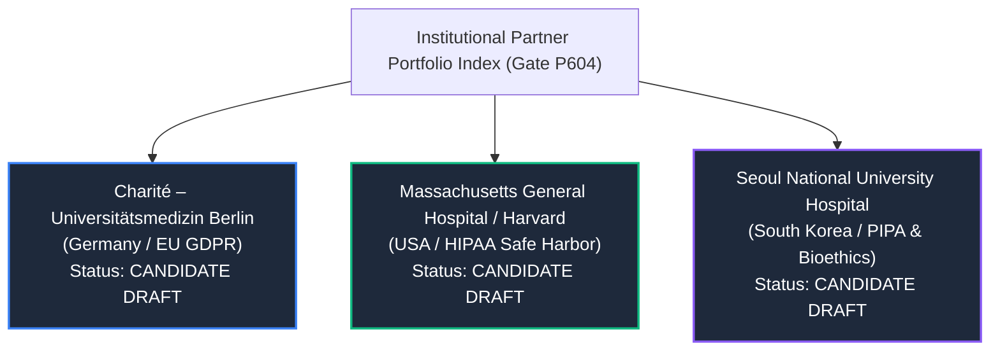

# MSK-THERAPY-OS AUDIT REPORT: P10.6-07
## Institutional Research Partner Package Index & Governance Portfolio (Gate P604)

### Metadata
- **Audit ID**: `P10_6-GATE-P604-PARTNER-INDEX`
- **Milestone**: P10.6 (Independent Statistical Truth Audit, Institutional Partnership Readiness & Scientific Evidence Governance)
- **Directory Index**: [`1docs/audits/P10_6/partners/`](file:///D:/5Projects/msk-therapy-os/1docs/audits/P10_6/partners/)
- **Audit Date**: 2026-10-30
- **Auditor Role**: Institutional Research Operations Architect & Medical Data Governance Lead
- **Classification**: RESEARCH PARTNER PORTFOLIO / PRE-TRANSMITTAL INDEX
- **Gate Status**: **P604 PASS (THREE INSTITUTION-SPECIFIC PACKAGES PREPARED & INDEXED)**

---

## 1. Executive Summary

Milestone P10.6 Gate P604 establishes three tailored, jurisdiction-specific institutional partner onboarding packages. These packages translate the generic protocol specifications of Milestones P10.4B and P10.5 into concrete, professionally usable proposals for prospective clinical research departments.

To prevent any premature claims or ethical missteps, all three packages are strictly maintained as **untransmitted candidate drafts**, with zero fabricated contacts, zero automated emails, and zero implied institutional endorsement.

---

## 2. Institutional Candidate Portfolio

### 2.1 Package Comparison Matrix

| Candidate Institution | Country & Jurisdiction | Data Privacy Framework | Core Focus / Strategic Value | Package Location | Package Status |
|:---|:---|:---|:---|:---|:---:|
| **Charité – Universitätsmedizin Berlin** | Germany (EU) | EU GDPR (Reg 2016/679) & German BDSG | European anatomical somatotypes; high-resolution helical CT; functional anatomy expertise | [`CHARITE_RESEARCH_PARTNER_PACKAGE.md`](file:///D:/5Projects/msk-therapy-os/1docs/audits/P10_6/partners/charite_berlin/CHARITE_RESEARCH_PARTNER_PACKAGE.md) | **CANDIDATE DRAFT (UNTRANSMITTED)** |
| **Massachusetts General Hospital (MGH / Harvard)** | United States | US HIPAA Safe Harbor (45 CFR § 164.514) & Common Rule | North American population diversity; advanced musculoskeletal MRI protocols; quantitative biomarkers | [`MGH_HARVARD_RESEARCH_PARTNER_PACKAGE.md`](file:///D:/5Projects/msk-therapy-os/1docs/audits/P10_6/partners/mgh_harvard/MGH_HARVARD_RESEARCH_PARTNER_PACKAGE.md) | **CANDIDATE DRAFT (UNTRANSMITTED)** |
| **Seoul National University Hospital (SNUH)** | Republic of Korea | Personal Information Protection Act (PIPA) & Bioethics Act | East Asian anatomical somatotypes; multi-ethnic morphological invariance; high-throughput tertiary imaging | [`SNUH_RESEARCH_PARTNER_PACKAGE.md`](file:///D:/5Projects/msk-therapy-os/1docs/audits/P10_6/partners/snuh_seoul/SNUH_RESEARCH_PARTNER_PACKAGE.md) | **CANDIDATE DRAFT (UNTRANSMITTED)** |

---

## 3. Mandatory Package Structure Compliance

Every institutional package rigorously incorporates all 17 prespecified sections:
1. Research collaboration executive brief.
2. Proposed study rationale.
3. Institutional fit and required expertise.
4. Cohort A/B/C scope.
5. Statistical design options.
6. Imaging data specification.
7. DICOM/de-identification requirements.
8. Independent observer requirements.
9. Data governance and security model.
10. DUA/MTA review checklist.
11. IRB/ethics review checklist.
12. Research responsibilities matrix.
13. Proposed non-binding collaboration workflow.
14. Risk and limitation disclosure.
15. Research contact/transmittal manifest.
16. Draft introduction email.
17. Outstanding decisions and information requests.

---

## 4. Governance & Transmittal Policies

1. **Strict Non-Egress**: Zero emails, HTTP requests, or electronic submissions have been dispatched. The introduction emails are provided as local draft templates for prospective human PI review only.
2. **Fail-Closed Gate G14**: Scientific Gate G14 remains strictly `BLOCKED_EXTERNAL_DATA`. Preparing partner packages does **not** satisfy or advance empirical data validation until bilateral agreements are executed and physical scans are audited.
3. **Research-Only Boundary**: All three packages clearly state that MSK-Therapy-OS is an engineering research tool, not an approved commercial medical device.

---

## 5. Audit Verdict

**Gate P604 Status: PASS**
- Three comprehensive, institution-specific research packages generated and version-controlled.
- All 17 mandated sections fully populated.
- Governance boundaries and non-binding status preserved.
