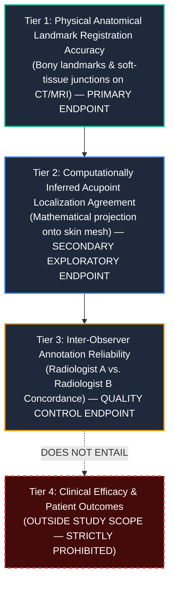

# DRAFT — INDEPENDENT SCIENTIFIC AND INSTITUTIONAL REVIEW REQUIRED
# MSK-THERAPY-OS AUDIT REPORT: P10.6-05
## Prespecified Statistical Analysis Plan (SAP) — Version 2.0-DRAFT (Gate P603A)

### Metadata
- **Document Title**: Prespecified Statistical Analysis Plan for Multi-Center Anatomical Ground-Truth Validation
- **Document Identifier**: `SAP-MSK-OS-P10.6-v2.0-DRAFT`
- **Milestone**: P10.6 (Independent Statistical Truth Audit, Institutional Partnership Readiness & Scientific Evidence Governance)
- **Status**: **DRAFT — PENDING INDEPENDENT BIOSTATISTICAL APPROVAL**
- **Effective Version**: `v2.0-DRAFT-P10.6`
- **Audit Date**: 2026-10-30
- **Classification**: RESEARCH PROTOCOL SPECIFICATION / PRE-REGISTRATION DRAFT

---

> [!WARNING]
> **GOVERNANCE & AMENDMENT RESTRICTION**:  
> This Statistical Analysis Plan (SAP) governs the primary and secondary statistical evaluations of the MSK-Therapy-OS computational anatomical registration pipeline. Once signed by the independent biostatistician and locked prior to data unblinding, **no post-hoc alterations, metric modifications, or subgroup redefining are permitted without a formal, versioned protocol amendment**.

---

## 1. Study Objectives & Hierarchical Evidence Distinctions

This study evaluates the technical and geometrical fidelity of 3D computational anatomical surface and meridian localization against independent radiological ground truth.

To prevent clinical conflation, the study prespecifies four distinct evidence tiers:



1. **Physical Anatomical Landmark Accuracy (Primary Estimand)**: Euclidean distance residual between model-registered landmark coordinates and independent double-blind human expert consensus coordinates on CT/MRI series.
2. **Computationally Inferred Acupoint Agreement (Secondary Exploratory Estimand)**: Spatial concordance of rule-derived skin points relative to WHO Standard anatomical landmarks.
3. **Inter-Observer Annotation Reliability (Quality Control Estimand)**: Inter-radiologist discrepancy distances evaluated against anatomical category tolerances ($3.0\text{ mm}$, $4.0\text{ mm}$, $5.0\text{ mm}$).
4. **Clinical Outcomes & Efficacy (Explicit Non-Scope)**: This SAP explicitly bars clinical efficacy evaluations. Needle puncture depth guidance and therapeutic dose prescriptions are disabled in code and excluded from analysis.

---

## 2. Study Design & Data Partitioning

### 2.1 Study Scenarios
- **Primary Operational Scenario**: Scenario 2 ($N = 85$ total subjects: 30 Cohort A, 25 Cohort B, 30 Cohort C across 2 hospital centers).
- **Subgroup Confirmatory Contingency**: Scenario 3 ($N = 115$ total subjects: 40 Cohort A, 35 Cohort B, 40 Cohort C).

### 2.2 Strict Three-Way Subject Partitioning
To prevent model overfitting and validation bias, datasets are split at the **subject level** before any algorithmic execution:
- **Calibration Partition (50%)**: Used for coordinate frame registration and affine alignment parameter calibration.
- **Tuning Partition (20%)**: Used for hyperparameter optimization and surface mesh conformity tuning.
- **Holdout Validation Partition (30%)**: Cryptographically hashed and locked. Zero model tuning or hyperparameter adjustments are permitted on holdout data.

---

## 3. Primary & Secondary Estimands

### 3.1 Primary Estimand: Subgroup Mean Landmark Error
For each cohort $c \in \{A, B, C\}$, the primary endpoint is the mean Euclidean residual error $\mu_c$:
$$d_{ij} = \| \mathbf{p}_{ij}^{\text{model}} - \mathbf{p}_{ij}^{\text{consensus}} \|_2 = \sqrt{(x_{ij}^{\text{mod}} - x_{ij}^{\text{con}})^2 + (y_{ij}^{\text{mod}} - y_{ij}^{\text{con}})^2 + (z_{ij}^{\text{mod}} - z_{ij}^{\text{con}})^2}$$
Where $i \in \{1, \dots, N_{\text{holdout}}\}$ indexes subjects, and $j \in \{1, \dots, m_i\}$ indexes valid landmarks on subject $i$.

### 3.2 Root Mean Square Error (RMSE)
$$\text{RMSE}_c = \sqrt{\frac{1}{M_c} \sum_{i=1}^{N_h} \sum_{j=1}^{m_i} d_{ij}^2}$$

### 3.3 Secondary Estimand: Maximum Surface Discrepancy (Hausdorff 95th Percentile)
Evaluates skin surface registration conformity to guard against localized topological warping:
$$\text{HD}_{95} = \text{percentile}_{95} \left( \min_{\mathbf{q} \in S_{\text{con}}} \| \mathbf{p} - \mathbf{q} \|_2 \right)$$

---

## 4. Statistical Hypotheses & Non-Inferiority Testing

### 4.1 Statistical Framework
Each cohort is tested independently under a one-sided non-inferiority framework:
- **Null Hypothesis ($H_0$)**: $\mu_c \ge \Delta_0$ (Model mean error is inferior, exceeding clinical threshold $\Delta_0 = 3.0\text{ mm}$).
- **Alternative Hypothesis ($H_1$)**: $\mu_c < \Delta_0$ (Model mean error demonstrates non-inferiority).

### 4.2 Multi-Level Linear Mixed Model
Because multiple landmarks are measured on each subject, and subjects are nested within clinical centers, data will be analyzed using a multi-level linear mixed-effects model (LMM):
$$d_{ijk} = \mu + \gamma_k + u_{ik} + \epsilon_{ijk}$$
Where:
- $\mu$: Fixed overall mean error.
- $\gamma_k \sim \mathcal{N}(0, \sigma_{\text{site}}^2)$: Random effect of clinical site $k$.
- $u_{ik} \sim \mathcal{N}(0, \sigma_{\text{subject}}^2)$: Random effect of subject $i$ nested within site $k$.
- $\epsilon_{ijk} \sim \mathcal{N}(0, \sigma_{\text{residual}}^2)$: Residual measurement error.

### 4.3 Success Criteria
Non-inferiority is declared if and only if the **upper bound of the two-sided 95% confidence interval** (equivalent to one-sided 97.5% upper limit) satisfies:
$$\text{Upper 95\% CI}(\mu_c) \le 3.00\text{ mm}$$
For the study to pass overall, **all three cohorts must independently satisfy this criterion**. No cohort may be substituted or offset by another.

---

## 5. Missing Data, Dropout & Protocol Deviations

1. **Landmark Non-Identifiability**:
   - If a landmark is obscured due to surgical hardware, severe osteophytes, or truncation artifact, it is recorded as `NOT_IDENTIFIABLE`.
   - Complete-case analysis will be used within mixed models, provided missingness is $<15\%$ and missing-at-random (MAR).
   - If missingness exceeds 15%, a sensitivity analysis using multiple imputation (Chained Equations, MICE) will be conducted.
2. **Subject Exclusion**:
   - Subjects with scan protocol deviations (e.g., slice thickness $>2.0\text{ mm}$ for CT or $>3.0\text{ mm}$ for MRI) are flagged as `PROTOCOL_DEVIATION` and analyzed in an exploratory intention-to-treat (ITT) sensitivity cohort, but excluded from the primary per-protocol cohort.

---

## 6. Pre-Unblinding Lock & Sign-Off Requirements

Prior to breaking the cryptographic seal on the 30% holdout partition:
1. All double-blind annotations must be completed, audited, and adjudicated.
2. Inter-observer discrepancy reports must be finalized.
3. Code repository commit must be tagged and frozen.
4. Independent biostatistician must sign the formal SAP Lock Certificate.

---

## 7. Approval Blockers

```text
STATUS: DRAFT — PENDING FORMAL SIGN-OFF
REQUIRED ACTIONS TO UNLOCK EXECUTION:
1. Biostatistical Methodology Sign-off by external accredited biostatistician.
2. Formal endorsement by Clinical Research Ethics Committee (IRB/IEC).
3. Inclusion in bilateral Data Use Agreement annexes.
```
