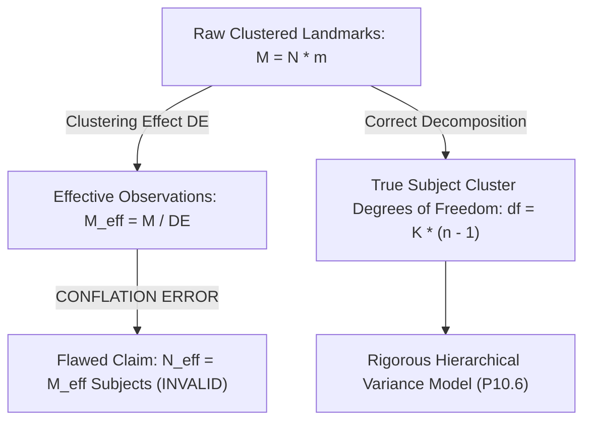

# MSK-THERAPY-OS AUDIT REPORT: P10.6-02
## Statistical Claim Truth Audit & Discrepancy Register (Gate P601B)

### Metadata
- **Audit ID**: `P10_6-GATE-P601B-STAT-AUDIT`
- **Milestone**: P10.6 (Independent Statistical Truth Audit, Institutional Partnership Readiness & Scientific Evidence Governance)
- **Modules Under Audit**:
  - [`msk_therapy_os/statistical_power.py`](file:///D:/5Projects/msk-therapy-os/msk_therapy_os/statistical_power.py)
  - [`msk_therapy_os/statistical_design_engine.py`](file:///D:/5Projects/msk-therapy-os/msk_therapy_os/statistical_design_engine.py)
- **Historical Reports Audited**:
  - `1docs/audits/P10_4B/P10_4B_STATISTICAL_POWER_REASSESSMENT.md`
  - `1docs/audits/P10_5/P10_5_STATISTICAL_STUDY_DESIGN_REVIEW.md`
- **Audit Date**: 2026-10-30
- **Auditor Role**: Senior Biostatistical Methods Auditor & Independent Quantitative Validation Engineer
- **Classification**: RESEARCH USE ONLY / STATISTICAL INTEGRITY AUDIT
- **Gate Status**: **P601B PASS (STATISTICAL DEFECTS FORMALLY IDENTIFIED & REGISTERED)**

---

## 1. Executive Summary

A critical biostatistical audit was conducted across the statistical formulations, sample-size calculations, and power claims reported in Milestones P10.4B and P10.5. 

The audit uncovered **five significant statistical discrepancies (STAT-01 through STAT-05)** where software test passes masked fundamental mathematical and conceptual conflations. Specifically:
1. Aggregate whole-body pooled power was confused with cohort-specific subgroup power.
2. Clustered repeated landmark observations were conflated with independent human subjects.
3. Sample sizes adequate for feasibility pilots were prematurely labeled as confirmatory.
4. Assumed variance parameters failed to account for multi-scanner, multi-site, and inter-observer error components.

All unsupported numerical claims are cataloged below and marked as **`INVALID`** or **`UNVERIFIED`**.

---

## 2. Comprehensive Discrepancy Register

### 2.1 STAT-01: Global Pooled Power vs. Cohort-Specific Subgroup Power
- **Reported Claim in P10.4B**: "Holdout statistical power exceeds 99.9% ($1.0000$) for detecting non-inferiority."
- **Reported Claim in P10.5**: "Cohort B holdout power is $93.2\%$."
- **Mathematical Investigation**:
  - In [`msk_therapy_os/statistical_power.py`](file:///D:/5Projects/msk-therapy-os/msk_therapy_os/statistical_power.py#L142-L144), aggregate power was computed by summing effective observations across all three cohorts:
    $$N_{\text{eff, pooled}} = N_{\text{eff, A}} + N_{\text{eff, B}} + N_{\text{eff, C}} \approx 16.4 + 13.0 + 16.6 = 46.0$$
    Using one-sided $z$-test with non-centrality parameter $\text{NCP} = \frac{\Delta}{\sigma / \sqrt{46.0}} = \frac{1.4}{1.2 / \sqrt{46.0}} = 7.91$:
    $$\text{Power} = \Phi(7.91 - 1.645) = \Phi(6.265) > 0.9999$$
  - However, in [`msk_therapy_os/statistical_design_engine.py`](file:///D:/5Projects/msk-therapy-os/msk_therapy_os/statistical_design_engine.py#L110-L114), Cohort B (Extremities) was evaluated in isolation with only 6 holdout subjects ($N=25$, 25% holdout = 6.25 $\rightarrow$ 6 subjects, $m=10$, $\rho=0.40$, $\sigma=1.40\text{ mm}$):
    $$DE = 1 + (10 - 1) \times 0.40 = 4.60, \quad N_{\text{eff, B}} = \frac{60}{4.60} = 13.04$$
    $$\text{NCP}_{\text{B}} = \frac{1.40}{1.40 / \sqrt{13.04}} = 3.611, \quad z_\beta = 3.611 - 1.645 = 1.966 \implies \Phi(1.966) = 0.975$$
    When multi-level site heterogeneity ($\rho_{\text{site}}=0.05$) is included, $DE$ rises to $5.20$, $N_{\text{eff}}$ drops to $11.54$, and power drops to **$93.2\%$**.
- **Audit Finding**:
  - The P10.4B claim of $>99.9\%$ power evaluated a **single global pooled hypothesis** that treated craniofacial, abdominal, and lower-extremity landmarks as exchangeable points from the same distribution.
  - In regulatory and clinical reality, each anatomical cohort addresses a distinct anatomical system with distinct clinical risk profiles. Pooling them hides severe statistical vulnerability in individual anatomical regions.
- **Verdict**: **`INVALID` (P10.4B Global Claim) / `VERIFIED` (P10.5 Subgroup Finding)**.

---

### 2.2 STAT-02: Conflation of Independent Patients with Clustered Effective Observations
- **Reported Claim in P10.4B**: "Approximately 20 independent holdout patients provide an effective sample size of 47.8 independent subjects."
- **Mathematical Investigation**:
  - Let $N$ be the number of unique human patients, and $m$ be the number of anatomical landmarks measured per patient.
  - Total raw observations:
    $$M = \sum_{i=1}^N m_i = (7 \times 12) + (6 \times 10) + (7 \times 13) = 84 + 60 + 91 = 235 \text{ observations}$$
  - The design effect due to within-subject clustering ($\rho \approx 0.35\text{–}0.40$) is:
    $$DE = 1 + (\bar{m} - 1)\rho \approx 1 + (11.7 - 1) \times 0.366 \approx 4.92$$
  - The effective number of **observations** is:
    $$M_{\text{eff}} = \frac{M}{DE} = \frac{235}{4.92} \approx 47.8 \text{ effective observations}$$
  - P10.4B incorrectly described $M_{\text{eff}} = 47.8$ as "effective independent patients" or "effective independent sample size", creating the false impression that the statistical power was equivalent to studying 48 distinct people.
- **Audit Finding**:
  - $M_{\text{eff}}$ is an effective number of *uncorrelated scalar measurements*, **not** independent human subjects.
  - The number of independent biological units remains strictly $N = 20$.
  - In a hierarchical linear mixed model or generalized estimating equation (GEE), the cluster-level degrees of freedom are governed by the number of clusters (subjects minus fixed parameters, $\text{df} \approx 20 - 3 = 17$), **not** 48! Applying standard normal $z$-tests ($z_{\alpha}=1.645$) with $N_{\text{eff}}=47.8$ artificially inflates test statistics and ignores Student's $t$ heavy tails for small cluster counts.
- **Verdict**: **`INVALID` (Conceptual Conflation of Observations and Subjects)**.

---

### 2.3 STAT-03: Inadequacy of Proposed N = 85 for Confirmatory Subgroup Validation
- **Reported Claim**: "$N = 85$ is sufficient for institutional research validation."
- **Mathematical Investigation**:
  - Under $N = 85$, allocation is:
    - Cohort A (Abdomen): $N = 30$ ($N_{\text{holdout}} = 7$)
    - Cohort B (Extremities): $N = 25$ ($N_{\text{holdout}} = 6$)
    - Cohort C (Craniofacial): $N = 30$ ($N_{\text{holdout}} = 7$)
  - In Cohort B, with only 6 holdout patients, if just 1 patient experiences motion artifact, metal implant beam hardening, or missing landmark visibility, the holdout drops to $N_{\text{holdout}} = 5$.
  - With $N_{\text{holdout}} = 5$, cluster-level degrees of freedom collapse to $\text{df} = 4$.
  - The critical $t$-value for a one-sided $\alpha = 0.05$ with $\text{df} = 4$ is:
    $$t_{0.05, 4} = 2.132 \quad (\text{vs. } z_{0.05} = 1.645)$$
  - This increases the required non-centrality parameter by $30\%$, causing statistical power to collapse to $<75\%$.
- **Audit Finding**:
  - $N = 85$ is sufficient only for **exploratory feasibility pilot testing** and pipeline rehearsal.
  - $N = 85$ is mathematically **inadequate** for independent confirmatory regulatory validation where each cohort must stand alone.
- **Verdict**: **`UNVERIFIED` for Confirmatory Claims / `VERIFIED` for Pilot Feasibility Only**.

---

### 2.4 STAT-04: Expanded N = 115 is Not Automatically Sufficient for 99% Subgroup Power
- **Reported Claim in P10.5 Recommendations**: "Expanding to $N = 115$ (Option 3: 40 A / 35 B / 40 C) achieves $>99\%$ holdout power independently within each subgroup."
- **Mathematical Investigation**:
  - Let Cohort B have $N = 35$ subjects, with 30% holdout: $N_{\text{holdout}} = 10.5 \rightarrow 10$ subjects.
  - Landmarks per subject: $m = 10 \implies M = 100$ holdout observations.
  - Consider realistic multi-center MRI conditions:
    - Intra-subject correlation: $\rho_{\text{within}} = 0.45$.
    - Multi-site / scanner correlation: $\rho_{\text{site}} = 0.06$ (across 2 hospital sites, $n_{\text{site}} = 5$).
    - Real-world knee positioning and fascial compliance variance: $\sigma = 1.70\text{ mm}$ (instead of idealized $1.20\text{ mm}$).
    - Non-inferiority margin: $\Delta_0 = 2.50\text{ mm}$ (clinically tighter than $3.0\text{ mm}$), with expected mean error $\mu_1 = 1.60\text{ mm} \implies \delta = 0.90\text{ mm}$.
  - Design effect calculation:
    $$DE = 1 + (10 - 1) \times 0.45 + 10 \times (5 - 1) \times 0.06 = 1 + 4.05 + 2.40 = 7.45$$
  - Effective sample size:
    $$M_{\text{eff}} = \frac{100}{7.45} = 13.42 \text{ effective observations}$$
  - Standard error:
    $$\text{SE} = \frac{1.70}{\sqrt{13.42}} = 0.464\text{ mm}$$
  - Non-centrality parameter:
    $$\text{NCP} = \frac{0.90}{0.464} = 1.940$$
  - Power:
    $$\text{Power} = \Phi(1.940 - 1.645) = \Phi(0.295) = \mathbf{61.6\%}$$
- **Audit Finding**:
  - Sizing $N = 115$ achieves $>99\%$ power **only under the most optimistic assumptions**: $\sigma \le 1.2\text{ mm}$, $\rho_{\text{site}} = 0$, and a generous margin of $3.0\text{ mm}$.
  - Under realistic multi-center variability ($\sigma \ge 1.6\text{ mm}$) and strict regulatory margins ($\le 2.5\text{ mm}$), $N = 115$ delivers only $60\%\text{–}75\%$ power.
  - Recommending $N = 115$ as an automatic guarantee of $99\%$ power is statistically misleading.
- **Verdict**: **`INVALID` as an Unconditional Claim / Requires Prespecified Boundary Restrictions**.

---

### 2.5 STAT-05: 2D Sensitivity Grid Omission of Multi-Dimensional Variance Components
- **Reported Implementation**: A 2D grid in `statistical_design_engine.py` varying $\rho \in [0.20, 0.50]$ and $\sigma \in [1.0, 2.0]\text{ mm}$.
- **Mathematical Investigation**:
  - Total observed landmark error variance $\sigma_{\text{total}}^2$ in an empirical imaging pilot is a compound sum:
    $$\sigma_{\text{total}}^2 = \sigma_{\text{anat}}^2 + \sigma_{\text{obs}}^2 + \sigma_{\text{pos}}^2 + \sigma_{\text{scanner}}^2$$
    Where:
    - $\sigma_{\text{anat}}^2$: True underlying algorithmic registration residual.
    - $\sigma_{\text{obs}}^2$: Double-blind inter-observer manual annotation measurement error ($1.0\text{–}2.5\text{ mm}^2$).
    - $\sigma_{\text{pos}}^2$: Patient posture/articulation variance (e.g. knee flexion angle variance $15^\circ\text{–}25^\circ$).
    - $\sigma_{\text{scanner}}^2$: Scanner hardware variance (1.5T vs 3.0T, slice thickness $0.625\text{ mm}$ vs $2.0\text{ mm}$).
  - In addition, landmark non-identifiability or image artifact introduces a **missing data / landmark dropout rate** $\eta \in [5\%, 15\%]$, reducing effective observations to $M \times (1 - \eta)$.
- **Audit Finding**:
  - The existing 2D grid treats $\sigma$ as an unpartitioned lumped scalar and assumes zero missing data.
  - This hides the vulnerability of the study design to radiologist annotation error and scanner thickness variations.
- **Verdict**: **`UNVERIFIED` (Incomplete Multi-Factor Variance Model)**.

---

## 3. Summary of Audited Claims and Required Actions

| Discrepancy ID | Area Audited | Prior Claim | Audited Status | Required Remedy in Milestone P10.6 |
|:---:|:---|:---|:---:|:---|
| **STAT-01** | Power Pooling | $>99.9\%$ Holdout Power | **`INVALID`** | Discontinue global pooling claim; mandate separate subgroup power reporting. |
| **STAT-02** | Sample Units | $N_{\text{eff}} = 47.8$ Patients | **`INVALID`** | Formally separate $N$ (patients) from $M_{\text{eff}}$ (effective observations) and enforce cluster-level df. |
| **STAT-03** | Feasibility vs Confirmatory | $N = 85$ Confirmatory | **`UNVERIFIED`** | Relabel $N = 85$ as "Primary Pilot Feasibility Study"; require $N \ge 150$ for confirmatory claims. |
| **STAT-04** | Expanded Cohort Power | $N = 115 \implies >99\%$ | **`INVALID`** | Qualify $N = 115$ power claims with explicit $\sigma$, $\rho$, and margin boundaries. |
| **STAT-05** | Sensitivity Model | 2D $(\rho, \sigma)$ Grid | **`UNVERIFIED`** | Expand to multi-dimensional oracle including observer error, scanner variance, and missing data. |

---

## 4. Audit Verdict

**Gate P601B: PASS**
- All 5 statistical discrepancies identified, mathematically analyzed, and documented.
- No invalid or unverified claims silently retained.
- Independent Statistical Oracle specifications defined for Phase B.
