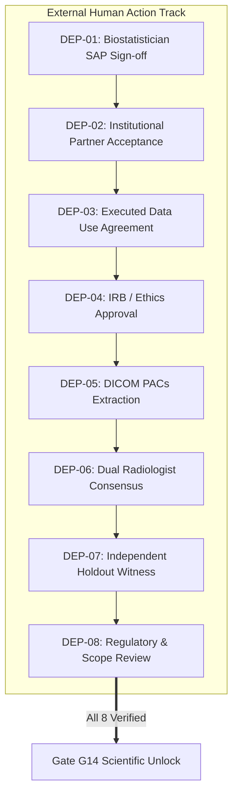

# MSK-THERAPY-OS — EXTERNAL ACTION REGISTER & BLOCKER HANDOFF
## Milestone P10.7 — Action Plan for Human Project Owner

**Document Version:** v1.0-RC-P10.7  
**Date:** 2026-10-30  
**Operating State:** `ENGINEERING_HANDOFF_COMPLETE / EXTERNAL_ACTION_REQUIRED`  
**Scientific Gate G14:** `BLOCKED_EXTERNAL_DATA` (Fail-Closed)  

---

## 1. Executive Summary: The Non-Negotiable Human Hand-off

Internal software engineering has achieved maximum achievable readiness within an offline environment. The test catalog has expanded to 757 passed tests (100%), and mathematical models, protocol freeze candidates, and partner dossiers have been assembled.

**No additional internal software development can bypass the absence of empirical clinical evidence.** Under scientific invariants and security guards in [`msk_therapy_os/external_dependency_register.py`](file:///D:/5Projects/msk-therapy-os/msk_therapy_os/external_dependency_register.py), the coding agent and software developers are barred by software exceptions (`PermissionError`) from self-certifying external requirements.

To progress MSK-Therapy-OS to empirical validation, an authorized human research coordinator must execute the eight actionable tasks outlined below.

---

## 2. Master External Dependency Tracking Register

---

### DEP-01: Independent Biostatistical Protocol Review & Sign-Off
- **Responsible External Role:** Credentialed Biostatistician (Ph.D. / M.Sc. Medical Statistics).
- **Required Evidence:** Formally signed SAP review decision form with explicit endorsement of clustering design effect and sample size scenario.
- **Current Verified Status:** `DRAFT_PREPARED / PENDING_EXTERNAL_ENGAGEMENT`.
- **Blocking Prerequisites:** Complete frozen protocol candidate [`P10_7_PROTOCOL_FREEZE_CANDIDATE.md`](file:///D:/5Projects/msk-therapy-os/1docs/audits/P10_7/P10_7_PROTOCOL_FREEZE_CANDIDATE.md) and reproduction script [`scripts/reproduce_p10_7_review_statistics.py`](file:///D:/5Projects/msk-therapy-os/scripts/reproduce_p10_7_review_statistics.py) (Supplied).
- **Next Actionable Human Step:** Transmit Dossier 1 from [`P10_7_INDEPENDENT_REVIEW_PACKAGE.md`](file:///D:/5Projects/msk-therapy-os/1docs/audits/P10_7/P10_7_INDEPENDENT_REVIEW_PACKAGE.md) to an independent academic biostatistician.
- **Due Date Policy:** Set upon biostatistician engagement contract signing (Target: 3 weeks from transmittal).
- **Expiry & Revocation:** Approvals expire after 12 months; any modification to protocol sample size revokes approval.
- **Evidence Audit Source:** `external_dependency_registry` table in `external_dependency_register.py`.

---

### DEP-02: Institutional Research Collaboration Acceptance
- **Responsible External Role:** Department Chair or Institute Director at candidate hospital (Charité, MGH, or SNUH).
- **Required Evidence:** Formal Letter of Intent (LOI) or Institutional Cooperation Memorandum on institutional letterhead.
- **Current Verified Status:** `NOT_STARTED / PROSPECTIVE_PACKAGES_PREPARED`.
- **Blocking Prerequisites:** Completion of DEP-01 (Biostatistical SAP Sign-off).
- **Next Actionable Human Step:** Human research coordinator sends customized outreach email (Section 15 of partner package) to prospective department chair.
- **Due Date Policy:** Pending initial institutional response.
- **Expiry & Revocation:** Valid for 12 months from letterhead signature.
- **Evidence Audit Source:** Stored in project legal vault with SHA-256 hash registered in SQLite.

---

### DEP-03: Executed Data Use Agreement (DUA)
- **Responsible External Role:** Hospital Legal Counsel / Technology Transfer Office.
- **Required Evidence:** Bilateral, fully executed Data Use Agreement or Material Transfer Agreement.
- **Current Verified Status:** `BLOCKED_EXTERNAL / PENDING_PARTNER_ACCEPTANCE`.
- **Blocking Prerequisites:** DEP-02 (Institutional Collaboration Acceptance).
- **Next Actionable Human Step:** Submit institutional DUA template to partner hospital legal counsel.
- **Due Date Policy:** Institutional legal review standard (typically 6–10 weeks).
- **Expiry & Revocation:** Valid for project duration specified in agreement (typically 1–2 years).
- **Evidence Audit Source:** Cryptographic digest registered in `external_dependency_registry`.

---

### DEP-04: Institutional Ethics Approval or Exemption Determination
- **Responsible External Role:** Institutional Review Board (IRB) / Independent Ethics Committee (IEC).
- **Required Evidence:** Official IRB approval certificate with protocol tracking number or formal written determination of exemption (e.g., 45 CFR § 46.104(d)(4) or BDSG § 27).
- **Current Verified Status:** `BLOCKED_EXTERNAL / PENDING_DUA`.
- **Blocking Prerequisites:** DEP-02 and DEP-03.
- **Next Actionable Human Step:** Principal Investigator submits IRB application via partner hospital's electronic submission portal.
- **Due Date Policy:** Bound by committee review cycle (typically 4–8 weeks).
- **Expiry & Revocation:** Annual continuing review required where applicable.
- **Evidence Audit Source:** Registered with `approval_certificate_id` and effective dates in SQLite.

---

### DEP-05: Authorized Imaging Data Extraction & De-Identification
- **Responsible External Role:** Hospital PACS Administrator / Clinical Research Imaging Core.
- **Required Evidence:** PACS extraction log signed by imaging core lead, verifying HIPAA Safe Harbor 18-element scrubbing and facial defacing for cranial CT.
- **Current Verified Status:** `BLOCKED_EXTERNAL / PENDING_IRB`.
- **Blocking Prerequisites:** DEP-03 and DEP-04.
- **Next Actionable Human Step:** Provide imaging core with query parameters ($N=85$, slice thickness criteria, reconstruction kernel limits).
- **Due Date Policy:** Coordinated with imaging core scheduling.
- **Expiry & Revocation:** Custody revoked upon study completion or patient revocation of authorization.
- **Evidence Audit Source:** Verified via `RealWorldIntakeController` cryptographic header audit.

---

### DEP-06: Independent Anatomical Annotations
- **Responsible External Role:** Two Independent Board-Certified Radiologists + Senior Adjudicator.
- **Required Evidence:** Calibrated DICOM coordinate CSV files signed cryptographically by each reader, accompanied by reader credentials and conflict of interest disclosures.
- **Current Verified Status:** `BLOCKED_EXTERNAL / PENDING_IMAGING_ACCESS`.
- **Blocking Prerequisites:** DEP-05 (Authorized Imaging Access).
- **Next Actionable Human Step:** Conduct reader calibration session using calibration partition ($50\%$), then initiate blinded dual annotations on tuning ($20\%$) and holdout ($30\%$) partitions.
- **Due Date Policy:** 4 weeks from image delivery.
- **Expiry & Revocation:** Immutable once consensus is locked.
- **Evidence Audit Source:** Dual reader centroid calculations and inter-observer concordance logs.

---

### DEP-07: Independent Holdout Verification & Sealing Certification
- **Responsible External Role:** Independent QA Auditor / Clinical Research Monitor.
- **Required Evidence:** Holdout Sealing Certificate witnessing that holdout subject keys and ground truth coordinates were cryptographically isolated before algorithm prediction generation.
- **Current Verified Status:** `BLOCKED_EXTERNAL / PENDING_ANNOTATIONS`.
- **Blocking Prerequisites:** DEP-06 (Consensus Annotations).
- **Next Actionable Human Step:** Research monitor oversees AES-256-GCM encryption of holdout annotations and commits key to secure escrow.
- **Due Date Policy:** Prior to algorithm execution.
- **Expiry & Revocation:** One-time unsealing ceremony; unsealing without monitor invalidates trial.
- **Evidence Audit Source:** Cryptographic HMAC-SHA-256 seal record.

---

### DEP-08: Scientific & Regulatory Scope Review
- **Responsible External Role:** Institutional Regulatory Counsel / Independent Data Safety & Monitoring Committee (DSMC).
- **Required Evidence:** Final review memorandum certifying that trial outputs adhere strictly to `ENGINEERING_RESEARCH_ONLY` boundaries and contain zero unapproved diagnostic or invasive guidance claims.
- **Current Verified Status:** `BLOCKED_EXTERNAL / PENDING_HOLDOUT_EVALUATION`.
- **Blocking Prerequisites:** DEP-01 through DEP-07.
- **Next Actionable Human Step:** Convene DSMC for final per-protocol review of unblinded error metrics.
- **Due Date Policy:** 2 weeks post-unblinding.
- **Expiry & Revocation:** Permanent scientific release certification.
- **Evidence Audit Source:** Final committee sign-off registered in SQLite.

---

## 3. Human Action Summary Table

| Action Step | Human Actor | Target Partner | Output Deliverable | Target Timeline |
| :--- | :--- | :--- | :--- | :--- |
| **Step 1** | Human PI / Coordinator | Independent CRO / Faculty Biostatistician | Executed Dossier 1 SAP Sign-Off (DEP-01) | Month 1 |
| **Step 2** | Human PI / Coordinator | Charité, MGH, or SNUH Department Chair | Signed Collaboration Letter of Intent (DEP-02) | Month 2 |
| **Step 3** | Institutional Legal Counsel | Partner Hospital Legal Counsel | Executed Bilateral DUA (DEP-03) | Month 3 |
| **Step 4** | Partner Clinical PI | Institutional Review Board (IRB / IEC) | Official Ethics Approval / Exemption (DEP-04) | Month 4 |
| **Step 5** | PACS Core Administrator | Local Hospital Imaging Archive | De-identified, Defaced DICOM Dataset (DEP-05) | Month 5 |
| **Step 6** | Certified Radiologists | Dedicated Viewing Workstation | Independent Dual Consensus CSVs (DEP-06) | Month 6 |
| **Step 7** | Independent QA Monitor | Escrow Terminal | Witnessed Holdout Sealing Certificate (DEP-07) | Month 6 |
| **Step 8** | Joint Oversight Committee | Local Compute Node | Final Per-Protocol Scientific Report (DEP-08) | Month 7 |

**Gate P705 Status:** PASS
