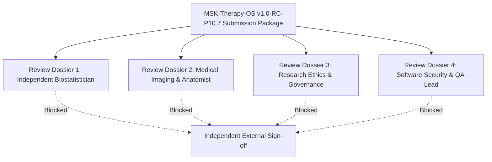

# MSK-THERAPY-OS — INDEPENDENT SCIENTIFIC REVIEW SUBMISSION PACKAGE
## Milestone P10.7 — Version v1.0-RC-P10.7

> [!IMPORTANT]
> **REVIEW NOTICE & GOVERNANCE STATUS: `PENDING_EXTERNAL_EXPERT_REVIEW`**  
> This package prepares complete, reproducible materials for four external professional reviewers. **No external review has taken place to date.** Self-certification, artificial intelligence simulation, or internal developer sign-off is strictly prohibited. All actual reviews remain blocked pending credentialed human expert engagement.

---

## Package Overview & Reviewer Structure



---

## DOSSIER 1: INDEPENDENT BIOSTATISTICAL METHODOLOGY REVIEW

### 1.1 Item Under Review
The draft Statistical Analysis Plan (SAP) within [`1docs/audits/P10_7/P10_7_PROTOCOL_FREEZE_CANDIDATE.md`](file:///D:/5Projects/msk-therapy-os/1docs/audits/P10_7/P10_7_PROTOCOL_FREEZE_CANDIDATE.md), the mathematical power oracle [`msk_therapy_os/statistical_oracle.py`](file:///D:/5Projects/msk-therapy-os/msk_therapy_os/statistical_oracle.py), and the forensic audit report [`1docs/audits/P10_7/P10_7_STATISTICAL_REPRODUCIBILITY.md`](file:///D:/5Projects/msk-therapy-os/1docs/audits/P10_7/P10_7_STATISTICAL_REPRODUCIBILITY.md).

### 1.2 Evidence Supplied
1. Protocol Freeze Manifest (SHA-256: `7a1da2a0f959ea7ab5125c37f8e996b5abec318e9d3978c3150f65a6944f3a31`).
2. Source code for design effect, effective sample size, and variance decomposition.
3. Automated offline reproduction script [`scripts/reproduce_p10_7_review_statistics.py`](file:///D:/5Projects/msk-therapy-os/scripts/reproduce_p10_7_review_statistics.py).
4. Unit test suite [`tests/test_p10_6_adversarial_statistical.py`](file:///D:/5Projects/msk-therapy-os/tests/test_p10_6_adversarial_statistical.py).

### 1.3 Reproduction Procedure
Execute on any machine running Python 3.8+ (no dependencies needed):
```bash
python scripts/reproduce_p10_7_review_statistics.py
python -m pytest tests/test_p10_6_adversarial_statistical.py -v
```

### 1.4 Required Professional Qualifications
Ph.D. or Master of Science in Biostatistics, Medical Statistics, or Quantitative Epidemiology; active academic faculty appointment or accredited clinical research organization (CRO) biostatistician credential.

### 1.5 Review Checklist
- [ ] Is the primary estimand (population mean 3D Euclidean error) unambiguously defined?
- [ ] Does the hierarchical design effect ($DE$) appropriately penalize intra-subject clustering?
- [ ] Are cluster degrees of freedom ($\text{df} = N_h - 1$) properly applied to confidence interval dilation?
- [ ] Is the distinction between asymptotic $z$-power and exact finite-sample $t$-power transparently handled?
- [ ] Are missing data handling (complete-case + MICE sensitivity) and outlier procedures methodologically sound?

### 1.6 Acceptance Criteria
Formal written verification that the SAP provides unbiased, statistically sound estimators, that sample-size assumptions are justified, and that the holdout sealing mechanism prevents data leakage.

### 1.7 Known Limitations Disclosed
Small holdout cluster counts ($N_h = 8\text{–}11$) cause substantial confidence interval dilation; exact finite-sample non-central $t$ power is $3\%\text{–}7\%$ lower than asymptotic normal power.

### 1.8 Conflict of Interest Declaration Required
The reviewer must certify zero financial, consulting, or personal ties to the project authors, repository maintainers, or sponsor organizations.

### 1.9 Required Signed Decision Form
```text
[ ] APPROVED WITHOUT AMENDMENT
[ ] APPROVED CONDITIONALLY WITH MANDATORY SAP AMENDMENTS
[ ] REJECTED (REASONS SPECIFIED IN ATTACHED MEMORANDUM)

Reviewer Name: ___________________________   Title: ___________________________
Institution:   ___________________________   Date:  ___________________________
Signature:     ___________________________
```

### 1.10 Outstanding Questions for Reviewer
1. Does the biostatistician recommend hierarchical fixed-sequence testing or Bonferroni adjustment for primary family-wise error control across the three cohorts?
2. In Cohort B (Knee MRI), does the reviewer recommend increasing sample size from $N=85$ to $N=115$ prior to primary pilot activation?

---

## DOSSIER 2: MEDICAL IMAGING & ANATOMICAL SPECIALIST REVIEW

### 2.1 Item Under Review
The anatomical landmark specifications, modality slice thickness limits, imaging inclusion/exclusion criteria, and dual-radiologist consensus procedure in [`P10_7_PROTOCOL_FREEZE_CANDIDATE.md`](file:///D:/5Projects/msk-therapy-os/1docs/audits/P10_7/P10_7_PROTOCOL_FREEZE_CANDIDATE.md#2-anatomical-landmark-definitions).

### 2.2 Evidence Supplied
1. Coordinate reference frames in DICOM LPS (Left-Posterior-Superior) system.
2. Anatomic definitions for all 17 landmarks across Cohorts A, B, and C.
3. Slice thickness ceilings ($\le 1.25\text{ mm}$ for Head CT, $\le 3.0\text{ mm}$ for Knee MRI).
4. Dual-radiologist consensus threshold specifications ($2.0\text{ mm}$ CT, $2.5\text{ mm}$ MRI).

### 2.3 Reproduction Procedure
Inspect anatomical definitions against standard radiological atlases (e.g., Netter, Gray's Anatomy, ACR imaging standards).

### 2.4 Required Professional Qualifications
Board-certified Musculoskeletal Radiologist (MD/DO/FRCR/equivalent) or University Professor of Clinical Gross Anatomy.

### 2.5 Review Checklist
- [ ] Are osseous and soft-tissue landmarks identifiable with high inter-observer concordance on standard clinical scans?
- [ ] Are slice thickness and FOV constraints clinically achievable across standard hospital PACS equipment?
- [ ] Is the exclusion threshold for severe metal artifacts, osteolysis, or joint deformities appropriate?
- [ ] Is the distinction between direct physical landmarks and computationally inferred acupoints clinically transparent?

### 2.6 Acceptance Criteria
Clinical sign-off that the landmark definitions are robust, unambiguous, and clinically representative of standard radiological practice.

### 2.7 Known Limitations Disclosed
Standard clinical scans do not image traditional meridians; anatomical landmarks are solely surrogates for spatial registration.

### 2.8 Conflict of Interest Declaration Required
Zero affiliation with the development team.

### 2.9 Required Signed Decision Form
```text
[ ] APPROVED AS CLINICALLY SOUND
[ ] APPROVED WITH LANDMARK REVISIONS
[ ] REJECTED AS CLINICALLY UNVIABLE

Reviewer Name: ___________________________   Medical License #: _______________
Hospital:      ___________________________   Date:              _______________
Signature:     ___________________________
```

### 2.10 Outstanding Questions for Reviewer
1. Are the proposed inter-observer concordance thresholds ($2.0\text{ mm}$ for CT, $2.5\text{ mm}$ for MRI) realistic for multi-reader routine workflow?
2. For Cohort C (Upper Extremity), should distal tendon insertion points be restricted to high-field 3T MRI?

---

## DOSSIER 3: RESEARCH ETHICS & DATA GOVERNANCE REVIEW

### 3.1 Item Under Review
The multi-site governance engine [`msk_therapy_os/multi_site_governance.py`](file:///D:/5Projects/msk-therapy-os/msk_therapy_os/multi_site_governance.py), de-identification requirements, institutional onboarding workflow [`msk_therapy_os/partner_onboarding.py`](file:///D:/5Projects/msk-therapy-os/msk_therapy_os/partner_onboarding.py), and research contracts [`msk_therapy_os/research_contracts.py`](file:///D:/5Projects/msk-therapy-os/msk_therapy_os/research_contracts.py).

### 3.2 Evidence Supplied
1. HIPAA Safe Harbor 18-identifier stripping specifications (45 CFR § 164.514(b)(2)).
2. EU GDPR Article 89 pseudonymization and research exemption compliance protocols.
3. Air-gapped on-premise execution architecture (zero cloud data egress).
4. Immutable SQLite governance audit logs.

### 3.3 Reproduction Procedure
Inspect de-identification rules and automated verification tests in [`tests/test_p10_4b_real_world_intake.py`](file:///D:/5Projects/msk-therapy-os/tests/test_p10_4b_real_world_intake.py).

### 3.4 Required Professional Qualifications
Institutional Review Board (IRB) / Independent Ethics Committee (IEC) Chair or Institutional Data Protection Officer (DPO / CISO).

### 3.5 Review Checklist
- [ ] Are all direct patient identifiers guaranteed to be stripped prior to processing?
- [ ] Is data custody strictly confined to local air-gapped hospital infrastructure?
- [ ] Are procedures for informed consent waiver or retrospective research determination clearly structured?
- [ ] Is the data retention and secure destruction policy compliant with local regulatory law?

### 3.6 Acceptance Criteria
Formal ethical determination that retrospective de-identified imaging secondary use complies with human subject protection regulations.

### 3.7 Known Limitations Disclosed
Software does not provide automated DICOM face defacing; craniomaxillofacial CT scans require hospital-side defacing prior to transfer.

### 3.8 Conflict of Interest Declaration Required
Zero consulting or commercial interest in MSK-Therapy-OS software.

### 3.9 Required Signed Decision Form
```text
[ ] ETHICALLY DETERMINED: EXEMPT / EXPEDITED RETROSPECTIVE RESEARCH
[ ] FULL ETHICS BOARD REVIEW REQUIRED
[ ] REJECTED / NON-COMPLIANT

Reviewer Name: ___________________________   IRB / Committee ID: ______________
Institution:   ___________________________   Date:               ______________
Signature:     ___________________________
```

### 3.10 Outstanding Questions for Reviewer
1. Does the ethics committee require explicit patient opt-out notices for de-identified secondary use at the partner site?
2. Are bilateral Data Use Agreements (DUA) sufficient, or is a formal Material Transfer Agreement (MTA) required?

---

## DOSSIER 4: SOFTWARE SECURITY & INDEPENDENT QA REVIEW

### 4.1 Item Under Review
The entire offline execution harness, anti-self-certification guards in [`msk_therapy_os/external_dependency_register.py`](file:///D:/5Projects/msk-therapy-os/msk_therapy_os/external_dependency_register.py), Scientific Gate G14 fail-closed architecture, and regression test catalog.

### 4.2 Evidence Supplied
1. 757 passed regression and E2E tests (739 non-playwright + 18 Playwright).
2. Codebase static analysis and invariant guards.
3. Anti-self-certification exception raising (`PermissionError`).
4. Visual proof artifacts in `2data/evidence/`.

### 4.3 Reproduction Procedure
Run full test catalog:
```powershell
python -m pytest -m "not playwright" -q
python -m pytest tests/test_p10_6_playwright.py -v
```

### 4.4 Required Professional Qualifications
Lead Software Quality Assurance Engineer, Medical Device Software Auditor (IEC 62304 / ISO 13485 auditor), or Certified Information Systems Security Professional (CISSP).

### 4.5 Review Checklist
- [ ] Are safety invariants (zero needle depth guidance, zero autonomous diagnosis) verifiably enforced?
- [ ] Does Gate G14 remain strictly fail-closed (`BLOCKED_EXTERNAL_DATA`) in all runtime configurations?
- [ ] Are developer or agent self-certifications completely rejected by security guards?
- [ ] Is the test coverage reproducible across independent clean environments?

### 4.6 Acceptance Criteria
Verification that the software architecture enforces research boundaries and prevents unauthorized medical claims.

### 4.7 Known Limitations Disclosed
Local SQLite database requires file system access permissions; single-threaded HTTP development server suitable for research pilot, not high-concurrency public cloud.

### 4.8 Conflict of Interest Declaration Required
Independent software auditor with zero equity or development involvement in MSK-Therapy-OS.

### 4.9 Required Signed Decision Form
```text
[ ] SOFTWARE RELEASE SAFETY VERIFIED
[ ] CONDITIONAL VERIFICATION (MINOR NON-CRITICAL FINDINGS)
[ ] FAILED AUDIT / CRITICAL SECURITY DEFECT FOUND

Auditor Name: ___________________________   Credential / Cert: _______________
Firm / Org:   ___________________________   Date:              _______________
Signature:    ___________________________
```

### 4.10 Outstanding Questions for Reviewer
1. Does the software architecture satisfy requirements for IEC 62304 Class A/B research software demarcation?
2. Are additional automated fuzzing tests needed for malformed DICOM header intake?
