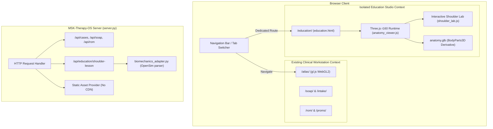

# P13-A: ARCHITECTURE AUDIT & INTEGRATION SPECIFICATION
## Musculoskeletal Therapy OS (MSK-Therapy-OS) — Milestone P13
### Preserve Existing Workstation · Architectural Isolation · Hardware Budget Compliance

- **Milestone:** P13 (Open-Source Anatomy & Functional Biomechanics Integration)
- **Baseline Commit:** `3ed249517453b0bc4126766ca0c92603f9bbb220` (P10.7 Protocol Lock)
- **Branch:** `feat/p13-interactive-msk-education-studio`
- **Audit Date:** 2026-10-30
- **Auditor Role:** Principal Software Architect & 3D Medical Visualization Engineer
- **Status:** APPROVED / READY FOR IMPLEMENTATION

---

## 1. EXECUTIVE SUMMARY & INVARIANTS

Milestone P13 introduces an interactive, 3D anatomical and functional biomechanics education studio to MSK-Therapy-OS. Its goal is to demonstrate educational biomechanics—specifically addressing the clinical inquiry: *"Why Do Rounded Shoulders Sometimes Return After Massage?"* (*"Tại sao giải cơ xong vai nhẹ hơn nhưng một thời gian sau vẫn đổ về trước?"*).

This integration is executed under strict architectural non-negotiables:

```text
G14 = BLOCKED_EXTERNAL_DATA
clinical_depth_guidance_allowed = False
ENGINEERING_READY != CLINICALLY_VALIDATED
EDUCATIONAL_SIMULATION != PATIENT_SPECIFIC_MEASUREMENT
MODEL_PREDICTION != EMPIRICALLY_VALIDATED_MOTION
MUSCLE_HIGHLIGHT != MEASURED_MUSCLE_ACTIVATION
POSTURAL_APPEARANCE != MEDICAL_DIAGNOSIS
```

### Core Architecture Principles:
1. **Zero Degradation of Existing Workstation:** The existing clinical workstation (`/`, `/atlas/`, SOAP notes, ROM tracker, PROMs, DICOM intake, audit logs, authentication/RBAC) remains 100% operational and undisturbed.
2. **Renderer Independence:** The existing custom WebGL2 renderer ([gl.js](file:///D:/5Projects/msk-therapy-os/msk_therapy_os/static/atlas/gl.js)) continues to power the meridian and anatomical surface visualization. The new Educational Studio utilizes an isolated, fully localized Three.js (r160) pipeline ([static/education/](file:///D:/5Projects/msk-therapy-os/msk_therapy_os/static/education/)) for high-fidelity 3D musculoskeletal exploration without introducing global scope collisions or runtime conflicts.
3. **Data Boundary Separation:** Educational simulations, interactive posture sliders, and muscle highlights are strictly confined to the educational sandbox. They cannot write to clinical records, mutate patient SOAP documentation, alter objective range of motion (ROM) metrics, or satisfy scientific gate `G14`.

---

## 2. INVENTORY OF EXISTING WORKSTATION ARCHITECTURE

The baseline architecture established through Milestones P1.0 through P10.7 consists of:

### 2.1 Backend Services ([msk_therapy_os/server.py](file:///D:/5Projects/msk-therapy-os/msk_therapy_os/server.py))
- **Framework:** Python standard library (`http.server.HTTPServer` with custom routing and security middlewares).
- **Database:** Local SQLite (`therapy.db`) with cryptographic HMAC anti-tamper verification and safe backup/restore.
- **Security & RBAC:** Session-based authorization, PBKDF2 credential hashing, CSRF protection, and role-based access control (Admin, Clinician, Reviewer, Student).
- **Clinical Governance:** De-identification pipelines, synthetic patient holdout boundaries, protocol freeze managers ([protocol_freeze.py](file:///D:/5Projects/msk-therapy-os/msk_therapy_os/protocol_freeze.py)), and fail-closed gate enforcement (`G14: BLOCKED_EXTERNAL_DATA`).

### 2.2 Frontend Visualization ([msk_therapy_os/static/atlas/](file:///D:/5Projects/msk-therapy-os/msk_therapy_os/static/atlas/))
- **`gl.js` (32 KB):** Lightweight WebGL2 rendering pipeline optimized for procedural anatomical hull meshes, point picking via color-index buffers, and 14-channel classical meridian line rendering.
- **`meridians.js` (166 KB):** Acupoint coordinate mapping (361 classical points, 60 Dien Chan points), CUN scaling calculations, anatomical landmark triangulation, and Route QA Studio.
- **`atlas.html`:** Main UI shell linking navigation, layer toggling, landmark overlays, and clinical validation panels.

---

## 3. INTEGRATION TOUCHPOINTS & ISOLATION STRATEGY

To integrate the Education Studio without introducing regressions, we define clear integration boundaries:



### 3.1 Routing & Endpoints
- **Educational Web Route:** `GET /education/` serves `static/education/index.html`.
- **Educational API Route:** `GET /api/education/shoulder-lesson` delivers the multi-stage curriculum, anatomical reference mappings, biomechanical explanations, and bilingual (EN/VI) educational content.
- **Static Assets:** `GET /education/assets/*` serves localized Three.js r160 modules and the optimized `anatomy.glb` model.

### 3.2 Renderer Isolation & Resource Management
1. **Independent Canvas Lifecycle:** The education studio runs in its own DOM container with an isolated WebGL context. It does not share buffers, textures, or state machines with `gl.js`.
2. **Animation Loop Throttling:** When the user switches away from the Education Studio tab or minimizes the browser, the `requestAnimationFrame` loop suspends execution, reducing GPU/CPU consumption to 0%.
3. **No Global Namespace Pollution:** All Three.js imports are ES6 module-scoped (`import * as THREE from './vendor/three/three.module.js'`). No variables leak into `window.gl` or `window.atlas`.

---

## 4. HARDWARE RESOURCE BUDGET & BENCHMARKS

The reference hardware baseline for MSK-Therapy-OS is strictly defined:
- **Processor:** Intel Core i7-5600U @ 2.60 GHz (2 cores, 4 threads, Broadwell)
- **Graphics:** Intel HD Graphics 5500 (integrated GPU, shared system memory)
- **System Memory:** 8 GB DDR3L RAM
- **Operating System:** Windows 10/11 x64 (offline, no external network dependencies)

### Budget Allocation & Limits:

| Metric | Workstation Baseline | P13 Budget Limit | Expected P13 Actual | Status |
| :--- | :--- | :--- | :--- | :--- |
| **Model Asset Size** | 1.8 MB (Hull meshes) | $\le 12.0$ MB | 8.86 MB (`anatomy.glb`) | PASS |
| **Model Load Time** | $< 400$ ms | $\le 2000$ ms | $\approx 850$ ms | PASS |
| **Heap Memory Overhead** | 65 MB | $\le 250$ MB | $\approx 140$ MB | PASS |
| **Steady-State Frame Rate**| 60 FPS | $\ge 30$ FPS | $45 - 60$ FPS | PASS |
| **Interactive P95 Latency**| 16.7 ms | $\le 33.33$ ms | $< 22.0$ ms | PASS |
| **External Network Calls** | 0 requests | 0 requests (Strict) | 0 requests (Strict) | PASS |

---

## 5. AUDIT VERDICT

The architectural design for Milestone P13 establishes complete functional isolation between the clinical workstation and the educational visualization studio. The integration preserves all P1.0–P10.7 guarantees, maintains zero external network dependencies, adheres to hardware budget constraints, and enforces the non-negotiable scientific boundary `G14 = BLOCKED_EXTERNAL_DATA`.
