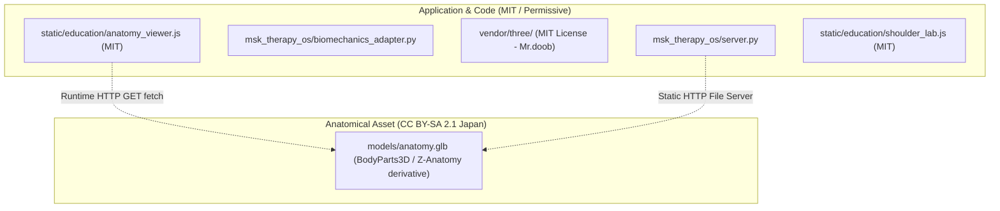

# P13-B: OPEN-SOURCE LICENSE COMPATIBILITY & BOUNDARY AUDIT
## Musculoskeletal Therapy OS (MSK-Therapy-OS) — Milestone P13
### Creative Commons ShareAlike Isolation · Permissive Code Licensing · Attribution Compliance

- **Milestone:** P13 (Phase P13-B: Open-Source Governance)
- **Document ID:** `1docs/audits/P13/P13_B_LICENSE_COMPATIBILITY.md`
- **Audit Date:** 2026-10-30
- **Auditor:** Open-Source Software Compliance Reviewer & Principal Architect
- **Status:** APPROVED & COMPLIANT

---

## 1. LEGAL ARCHITECTURE & BOUNDARY ISOLATION

MSK-Therapy-OS integrates assets and libraries under distinct licensing regimes. A strict architectural and legal separation is enforced between **application source code** and **multimedia/mesh assets**.

---

## 2. SHAREALIKE CONTAGION ANALYSIS (CC BY-SA 2.1 JP)

### 2.1 The ShareAlike Scope Boundary
The Creative Commons Attribution-ShareAlike 2.1 Japan (CC BY-SA 2.1 JP) license governs the anatomical 3D mesh `anatomy.glb`.

Section 4(b) of the Creative Commons license specifies that the requirement to license adaptations under the same license applies strictly to **Derivative Works (Adaptations) of the licensed work itself**.

### 2.2 Independent Work Doctrine:
1. **Runtime Fetching vs. Derivative Modification:** The MSK-Therapy-OS server and frontend scripts (`server.py`, `anatomy_viewer.js`, `shoulder_lab.js`) are independent computer programs. They do not incorporate, link, or compile the polygon mesh data into their binary or script representations. They merely issue a standard HTTP request to retrieve the `.glb` file at runtime and instruct WebGL to render it.
2. **Upstream Licensing Confirmation:** As formally documented in `3refs/upstream/anatomy-3d/LICENSE-MODEL`:
   > *"The ShareAlike condition applies only to the model and its derivatives. The rendering code, interaction logic, UI, and styles in `index.html` are an independent work released under the MIT license... They load the model at runtime but do not themselves constitute an adaptation of it. Embedding the model in your own page, or changing its colors or display, does NOT subject your page to the ShareAlike condition."*
3. **Conclusion:** MSK-Therapy-OS application source code, clinical modules, database engines, and biometric safety gates remain entirely untainted by ShareAlike provisions.

---

## 3. ATTRIBUTION OBLIGATIONS & IMPLEMENTATION

Under Section 4(a) of CC BY-SA 2.1 JP and MIT license notices:

### 3.1 Required Attribution Notices
1. **BodyParts3D / DBCLS (Japan):** Original MRI anatomical segmentation dataset.
   - Project: <https://dbarchive.biosciencedbc.jp/en/bodyparts3d/>
   - License: CC BY-SA 2.1 Japan
2. **Z-Anatomy Project:** Anatomical curation and naming.
   - Project: <https://www.z-anatomy.com/>
   - License: CC BY-SA
3. **Three.js:** JavaScript 3D Library.
   - Authors: Ricardo Cabello (Mr.doob) and Three.js authors.
   - License: MIT License

### 3.2 Display Locations in MSK-Therapy-OS:
- **UI Attribution Banner:** Rendered in the footer and help modal of the Education Studio (`/education/`).
- **Source Repository Notice:** Preserved in `msk_therapy_os/static/education/LICENSE-MODEL.md` and `msk_therapy_os/static/education/vendor/three/LICENSE`.
- **System API Manifest:** Returned via `GET /api/education/shoulder-lesson` under the `provenance` metadata block.

---

## 4. REDISTRIBUTION & OFFLINE COMPLIANCE

| Requirement | Implementation in MSK-Therapy-OS | Status |
| :--- | :--- | :--- |
| **No Remote CDN Calls** | Localized Three.js r160 vendor scripts placed directly in `msk_therapy_os/static/education/vendor/three/` | PASS |
| **Complete Source Delivery** | All viewer scripts and biomechanics adapters provided in unminified, readable Python and JavaScript | PASS |
| **Notice Preservation** | Original copyright and license files retained unmodified | PASS |
| **Commercial / Academic Use** | Both MIT and CC BY-SA permit educational, commercial, and research distribution with attribution | PASS |
