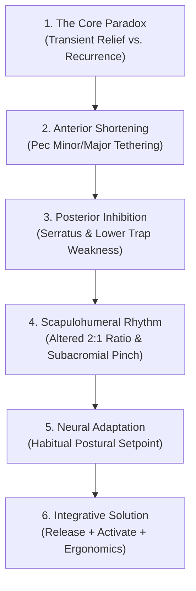

# P13-E: INTERACTIVE SHOULDER & POSTURE EDUCATION CURRICULUM
## Musculoskeletal Therapy OS (MSK-Therapy-OS) — Milestone P13
### "Why Do Rounded Shoulders Sometimes Return After Massage?" · 6 Educational Modules · Bilingual Syllabus

- **Milestone:** P13 (Phase P13-E: Educational Curriculum & Interactive Lab)
- **Document ID:** `1docs/audits/P13/P13_E_SHOULDER_LESSON.md`
- **Frontend Controller:** [`msk_therapy_os/static/education/shoulder_lab.js`](file:///D:/5Projects/msk-therapy-os/msk_therapy_os/static/education/shoulder_lab.js)
- **Audit Date:** 2026-10-30
- **Auditor:** Musculoskeletal Biomechanics Integration Engineer & Clinical Education Specialist
- **Status:** APPROVED & INTEGRATED

---

## 1. INQUIRY STATEMENT & PEDAGOGICAL MISSION

### Clinical Inquiry:
> **English:** *"Why do rounded shoulders sometimes return after massage?"*
> **Vietnamese:** *"Tại sao giải cơ xong vai nhẹ hơn nhưng một thời gian sau vẫn đổ về trước?"*

This clinical question is one of the most frequent dilemmas encountered by physical therapy patients, desk workers, and bodywork clients. Milestone P13 provides an interactive, evidence-grounded educational exploration that answers this paradox through anatomy, scapulothoracic kinematics, reciprocal inhibition, and central nervous system adaptation.

---

## 2. THE 6-MODULE EDUCATIONAL SYLLABUS

---

### Module 1: The Core Paradox (Nghịch lý cốt lõi)
- **English Concept:** Massage and passive myofascial therapy provide immediate sensation of lightness by stimulating cutaneous and muscular mechanoreceptors (Ruffini endings, Pacinian corpuscles) and transiently reducing muscle spindle gain. However, this neurological reset is temporary if the mechanical resting length and reciprocal coordination remain unaddressed.
- **Vietnamese Concept:** Giải cơ bằng tay kích thích các thụ thể cơ học, làm giảm xung động thần kinh từ thoi cơ và tăng lưu thông máu cục bộ, tạo cảm giác nhẹ nhõm tức thì. Tuy nhiên, nếu chiều dài nghỉ của cơ và sự phối hợp đối vận không được thay đổi, hiệu quả chỉ kéo dài vài giờ đến vài ngày.
- **Anatomical Focus:** `pectoralis_minor`, `trapezius_upper`, `levator_scapulae`.

---

### Module 2: Anterior Shortening (Sự co ngắn phía trước)
- **English Concept:** Prolonged desk work (keyboarding, driving, phone usage) holds the pectoralis minor in a chronologically shortened position. Because it inserts onto the coracoid process of the scapula, adaptive shortening tethers the scapula forward (protraction) and downward (anterior tilt), physically pulling the shoulder girdle into an anterior posture.
- **Vietnamese Concept:** Tư thế ngồi làm việc cúi gập liên tục giữ cơ ngực bé ở trạng thái co ngắn kéo dài. Do bám vào mỏm quạ xương bả vai, sự co ngắn cơ học này kéo xương bả vai chúc về phía trước và xuống dưới, tạo thành hình thái vai đổ trước kinh điển.
- **Anatomical Focus:** `pectoralis_minor`, `pectoralis_major`, `deltoid_anterior`.

---

### Module 3: Posterior Functional Inhibition (Sự ức chế cơ mặt sau)
- **English Concept:** Under Sherrington's law of reciprocal inhibition, chronic hypertonicity of anterior pectorals sends inhibitory neurological signals to their antagonists: the middle/lower trapezius and serratus anterior. These posterior stabilizers become "functionally amnesic" and lengthened, losing their ability to hold the scapula flat against the thoracic wall.
- **Vietnamese Concept:** Theo quy luật ức chế tương hỗ, sự co thắt mạn tính của nhóm cơ ngực trước gửi tín hiệu ức chế thần kinh tới nhóm cơ đối kháng ở lưng: cơ thang giữa, cơ thang dưới và cơ răng trước. Hậu quả là các cơ ổn định mặt sau bị yếu chức năng và mất khả năng giữ xương bả vai áp sát lồng ngực.
- **Anatomical Focus:** `serratus_anterior`, `trapezius_lower`, `rhomboid_major`.

---

### Module 4: Scapulohumeral Rhythm & Subacromial Space (Nhịp bả vai - cánh tay & Khoang dưới mỏm cùng vai)
- **English Concept:** A healthy shoulder relies on a 2:1 scapulohumeral rhythm during arm elevation (for every 2° of glenohumeral elevation, the scapula must upwardly rotate 1°). In rounded shoulders, reduced scapular upward rotation and excessive anterior tilt decrease subacromial clearance, increasing the risk of rotator cuff impingement.
- **Vietnamese Concept:** Khớp vai khỏe mạnh đòi hỏi nhịp bả vai - cánh tay chuẩn tỷ lệ 2:1 khi nâng tay. Ở người vai đổ trước, xương bả vai giảm khả năng xoay lên và tăng độ nghiêng trước, làm hẹp khoang dưới mỏm cùng vai và dễ gây viêm chèn ép gân cơ chóp xoay.
- **Anatomical Focus:** `deltoid_lateral`, `supraspinatus`, `infraspinatus`.

---

### Module 5: Neural Adaptation & Proprioceptive Drift (Thích nghi thần kinh & Lệch cảm thụ bản thể)
- **English Concept:** The central nervous system constructs its postural schema based on prevailing sensory feedback. After years of forward slump, the brain accepts the protracted shoulder position as the "natural neutral setpoint." When a therapist manually moves the shoulder into upright posture, the patient often perceives it as "unnatural" or "tense" because the neural setpoint has drifted.
- **Vietnamese Concept:** Não bộ hình thành bản đồ cảm thụ bản thể dựa trên vị trí thường xuyên nhất. Sau nhiều năm gù vai, hệ thần kinh định nghĩa tư thế đổ trước là "vị trí trung tính bình thường". Khi kỹ thuật viên kéo vai về đúng trục, người bệnh thường cảm thấy "gượng gạo" do điểm tham chiếu thần kinh trung ương đã bị lệch.
- **Anatomical Focus:** `trapezius_middle`, `rhomboid_minor`, `latissimus_dorsi`.

---

### Module 6: The Integrative Solution (Giải pháp tích hợp đa phương thức)
- **English Concept:** Sustainable postural change requires a tripartite clinical framework:
  1. *De-toning:* Myofascial release of tight anterior structures (pectoralis minor/major, subclavius).
  2. *Activation:* Neuromuscular re-education and progressive strengthening of posterior upward rotators (serratus anterior, lower trapezius).
  3. *Ergonomics & Somatic Awareness:* Workspace adjustments (monitor height, arm support) and conscious posture interruption drills.
- **Vietnamese Concept:** Khắc phục bền vững đòi hỏi kiềng 3 chân:
  1. *Giải phóng cơ:* Thả lỏng mạc cơ nhóm cơ ngực co ngắn (cơ ngực bé, ngực lớn, dưới đòn).
  2. *Kích hoạt thần kinh - cơ:* Tập mạnh có chủ đích nhóm cơ xoay lên và kéo bả vai (cơ răng trước, cơ thang dưới).
  3. *Công thái học & Nhận thức thân thể:* Nâng cao màn hình làm việc, kê đỡ khuỷu tay và duy trì các quãng nghỉ vận động ngắn trong ngày.
- **Anatomical Focus:** `pectoralis_minor`, `trapezius_lower`, `serratus_anterior`.

---

## 3. INTERACTIVE SIMULATOR SPECIFICATION

In [`shoulder_lab.js`](file:///D:/5Projects/msk-therapy-os/msk_therapy_os/static/education/shoulder_lab.js), the user adjusts the **Posture Severity Slider** ($0\%$ to $100\%$), which dynamically updates:
- **Scapular Protraction Angle:** $15.0^\circ \longrightarrow 43.0^\circ$
- **Scapular Anterior Tilt Angle:** $10.0^\circ \longrightarrow 32.0^\circ$
- **Scapular Upward Rotation Capacity:** $16.0^\circ \longrightarrow 2.0^\circ$
- **Scapulohumeral Rhythm Ratio:** $2.0:1 \longrightarrow >3.5:1$
- **Reciprocal Balance Score:** $100/100 \longrightarrow 10/100$

All calculations strictly cite established literature (Inman 1944, Ludewig 2000, Borstad 2005) and display non-negotiable educational disclaimers.
