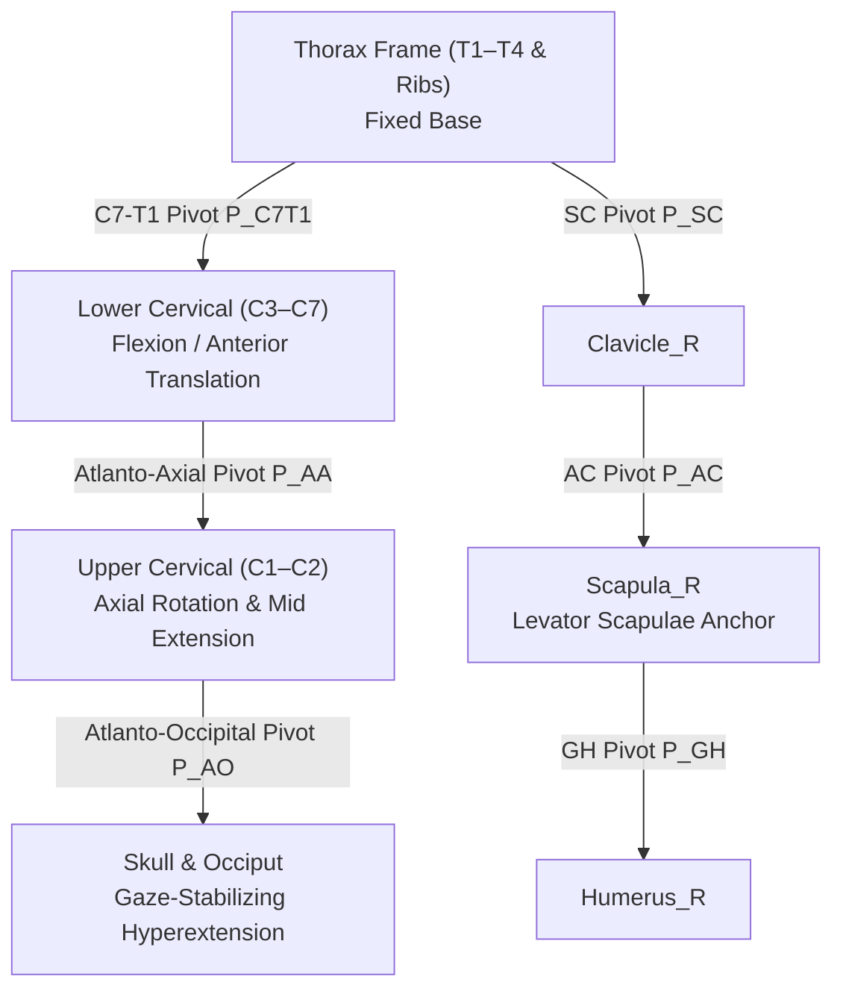

# P15 Cervical Kinematic Hierarchy & Forward Head Posture Mechanics

**Milestone:** P15 — Cervicothoracic Biomechanics, Forward Head Posture & Upper Crossed Syndrome Studio  
**Date:** October 31, 2026  
**Auditor / Architect:** Musculoskeletal Biomechanics Engineer & 3D Kinematics Specialist  
**Document ID:** `1docs/audits/P15/P15_CERVICAL_KINEMATIC_CHAIN.md`  
**Status:** VALIDATED  

---

## 1. Multi-Body Joint Pivot Topology

The Three.js scene graph articulates the spine through a three-pivot forward kinematic chain anchored to the fixed thoracic frame:

### Pivot Coordinates in Meters (BodyParts3D Coordinate Space):
1. **$P_{\text{C7T1}}$ (Cervicothoracic Junction):** $(-0.001, 1.448, -0.046)\text{ m}$
2. **$P_{\text{AA}}$ (Atlanto-Axial Pivot):** $(-0.001, 1.542, -0.037)\text{ m}$
3. **$P_{\text{AO}}$ (Atlanto-Occipital Pivot):** $(-0.001, 1.556, -0.036)\text{ m}$
4. **$P_{\text{SC}}$ (Sternoclavicular Joint):** $(-0.018, 1.405, 0.038)\text{ m}$
5. **$P_{\text{AC}}$ (Acromioclavicular Joint):** $(-0.142, 1.415, -0.025)\text{ m}$
6. **$P_{\text{GH}}$ (Glenohumeral Joint Center):** $(-0.165, 1.395, -0.020)\text{ m}$

---

## 2. Coupled Kinematics of Forward Head Posture (FHP)

In healthy upright posture, the Craniovertebral Angle (CVA) is approximately $53^\circ$, maintaining the head's center of gravity close to the cervical articular pillar with minimal gravitational moment arm ($d \approx 2.5\text{ cm}$).

During sustained forward head migration:
1. **Lower Cervical Flexion:** The lower cervical column (C3–C7) tilts anteriorly ($\theta_{\text{lower}} \approx +26^\circ$), creating shear forces on the C5–C6 and C6–C7 discs.
2. **Upper Cervical Hyperextension:** To maintain horizontal gaze and visual horizon, the suboccipital and atlanto-occipital complex must rotate posteriorly ($\theta_{\text{upper}} \approx -18^\circ$).
3. **Moment Arm Dilation:** The anterior translation of head center of mass increases the gravitational moment arm from $2.5\text{ cm}$ to $7.0+\text{ cm}$, escalating the required extensor holding force from $36\text{ N}$ to over $100\text{ N}$ (Panjabi 1992, Vasavada 1998, Yip 2008).
