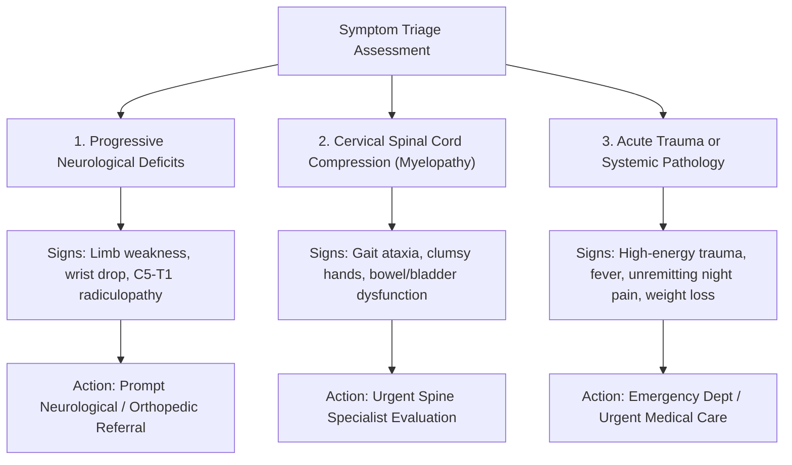

# P16 Audit: Educational Content & Clinical Safety Review

**Milestone:** P16 — Scientific Biomechanics Integrity, Muscle Mechanics & Interactive Self-Education Studio  
**Date:** 2026-10-31  
**Status:** AUDITED AND CERTIFIED  
**Repository:** `D:\5Projects\msk-therapy-os`  
**Classification:** `ENGINEERING_RESEARCH_ONLY`  
**Gate G14 Status:** `BLOCKED_EXTERNAL_DATA`

---

## 1. Unified 10-Topic Educational Curriculum

Milestone P16 establishes a comprehensive, bilingual (English / Vietnamese) 10-topic musculoskeletal education curriculum unifying the shoulder girdle, cervical spine, and thoracic junction into a coherent narrative:

1. **Anatomy: Head, Neck & Shoulder Girdle Architecture**
   - 3D osseous anatomy: Cranium, C1–C7, T1–T4, Clavicle, Scapula, Humerus.
   - The ~5 kg skull balancing atop cervical facets and coupling to the thorax via the floating scapulothoracic articulation.
2. **Joint Motion: Scapular & Cervical Kinematics**
   - Coordinated multi-segment rhythm: 2:1 scapulohumeral rhythm during arm elevation; upper cervical vs lower cervical gliding.
3. **Alignment: Forward-Head & Postural Diversity**
   - Craniovertebral Angle (CVA), natural variation across asymptomatic populations. Rejection of posture as an autonomous pathology.
4. **Physics: Gravity, Moment Arms & Equilibrium**
   - Disambiguation of $W_{\text{head}}$, $d_{\text{horizontal}}$, $M_{\text{gravity}}$, $r_{\text{eff}}$, $F_{\text{extensor}}$, and $R_{\text{comp}}$.
5. **Muscle Roles: Deep Stabilizers vs Global Movers**
   - Contrast between deep stabilizers (Longus Colli, Longus Capitis, Serratus Anterior) and superficial global movers (Upper Trapezius, SCM, Pec Minor).
6. **The Massage Paradox: Why Relief is Often Temporary**
   - Manual therapy stimulates mechanoreceptors providing transient neurophysiological modulation; lasting motor patterning requires active movement re-education.
7. **Motor Control: Muscle Inhibition & Neuromuscular Re-Education**
   - Janda Upper Crossed Syndrome framed as a conceptual model; active motor retraining (craniocervical flexion test protocol).
8. **Movement Exploration: Dynamic Arm Elevation & Neck Turning**
   - Active range of motion exploration without provoking nociceptive fear avoidance.
9. **Daily Habits: Breaks, Ergonomics & Variable Postures**
   - Ergonomic awareness; debunking the "single perfect posture" myth in favor of movement variability.
10. **Evidence & Critical Thinking: Biomechanics in Perspective**
    - Biopsychosocial context; separating biomechanical heuristics from medical diagnoses.

---

## 2. Red Flags Safety Triage System

To prevent users with serious spinal or systemic conditions from engaging in inappropriate self-care, P16 implements three explicit red-flag categories ([`#red-flags-card`](file:///D:/5Projects/msk-therapy-os/msk_therapy_os/static/education/index.html)):

---

## 3. Five-Question Comprehension Quiz

A bilingual interactive quiz tests conceptual understanding:
1. **Q1 (Physics of Forward Head):** Why extensor load surges with anterior translation (moment arm increases).
2. **Q2 (Scapulohumeral Rhythm):** Significance of 2:1 scapular upward rotation during arm elevation.
3. **Q3 (Massage Paradox):** Neurophysiological mechanoreceptor stimulation vs active motor control.
4. **Q4 (Upper Crossed Syndrome):** Epistemological qualification as a conceptual model, not a deterministic diagnosis.
5. **Q5 (Red Flags):** Immediate recognition of progressive neurological deficit requiring prompt medical evaluation.
