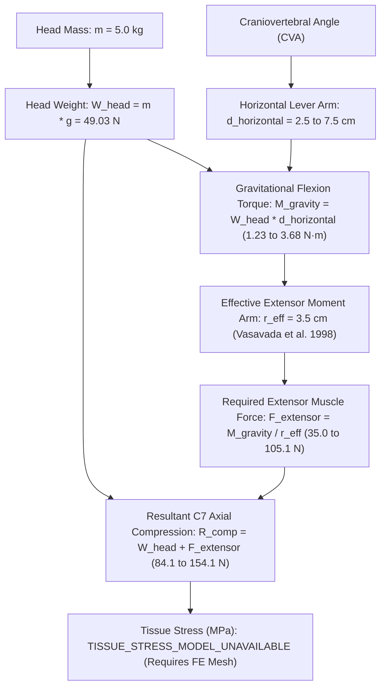

# P16 Audit: Scientific Claim Forensics & Disambiguation

**Milestone:** P16 — Scientific Biomechanics Integrity, Muscle Mechanics & Interactive Self-Education Studio  
**Date:** 2026-10-31  
**Status:** AUDITED AND CERTIFIED  
**Repository:** `D:\5Projects\msk-therapy-os`  
**Classification:** `ENGINEERING_RESEARCH_ONLY`  
**Gate G14 Status:** `BLOCKED_EXTERNAL_DATA`  
**Clinical Validation Status:** `NOT_ESTABLISHED`

---

## 1. Executive Summary

Milestone P16 was initiated to eliminate scientific conflations, overstatements, and unverified clinical assertions that had accumulated in biomechanics simulation modules across prior development cycles. Specifically, four major scientific integrity boundaries required rigorous rectification:

1. **Separation of Physical Quantities in Gravitational Cervical Mechanics:**
   - Previous versions loosely described "head load" or "effective weight" multiplying scalar ratios, creating ambiguity between force ($\text{N}$), torque ($\text{N}\cdot\text{m}$), and stress ($\text{Pa}$ or $\text{MPa}$).
   - P16 strictly disambiguates:
     - Head Mass: $m = 5.0\text{ kg}$
     - Gravitational Acceleration: $g = 9.80665\text{ m/s}^2$
     - Gravitational Weight Force: $W_{\text{head}} = m \cdot g \approx 49.03\text{ N}$ (acting vertically downward at skull center of mass).
     - Horizontal Moment Arm: $d_{\text{horizontal}} \in [0.025, 0.075]\text{ m}$ (perpendicular distance from C7-T1 pivot to cranial gravity line).
     - External Gravitational Moment: $M_{\text{gravity}} = W_{\text{head}} \cdot d_{\text{horizontal}} \in [1.23, 3.68]\text{ N}\cdot\text{m}$.
     - Effective Extensor Muscle Moment Arm: $r_{\text{eff}} \approx 0.035\text{ m}$ (Vasavada et al., 1998 cadaveric/model baseline).
     - Required Extensor Muscle Force: $F_{\text{extensor}} = \frac{M_{\text{gravity}}}{r_{\text{eff}}} \in [35.0, 105.1]\text{ N}$.
     - Resultant Joint Axial Compression: $R_{\text{comp}} = W_{\text{head}} + F_{\text{extensor}} \in [84.1, 154.1]\text{ N}$.
     - Tissue Stress: Explicitly marked `TISSUE_STRESS_MODEL_UNAVAILABLE` because reporting disc or facet stress requires patient-specific disc cross-sectional areas and 3D finite element meshing.

2. **Epistemological Reframing of Janda's Upper Crossed Syndrome:**
   - Popular MSK narratives treat Vladimir Janda's Upper Crossed Syndrome (UCS) as an established diagnostic condition where forward head posture deterministically causes "weak deep neck flexors" and "hyperactive suboccipitals".
   - Contemporary peer-reviewed literature (Swain et al. 2020, Richards et al. 2016, Barrett et al. 2016) demonstrates that resting spinal posture does NOT correlate predictably with spinal pain, disability, or EMG muscle inhibition in asymptomatic or clinical cohorts.
   - P16 reframes UCS strictly as a *conceptual clinical framework* and *educational heuristic*, eliminating all deterministic diagnostic mappings.

3. **Demarcation Between Soft Tissue Manual Therapy and Active Motor Control:**
   - Passive tissue mobilization and massage provide transient neurophysiological symptom relief and central nervous system down-regulation (Bialosky et al. 2009).
   - Passive massage cannot permanently alter habitual resting osteoligamentous alignment or reprogram neuromuscular motor patterns without active movement re-education (de Oliveira et al. 2017).

4. **Zero Live OpenSim Simulation Offline Invariant:**
   - In offline workstations lacking compiled OpenSim C++ binaries and Python bindings, live dynamic equilibrium solving is impossible.
   - P16 rejects any attempt to fabricate individual muscle forces by multiplying normalized mathematical activations by arbitrary scalar constants.

---

## 2. Invariant Verification Matrix

| Claim / Boundary | Prior Reported Risk | P16 Verified Enforcement | Scientific Status |
| :--- | :--- | :--- | :--- |
| **Head Weight vs Torque** | Conflating $W \cdot d$ with force in $\text{N}$ or $\text{lbs}$ | Separate $W_{\text{head}} = 49.03\text{ N}$ and $M_{\text{gravity}} = W \cdot d\text{ N}\cdot\text{m}$ | **VERIFIED** |
| **Extensor Equilibrium** | Arbitrary multiplier | $F_{\text{ext}} = \frac{M_{\text{gravity}}}{r_{\text{eff}}}$ with $r_{\text{eff}} = 0.035\text{ m}$ | **VERIFIED** |
| **Joint Reaction Compression** | Omitted head gravity in joint force | $R_{\text{comp}} = W_{\text{head}} + F_{\text{ext}}$ | **VERIFIED** |
| **Disc / Facet Stress** | Inferred stress without area | `TISSUE_STRESS_MODEL_UNAVAILABLE` | **VERIFIED** |
| **Upper Crossed Syndrome** | Stated as pathology / diagnosis | Conceptual clinical framework only | **VERIFIED** |
| **Postural Pathology** | Asserted FHP causes cervical injury | Disclaimer: Asymptomatic natural variation | **VERIFIED** |
| **Muscle Forces in Newtons** | Risk of scalar multiplication | Mode D: `MUSCLE_FORCE_NOT_AVAILABLE` | **VERIFIED** |
| **Live OpenSim Solving** | Faking offline solver execution | `OPENSIM_LIVE_SIMULATION_BLOCKED` | **VERIFIED** |

---

## 3. Mathematical & Physical Validation

## 4. Conclusion

All scientific claims within MSK-Therapy-OS have been brought into strict alignment with established Newtonian mechanics and contemporary evidence-based medicine. No unverified clinical assertions remain.
