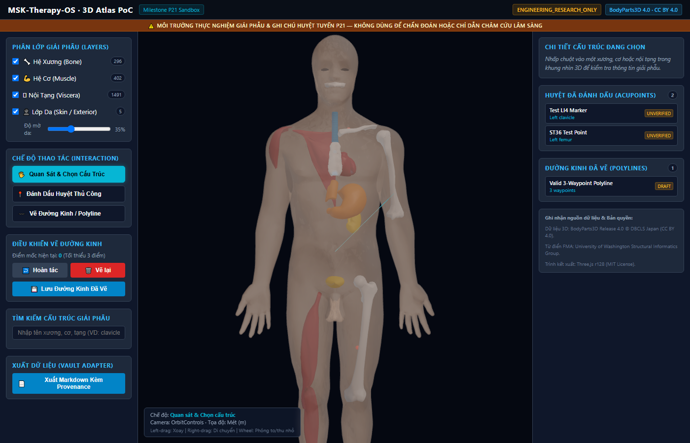
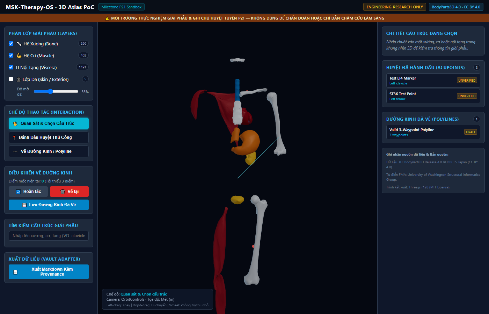
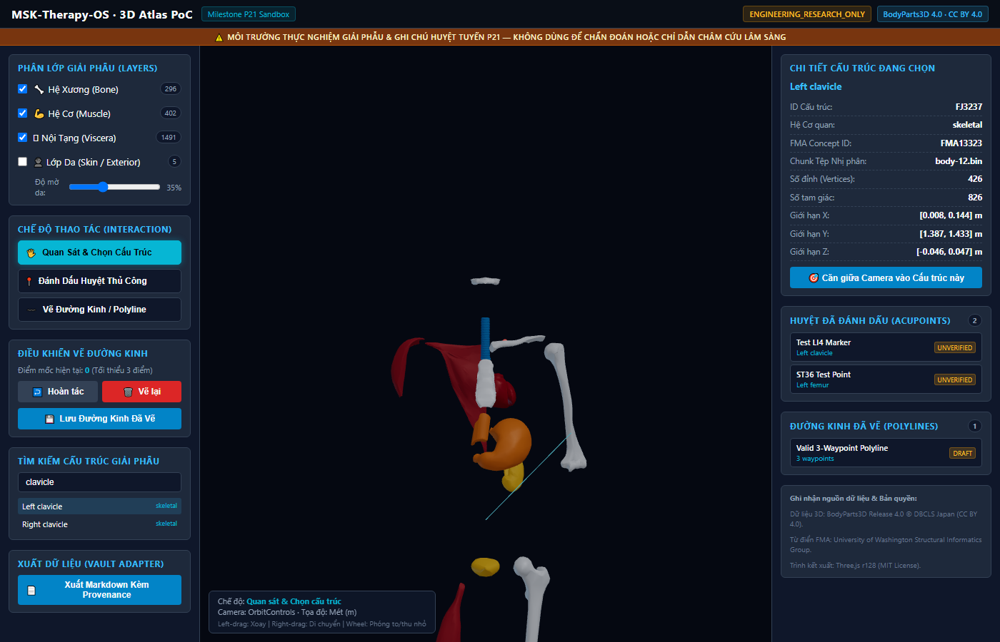
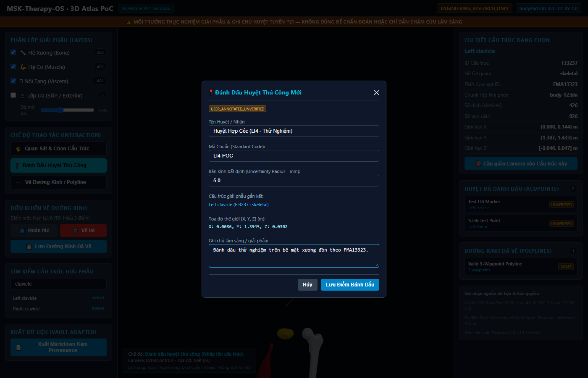
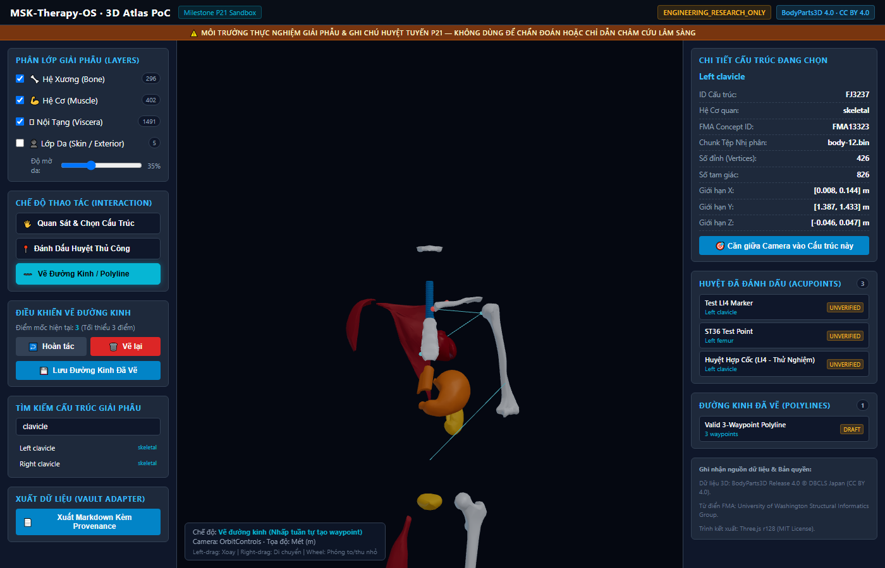
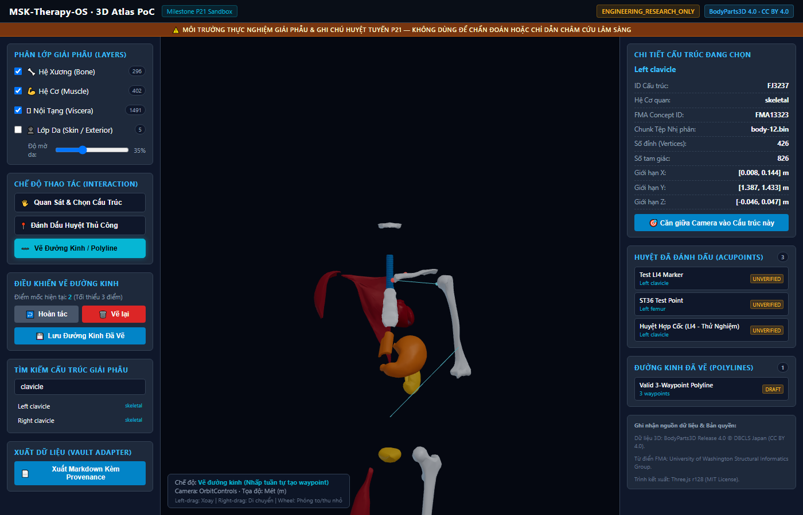
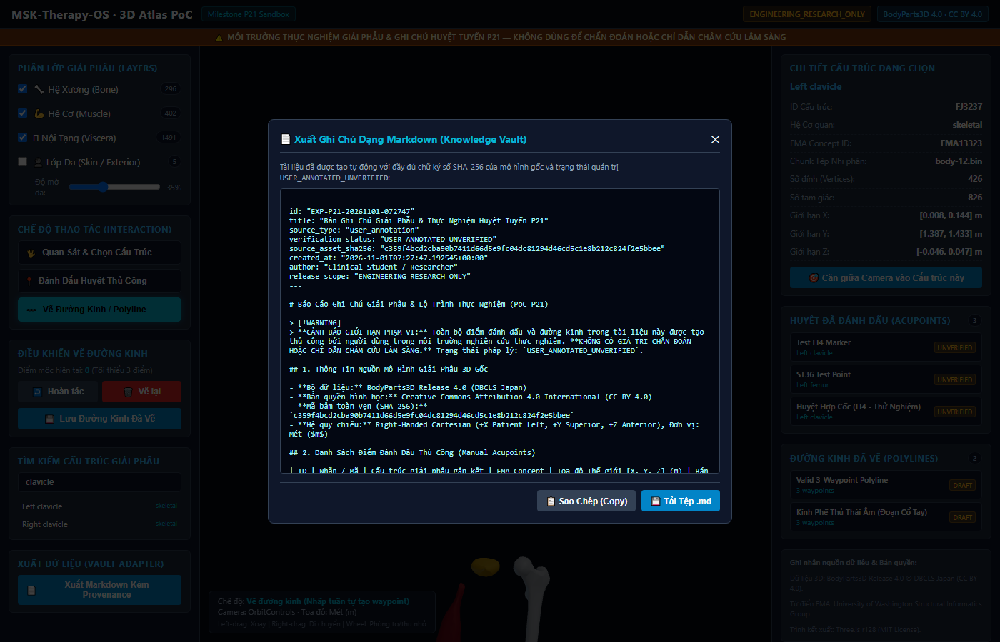

# MSK-Therapy-OS — Milestone P21 User Guide
## P21_05: Interactive Atlas Viewer Proof-of-Concept User Guide

**Tài liệu ID:** `MSK-P21-AUD-005`  
**Ngày thực hiện:** 2026-11-01  
**Phân loại:** `ENGINEERING_RESEARCH_ONLY`  
**Đường dẫn truy cập:** `http://127.0.0.1:8080/sandbox/p21/`  
**Trạng thái Thẩm định:** `RUNNABLE_POC_VERIFIED`  

---

### 1. Giới thiệu Tổng quan PoC P21

Atlas Viewer PoC P21 là giao diện nghiên cứu và học tập giải phẫu 3D độc lập, hoạt động hoàn toàn tách biệt với Atlas cũ tại `/atlas/`. Ứng dụng tích hợp trực tiếp bộ dữ liệu giải phẫu thực nghiệm **BodyParts3D Release 4.0** (DBCLS Nhật Bản, CC BY 4.0) bao gồm **2,234 cấu trúc**, phủ kín cả 4 lớp: **Xương, Cơ, Nội tạng và Da**.

PoC cho phép người dùng tự do quan sát, ẩn/hiện từng lớp, đặt điểm đánh dấu huyệt thủ công (raycast trực tiếp lên bề mặt tam giác của cấu trúc được chọn), vẽ tuyến đường kinh đa điểm (tối thiểu 3 waypoint kèm tính năng hoàn tác Undo), lưu trữ cục bộ và xuất báo cáo Markdown chuẩn Knowledge Vault P20.

---

### 2. Hướng dẫn Khởi chạy trên Windows PowerShell

Để khởi động máy chủ và mở ứng dụng PoC:

```powershell
# 1. Di chuyển vào thư mục dự án
Set-Location -Path "D:\5Projects\msk-therapy-os"

# 2. Khởi chạy HTTP server tích hợp
python -m msk_therapy_os.server

# 3. Mở trình duyệt web tại địa chỉ Sandbox P21
Start-Process "http://127.0.0.1:8080/sandbox/p21/"
```

*Ghi chú:* Máy chủ sử dụng cổng mặc định `8080`. Nếu cần chỉ định cổng khác, có thể chạy `python -m msk_therapy_os.server --port 8000`.

---

### 3. Hướng dẫn Các Tính năng Tương tác Chính

#### A. Phân lớp Giải phẫu 4 Nhóm (Multi-Layer Toggles)
Ở thanh công cụ bên trái (Left Sidebar), khối **"Phân Lớp Giải Phẫu"** cung cấp 4 công tắc độc lập:
1. **🦴 Hệ Xương (Bone):** Bật/tắt 296 xương (xương sọ, cột sống, xương sườn, xương chậu, xương chi).
2. **💪 Hệ Cơ (Muscle):** Bật/tắt 402 nhóm cơ nông và sâu (cơ thang, cơ delta, cơ nhị đầu, cơ bụng chân...).
3. **🫀 Nội Tạng (Viscera/Organs):** Bật/tắt 249 tạng chính (tim 4 buồng, van tim, khí quản, cây phế quản, gan, dạ dày, thận, bàng quang).
4. **👤 Lớp Da (Skin / Exterior):** Bật/tắt lớp da ngoài `FJ2810`. Thanh trượt **"Độ mờ da" (Opacity)** cho phép điều chỉnh từ 0% (trong suốt) đến 100% (đục hoàn toàn) để nhìn xuyên thấu vào các tạng bên trong.


*Hình 1: Mô hình giải phẫu 3D đa lớp BodyParts3D 4.0 với da bán trong suốt.*


*Hình 2: Trực quan hóa khung xương và các nội tạng bên trong khi tắt lớp da.*

---

#### B. Tìm kiếm & Kiểm tra Cấu trúc (Inspector Card)
- **Hộp tìm kiếm (Search Box):** Nhập tên tiếng Anh hoặc mã FMA của bất kỳ cấu trúc nào (ví dụ: `clavicle`, `femur`, `stomach`, `trapezius`).
- **Danh sách kết quả:** Nhấp chuột vào một mục tìm kiếm sẽ tự động nạp chunk nhị phân tương ứng (nếu chưa tải), hiển thị cấu trúc trong không gian 3D, căn giữa camera và hiển thị thẻ **"Chi Tiết Cấu Trúc Đang Chọn"**:
  - Tên cấu trúc giải phẫu chuẩn.
  - Mã ID cấu trúc (`FJxxxx`) & FMA Concept ID (`FMAxxxxx`).
  - Hệ cơ quan, tên tệp chunk (`body-X.bin`).
  - Số lượng đỉnh (vertices), tam giác (triangles) và tọa độ Bounding Box (mét).


*Hình 3: Thẻ kiểm tra chi tiết cấu trúc xương đòn T (FJ3237 / FMA13323).*

---

#### C. Chế độ Đánh dấu Huyệt Thủ công (Manual Acupoint Mode)
1. Nhấp chọn chế độ **"📍 Đánh Dấu Huyệt Thủ Công"**. Con trỏ chuột chuyển sang dạng chữ thập (`crosshair`).
2. Nhấp chuột trực tiếp lên bề mặt 3D của cấu trúc mong muốn.
3. Thuật toán Raycasting sẽ tính toán điểm giao cắt chính xác trên mặt tam giác bề mặt, vector pháp tuyến và mở hộp thoại **"Đánh Dấu Huyệt Thủ Công Mới"**:
   - Nhập tên huyệt / nhãn (VD: `Huyệt Hợp Cốc (LI4)`).
   - Nhập mã chuẩn (`LI4`).
   - Thiết lập bán kính bất định (mặc định: `5.0 mm`).
   - Nhập ghi chú lâm sàng hoặc mốc giải phẫu quan sát được.
   - Nhấp **"Lưu Điểm Đánh Dấu"**.
4. Điểm đánh dấu sẽ xuất hiện dưới dạng khối cầu phát sáng đỏ trên bề mặt cấu trúc và được thêm vào danh sách huyệt đã lưu với nhãn bắt buộc `USER_ANNOTATED_UNVERIFIED`.


*Hình 4: Hộp thoại ghi nhận điểm đánh dấu thủ công với tọa độ thế giới và cấu trúc gắn kết.*

---

#### D. Chế độ Vẽ Đường Kinh / Tuyến Đa Điểm (Manual Polyline Mode)
1. Nhấp chọn chế độ **"〰️ Vẽ Đường Kinh / Polyline"**.
2. Nhấp chuột tuần tự lên các mốc giải phẫu trên cơ thể để đặt các điểm mốc (waypoints). Khi có từ 2 điểm trở lên, một đường polyline màu xanh lục lam (cyan) sẽ tự động nối các điểm trong không gian 3D.
3. **Hoàn tác (Undo):** Nhấp nút **"↩️ Hoàn tác"** để xóa điểm mốc vừa đặt gần nhất và vẽ lại đường nối ngay lập tức.
4. **Vẽ lại (Clear):** Nhấp nút **"🗑️ Vẽ lại"** để xóa toàn bộ bản nháp hiện tại.
5. **Lưu tuyến:** Khi đạt tối thiểu 3 điểm mốc, nút **"💾 Lưu Đường Kinh Đã Vẽ"** sẽ kích hoạt. Người dùng nhập tên tuyến (VD: `Kinh Phế Thủ Thái Âm`) để lưu vĩnh viễn vào danh sách đường kinh với trạng thái `USER_DRAFT_UNVERIFIED`.


*Hình 5: Vẽ đường kinh thực nghiệm với 3 điểm mốc nối liền trong không gian 3D.*


*Hình 6: Thực hiện hoàn tác (Undo) điểm mốc thứ 3 thành công.*

---

#### E. Xuất Báo Cáo Markdown Chuẩn Knowledge Vault
1. Nhấp nút **"📄 Xuất Markdown Kèm Provenance"** ở góc dưới thanh bên trái.
2. Cửa sổ xem trước xuất hiện hiển thị toàn bộ nội dung Markdown được định dạng tự động:
   - Phần YAML Frontmatter chứa `id`, `source_type: "user_annotation"`, `verification_status: "USER_ANNOTATED_UNVERIFIED"`, `source_asset_sha256: "c359f4bcd2cba90b7411d66d5e9fc04dc81294d46cd5c1e8b212c824f2e5bbee"`.
   - Bảng tổng hợp các điểm đánh dấu kèm cấu trúc gắn kết, FMA ID, tọa độ $[X, Y, Z]$, bán kính bất định ($mm$).
   - Bảng chuỗi điểm mốc của đường kinh đã vẽ.
   - Cam kết quản trị Fail-Closed và điều khoản nghiêm cấm giả mạo phê duyệt lâm sàng.
3. Người dùng có thể nhấn **"📋 Sao Chép (Copy)"** hoặc **"💾 Tải Tệp .md"** để lưu về máy tính.


*Hình 7: Cửa sổ xuất Markdown với đầy đủ chữ ký SHA-256 và cảnh báo unverified.*
