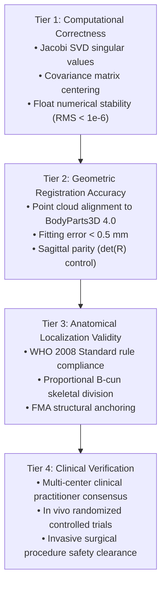

# P9.10 Quality Claim Governance & Clinical Evidence Specification

**Milestone:** P9.10 Independent Anatomical Ground Truth Validation & Performance Acceptance Hardening  
**Auditor:** Clinical Software Safety & QA Reviewer / Senior Systems Architect  
**Date:** 2026-10-28  
**Status:** RATIFIED & ENFORCED

---

## 1. Executive Summary & Purpose

A critical vulnerability in clinical software systems is **semantic conflation**: allowing mathematical precision or geometric alignment to be misinterpreted as clinical safety or therapeutic efficacy.

This standard establishes strict semantic and governance boundaries across MSK-Therapy-OS. It defines a mandatory four-tier hierarchy of claim integrity, reconciles terminology across all documentation and user interfaces, and enforces a fail-closed boundary between **technical parametric calibration** and **formal clinical verification**.

---

## 2. The Four-Tier Evidence Hierarchy

All technical, geometrical, anatomical, and clinical claims in MSK-Therapy-OS must strictly adhere to this four-tier taxonomy:



### Governance Invariants:
1. **Tier 1 does NOT imply Tier 2:** A mathematically perfect SVD alignment does not guarantee that the anatomical structures correspond to a human subject.
2. **Tier 2 does NOT imply Tier 3:** Perfectly registering two geometric point clouds does not confirm that an acupoint is located in the clinically correct anatomical depression or tendon border.
3. **Tier 3 does NOT imply Tier 4:** Conforming strictly to the WHO 2008 textbook standard does NOT constitute clinical trial evidence or guarantee therapeutic safety for invasive needling.

---

## 3. Catalog Distribution & Authoritative Metrics

Authoritative distribution across all 362 acupoints in the canonical atlas:

| Quality Class | Definition | Acupoint Count | Percentage | Permitted Semantic Term | Prohibited Semantic Term |
|---|---|---:|---:|---|---|
| **Class A** | Independently Audited Anchors | 18 | 5.0% | Audited Canonical Ground Truth Anchor | Clinically Verified / Trial Proven |
| **Class B** | WHO 2008 Rule-Derived Points | 126 | 34.8% | Calibrated Rule-Derived Acupoint | Clinically Verified Point |
| **Class C** | Deprecated / Ambiguous | 0 | 0.0% | Deprecated | Active Point |
| **Class D** | Uncalibrated Legacy Surface Raycasts | 218 | 60.2% | Uncalibrated Legacy Reference | Calibrated Point / Verified |
| **Class A+B** | **Combined Calibrated Coverage** | **144** | **39.8%** | **Calibrated Coverage** | **Clinically Verified Coverage** |
| **Tier 4** | **Formal Clinical Verification** | **0** | **0.0%** | **Unverified in Clinical Trials** | **Any Clinical Verification Claim** |

---

## 4. UI Presentation & API Governance Rules

### 4.1 Meridian QA Studio UI
- **Label Standard:** The UI element displaying the 39.8% metric must read:  
  `Calibrated (A+B): 39.8% (--% Audited)`
- **Prohibited UI Text:** Under no circumstances may the UI display `"39.8% Clinically Verified"` or `"39.8% Verified for Clinical Use"`.
- **Tooltip Enforcement:** The label includes an explicit tooltip:  
  `"39.8% calibrated under WHO 2008 rules. Non-invasive educational reference only; not clinical verification."`

### 4.2 Coverage Dashboard API Payload
The `get_meridian_atlas_coverage_dashboard` endpoint (`/atlas/api/coverage`) must return explicit governance metadata:

```json
{
  "total_points": 362,
  "calibrated_percentage": 39.8,
  "independently_verified_count": 18,
  "rule_derived_count": 126,
  "uncalibrated_legacy_count": 218,
  "governance_semantic_metadata": {
    "class_a_definition": "Independently audited canonical ground truth anchors (18 points, 5.0%)",
    "class_b_definition": "WHO 2008 standard parametric rule-derived coordinates (126 points, 34.8%)",
    "class_d_definition": "Uncalibrated legacy surface raycasts (218 points, 60.2%)",
    "calibrated_coverage_rate": 39.8,
    "clinical_verification_status": "TECHNICAL_CALIBRATION_ONLY; formal independent clinical trial / clinical practitioner verification is a separate clinical governance tier and is NOT implied by Class A+B.",
    "clinical_verification_count": 0,
    "clinical_verification_percentage": 0.0,
    "clinical_disclaimer": "Zero acupoints have undergone multi-center clinical practitioner consensus or clinical trial verification."
  },
  "quality_assurance": {
    "audit_status": "P9.10_GROUND_TRUTH_VALIDATED_PARTIAL",
    "clinical_safety_notice": "Visual and educational guidance only. Strictly non-invasive; zero surgical depth claims."
  }
}
```

---

## 5. Fail-Closed Clinical Safety Disclaimers

### 5.1 Non-Invasive Scope Limitation
MSK-Therapy-OS is strictly designed and licensed as a **3D anatomical visualization, non-invasive palpation reference, and educational guidance tool**. It possesses ZERO clearance for:
- Surgical trajectory or robotic needle insertion.
- Intramuscular or subcutaneous depth specification.
- Direct-to-patient autonomous diagnosis or treatment.

### 5.2 Class D Point Safety Warning
All 218 Class D points carry an uncertainty envelope of $\pm 15.0\text{ to }40.0\text{ mm}$ and must be rendered in muted amber (`#f59e0b`). The UI and API must explicitly emit the warning notice:
> *"WARNING: 218 Class D points remain uncalibrated legacy surface raycasts (uncertainty ±15-40mm). They are suitable for non-invasive educational reference only and MUST NOT be used for clinical depth or invasive procedure guidance."*
