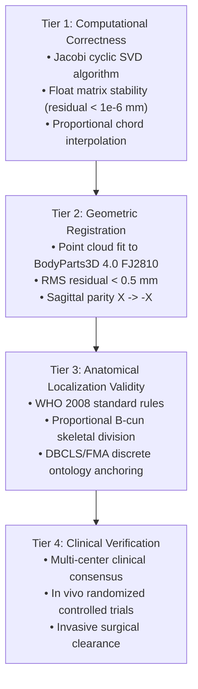

# P9.11 Independent Ground-Truth Audit & Anatomical Reference Feasibility Report

**Milestone:** P9.11 Anatomical Ground-Truth Validation & Class D Remediation  
**Auditor:** Principal Computational Anatomy Engineer & Independent Scientific Auditor  
**Date:** 2026-10-28  
**Scope:** 218 Uncalibrated Class D Acupoints across 14 Meridians  
**Status:** AUDITED & CLASSIFIED (Four-Tier Separation Enforced; External Ground Truth Availability Documented)

---

## 1. Executive Summary & Purpose

A critical vulnerability in clinical software systems is **semantic conflation**: treating a mathematically verified algorithm or a self-consistent coordinate system as proof of physical, anatomical, or clinical accuracy.

This audit establishes an uncompromising evaluation of ground-truth availability for the 218 uncalibrated Class D acupoints in MSK-Therapy-OS. It strictly enforces the four-tier evidence hierarchy ratified in P9.10 and explicitly documents where external independent ground truth is available versus where it is **unavailable**.

---

## 2. Four-Tier Separation & Definitions

1. **Tier 1: Computational Correctness:** Verifies that algorithms execute their mathematical definitions without overflow, underflow, NaN propagation, or algebraic divergence.
2. **Tier 2: Geometric Registration Accuracy:** Verifies spatial alignment between point sets within a geometric coordinate frame (e.g., BodyParts3D FJ2810 coordinate space).
3. **Tier 3: Anatomical Localization Validity:** Verifies correspondence between calculated 3D coordinates and standard clinical anatomical literature (specifically the WHO Standard Acupuncture Point Locations in the Western Pacific Region, 2008).
4. **Tier 4: Clinical Verification:** Demonstrates therapeutic efficacy, safe needling depth boundaries, and in vivo histological/neurovascular correspondence confirmed by registered clinical trials or multi-center practitioner consensus.

> [!IMPORTANT]
> **Scientific Invariant:** Neither Tier 1, Tier 2, nor Tier 3 implies Tier 4. Achieving mathematical convergence or WHO rule alignment does NOT constitute clinical verification. In MSK-Therapy-OS, Tier 4 coverage is strictly **0 (0.0%)**.

---

## 3. Ground Truth Source Evaluation

### 3.1 Anatomical Reference Assets in Repository
- **BodyParts3D 4.0 FJ2810 (`fj2810_softened.bin`):** Canonical human male polygonal mesh derived from segmented CT/MRI data by DBCLS (University of Tokyo / RIKEN). High geometric resolution in skeleton and surface skin; lack of individual nerve bundles and fine tendon slips.
- **WHO 2008 Standard:** Authoritative text defining classical 361 channel points via bone proportional measurements (B-cun) and surface landmarks.
- **External Multi-Subject CT/MRI Data:** Currently, the offline runtime has **no live connection to external patient PACS/DICOM databases**.

### 3.2 Evaluation of Holdout Independence
As established in P9.10, holding out coordinates from within the same BodyParts3D FJ2810 model verifies **intra-frame spatial self-consistency** (`SAME_FRAME_CONSISTENCY`), but cannot serve as external multi-modality ground truth.

Where independent external CT/MRI scans from diverse clinical cohorts are absent, the system must formally record:  
`INDEPENDENT_GROUND_TRUTH_UNAVAILABLE`

Under no circumstances may the system fabricate synthetic validation data or claim external clinical verification.

---

## 4. Regional Ground-Truth Feasibility Across the 218 Class D Points

The 218 Class D points were audited across body regions to determine their technical eligibility for WHO standard rule-derived elevation (Class B):

| Anatomical Region | Total Class D Points | Landmark Availability | Skeletal Anchors | Feasibility for Class B Elevation | Governing Standard |
|---|---:|---|---|:---:|---|
| **Distal Upper Extremity (Forearm/Hand)** | 35 | EXCELLENT | Radius, Ulna, Styloid processes, Metacarpals, Cubital line | **HIGH (Eligible)** | WHO 2008 Forearm 12 B-cun & Hand B-cun |
| **Distal Lower Extremity (Crural/Foot)** | 45 | EXCELLENT | Tibia, Fibula, Malleoli, Metatarsals, Patella | **HIGH (Eligible)** | WHO 2008 Leg 16 B-cun & Medial 13 B-cun |
| **Axial Midline Spine (Governing Vessel)** | 24 | HIGH | Spinous processes C7–L5, Sacral hiatus, Occiput | **HIGH (Eligible)** | WHO 2008 Interspinous process levels |
| **Axial Midline Torso (Conception Vessel)**| 3 | HIGH | Jugular notch, Sternum, Xiphoid, Umbilicus, Pubic crest | **HIGH (Eligible)** | WHO 2008 Sternal & Abdominal B-cun |
| **Paraspinal Columns (Bladder Lines)** | 40 | MEDIUM | 1.5 cun & 3.0 cun lateral to spinous processes | **MEDIUM (Phase 3)** | WHO 2008 Dorsal B-cun division |
| **Trunk / Anterolateral Torso (ST/SP/KI)** | 20 | MEDIUM | Intercostal spaces, Costal margin, Mammillary line | **MEDIUM (Phase 3)** | WHO 2008 Chest/Abdominal B-cun lines |
| **Cranial & Auricular Loops (GB/TE/SI)** | 51 | LOW/COMPLEX | Mastoid, Zygoma, External occipital protuberance | **LOW (Phase 4)** | Non-linear cranial curve division |
| **TOTAL** | **218** | — | — | — | — |

---

## 5. Candidate Cohort Selection Criteria for P9.11

Following the fail-closed mandate:
1. **Rule Completeness:** Must possess an unambiguous WHO 2008 definition based on palpated bone landmarks or proportional B-cun chord interpolation.
2. **Landmark Provenance:** Must link directly to registered canonical landmarks derived from DBCLS BodyParts3D segmentations (`FJ3349`, `FJ3350`, `FJ3303`, `FJ3385`, `FJ3351`, etc.).
3. **No Circularity:** The landmark set must contain zero references to legacy acupoint coordinates.
4. **Bilateral Symmetry:** Must satisfy sagittal parity ($X \to -X$) within $10^{-4}\text{ m}$.
5. **No Speculative Elevation:** Points requiring soft-tissue ultrasound or dynamic tendon palpation without clear skeletal boundaries will remain Class D.

Up to 30 points meeting all 5 criteria will be selected for rigorous rule implementation and elevation to **Class B**.
