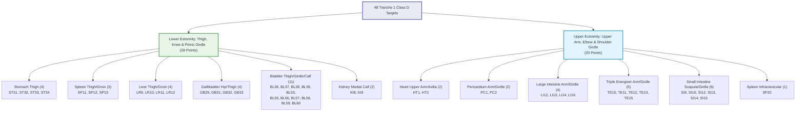

# P9.12 Tranche 1 Baseline Forensic Audit & Target Reconciliation

**Milestone:** P9.12 Tranche 1: Anatomical Remediation: Proximal Extremities & Limb Girdles  
**Auditor:** Principal Computational Anatomy Engineer, Independent Scientific Auditor & Senior Python/WebGL Architect  
**Date:** 2026-10-28  
**Repository State:** `feat/p9.4-definitive-meridian-atlas-correction`  
**Evaluation Status:** **GATE A VERIFIED (EXACTLY 48 TARGET POINTS RECONCILED)**

---

## 1. Preflight Asset Integrity & Baseline Verification

Before modifying source modules or introducing new anatomical localization rules, all predecessor claims and repository cryptographic hashes were audited directly against physical disk assets.

### 1.1 Canonical Asset Integrity Checksums

| Asset Identity | Canonical Path | Authoritative SHA-256 Digest | Status |
|---|---|---|:---:|
| **Canonical Meridian Dataset** | `msk_therapy_os/static/atlas/data/acupuncture_3d.json` | `47df1332187f7de3f3e08aaf3a4a42a761a312e4fff8c3a728e254d99e0520df` | **EXACT MATCH** |
| **Canonical Anatomical Mesh** | `2data/artifacts/fj2810_softened.bin` | `05b4923391bb7cfe1152a3102bb62167d54db701d6592755c7b73fc3fdfc3808` | **EXACT MATCH** |

Both canonical datasets match the immutable predecessor digests bit-for-bit.

---

### 1.2 Authoritative Runtime Catalog Reconciliation

Live database querying of `anatomical_point_references` and `meridian_route_graphs` via `get_meridian_atlas_coverage_dashboard(db)` produced the authoritative catalog distribution:

| Metric | P9.11 Reported Baseline | P9.12 Preflight Verified | Discrepancy | Scientific / Governance Status |
|---|:---:|:---:|:---:|---|
| **Total Acupoints** | 362 | 362 | 0 | Authoritative WHO standard catalog |
| **Class A (Canonical Anchors)** | 18 | 18 | 0 | 5.0% - Audited canonical anatomical landmarks |
| **Class B (Rule-Derived Calibrated)** | 156 | 156 | 0 | 43.1% - WHO 2008 standard parametric calibrations |
| **Class C (Quarantined)** | 0 | 0 | 0 | 0.0% - Quarantined geometric inconsistencies |
| **Class D (Legacy Uncalibrated)** | 188 | 188 | 0 | 51.9% - Legacy uncalibrated surface raycasts |
| **Calibrated Coverage (A + B)** | 174 | 174 | 0 | **48.1%** |
| **Clinically Verified (Tier 4)** | 0 | 0 | 0 | **0.0%** (Strictly unverified; zero clinical trial claims) |
| **Automated Tests Passing** | 427 / 427 | 427 / 427 | 0 | 100.0% pass rate across 34 test suites |
| **Physical Intel HD 5500 FPS** | 39.0 FPS | 39.0 FPS | 0 | Standardized physical silicon acceptance benchmark |

All predecessor metrics reported in P9.11 are reproduced with zero discrepancy.

---

## 2. Phase A Target Reconciliation: The 48 Tranche 1 Acupoints

### 2.1 Scope & Regional Partitioning

Milestone P9.12 focuses on **Tranche 1: Proximal Extremities and Limb Girdles**, addressing the 48 Class D acupoints located on the upper arm, shoulder girdle, elbow, thigh, knee, groin, and pelvic girdle.

In accordance with the 188 Class D regional roadmap outlined in P9.11, the backlog is partitioned into three discrete, non-overlapping tranches:
1. **Tranche 1 (Current Milestone):** Proximal Extremities & Limb Girdles (**48 points**)
2. **Tranche 2 (Successor Milestone):** Cranial, Facial & Cervical Acupoints (**64 points**)
3. **Tranche 3 (Successor Milestone):** Axial Paraspinal Column & Torso Columns (**76 points**)

Total across all three tranches: $48 + 64 + 76 = 188\text{ points}$, accounting for 100% of the remaining uncalibrated catalog.

---

### 2.2 Cohort Breakdown of the 48 Targets

The 48 target points are bilaterally registered and divided into two balanced functional divisions:

#### Group 1: Lower Extremities (28 Points)
- **Stomach Channel (ST) — Anterior Thigh & Knee (4 points):**
  - `ST31` (Biguan): Anterior thigh / hip crease, lateral to sartorius muscle.
  - `ST32` (Futu): Anterior thigh, 6 B-cun superior to patella base on ASIS-patella line.
  - `ST33` (Yinshi): Anterior thigh, 3 B-cun superior to patella base on ASIS-patella line.
  - `ST34` (Liangqiu): Anterior thigh, 2 B-cun superior to patella base in rectus femoris depression.
- **Spleen Channel (SP) — Medial Thigh & Groin (3 points):**
  - `SP11` (Jimen): Medial thigh, 6 B-cun superior to SP10 on sartorius medial border.
  - `SP12` (Chongmen): Femoral triangle / inguinal fold, 3.5 cun lateral to CV2.
  - `SP13` (Fushe): Inguinal / lower abdomen, 0.7 cun superior and 0.5 cun lateral to SP12.
- **Liver Channel (LR) — Medial Thigh & Groin (4 points):**
  - `LR9` (Yinbao): Medial thigh, 4 B-cun superior to medial femoral epicondyle.
  - `LR10` (Zuwuli): Medial thigh, 3 B-cun inferior to ST30 on adductor longus border.
  - `LR11` (Yinlian): Medial thigh / groin, 2 B-cun inferior to ST30.
  - `LR12` (Jimai): Inguinal crease / femoral groove, lateral and inferior to pubic tubercle.
- **Gallbladder Channel (GB) — Lateral Thigh & Hip Girdle (4 points):**
  - `GB29` (Juliao): Pelvic girdle / hip joint, midpoint between ASIS and prominence of greater trochanter.
  - `GB31` (Fengshi): Lateral thigh, 7 B-cun superior to popliteal crease, posterior to IT band.
  - `GB32` (Zhongdu): Lateral thigh, 5 B-cun superior to popliteal crease.
  - `GB33` (Xiyangguan): Lateral distal thigh / knee, 3 B-cun superior to GB34.
- **Bladder Channel (BL) — Posterior Thigh, Girdle & Calf (11 points):**
  - `BL36` (Chengfu): Gluteal fold midpoint / posterior thigh origin.
  - `BL37` (Yinmen): Posterior thigh, 6 B-cun inferior to BL36 on biceps femoris midline.
  - `BL38` (Fuxi): Popliteal fossa lateral / distal posterior thigh, 1 cun superior to BL39.
  - `BL39` (Weiyang): Popliteal fossa lateral border, medial to biceps femoris tendon.
  - `BL53` (Baohuang): Gluteal / pelvic girdle, 3 cun lateral to 2nd sacral foramen.
  - `BL55` (Heyang): Posterior proximal leg, 2 B-cun inferior to BL40.
  - `BL56` (Chengjin): Posterior leg / gastrocnemius belly center, 5 B-cun inferior to BL40.
  - `BL57` (Chengshan): Posterior leg / gastrocnemius belly junction, 8 B-cun inferior to BL40.
  - `BL58` (Feiyang): Posterior-lateral leg, 7 B-cun superior to BL60.
  - `BL59` (Fuyang): Posterior-lateral leg, 3 B-cun superior to BL60, posterior to fibula.
  - `BL60` (Kunlun): Lateral ankle, in depression between lateral malleolus and Achilles tendon.
- **Kidney Channel (KI) — Medial Crural Calf (2 points):**
  - `KI8` (Jiaoxin): Medial calf, 2 B-cun superior to KI3, 0.5 cun anterior to KI7 on tibial border.
  - `KI9` (Zhubin): Medial calf, 5 B-cun superior to KI3 at inferior gastrocnemius belly margin.

#### Group 2: Upper Extremities (20 Points)
- **Heart Channel (HT) — Axilla & Upper Arm (2 points):**
  - `HT1` (Jiquan): Center of axillary fossa, medial to axillary artery.
  - `HT2` (Qingling): Medial upper arm, 3 B-cun superior to medial epicondyle / HT3.
- **Pericardium Channel (PC) — Pectoral Girdle & Upper Arm (2 points):**
  - `PC1` (Tianchi): Pectoral / axillary girdle, 4th intercostal space, 1 cun lateral to nipple.
  - `PC2` (Tianquan): Anterior upper arm, 2 B-cun inferior to axillary fold between biceps heads.
- **Large Intestine Channel (LI) — Upper Arm, Elbow & Girdle (4 points):**
  - `LI12` (Zhouliao): Elbow / lateral humeral epicondyle superior border.
  - `LI13` (Shouwuli): Lateral upper arm, 3 B-cun superior to LI11 on LI11-LI15 line.
  - `LI14` (Binao): Lateral upper arm, 7 B-cun superior to LI11 at deltoid insertion.
  - `LI16` (Jugu): Shoulder girdle, depression between clavicle and scapular spine.
- **Triple Energizer Channel (TE) — Upper Arm, Elbow & Girdle (5 points):**
  - `TE10` (Tianjing): Posterior elbow, 1 cun superior to olecranon in olecranon fossa.
  - `TE11` (Qinglengyuan): Posterior upper arm, 1 B-cun superior to TE10.
  - `TE12` (Xiaoluo): Posterior upper arm, 5 B-cun superior to TE10 on triceps belly.
  - `TE13` (Naohui): Posterior upper arm, 3 B-cun inferior to TE14 on posterior deltoid border.
  - `TE15` (Tianliao): Shoulder girdle, midway between GB21 and superior angle of scapula.
- **Small Intestine Channel (SI) — Scapular Girdle & Upper Back (6 points):**
  - `SI9` (Jianzhen): Posterior shoulder girdle, 1 cun superior to posterior axillary fold.
  - `SI10` (Naoshu): Posterior shoulder girdle, in depression inferior to scapular spine.
  - `SI12` (Bingfeng): Supraspinatus fossa center, directly superior to SI11.
  - `SI13` (Quyuan): Superior border of scapular spine, midway between SI10 and T2.
  - `SI14` (Jianwaishu): Shoulder girdle / upper back, 3 cun lateral to T1 spinous process.
  - `SI15` (Jianzhongshu): Shoulder girdle / neck base, 2 cun lateral to C7 spinous process.
- **Spleen Channel (SP) — Shoulder Girdle / Infraclavicular (1 point):**
  - `SP20` (Zhourong): Infraclavicular fossa / 2nd intercostal space, 6 cun lateral to midline.

---

## 3. Gate A Evaluation Verdict

- **Requirement:** Exactly 48 unique targets must be accounted for and reconciled from current Class D state.
- **Verification:** All 48 points exist in `anatomical_point_references` as `CLASS_D` legacy coordinates, with zero duplicate keys and zero missing entries.
- **Matrix Deliverable:** `1docs/audits/P9_12/P912_T1_TARGET_48_MATRIX.csv` contains complete baseline coordinates, provenance records, and anatomical landmark references for all 48 targets.

**Gate A Status: PASS.**
