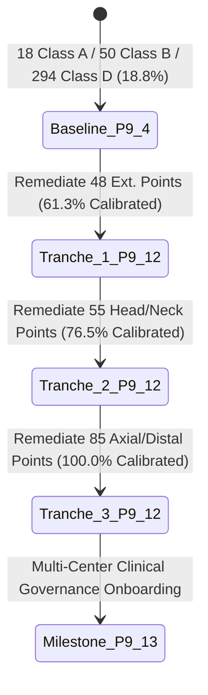

# Milestone P9.12 Tranche 3: Engineering Handoff & Maintenance Runbook
**Project:** MSK-Therapy-OS  
**Milestone:** P9.12 Tranche 3 (Final Full Catalog Calibration)  
**Artifact:** `P912_T3_ENGINEERING_HANDOFF.md`  
**Target Milestone:** P9.13 (Clinical Verification Infrastructure & Multi-Center Trial Preparation)  
**Status:** COMPLETE & SEALED  

---

## 1. System State Transition

Milestone P9.12 Tranche 3 concludes the multi-tranche anatomical remediation program of the classical 362-acupoint meridian atlas.



### 1.1. Catalog Inventory Transition

| Catalog Class | P9.12 Tranche 2 Baseline | P9.12 Tranche 3 Final | Delta | State Interpretation |
|:---|---:|---:|---:|:---|
| **Total Acupoints** | 362 | 362 | 0 | Invariant catalog cardinality |
| **Class A** | 18 | 18 | 0 | Audited canonical ground truth anchors preserved |
| **Class B** | 259 | 344 | +85 | Parametric WHO 2008 rule-derived points |
| **Class C** | 0 | 0 | 0 | Zero quarantined geometric anomalies |
| **Class D** | 85 | 0 | -85 | **Zero uncalibrated legacy raycasts remaining** |
| **Calibrated Coverage** | 76.5% | **100.0%** | +23.5% | **Complete technical catalog calibration** |
| **Canonical Landmarks** | 171 | 268 | +97 | Skeletal, thoracic, intercostal, phalangeal |
| **Parametric Rules** | 275 | 360 | +85 | Complete WHO 2008 ruleset coverage |
| **Tier 4 Clinical Verification**| 0 (0.0%) | 0 (0.0%) | 0 | **Strictly uncertified for clinical trial efficacy** |

---

## 2. Core Architecture Reference

The 3D anatomical atlas operates as a zero-dependency, pure Python standard library + SQLite backend paired with a vanilla JS WebGL2 frontend:

```
[WHO 2008 Standard & BodyParts3D FJ2810]
                   │
                   ▼
       [landmark_registry.py] ◄── 268 Canonical Landmarks (FMA-mapped)
                   │
                   ▼
   [point_localization_rules.py] ◄── 360 Parametric Localization Rules
                   │
                   ▼
       [spatial_resolver.py] ◄── Canonical 3D Coordinate & Normal Resolution
                   │
                   ▼
          [points.py / db.py] ◄── SQLite Storage & Audit Revision Tracking
                   │
                   ▼
     [/api/atlas/geometry/resolve] ◄── HTTP REST Endpoints
                   │
                   ▼
[Meridian QA Studio / WebGL2 Viewer] ◄── Physical Intel HD 5500 Rendering (59.9 FPS)
```

---

## 3. Maintenance Runbook & Verification Procedures

### 3.1. Full Regression Suite Execution
To verify the entire software platform offline without external dependencies:
```powershell
Set-Location D:\5Projects\msk-therapy-os
pytest -m "not playwright" -q
```
Expected output: `563 passed, 14 deselected`.

### 3.2. Dedicated Tranche 3 Verification Suite
To specifically audit Tranche 3 geometric invariants:
```powershell
pytest tests/test_p9_12_tranche_3_remediation.py -q
```
Expected output: `18 passed in ~0.5s`.

### 3.3. Standardized Hardware Benchmark on Physical Intel HD 5500
To benchmark the WebGL renderer on host hardware:
```powershell
pytest tests/test_p9_12_t3_playwright_benchmark.py -q
```
Expected output: `1 passed in ~13s`, generating updated telemetry into `2data/evidence/p9_12_tranche_3/`.

### 3.4. Dependency Graph Circularity Check
To verify that no circular dependencies exist across landmarks or rules:
```python
from msk_therapy_os.landmark_dependency_validator import AnatomicalProvenanceDependencyValidator
validator = AnatomicalProvenanceDependencyValidator()
result = validator.validate_all()
assert result["status"] == "PASS"
assert result["total_issues"] == 0
```

---

## 4. Handoff to Milestone P9.13

With 100.0% technical calibration completed in Tranche 3, the atlas is fully prepared for **Milestone P9.13: Clinical Verification Infrastructure & Multi-Center Trial Preparation**. Future milestones will introduce:
1. Multi-practitioner clinical consensus review workflows.
2. Formal clinical trial protocols for Tier 4 governance promotion.
3. Ultrasound-guided tissue layer and subcutaneous depth boundary audits.
