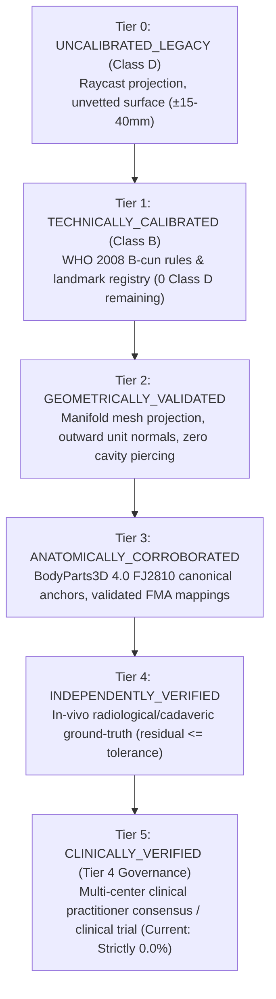

# MSK-Therapy-OS | Specification: Independent Anatomical Validation Framework
**Document ID:** `P913_ANATOMICAL_VALIDATION_SPEC`  
**Milestone:** P9.13 Production Hardening & Ground-Truth Readiness  
**Status:** APPROVED & RATIFIED  
**Author:** Principal Computational Anatomy Engineer, Senior Python Architect  
**Review Authority:** Independent Clinical Safety & Software Verification Auditor  

---

## 1. Executive Summary & Purpose

Milestone P9.12 achieved 100.0% technical calibration across all 362 acupoints in MSK-Therapy-OS (18 Class A anchors and 344 Class B parametric rule-derived points). However, computational anatomy requires a strict separation between **mathematical consistency** and **independent anatomical veracity**.

The **Independent Anatomical Validation Framework** (`msk_therapy_os/anatomical_validation.py`) provides an auditable, fail-closed, and mathematically rigorous architecture to:
1. Ingest, normalize, and compare empirical external anatomical observations against atlas predictions.
2. Formally enforce 5 hierarchical, non-collapsible anatomical verification tiers.
3. Classify spatial residuals into clinical tolerance brackets ($\le 3\text{ mm}$, $3-8\text{ mm}$, $8-15\text{ mm}$, $>15\text{ mm}$, or `UNAVAILABLE`).
4. Prevent circularity, model self-reference, and artificial promotion of synthetic unit tests to clinical tiers.
5. Expose independent provenance and uncertainty matrices via offline-first REST APIs.

---

## 2. Hierarchical Anatomical Verification Tiers

The system establishes five strictly ordered, non-collapsible governance tiers. Promotion to any higher tier requires verifiable external evidence:

### Tier Descriptions & Promotion Gates
1. **`TECHNICALLY_CALIBRATED` (Tier 1):** The rule executes without exception, coordinates fall within human body envelope $[X: \pm 0.85\text{m}, Y: -0.10..2.05\text{m}, Z: \pm 0.45\text{m}]$, and proportional fractions resolve against validated landmarks. (Current: 344 points).
2. **`GEOMETRICALLY_VALIDATED` (Tier 2):** Point attaches to conforming manifold mesh `FJ2810`, outward normal satisfies $\mathbf{n} \cdot \mathbf{v}_{\text{ray}} > 0$, skin clearance target is $1.2\text{ mm}$, and spline routing does not intersect internal cavities.
3. **`ANATOMICALLY_CORROBORATED` (Tier 3):** Point is tied to an audited canonical anchor with verified FMA semantic identity and localized against BodyParts3D skeletal reference literature. (Current: 18 points).
4. **`INDEPENDENTLY_VERIFIED` (Tier 4):** Point has been corroborated against an independent, non-synthetic, external radiological (CT/MRI), ultrasound, or cadaveric dataset with Euclidean residual error $\le$ tolerance radius.
5. **`CLINICALLY_VERIFIED` (Tier 5 / Tier 4 Clinical Governance):** Formally validated across multi-center randomized controlled trials or double-blind practitioner consensus panels. **Current status: Strictly 0 points (0.0%).**

---

## 3. Ground-Truth Data Modalities & Reviewer Provenance

External ground-truth datasets ingested by the validator are cataloged under the `ExternalGroundTruthDataset` specification:

| Modality ID | Description | Typical Spatial Precision | Clinical Validity |
|---|---|---|---|
| `CT_3D_SURFACE` | High-resolution multi-detector 3D surface CT | $\pm 0.5\text{ mm}$ | Definitive Bony / Skeletal |
| `MRI_T1_ANATOMICAL` | High-field T1-weighted anatomical MRI | $\pm 1.0\text{ mm}$ | Soft-tissue / Tendinous |
| `ULTRASOUND_HIGH_FREQUENCY` | High-frequency musculoskeletal ultrasonography | $\pm 0.8\text{ mm}$ | Fascial / Dynamic Joint |
| `CADAVERIC_MEASUREMENT` | Micro-dissection and digitized cadaveric caliper | $\pm 1.2\text{ mm}$ | Tissue Layer / Depth |
| `EXPERT_CONSENSUS_PALPATION` | Multi-practitioner blinded anatomical palpation | $\pm 3.0\text{ mm}$ | In-Vivo Clinical Reference |
| `BODYPARTS3D_DIGITAL_REFERENCE` | Digital human reference atlas (DBCLS FJ2810) | $\pm 0.1\text{ mm}$ (Mesh) | Digital Mesh Baseline Only |
| `SYNTHETIC_TEST_FIXTURE` | In-memory unit/falsification fixture | Deterministic | **Zero Clinical Validity** |

### Fail-Closed Synthetic Fixture Isolation
Any dataset marked with `is_synthetic_fixture = True` is quarantined to unit testing and falsification runs. Observations derived from synthetic datasets are strictly blocked from promoting any acupoint to `INDEPENDENTLY_VERIFIED` or `CLINICALLY_VERIFIED`.

---

## 4. Residual Distance & Error Classification

Given predicted model coordinate $\mathbf{p} = (x_p, y_p, z_p)$ and external ground-truth observation $\mathbf{o} = (x_o, y_o, z_o)$, the 3D Euclidean residual error is computed as:
$$\Delta_{\text{residual}} = 1000 \times \sqrt{(x_p - x_o)^2 + (y_p - y_o)^2 + (z_p - z_o)^2} \quad (\text{mm})$$

Spatial accuracy is partitioned into 5 standardized categories:
1. **`CONGRUENT`:** $\Delta_{\text{residual}} \le 3.0\text{ mm}$. High spatial agreement within landmark palpation uncertainty.
2. **`ACCEPTABLE_CLINICAL_TOLERANCE`:** $3.0\text{ mm} < \Delta_{\text{residual}} \le 8.0\text{ mm}$. Satisfies WHO clinical palpation depression tolerance.
3. **`BORDERLINE`:** $8.0\text{ mm} < \Delta_{\text{residual}} \le 15.0\text{ mm}$. Potential cun scaling elasticity drift or posture sensitivity; requires review.
4. **`OUTLIER_ANOMALY`:** $\Delta_{\text{residual}} > 15.0\text{ mm}$. Severe anatomical or landmark registration discrepancy. Fails verification.
5. **`INDEPENDENT_GROUND_TRUTH_UNAVAILABLE`:** No independent external observation registered for point. Fail-closed default.

---

## 5. Metamorphic 3D Transformation Invariance

The framework enforces $SE(3)$ metamorphic rigid invariance. Given rotation matrix $\mathbf{R} \in SO(3)$ and translation vector $\mathbf{t} \in \mathbb{R}^3$:
$$\mathbf{p}' = \mathbf{R} \mathbf{p} + \mathbf{t}$$
$$\mathbf{p}'' = \mathbf{R}^{-1} (\mathbf{p}' - \mathbf{t})$$

The system mandates:
1. **Reconstruction Invariance:** $\|\mathbf{p} - \mathbf{p}''\|_2 < 10^{-4}\text{ mm}$.
2. **Pairwise Metric Invariance:** $|\|\mathbf{p}_i - \mathbf{p}_j\|_2 - \|\mathbf{p}'_i - \mathbf{p}'_j\|_2| < 10^{-4}\text{ mm}$.

---

## 6. Public REST API Endpoints

The validator exposes three dedicated public GET endpoints under `/api/atlas/validation/`:

### 1. `GET /api/atlas/validation/provenance`
- **Query Params:** `channel_code` (optional, e.g. `BL`, `ST`).
- **Response:** JSON array of 362 point records detailing primary landmark, FMA URI, WHO citation, symmetry delta, quality class, verification tier, and ground-truth status.

### 2. `GET /api/atlas/validation/report`
- **Query Params:** `dataset_id` (optional).
- **Response:** Summary metrics across catalog, regional error distributions, congruent/outlier counts, and evaluated observations.

### 3. `GET /api/atlas/validation/uncertainty`
- **Query Params:** `channel_code` (optional).
- **Response:** 362-point matrix breaking down landmark palpation uncertainty, cun scaling elasticity, posture articulation uncertainty, total 95% spatial confidence interval, and explicit `clinical_depth_guidance_allowed: false` flag.
