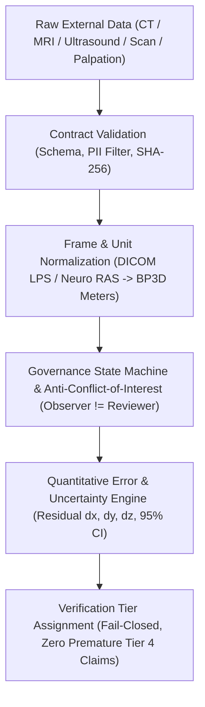

# P9.14 Ground-Truth Data Contract & External Ingestion Specification

**Project:** MSK-Therapy-OS  
**Milestone:** P9.14 — Independent Anatomical Ground-Truth Pilot & External Validation Framework  
**Status:** DEFINITIVE SPECIFICATION · FROZEN  
**Classification:** Software & Clinical Evidence Governance Standard  
**Date:** 2026-10-29  

---

## 1. Executive Summary & Core Principle

Milestone P9.13 completed 100% technical calibration of all 362 acupuncture points (18 Class A canonical anchors, 344 Class B parametric rule-derived points). However, **100% technical calibration is NOT equivalent to empirical anatomical ground truth or clinical validity**.

This document defines the formal, immutable **Ground-Truth Data Contract** governing how external, independent anatomical observations are ingested, validated, transformed, and reviewed within MSK-Therapy-OS.

---

## 2. Mandatory Data Contract Schema

Every empirical observation ingested into MSK-Therapy-OS MUST satisfy the following immutable 16-field schema defined in `GroundTruthObservation`:

| Field Name | Type | Allowed Values / Constraints | Governance Rationale |
|---|---|---|---|
| `dataset_id` | `str` | Must match a registered `ExternalGroundTruthDataset` | Ensures organizational provenance and auditability. |
| `subject_pseudonym` | `str` | Format: `SUBJ-***`, `CASE-***`, `SYNTH-***`. Strictly NO PII. | HIPAA / GDPR compliance; zero unpseudonymized personal data. |
| `point_code` | `str` | Exactly one of the 362 catalog codes (`LU1`..`GV28`, `GV24+`) | Prevents phantom point injection. |
| `laterality` | `str` | `"left"`, `"right"`, `"bilateral"`, `"midline"` | Explicit spatial symmetry and side binding. |
| `source_modality` | `GroundTruthModality` | `CT_3D_SURFACE`, `MRI_T1_ANATOMICAL`, `ULTRASOUND_HIGH_FREQUENCY`, `CADAVERIC_MEASUREMENT`, `EXPERT_CONSENSUS_PALPATION`, `BODYPARTS3D_DIGITAL_REFERENCE`, `SYNTHETIC_TEST_FIXTURE` | Distinguishes high-precision radiological truth from palpation or digital atlases. |
| `coordinate_frame` | `CoordinateFrame` | `BP3D_CARTESIAN_METERS`, `DICOM_LPS_MM`, `NEURO_RAS_MM`, `SURFACE_SCAN_MM`, `ANATOMICAL_LOCAL_METERS` | Guarantees deterministic spatial transformation into canonical space. |
| `unit` | `MeasurementUnit` | `"meters"`, `"millimeters"` | Explicit unit designation; eliminates unit ambiguity errors. |
| `measurement_coordinates`| `Tuple[float, float, float]` | 3D floats within valid anatomical envelope: $X \in [-1.5, 1.5]\text{ m}$, $Y \in [-0.5, 2.5]\text{ m}$, $Z \in [-1.0, 1.0]\text{ m}$ | Rejects gross out-of-envelope measurement blunders. |
| `measurement_uncertainty`| `float` | Strictly positive float ($> 0.0\text{ mm}$), nominal 0.5–5.0 mm | Explicit capture of measurement error for propagation. |
| `observer_id` | `str` | Identifier of data collector / radiologist | Prevents self-review conflicts of interest. |
| `independent_source_id` | `str` | Source registry or study identifier | Enforces independent lineage; detects circular model outputs. |
| `collection_protocol_id`| `str` | Clinical / anatomical scanning protocol code | Reproducibility of measurement methodology. |
| `consent_or_authorization_reference` | `str` | IRB / Ethics approval or anonymized public license reference | Regulatory compliance for human-derived data. |
| `source_checksum` | `str` | 64-character hexadecimal SHA-256 digest of raw record | Detects post-collection record tampering. |
| `synthetic_fixture` | `bool` | `True` for unit test / mock fixtures; `False` for authentic empirical data | Hard barrier preventing synthetic promotion. |
| `review_status` | `ReviewStatus` | `DATA_IMPORTED`, `PROVENANCE_VERIFIED`, `GEOMETRY_VALIDATED`, `INDEPENDENT_REVIEW_PENDING`, `REVIEWED`, `REJECTED`, `INCONCLUSIVE` | State machine tracking governance lifecycle. |

---

## 3. PII (Personally Identifiable Information) Rejection Rules

The ingestion engine enforces automated fail-closed PII rejection on all incoming records:

1. **Email Detection:** Rejects strings containing `@` (e.g., `patient.smith@clinic.org`).
2. **Social Security / Tax ID Detection:** Rejects 9-digit SSN patterns (`\b\d{3}-\d{2}-\d{4}\b`).
3. **Phone Number Detection:** Rejects standard 10/11-digit phone number sequences (`(\+?\d{1,3}[-.\s]?)?\(?\d{3}\)?[-.\s]?\d{3}[-.\s]?\d{4}`).
4. **Honorific / Personal Title Detection:** Rejects strings containing clinical or personal titles (`Mr.`, `Mrs.`, `Ms.`, `Dr.`, `Prof.`, `Patient:`).
5. **Length & Prefix Constraints:** Pseudonyms must be at least 3 characters and should follow standard de-identified cohort prefixes (`SUBJ-`, `CASE-`, `FIXTURE-`).

Any record violating PII constraints is rejected immediately with `PII_DETECTED_IN_SUBJECT_PSEUDONYM` before database entry or memory caching.

---

## 4. Coordinate Frame Transformation & Unit Normalization

MSK-Therapy-OS standardizes all internal 3D computations on **BodyParts3D Cartesian SI Meters**:
- $+X$: Right lateral
- $+Y$: Superior (cranial / up)
- $+Z$: Anterior (ventral / front)

External datasets from medical imaging or surface scanning adhere to different clinical conventions. The engine implements deterministic, closed-form transformations:

### 4.1 DICOM Standard LPS (Left-Posterior-Superior) in Millimeters
In DICOM LPS:
- $+X_{\text{lps}}$: Left
- $+Y_{\text{lps}}$: Posterior
- $+Z_{\text{lps}}$: Superior

Transformation to BodyParts3D meters:
$$\begin{bmatrix} X_{\text{bp3d}} \\ Y_{\text{bp3d}} \\ Z_{\text{bp3d}} \end{bmatrix} = 0.001 \times \begin{bmatrix} -1 & 0 & 0 \\ 0 & 0 & 1 \\ 0 & -1 & 0 \end{bmatrix} \begin{bmatrix} X_{\text{lps}} \\ Y_{\text{lps}} \\ Z_{\text{lps}} \end{bmatrix}$$

### 4.2 Neuroimaging Standard RAS (Right-Anterior-Superior) in Millimeters
In Neuroimaging RAS:
- $+X_{\text{ras}}$: Right
- $+Y_{\text{ras}}$: Anterior
- $+Z_{\text{ras}}$: Superior

Transformation to BodyParts3D meters:
$$\begin{bmatrix} X_{\text{bp3d}} \\ Y_{\text{bp3d}} \\ Z_{\text{bp3d}} \end{bmatrix} = 0.001 \times \begin{bmatrix} 1 & 0 & 0 \\ 0 & 0 & 1 \\ 0 & 1 & 0 \end{bmatrix} \begin{bmatrix} X_{\text{ras}} \\ Y_{\text{ras}} \\ Z_{\text{ras}} \end{bmatrix}$$

---

## 5. Anti-Conflict-of-Interest & Anti-Circularity Governance

### 5.1 Anti-Conflict-of-Interest Rule
An observer who recorded or measured an anatomical point CANNOT serve as the independent clinical reviewer for that observation.
$$\text{If } \text{obs}.\text{observer\_id} == \text{reviewer}.\text{reviewer\_id} \implies \text{RAISE } \texttt{CONFLICT\_OF\_INTEREST\_DETECTED}$$

### 5.2 Anti-Circularity Rule
If an observation's coordinates match the model's predicted coordinates bit-for-bit ($\Delta < 1\times 10^{-6}\text{ m}$) AND the dataset is derived internally (e.g., `DS-BP3D-FJ2810` or `SRC-MODEL-PREDICTION`), the observation is flagged `CIRCULAR_DEPENDENCY_DETECTED`.
Under fail-closed governance, circular observations CANNOT promote any point to `INDEPENDENTLY_VERIFIED` or `CLINICALLY_VERIFIED`.

---

## 6. Implementation Reference

The contract is implemented and enforced by:
- `msk_therapy_os/anatomical_validation.py` (`validate_observation_contract`, `transform_coordinates_to_bp3d`, `register_independent_review`).
- Test suite: `tests/test_p9_14_ground_truth.py` (Groups 1–7, 11, 12, 15).
