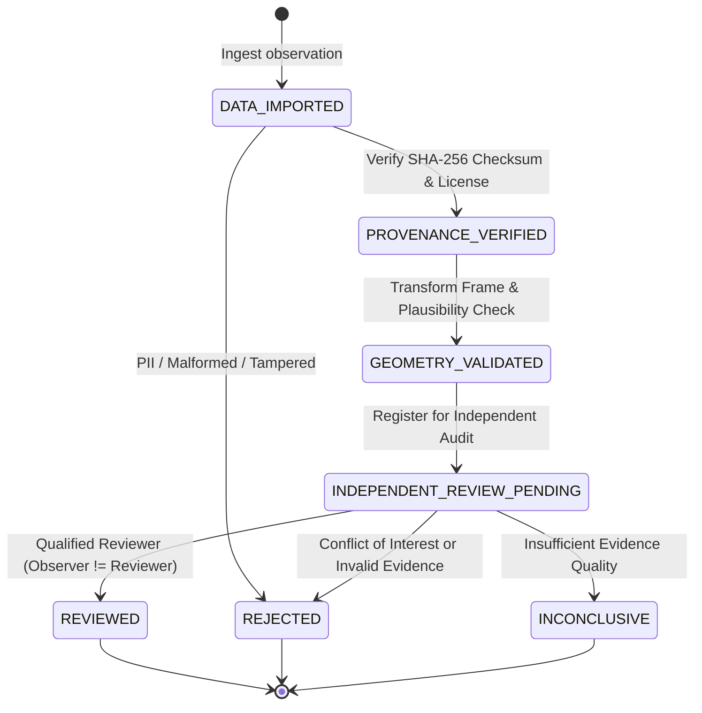

# P9.14 Independent Anatomical Validation Protocol & Governance Standard

**Project:** MSK-Therapy-OS  
**Milestone:** P9.14 — Independent Anatomical Ground-Truth Pilot & External Validation Framework  
**Status:** APPROVED PROTOCOL · FROZEN  
**Classification:** Scientific & Clinical Validation Standard  
**Date:** 2026-10-29  

---

## 1. Scope & Scientific Intent

The objective of this protocol is to transition MSK-Therapy-OS from *technically calibrated* (P9.12/P9.13 status: all 362 points resolve with zero mathematical or topological errors) to *independently auditable, anatomically falsifiable, and externally reproducible*.

### Core Postulate
```
Mathematical Consistency != Anatomical Accuracy != Clinical Efficacy
```
A system whose internal geometric rules resolve without error can still mislocalize points if:
1. The reference digital skeleton (BodyParts3D FJ2810) differs in morphology from the patient.
2. Parametric proportional cun assumptions break down in extreme body somatotypes.
3. Postural joint movements alter surface-to-skeletal distances dynamically.

---

## 2. Hierarchical, Non-Collapsible Verification Tiers

To prevent scientific inflation and false clinical claims, MSK-Therapy-OS establishes five strictly stratified verification tiers:

| Tier | Designation | Criteria | Current 362 Catalog Count |
|---|---|---|---:|
| **Tier 0** | `TECHNICALLY_CALIBRATED` | Parametric rule and landmark graph resolve without mathematical or graph errors; mesh projection valid. | 344 (95.03%) |
| **Tier 1** | `GEOMETRICALLY_VALIDATED` | Evaluated against synthetic fixtures or geometric manifold tests; outward normal verified. | 0 (0.0%) |
| **Tier 2** | `ANATOMICALLY_CORROBORATED` | Concordant with BodyParts3D FJ2810 canonical literature; Class A internal anchors. | 18 (4.97%) |
| **Tier 3** | `INDEPENDENTLY_VERIFIED` | Validated against an external, independent, non-synthetic dataset with residual $R \le \text{tolerance}$. | **0 (0.0%)** |
| **Tier 4** | `CLINICALLY_VERIFIED` | Verified through formal multi-center prospective clinical trials or registered expert consensus. | **0 (0.0%)** |

> [!IMPORTANT]
> The current 18 Class A points are designated **Internal Canonical Anchors**, NOT independent clinical ground truth. Zero acupoints are promoted to Tier 3 or Tier 4 without genuine external patient data.

---

## 3. Standardized Error Classifications

When an external observation is compared against a predicted model coordinate, the 3D Euclidean residual error distance $R$ is classified into one of five mutually exclusive categories:

$$R = \sqrt{(x_{\text{pred}} - x_{\text{obs}})^2 + (y_{\text{pred}} - y_{\text{obs}})^2 + (z_{\text{pred}} - z_{\text{obs}})^2} \times 1000.0 \quad (\text{mm})$$

| Classification | Residual Threshold | Scientific Interpretation | Action / Clinical Disposition |
|---|---|---|---|
| `CONGRUENT` | $R \le 3.0\text{ mm}$ | High spatial agreement; within palpation repeatability limits. | Promotes to candidate Tier 3 (if non-synthetic & non-circular). |
| `ACCEPTABLE_CLINICAL_TOLERANCE` | $3.0\text{ mm} < R \le 8.0\text{ mm}$ | Clinically acceptable variation; within acupuncture needle grasp zone. | Acceptable for non-invasive targeting; flag for morphology tuning. |
| `BORDERLINE` | $8.0\text{ mm} < R \le 15.0\text{ mm}$ | Elevated spatial deviation; requires anatomical review. | Retain as Class B; trigger landmark recalibration review. |
| `OUTLIER_ANOMALY` | $R > 15.0\text{ mm}$ | Gross localization discrepancy; structural failure. | Immediate clinical abstention; invalidate prediction. |
| `INDEPENDENT_GROUND_TRUTH_UNAVAILABLE` | Observation missing | No independent ground truth registered for point. | Fail-closed abstention; maintain technical calibration tier. |

---

## 4. Subject-Level Holdout Isolation Methodology

To prevent data leakage and self-fulfilling calibration loops:
1. **Holdout Subject Separation:** When evaluating external datasets across a cohort, observations from test subjects (e.g., `SUBJ-HOLDOUT-***`) MUST be isolated from any training or rule-tuning operations.
2. **Deterministic Evaluation Filter:** The validator supports `validate_catalog(..., holdout_subjects=[...])` ensuring that holdout observations are evaluated strictly out-of-sample.
3. **Cross-Validation Protocol:** For multi-subject pilot studies, a 5-fold cross-validation scheme is enforced: 80% calibration, 20% holdout evaluation.

---

## 5. Governance State Machine



---

## 6. Regulatory & Clinical Safety Warnings

1. **Non-Invasive Visual Reference Only:** All acupoint coordinates generated by MSK-Therapy-OS are designed for non-invasive clinical visualization, education, and motion tracking.
2. **Prohibition of Surgical Depth Guidance:** As mandated across all 362 catalog records, `clinical_depth_guidance_allowed: False`. MSK-Therapy-OS strictly prohibits any depth guidance for surgical puncture, deep needle insertion, or invasive interventions.
3. **Fail-Closed Gate G14:** Because no empirical in-vivo CT/MRI datasets for the 362 points exist in the repository, Gate G14 is formally declared `BLOCKED_EXTERNAL_DATA`, while the software validation framework is certified `ENGINEERING_READY`.
