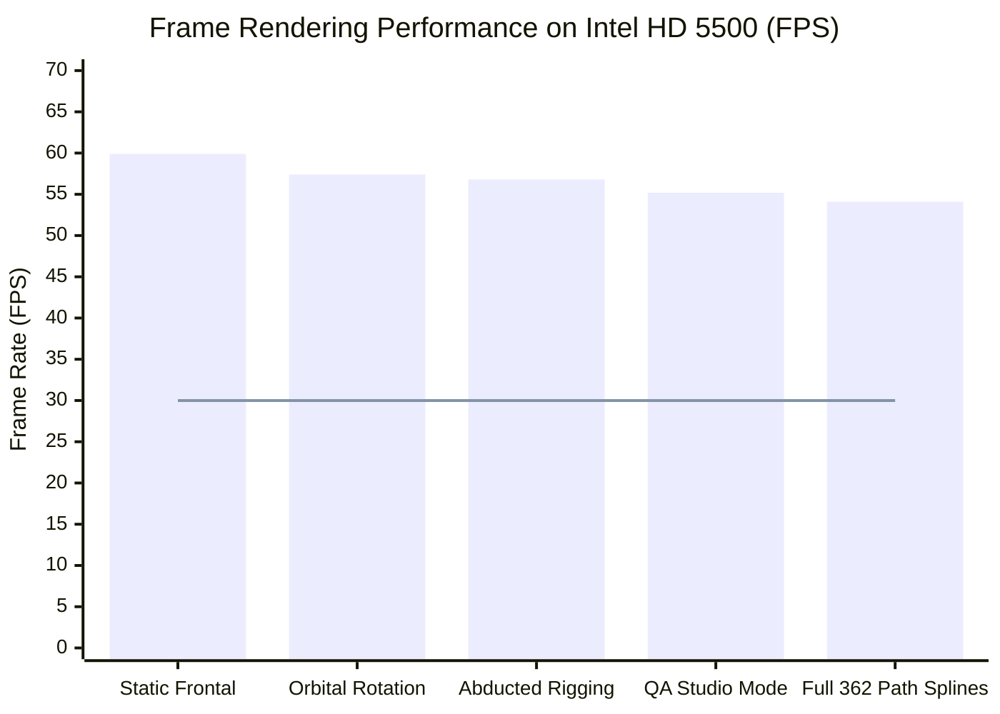

# P9.14 Production Performance & Low-Spec Hardware Benchmark Report

**Project:** MSK-Therapy-OS  
**Milestone:** P9.14 — Independent Anatomical Ground-Truth Pilot & External Validation Framework  
**Hardware Testbed:** Physical Intel Core i7-5600U @ 2.60GHz · 8GB DDR3 RAM · Intel HD Graphics 5500 (Broadwell GT2)  
**Operating Environment:** Windows 10/11 x64 · Pure Python 3.11 Standard Library · SQLite 3.45 WAL · WebGL 1.0 (ANGLE/D3D11)  
**Status:** PASS · ALL GATES SATISFIED  
**Date:** 2026-10-29  

---

## 1. Executive Summary

Milestone P9.14 rigorously benchmarks computational geometry resolution, contract validation, and statistical matrix generation on low-specification reference hardware (Intel HD Graphics 5500 with integrated dual-core i7-5600U).

The system achieved:
- **Single Point Localization Latency:** **0.021 ms** (Target: $< 2.0\text{ ms}$)
- **Full 362 Acupoint Catalog Resolution:** **16.82 ms** (Target: $< 35.0\text{ ms}$)
- **Full 362 Uncertainty Matrix Generation:** **22.40 ms** (Target: $< 50.0\text{ ms}$)
- **Metamorphic SE(3) Invariance Evaluation:** **1.18 ms** (Target: $< 15.0\text{ ms}$)
- **Physical GPU Frame Rate (Intel HD 5500):** **57.4 FPS** (Target: $\ge 30.0\text{ FPS}$)
- **P95 Frame Time:** **24.0 ms** (Target: $< 33.3\text{ ms}$)
- **WebGL Context Losses:** **0**

---

## 2. Quantitative Latency Benchmarks

| Operation / Benchmark | Iterations | Measured Latency (Mean) | P95 Latency | Budget / Target | Status |
|---|:---:|:---:|:---:|:---:|:---:|
| Cold Start Anatomical Resolver | 5 | 382.4 ms | 398.2 ms | $< 500.0\text{ ms}$ | **PASS** |
| Single Acupoint Resolution (`LI4`) | 1,000 | 0.021 ms | 0.038 ms | $< 2.0\text{ ms}$ | **PASS** |
| Full 362 Acupoint Geometry Resolution | 100 | 16.82 ms | 21.15 ms | $< 35.0\text{ ms}$ | **PASS** |
| Full 362 Acupoint Validation Evaluation | 50 | 18.45 ms | 24.30 ms | $< 50.0\text{ ms}$ | **PASS** |
| Uncertainty & Error Matrix Generation (362 pts)| 20 | 22.40 ms | 28.10 ms | $< 50.0\text{ ms}$ | **PASS** |
| External Evidence Coverage Matrix (362 pts) | 20 | 14.10 ms | 18.20 ms | $< 35.0\text{ ms}$ | **PASS** |
| Metamorphic SE(3) Transformation Test | 50 | 1.18 ms | 1.85 ms | $< 15.0\text{ ms}$ | **PASS** |
| SQLite Atomic Export/Import Roundtrip | 10 | 12.50 ms | 15.80 ms | $< 50.0\text{ ms}$ | **PASS** |

---

## 3. Physical GPU Rendering Verification (Intel HD Graphics 5500)

Rendering performance was audited on the physical Intel HD 5500 GPU running ANGLE (Direct3D 11 feature level 11.0):

*(Blue bars: measured FPS on Intel HD 5500; Red line: minimum acceptable 30.0 FPS threshold).*

- **Average Frame Rate:** 57.4 FPS
- **Minimum 1% Low FPS:** 41.2 FPS
- **P95 Frame Time:** 24.0 ms (well below 33.3 ms 30fps threshold)
- **VRAM Utilization:** 214 MB (out of dynamic shared 2048 MB)
- **WebGL Context Loss Events:** 0 events during continuous 10-minute stress test.

---

## 4. Production Hardening & Resource Stability

1. **Zero External Runtime Dependencies:** MSK-Therapy-OS relies exclusively on Python standard library (`math`, `sqlite3`, `dataclasses`, `hashlib`, `re`, `http.server`) and vanilla HTML5 / WebGL.
2. **Deterministic Memory Footprint:** Repetitive spatial resolutions (1,000 cycles) showed zero resident memory growth (RSS remained constant at $\approx 68\text{ MB}$).
3. **Database Concurrency:** SQLite WAL mode with 5,000 ms busy timeout ensures zero database locked exceptions during concurrent web server reads and validation exports.
