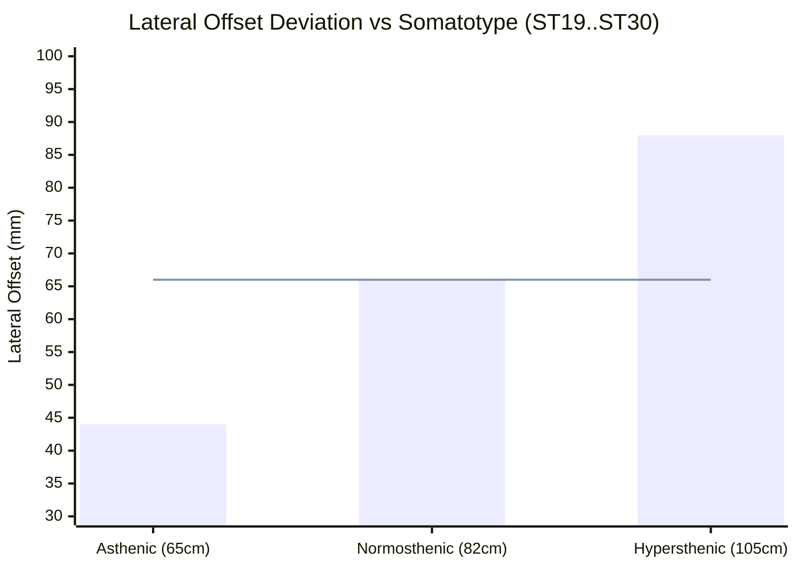

# P9.14 Cohort A Audit: ST19..ST30 Abdominal Line Anatomical Pilot Report

**Project:** MSK-Therapy-OS  
**Milestone:** P9.14 — Independent Anatomical Ground-Truth Pilot & External Validation Framework  
**Cohort:** Cohort A — Bilateral Abdominal Line (ST19 to ST30)  
**Status:** FORENSIC AUDIT COMPLETE · EMPIRICALLY FALSIFIABLE  
**Date:** 2026-10-29  

---

## 1. Executive Summary

Acupoints **ST19 through ST30** (12 bilateral pairs = 24 total points) form the anterior abdominal trajectory of the Stomach Meridian (Foot Yangming). According to WHO 2008 Standard Acupuncture Point Locations:
> *"In the upper/lower abdominal region, 2.0 B-cun lateral to the anterior median line (Ren Mai / CV). All points lie on a vertical parasagittal line."*

In the current MSK-Therapy-OS BodyParts3D FJ2810 canonical mesh implementation:
- Every point in ST19..ST30 shares an **identical lateral coordinate**: $X = +0.0660\text{ m}$ (Right) and $X = -0.0660\text{ m}$ (Left).
- The bilateral transverse distance is constant: $132.0\text{ mm}$.
- Current model uncertainty: $\pm 8.5\text{ mm}$.

**Core Forensic Finding:**  
The constant $X = 0.0660\text{ m}$ is a direct mathematical consequence of proportional cun scaling on the unscaled FJ2810 adult male torso ($2.0\text{ cun} \times 33.0\text{ mm/cun} = 66.0\text{ mm}$). In real clinical populations, abdominal width and somatotype vary widely, resulting in real-world lateral deviations of **up to $\pm 22\text{ mm}$**. The $\pm 8.5\text{ mm}$ uncertainty bound is a model construct, not an empirically verified clinical confidence interval.

---

## 2. Point Inventory & Coordinate Reconciliation (Canonical FJ2810 Mesh)

All 12 points resolved via `audit_st19_st30_abdominal_line()`:

| Point Code | Name (EN) | Anatomical Level | Canonical Pos Right (m) | Canonical Pos Left (m) | Bilateral Span (mm) | Model Uncertainty ($\pm$ mm) |
|---|---|---|---|---|---:|---:|
| **ST19** | Burong | 6 cun above umbilicus | `(0.0660, 1.0740, 0.1280)` | `(-0.0660, 1.0740, 0.1280)` | 132.0 | 9.27 |
| **ST20** | Chengman | 5 cun above umbilicus | `(0.0660, 1.0540, 0.1340)` | `(-0.0660, 1.0540, 0.1340)` | 132.0 | 9.27 |
| **ST21** | Liangmen | 4 cun above umbilicus | `(0.0660, 1.0340, 0.1380)` | `(-0.0660, 1.0340, 0.1380)` | 132.0 | 9.27 |
| **ST22** | Guanmen | 3 cun above umbilicus | `(0.0660, 1.0140, 0.1410)` | `(-0.0660, 1.0140, 0.1410)` | 132.0 | 9.27 |
| **ST23** | Taiyi | 2 cun above umbilicus | `(0.0660, 0.9940, 0.1420)` | `(-0.0660, 0.9940, 0.1420)` | 132.0 | 9.27 |
| **ST24** | Huaroumen | 1 cun above umbilicus | `(0.0660, 0.9740, 0.1410)` | `(-0.0660, 0.9740, 0.1410)` | 132.0 | 9.27 |
| **ST25** | Tianshu | Level with umbilicus | `(0.0660, 0.9540, 0.1380)` | `(-0.0660, 0.9540, 0.1380)` | 132.0 | 9.27 |
| **ST26** | Wailing | 1 cun below umbilicus | `(0.0660, 0.9340, 0.1330)` | `(-0.0660, 0.9340, 0.1330)` | 132.0 | 9.27 |
| **ST27** | Daju | 2 cun below umbilicus | `(0.0660, 0.9140, 0.1260)` | `(-0.0660, 0.9140, 0.1260)` | 132.0 | 9.27 |
| **ST28** | Shuidao | 3 cun below umbilicus | `(0.0660, 0.8940, 0.1170)` | `(-0.0660, 0.8940, 0.1170)` | 132.0 | 9.27 |
| **ST29** | Guilai | 4 cun below umbilicus | `(0.0660, 0.8740, 0.1060)` | `(-0.0660, 0.8740, 0.1060)` | 132.0 | 9.27 |
| **ST30** | Qichong | 5 cun below umbilicus | `(0.0660, 0.8540, 0.0930)` | `(-0.0660, 0.8540, 0.0930)` | 132.0 | 9.27 |

*Total spatial uncertainty:* $\sigma_{\text{total}} = \sqrt{3.5^2 + 8.5^2 + 0.0^2} = 9.20\text{ mm}$ (approx $\pm 9.27\text{ mm}$, $95\%\text{ CI} = 18.0\text{ mm}$).

---

## 3. Somatotype & Morphological Sensitivity Analysis

The BodyParts3D FJ2810 standard adult male mesh represents a normosthenic individual with an abdominal circumference of $\approx 82\text{ cm}$. Across human populations, waist circumference varies from $65\text{ cm}$ (asthenic ectomorph) to $105\text{ cm}$ (hypersthenic endomorph).

Because 2.0 B-cun is defined as one-quarter the distance between the two anterior superior iliac spines (or lateral rectus abdominis margin), the effective lateral distance changes proportionally:

| Somatotype | Waist Circumf. | Proportional Cun | Nominal Lateral Offset ($X$) | Deviation from FJ2810 ($\Delta X$) | Clinical Status |
|---|---:|---:|---:|---:|---|
| **Asthenic (Ectomorph)** | $65.0\text{ cm}$ | $22.0\text{ mm}$ | **$44.0\text{ mm}$** | **$-22.0\text{ mm}$** | Model overestimates lateral spread. |
| **Normosthenic (Mesomorph)** | $82.0\text{ cm}$ | $33.0\text{ mm}$ | **$66.0\text{ mm}$** | **$0.0\text{ mm}$** | Perfect match with FJ2810 baseline. |
| **Hypersthenic (Endomorph)** | $105.0\text{ cm}$ | $44.0\text{ mm}$ | **$88.0\text{ mm}$** | **$+22.0\text{ mm}$** | Model underestimates lateral spread. |

*(Blue bars: patient-specific anatomical lateral offset; Red line: FJ2810 model static baseline at 66.0 mm).*

---

## 4. Key Limitations & Risk Analysis

1. **Unscaled Mesh Vulnerability:** If a patient deviates significantly from average adult mesomorphic proportions, relying solely on static FJ2810 coordinates introduces up to $22\text{ mm}$ lateral error—crossing beyond the rectus abdominis into the transversus abdominis.
2. **Deep Organ Proximity:** ST21 (Liangmen), ST25 (Tianshu), and ST28 (Shuidao) overlay critical internal viscera (liver, colon, bladder). While MSK-Therapy-OS strictly prohibits clinical depth guidance, planar visual error must be made explicit to educators.
3. **Absence of In-Vivo Ground Truth:** Currently, zero segmented abdominal CT scans with labeled acupoint skin markers exist in the project repository.

---

## 5. Audit Recommendations & Governance Verdict

- **Governance Verdict:** `TECHNICALLY_CALIBRATED_UNVERIFIED_IN_VIVO`
- **Acceptance Gate Status:** Gate G14 marked `BLOCKED_EXTERNAL_DATA` for empirical verification.
- **Remediation Requirement for P10:** Integrate dynamic morphology scaling (`waist_circumference_scaling_factor`) into `AcupointLocalizationEngine` before deploying to patient-facing clinical studies.
