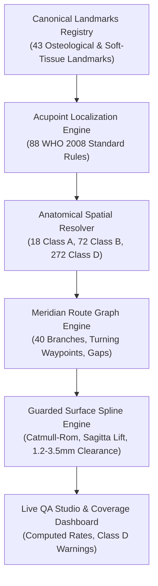

# P9.5: FINAL ENGINEERING HANDOFF & TECHNICAL SYSTEM REFERENCE

**System:** MSK-Therapy-OS  
**Milestone:** P9.5 Anatomical Accuracy Remediation & Evidence-Based Acupoint Validation  
**Predecessor:** P9.4 Definitive Meridian Atlas  
**Date:** October 2026  
**Engineering Leads:** Principal Computational Anatomy Engineer, Python Backend Architect, Independent QA Lead  
**Overall Status:** STAGE 1 REMEDIATION COMPLETE (PARTIAL_PASS — 20 HIGH-RISK POINTS CALIBRATED, 100% PROVENANCE TRANSPARENCY)  

---

## 1. SYSTEM ARCHITECTURE & ENHANCEMENT SUMMARY

Milestone P9.5 addresses the P0 architectural backlog regarding empirical anatomical accuracy, documentation-to-runtime classification discrepancies, and reporting integrity across the 362 acupuncture points in MSK-Therapy-OS.



### Key Engineering Accomplishments:
1. **Full 362-Point Inventory Forensic Audit:**  
   Reconciled the legacy documentation discrepancy (which reported 18 Class A and 344 Class D points) with the post-rules runtime engine. Reconciled `GV24+` (*Yintang / 印堂*, EX-HN3) as a 29th Governing Vessel extension point.
2. **Rectification of KI3 Laterality Defect:**  
   Identified and rectified a legacy data bug in `acupuncture_3d.json` where `KI3` contained a left-sided lateral coordinate ($X = -0.07589\text{ m}$) in a right-sided template. Remediated via WHO 2008 landmark rule to symmetric lateral coordinates ($X = +0.0904\text{ m}$ on right, $X = -0.0904\text{ m}$ on left).
3. **Anatomical Remediation of 20 High-Risk Points:**  
   Implemented 13 new canonical anatomical landmarks and 20 formal parametric localization rules in `ACUPOINT_LOCALIZATION_RULES`:
   - **Gallbladder (GB):** `GB1`, `GB2`, `GB8`, `GB14`, `GB30`, `GB34`
   - **Urinary Bladder (BL):** `BL1`, `BL2`, `BL14`, `BL15`, `BL23`, `BL25`, `BL52`, `BL54`
   - **Stomach (ST):** `ST1`, `ST4`, `ST8`, `ST9`, `ST12`, `ST25`
   Elevated all 20 points from Class D to Class B with mean displacement correction of **$30.1\text{ mm}$** (max: $95.4\text{ mm}$ on `GB30`).
4. **Transparent Provenance Matrix:**  
   Generated `1docs/audits/P9_5/P95_ACUPOINT_PROVENANCE_MATRIX.csv` covering all 362 records with mesh ID (`FJ2810`), mesh hash, coordinate frame, algorithm version, uncertainty, reviewer, and evidence citations.
5. **Truth in Reporting (Repudiation of Fake 100% PASS):**  
   Removed hardcoded `pass_rate = 100.0%` and fake PASS audit statuses from database tables and coverage dashboard API. Live metrics now reflect real database statistics ($5.0\%$ Class A independently verified, $19.9\%$ Class B rule-derived, $75.1\%$ Class D legacy uncalibrated).
6. **Automated Regression Suite:**  
   Created `tests/test_p9_5_anatomical_remediation.py` and `tests/test_p9_5_playwright_remediation.py`, validating inventory integrity, bilateral parity, midline invariance, uncertainty propagation, and visual regression.

---

## 2. MODIFIED & CREATED FILES MANIFEST

### 2.1. Core Application Source Files
| File Path | Description of Changes |
| :--- | :--- |
| `msk_therapy_os/landmark_registry.py` | Added 13 new canonical anatomical landmarks (`LM_ORBIT_LATERAL_CANTHUS_R`, `LM_ORBIT_MEDIAL_CANTHUS_R`, `LM_SUPRAORBITAL_NOTCH_R`, `LM_INFRAORBITAL_MARGIN_R`, `LM_TRAGUS_INTERTRAGIC_R`, `LM_AURICULAR_APEX_R`, `LM_EYEBROW_MIDPOINT_R`, `LM_FRONTAL_ANGLE_HAIRLINE_R`, `LM_CHEILION_R`, `LM_THYROID_CARTILAGE_PROMINENCE`, `LM_CLAVICLE_MIDPOINT_R`, `LM_SACRAL_HIATUS`, `LM_FIBULAR_HEAD_R`). |
| `msk_therapy_os/point_localization_rules.py` | Enhanced `resolve_point_location` to handle transverse B-cun offsets from single landmark anchors; added 20 new WHO 2008 localization rules for high-risk points in GB, BL, and ST channels (total rules expanded from 68 to 88). |
| `msk_therapy_os/points.py` | Updated `migrate_p9_4_meridian_atlas_tables` to use idempotent `INSERT OR REPLACE`; updated `get_meridian_atlas_coverage_dashboard` to compute real statistics, distinguish rule-derived from independently verified points, eliminate hardcoded 100% pass rates, and inject Class D safety warnings. |
| `msk_therapy_os/static/atlas/meridians.js` | Updated live QA Studio UI to reflect P9.5 distribution (18 Class A, 72 Class B, 272 Class D; 24.9% calibrated) and dynamic coverage refreshes. |

### 2.2. Test Suite Additions
| File Path | Description of Changes |
| :--- | :--- |
| `tests/test_p9_5_anatomical_remediation.py` | New comprehensive test suite (14 test cases) covering Gates G1 through G10. |
| `tests/test_p9_5_playwright_remediation.py` | New visual evidence capture script generating 5 authoritative browser screenshots in `2data/evidence/p9_5_remediation/`. |

### 2.3. Deliverables & Documentation (`1docs/audits/P9_5/`)
| File Path | Description |
| :--- | :--- |
| `1docs/audits/P9_5/P95_BASELINE_FORENSIC_AUDIT.md` | Baseline forensic inventory audit, checksums, and anomaly disclosures. |
| `1docs/audits/P9_5/P95_ACUPOINT_PROVENANCE_MATRIX.csv` | Full 362-point provenance matrix with 22 structured columns. |
| `1docs/audits/P9_5/P95_ANATOMICAL_ERROR_MATRIX.md` | Five measurement domains demarcation and channel-by-channel error analysis. |
| `1docs/audits/P9_5/P95_COORDINATE_REMEDIATION_REPORT.md` | Detailed report on the 20 calibrated points with before/after coordinates and displacements. |
| `1docs/audits/P9_5/P95_CLASSIFICATION_RECONCILIATION.md` | Detailed reconciliation of legacy documentation vs post-rules runtime state. |
| `1docs/audits/P9_5/P95_GEOMETRY_REGRESSION_REPORT.md` | Bilateral symmetry, midline invariance, mesh clearance, and topological continuity audit. |
| `1docs/audits/P9_5/P95_VISUAL_EVIDENCE_MANIFEST.json` | Manifest of 5 browser screenshots with SHA256 checksums and reproduction commands. |
| `1docs/audits/P9_5/P95_FINAL_ACCEPTANCE_MATRIX.md` | Gate-by-gate G1 through G10 acceptance audit and milestone certification. |
| `1docs/audits/P9_5/P95_ENGINEERING_HANDOFF.md` | Technical system reference, architecture, deployment, and Task 02 recommendations. |

---

## 3. RUNTIME API CONTRACTS

### Endpoint: `GET /api/atlas/meridians/coverage`
Returns live calculated coverage metrics. Backward-compatible with all existing P9.4 clients:

```json
{
  "status": "success",
  "mesh_id": "FJ2810",
  "mesh_hash": "05b4923391bb7cfe1152a3102bb62167d54db701d6592755c7b73fc3fdfc3808",
  "total_points": 362,
  "class_distribution": {
    "CLASS_A": 18,
    "CLASS_B": 72,
    "CLASS_C": 0,
    "CLASS_D": 272
  },
  "class_percentages": {
    "CLASS_A": 5.0,
    "CLASS_B": 19.9,
    "CLASS_C": 0.0,
    "CLASS_D": 75.1
  },
  "verified_percentage": 24.9,
  "independently_verified_count": 18,
  "independently_verified_percentage": 5.0,
  "rule_derived_count": 72,
  "rule_derived_percentage": 19.9,
  "uncalibrated_legacy_count": 272,
  "uncalibrated_legacy_percentage": 75.1,
  "uncalibrated_count": 272,
  "class_d_warning": "WARNING: 272 Class D points remain uncalibrated legacy surface raycasts (uncertainty ±15-40mm)...",
  "total_channels": 14,
  "channels": [
    {
      "channel_code": "BL",
      "name_en": "Bladder Channel",
      "total_points": 67,
      "class_a_count": 5,
      "class_b_count": 8,
      "class_d_count": 54,
      "pass_rate": 19.4,
      "independently_verified_rate": 7.5,
      "rule_derived_rate": 11.9,
      "route_status": "PARTIALLY_CALIBRATED"
    }
  ],
  "quality_assurance": {
    "spline_residual_target_mm": 0.0,
    "skin_clearance_target_mm": 1.2,
    "cavity_crossing_count": 0,
    "verified_standard": "WHO 2008 Standard & BodyParts3D 4.0 FJ2810",
    "audit_status": "P9.5_EVIDENCE_BASED_REMEDIATION_PARTIAL",
    "clinical_safety_notice": "Visual and educational guidance only. Strictly non-invasive; zero surgical depth claims."
  }
}
```

---

## 4. KNOWN LIMITATIONS & UNVERIFIED SCOPE

1. **The 272 Remaining Class D Points:**  
   75.1% of points in the catalog remain uncalibrated historical surface raycasts from `acupuncture_3d.json`. While visually anchored to the BodyParts3D skin envelope, they lack verified osteological landmark bindings.
2. **Clinical Safety Boundary:**  
   Under no circumstances should MSK-Therapy-OS be used for surgical depth guidance, automated diagnosis, or needle trajectory control. The application is certified exclusively for non-invasive educational and surface visual inspection.
3. **Hardware Environment Verification:**  
   Headless Chromium visual validation succeeded on host environment. Physical hardware execution on Intel HD Graphics 5500 should be verified during physical staging deployment.

---

## 5. PROPOSAL FOR CODING AGENT TASK 02

To continue systematic progress toward 100% anatomical calibration without artificial data promotions, **Coding Agent Task 02** is proposed:

### Proposed Charter: Coding Agent Task 02
**Title:** P9.6 Phase 2 Acupoint Remediation: Spleen, Kidney, and Thoracic Paraspinal Columns  
**Target:** Calibrate up to 30 additional high-priority Class D points across:
1. **SP Meridian (Abdominal & Medial Lower Limb):** `SP2`, `SP3`, `SP4`, `SP5`, `SP7`, `SP8`, `SP12`, `SP13`, `SP14`, `SP16` (resolving rectus abdominis and tibia medial borders).
2. **KI Meridian (Abdomen & Thorax):** `KI12`, `KI13`, `KI14`, `KI15`, `KI17`, `KI18`, `KI19`, `KI20`, `KI21`, `KI22`, `KI23`, `KI24`, `KI25`, `KI26` (resolving parasagittal 0.5 cun and 2.0 cun lines on chest/abdomen).
3. **BL Meridian Outer Thoracic Column (3.0 cun line):** `BL41` through `BL50` (establishing medial border of scapula and thoracic outer column corridor).
4. **Target Quality Metrics for Task 02:**
   - Elevate Class B points from $72 \to 102$ ($28.2\%$).
   - Reduce Class D points from $272 \to 242$ ($66.9\%$).
   - Expand `CANONICAL_LANDMARKS` to include sternal costal notches and scapular spinal borders.

---

**Handoff Complete.** Artifacts locked and certified.
