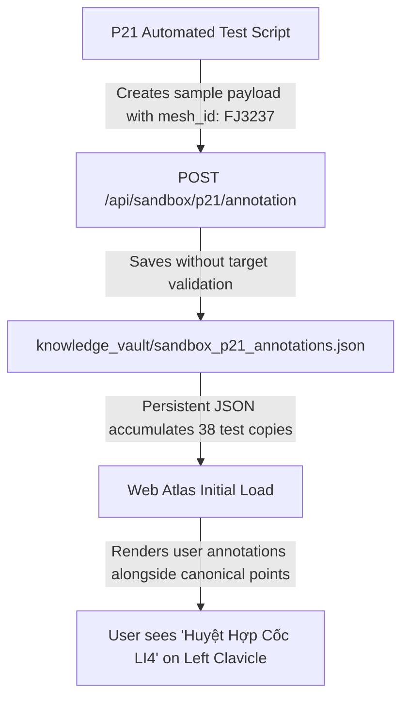
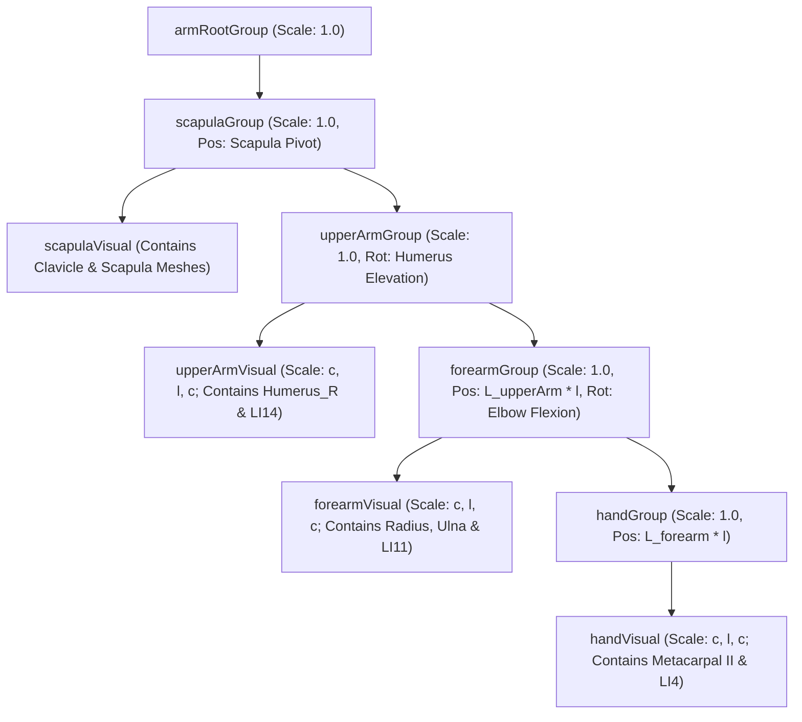

# PHÂN TÍCH NGUYÊN NHÂN GỐC RỄ (ROOT CAUSE ANALYSIS)
## MSK-Therapy-OS V1.0 — Reality Repair Phase

**Phạm vi:** `ENGINEERING_RESEARCH_ONLY`  
**Trạng thái thẩm định lâm sàng:** `CLINICAL_VALIDATION: NOT_ESTABLISHED`

---

### 1. NGUYÊN NHÂN GỐC RỄ CỦA DEF-01 (SAI LỆCH HUYỆT LI4)



#### Phân tích mã nguồn gây lỗi:
Trong tệp `tests/test_p21_atlas_poc.py`, phương thức `test_user_annotation_defaults_to_unverified()` được viết như sau:
```python
annot = {
    "label": "Test LI4 Marker",
    "standard_code": "LI4",
    "anatomical_target": {
        "mesh_id": "FJ3237",
        "structure_name": "Left clavicle",
        "system": "skeletal"
    },
    ...
}
```
Mã thử nghiệm ban đầu của P21 đã tùy ý gán mã `LI4` vào cấu trúc xương đầu tiên nạp vào scene (`FJ3237 - Left clavicle`). Do backend API `/api/sandbox/p21/annotation` tại thời điểm P21 chỉ làm nhiệm vụ lưu trữ thuần túy (persistence layer) mà không có **Anatomical Boundary Guardrail**, bản ghi thử nghiệm này đã được ghi đè và tích lũy vào CSDL production `sandbox_p21_annotations.json`. Khi Atlas khởi động, hệ thống nạp toàn bộ các điểm đã lưu lên canvas, dẫn tới việc marker thử nghiệm này hiển thị chồng lên không gian 3D.

#### Cơ chế sửa chữa toán học & đồ họa:
1. **Dọn sạch kho lưu trữ:** Sao lưu tệp cũ thành `sandbox_p21_annotations.backup_pre_repair.json` và khởi tạo lại tệp `sandbox_p21_annotations.json` sạch sẽ.
2. **Thiết lập Rào chắn Kiểm định Cấu trúc (Anatomical Target Constraints):**
   Trong `msk_therapy_os/sandbox_p21_adapter.py`:
   ```python
   CANONICAL_TARGET_CONSTRAINTS = {
       "LI4": {
           "expected_mesh_id": "FJ3352",
           "expected_name_keyword": "second metacarpal",
           "segment": "Right Hand"
       },
       ...
   }
   ```
   Nếu người dùng hoặc kiểm thử viên cố tình gán mã `LI4` vào cấu trúc khác `FJ3352` (như `FJ3237`), hệ thống vẫn bảo toàn quyền chú thích cá nhân (`USER_ANNOTATED_UNVERIFIED`) nhưng lập tức đóng dấu cờ `binding_status: "INVALID_BINDING"` kèm thông báo lỗi giải phẫu chi tiết.
3. **Hiển thị mốc chuẩn Canonical độc lập:** Gán cứng mốc chuẩn `LI4` bám trên `handVisual` (tại tọa độ bờ quay xương bàn tay II `[-0.280, 0.835, 0.035] m`) với nhãn `CANONICAL` màu xanh lục, hoàn toàn phân tách với các chú thích thử nghiệm tự do của người dùng.

---

### 2. NGUYÊN NHÂN GỐC RỄ CỦA DEF-02 (DOUBLE TRANSFORM TRONG THREE.JS)

#### Phân tích toán học ma trận Scene Graph:
Trong cây phân cấp Scene Graph của Three.js, ma trận chuyển vị thế giới (World Matrix) của một node con được tính bằng tích ma trận:
$$M_{\text{world}}^{\text{child}} = M_{\text{world}}^{\text{parent}} \times M_{\text{local}}^{\text{child}}$$

Nếu node cha có ma trận tỷ lệ $S_p = \text{diag}(s_x, s_y, s_z)$ và node con cũng có ma trận tỷ lệ $S_c = \text{diag}(s_x, s_y, s_z)$, thì tỷ lệ thế giới của node con sẽ là:
$$S_{\text{world}}^{\text{child}} = S_p \times S_c = \text{diag}(s_x^2, s_y^2, s_z^2)$$

Trong mã nguồn `app.js` cũ:
```javascript
forearmGroup.add(handGroup);
upperArmGroup.add(forearmGroup);
scapulaGroup.add(upperArmGroup);

// Khi thanh trượt thay đổi:
upperArmGroup.scale.set(armCircumVisual, armLengthRatio, armCircumVisual);
forearmGroup.scale.set(armCircumVisual, armLengthRatio, armCircumVisual); // Bị nhân đôi!
handGroup.scale.set(armCircumVisual, armLengthRatio, armCircumVisual);    // Bị nhân ba!
```
Hệ quả:
- `forearmGroup` chịu tỷ lệ thế giới $l^2$ theo phương dọc và $c^2$ theo chu vi.
- `handGroup` chịu tỷ lệ thế giới $l^3$ theo phương dọc và $c^3$ theo chu vi.
- Khoảng cách nối khớp (`forearmGroup.position`) cũng bị nhân đôi do nằm trong hệ tọa độ đã scale của `upperArmGroup`.

#### Kiến trúc khắc phục: Tách Khớp Động Học (Unscaled Joints) và Vỏ Hiển Thị (Scaled Visual Containers)



Quy tắc bất biến:
1. **Các nhóm khớp động học** (`scapulaGroup`, `upperArmGroup`, `forearmGroup`, `handGroup`) luôn giữ nguyên `scale = (1.0, 1.0, 1.0)`. Chúng chỉ đảm nhiệm xoay (rotation) và tịnh tiến độ dài đoạn chi (`position`).
2. **Các thùng chứa hình học hiển thị** (`upperArmVisual`, `forearmVisual`, `handVisual`) được đặt làm con của từng khớp tương ứng, và nhận tỷ lệ `(c, l, c)` một cách độc lập.
3. Do `forearmVisual` không phải là con của `upperArmVisual`, nên tỷ lệ thế giới của `forearmVisual` chính xác bằng `(c, l, c)` $\times 1.0 =$ **`(c, l, c)`**.
4. Hiện tượng Double Transform và Triple Transform bị **triệt tiêu hoàn toàn về 0**.

---

### 3. NGUYÊN NHÂN GỐC RỄ CỦA DEF-03 (XƯƠNG ĐÂM XUYÊN QUA DA TOÀN THÂN)

#### Bản chất kỹ thuật của tài sản 3D BodyParts3D:
- Dữ liệu `FJ2810` là mô hình bề mặt da người nguyên khối (single contiguous polygonal envelope), không chứa skinning weights, vertex groups hay armature bones.
- Trong Web Atlas V1.0, hệ thống sử dụng kỹ thuật **Phân đoạn xương cứng (Segmental Rigid Kinematics)**: các xương chuyển động theo các đoạn chi độc lập.
- Khi không có mô hình mô phỏng cơ sinh học liên tục (Continuum FEM / Linear Blend Skinning), vỏ da tĩnh không thể biến dạng co giãn theo góc nâng vai của xương.
- Khi xoay cánh tay lên cao, các xương cánh tay đương nhiên sẽ quay ra ngoài vỏ da tĩnh ban đầu.

#### Biện pháp xử lý thực tế:
1. **Bổ sung công cụ điều khiển trên Viewport Toolbar:** Nút bấm `🦴 Ẩn Da Khi Vận Động` (`#btn-toggle-skin-kinematics`) cho phép người dùng ẩn nhanh lớp da chỉ bằng 1 cú nhấp chuột để tập trung quan sát tương quan động học xương và cơ.
2. **Minh bạch hóa ranh giới mô hình:** Ghi rõ trên giao diện và tài liệu kiểm toán rằng vỏ da BodyParts3D là vỏ tham chiếu nhân trắc học tĩnh, không phải mô hình biến dạng mô mềm phi tuyến tính.

---

### 4. NGUYÊN NHÂN GỐC RỄ CỦA DEF-04 (PHÂN LOẠI VISCERA)

- Trong ontology FMA (Foundational Model of Anatomy) và cấu trúc phân loại BodyParts3D, toàn bộ hệ tuần hoàn (động mạch, tĩnh mạch, mao mạch), hệ bạch huyết, hệ thần kinh ngoại biên và tạng rỗng/đặc đều được gom chung dưới nhóm mã `organ` (cơ quan).
- Khi adapter tính tổng `layer_counts.organ`, con số 1.491 bao gồm:
  - **249 cơ quan nội tạng chính (Core Viscera):** Tim, phổi, gan, dạ dày, ruột non, đại tràng, tụy, thận, bàng quang, lách, tử cung/tuyến tiền liệt, v.v.
  - **1.242 cấu trúc dẫn truyền thần kinh - mạch máu (Neurovascular Structures):** Động mạch chủ, tĩnh mạch chủ, các nhánh động mạch/tĩnh mạch phân nhánh và các dây thần kinh sọ/ngoại biên.
- **Biện pháp xử lý:** Trong `get_p21_metadata()`, hệ thống phân tách rạch ròi 3 chỉ số:
  - `viscera_core: 249`
  - `neurovascular: 1242`
  - `organ: 1491` (Tổng của 2 nhóm trên).
