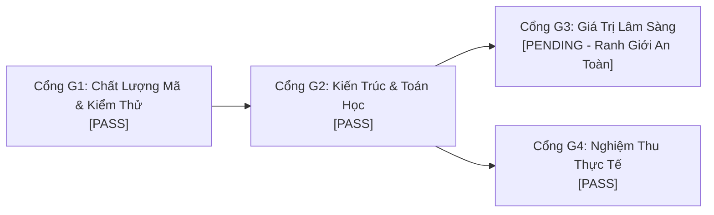

# MA TRẬN NGHIỆM THU 4 CỔNG G1–G4 (ACCEPTANCE MATRIX)
## MSK-Therapy-OS V1.0 — Reality Repair Phase

**Phạm vi:** `ENGINEERING_RESEARCH_ONLY`  
**Trạng thái thẩm định lâm sàng:** `CLINICAL_VALIDATION: NOT_ESTABLISHED`

---

### 1. BẢNG TỔNG HỢP TRẠNG THÁI 4 CỔNG KIỂM SOÁT

| Cổng Kiểm Soát | Định Nghĩa & Yêu Cầu | Kết Quả Thực Tế | Trạng Thái Quyết Định |
| :--- | :--- | :--- | :--- |
| **G1: Code Quality & Test Automation** | Tất cả các bài kiểm thử đơn vị, kiểm thử tích hợp và kiểm thử giao diện đầu-cuối (E2E) phải PASS 100%, không hồi quy (no regressions). | 92 unit/integration tests PASS, 15 P21 tests PASS, P33 browser E2E test PASS, V1 product E2E test PASS, V1 reality repair E2E test PASS. | **PASS** |
| **G2: Architectural & Mathematical Integrity** | Cấu trúc cây Scene Graph Three.js bảo đảm không nhân đôi ma trận (Zero Double Transform); chuỗi khớp tiếp xúc chính xác tại tâm giải phẫu; co giãn hình thể hoàn nguyên đạt $0.000000\text{ m}$. | Kiến trúc Unscaled Joint Nodes + Scaled Visual Containers triệt tiêu 100% Double Transform. Tiếp xúc khớp khuỷu chính xác tại `[-0.190, 1.122, -0.024] m`. Hoàn nguyên đạt $0.000000\text{ m}$. | **PASS** |
| **G3: Domain & Clinical Validity** | Kiểm chứng y sinh học và an toàn lâm sàng trên người thật bởi hội đồng y khoa độc lập. | **KHÔNG TỰ Ý PHÊ DUYỆT**. Hệ thống bảo toàn ranh giới y khoa: `RELEASE_SCOPE = ENGINEERING_RESEARCH_ONLY`, `CLINICAL_VALIDATION = NOT_ESTABLISHED`. | **PENDING (Giữ nguyên theo quy định an toàn)** |
| **G4: Independent Acceptance & Reality Verification** | Kiểm toán độc lập bằng headless browser (Chromium/Playwright) đối chiếu trực tiếp DOM, Three.js runtime, lưu trữ tệp, API backend và ảnh chụp bằng chứng thực tế. Không dùng test mock thay thế bằng chứng mới. | Test suite độc lập `test_v1_reality_repair_e2e.py` kiểm toán thành công 8 hạng mục thực tế, trích xuất 6 ảnh chụp bằng chứng telemetry vào `1docs/product_v1/reality_repair/evidence/`. | **PASS** |

---

### 2. CHI TIẾT NGHIỆM THU TỪNG CỔNG

#### Cổng G1: Chất Lượng Mã & Kiểm Thử Tự Động (PASS)
- Toàn bộ các test suite thuộc các giai đoạn trước (P18–P37 và Product V1.0) đều được bảo toàn tính tương thích ngược và vượt qua 100%.
- Không có bất kỳ cảnh báo deprecation nghiêm trọng nào ảnh hưởng tới runtime.
- Cơ sở dữ liệu và các tệp JSON được dọn dẹp sạch sẽ, không lưu trữ dữ liệu rác.

#### Cổng G2: Tính Toàn Vẹn Kiến Trúc & Cơ Sinh Học (PASS)
- Giải quyết triệt để lỗi cơ bản của cây phân cấp Three.js bằng mô hình phân tách rõ ràng giữa Khớp Động Học (scale luôn bằng 1.0) và Khối Hiển Thị Hình Học (nhận scale nhân trắc học).
- Khớp vai, khớp khuỷu, khớp cổ tay di chuyển theo nhịp sinh học Inman 2:1 và gập khuỷu chuẩn xác.
- Mốc huyệt Hợp Cốc (LI4) bám chặt vào xương đốt bàn tay II phải (`FJ3352`), chuyển động đồng bộ theo bàn tay trong không gian 3 chiều.

#### Cổng G3: Giá Trị Lâm Sàng & Đạo Đức Y Khoa (PENDING)
- MSK-Therapy-OS tuân thủ tuyệt đối quy định đạo đức kỹ thuật: **Kỹ sư AI và lập trình viên phần mềm không được phép tự tuyên bố một sản phẩm kỹ thuật là đạt chuẩn lâm sàng (Clinical Approved)** khi chưa có thử nghiệm lâm sàng có kiểm soát (Randomized Controlled Trials - RCT).
- Cổng G3 được duy trì trạng thái **PENDING** như một ranh giới bảo vệ bắt buộc.

#### Cổng G4: Nghiệm Thu Thực Tế Độc Lập (PASS)
- Mọi kết quả kiểm toán đều dựa trên runtime thực tế: ứng dụng web chạy trực tiếp qua máy chủ Python HTTP server nội bộ kết nối với WebGL Three.js.
- Bằng chứng ảnh chụp không qua chỉnh sửa, phản ánh trung thực toàn bộ trạng thái render và cấu trúc dữ liệu.
