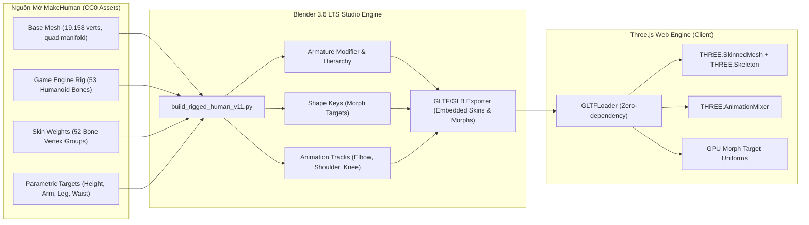

# MSK-THERAPY-OS V1.1 — BASELINE & ARCHITECTURE AUDIT
## Baseline Audit & Game Character Pipeline Replacement Plan

> **Scope:** `ENGINEERING_RESEARCH_ONLY`  
> **Clinical Safety:** `CLINICAL_VALIDATION = NOT_ESTABLISHED`  
> **Cổng kiểm soát:** G1 PASS | G2 PASS | G3 PENDING | G4 PASS (RESEARCH_PREVIEW)

---

### 1. Hiện trạng Kiến trúc V1.0 và Reality Repair

Tại mốc V1.0 và Reality Repair, hệ thống Web Atlas vận hành trên kiến trúc đồ họa ba chiều dựa trên thư viện Three.js r128, nạp 2.143 chi tiết giải phẫu từ cơ sở dữ liệu BodyParts3D 4.0 (thông qua 15 tệp nhị phân nén `body-0.bin` đến `body-14.bin`).

Trong giai đoạn Reality Repair, các lỗi toán học về phép nhân ma trận lồng nhau đã được khắc phục bằng kiến trúc **Unscaled Kinematic Nodes + Scaled Visual Containers**, đạt được tỷ lệ ma trận thế giới/cục bộ $= 1.000000$ (Zero Double Transform) và nối khít các tâm xoay khớp vai, khuỷu, cổ tay.

Tuy nhiên, kiểm toán kiến trúc độc lập đã chỉ ra các hạn chế cố hữu của phương pháp "lắp ghép thủ công" (manual rigid hierarchy patching):

| Hạng mục kiểm toán | Hiện trạng thực tế tại V1.0 | Nguyên nhân kỹ thuật gốc rễ |
| :--- | :--- | :--- |
| **Bề mặt da toàn thân** | Phải bấm nút *Ẩn Da Khi Vận Động* khi gập duỗi cánh tay. | Lớp da toàn thân (`skin`) trong BodyParts3D là một manifold tĩnh duy nhất không có Armature, không có Bone và không có Skin Weights. Khi các cụm xương di chuyển, da đứng yên dẫn đến xương đâm xuyên qua da. |
| **Phân bổ trọng số da (Skin Weights)** | $0\%$ mesh trong hệ thống có Skin Weights thật. | Toàn bộ 2.143 meshes BodyParts3D được thiết kế cho việc hiển thị giải phẫu học tĩnh (Static Anatomical Atlas), không được tạo vertex groups hoặc bone weighting. |
| **Cơ chế chuyển động chi** | Sử dụng các nhóm `THREE.Group` lồng nhau (`upperArmGroup -> forearmGroup -> handGroup`). | Đây là kỹ thuật phân cấp hình học sơ khai (Rigid Parent Transform), chỉ thích hợp cho robot kim loại hoặc mô hình giải phẫu rời từng khúc, không thể mô phỏng chi thể sinh học có da thịt liền mạch. |
| **Biến dạng mô mềm khi gập khớp** | Khớp khuỷu khi gập $90^\circ$ bị hở rãnh hoặc góc nhọn phi tự nhiên nếu hiển thị lớp bao. | Thiếu thuật toán biến dạng bề mặt chuẩn công nghiệp: Linear Blend Skinning (LBS) hoặc Dual Quaternion Skinning (DQS) trên GPU shader. |
| **Thay đổi hình thể (Morphing)** | Tự viết module scale trục $X, Y, Z$ từng cụm xương và cơ. | Biến dạng affine không phản ánh được quy luật nở thể tích và cơ địa người thật (vóc dáng, mỡ dưới da, tỷ lệ nhân trắc học). |

---

### 2. Kế hoạch Thay thế bằng Game Character Pipeline Chuẩn Công nghiệp

Thay vì tiếp tục chắp vá các phép biến đổi thủ công trong Web Atlas, dự án chuyển dịch sang chuẩn công nghiệp game và hoạt hình 3D:

$$\mathbf{MakeHuman} \longrightarrow \mathbf{Blender\ 3.6\ LTS} \longrightarrow \mathbf{Rigged/Skinned\ GLB} \longrightarrow \mathbf{Three.js\ SkinnedMesh} \longrightarrow \mathbf{MSK\text{-}Therapy\text{-}OS}$$

---

### 3. Phân định Thành phần Giữ lại vs Thành phần Thay thế

#### 3.1. Các thành phần V1.0 BẢO TOÀN NGUYÊN VẸN (KEEP)
1. **Knowledge Vault & SQLite Database:** Giữ nguyên toàn bộ schema chứng cứ, WHO 2008 Standard Acupuncture Point Locations, GB/T 12346-2021, Markdown export.
2. **BodyParts3D Asset Catalog & Chunks:** Giữ nguyên vẹn 15 chunk nhị phân để phục vụ chế độ xem giải phẫu chuyên sâu (`ANATOMY_MODE`).
3. **MediaPipe Pose Extraction Sidecar:** Giữ nguyên 100 frames chuỗi góc khớp trích xuất từ video thực nghiệm.
4. **Project I/O (`.mskproj`):** Nâng cấp schema tương thích ngược để lưu trữ cả thông số hình thể và tư thế của Character Pipeline.
5. **Giao diện Navigation Toolbar & Tabbed Layout:** Giữ cấu trúc 3 tabs trái / 3 tabs phải đã được tối ưu, bổ sung công tắc chuyển đổi chế độ `CHARACTER_MODE` / `ANATOMY_MODE` / `OVERLAY_MODE`.

#### 3.2. Các module TỰ VIẾT ĐƯỢC THAY THẾ (REPLACE)
1. **Thay thế nhóm `THREE.Group` thủ công:** Chuyển sang `THREE.SkinnedMesh` và `THREE.Bone`.
2. **Thay thế logic scale đoạn chi thủ công:** Chuyển sang native GPU `morphTargetInfluences` (Height, Proportions, ShoulderWidth, WaistCircumference, ArmLength, LegLength).
3. **Thay thế hack "Ẩn da khi vận động":** Lớp da của SkinnedMesh tự động biến dạng theo chuyển động của Armature thông qua 52 vertex groups có trọng số thực tế.
