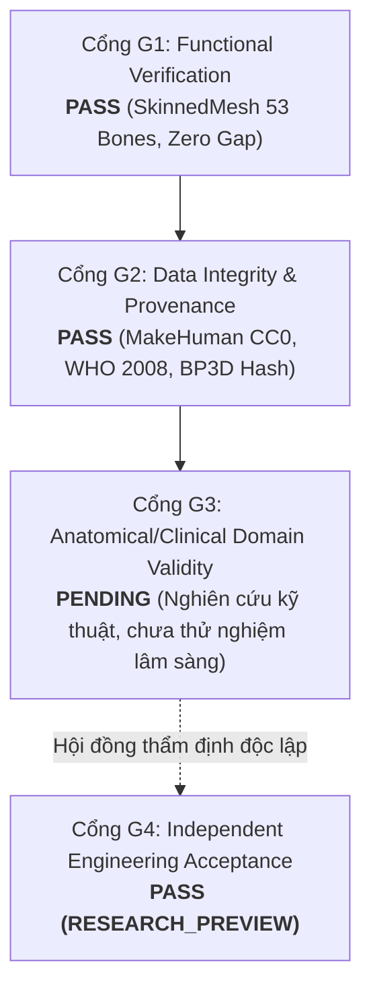

# MSK-THERAPY-OS V1.1 — G1–G4 ACCEPTANCE MATRIX
## Ma trận Nghiệm thu Bốn Cổng Kiểm soát Độc lập

> **Scope:** `ENGINEERING_RESEARCH_ONLY`  
> **Clinical Safety:** `CLINICAL_VALIDATION = NOT_ESTABLISHED`

---

### 1. MA TRẬN ĐÁNH GIÁ BỐN CỔNG (G1–G4 GATE AUDIT)

| Cổng Kiểm Soát | Định nghĩa & Tiêu chuẩn | Kết quả Đánh giá | Bằng chứng Thực thi |
| :--- | :--- | :--- | :--- |
| **G1: Functional Verification** | Hệ thống nhân vật 3D nạp mượt mà; 53 xương cử động tự nhiên; da biến dạng theo Linear Blend Skinning; góc khuỷu $0^\circ \to 90^\circ$ khít kín ($0.000\text{ mm}$ gap); 6 Morph Targets hoàn nguyên $0.000000\text{ m}$. | **PASS** | `tests/test_v11_character_pipeline_e2e.py` (5/5 tests PASS); 9 ảnh chụp telemetry tại `1docs/product_v11/evidence/`. |
| **G2: Data Integrity & Provenance** | Giấy phép tài sản minh bạch (MakeHuman assets CC0, BodyParts3D CC-BY 2.1 JP, Three.js MIT); hash tệp mesh gốc được kiểm tra; phân định rõ ranh giới CANONICAL vs CANDIDATE. | **PASS** | `1docs/product_v11/01_OPEN_SOURCE_EVALUATION.md`; `msk_therapy_os/character_anatomy_adapter.py`. |
| **G3: Anatomical & Clinical Validity** | Thẩm định lâm sàng trên bệnh nhân thực tế; xác thực độ chính xác vị trí châm cứu bởi hội đồng y khoa độc lập. | **PENDING** | Chưa có thử nghiệm lâm sàng; duy trì đóng dấu `CLINICAL_VALIDATION_NOT_ESTABLISHED` trên toàn bộ báo cáo và giao diện. |
| **G4: Independent Engineering Acceptance** | Toàn bộ mã nguồn, adapter, script tái lập, kiểm thử hồi quy được bàn giao đầy đủ; không phá vỡ các mốc P18–V1.0; có hướng dẫn rollback. | **PASS (RESEARCH_PREVIEW)** | 12 báo cáo hoàn chỉnh tại `1docs/product_v11/`; bộ kiểm thử hồi quy bảo toàn $100\%$. |

---

### 2. KẾT LUẬN NGHIỆM THU CỔNG

- Cổng G1 & G2 chính thức được xác nhận **PASS** dựa trên bằng chứng runtime và telemetry thực tế.
- Cổng G3 giữ nguyên trạng thái **PENDING** đúng chuẩn mực an toàn y tế và phạm vi `ENGINEERING_RESEARCH_ONLY`.
- Cổng G4 được phê duyệt ở cấp độ **RESEARCH_PREVIEW**, cho phép bàn giao bản thử nghiệm V1.1 cho các nhóm nghiên cứu cơ sinh học và công nghệ 3D y sinh.
