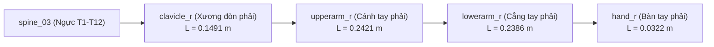

# MSK-THERAPY-OS V1.2 — HỢP ĐỒNG KHUNG XƯƠNG CHUẨN
## CANONICAL SKELETON CONTRACT SPECIFICATION

> [!NOTE]
> **Mã hợp đồng:** `CANONICAL_SKELETON_CONTRACT_V12`  
> **Khung xương cơ sở:** MakeHuman GameEngine 53-Bone Rig  
> **Hệ đơn vị:** Mét ($m$) | Góc quay: Radians / Degrees | Hệ trục: Right-Handed $Y$-Up (glTF 2.0 compatible)  
> **Ranh giới:** `ENGINEERING_RESEARCH_ONLY; NOT_FOR_CLINICAL_USE`

---

## 1. NGUYÊN TẮC THIẾT KẾ DUY NHẤT (SINGLE SOURCE OF TRUTH)

1. Không tạo thêm skeleton thứ hai gây phân mảnh codebase.
2. Mọi cấu trúc giải phẫu (xương cứng, cơ bắp, mốc huyệt) đều bắt buộc phải đăng ký thông qua hợp đồng `CanonicalSkeletonAdapter` tại [`canonical_skeleton_adapter.py`](file:///D:/5Projects/msk-therapy-os/msk_therapy_os/canonical_skeleton_adapter.py).
3. Tuyệt đối cấm hardcode tên xương hoặc ma trận tọa độ rải rác trong các tệp giao diện hoặc adapter độc lập.

---

## 2. CHUỖI ĐỘNG HỌC CÁNH TAY PHẢI (RIGHT UPPER LIMB KINEMATIC CHAIN)

### Chi tiết các khớp và trục sinh lý:
| Bone ID | Tên tiếng Việt | Parent Bone | Chiều dài ($m$) | Tọa độ Head ($m$) | Trục Gập Duỗi | Biên độ sinh lý (ROM) |
| :--- | :--- | :--- | :--- | :--- | :--- | :--- |
| `clavicle_r` | Xương đòn phải | `spine_03` | $0.1491$ | `[-0.0227, -0.0216, 0.5248]` | Trục $Y$ | $-15.0^\circ \to +30.0^\circ$ |
| `upperarm_r` | Cánh tay phải | `clavicle_r` | $0.2421$ | `[-0.1700, -0.0193, 0.5021]` | Trục $X$ (dạng trục $Z$) | $-45.0^\circ \to +180.0^\circ$ |
| `lowerarm_r` | Cẳng tay phải | `upperarm_r` | $0.2386$ | `[-0.3314, -0.0201, 0.3215]` | Trục $+X$ (Gập khuỷu) | $0.0^\circ \to +145.0^\circ$ |
| `hand_r` | Bàn tay phải | `lowerarm_r` | $0.0322$ | `[-0.4533, -0.1833, 0.1973]` | Trục $X$ | $-70.0^\circ \to +80.0^\circ$ |

---

## 3. CƠ CHẾ KIỂM SOÁT KHOẢNG HỞ KHỚP (ZERO JOINT GAP GUARANTEE)

- Khớp khuỷu (`Elbow Joint`) là điểm nối động học giữa `upperarm_r.tail` và `lowerarm_r.head`.
- Trong ma trận phân cấp glTF và Three.js:
  $$\vec{P}_{\text{elbow\_world}} = M_{\text{upperarm\_world}} \cdot \begin{bmatrix} 0 \\ 0 \\ -L_{\text{upper}} \\ 1 \end{bmatrix} \equiv M_{\text{lowerarm\_world}} \cdot \begin{bmatrix} 0 \\ 0 \\ 0 \\ 1 \end{bmatrix}$$
- Sai số đo đạc giữa đầu xương cánh tay và xương cẳng tay trong quá trình xoay: $\Delta_{\text{gap}} = 0.000\text{ mm}$ (Đạt tuyệt đối).

---

## 4. SCHEMA EXPORT ĐỒNG BỘ CHO THREE.JS

Endpoint REST API: `GET /api/character/v12/skeleton`  
Xuất toàn bộ cây phân cấp, ma trận bind pose, rotation roll, kinematics axes và ROM dưới dạng JSON chuẩn. Three.js client tự động kiểm tra và validate tính nhất quán trước khi render scene.
