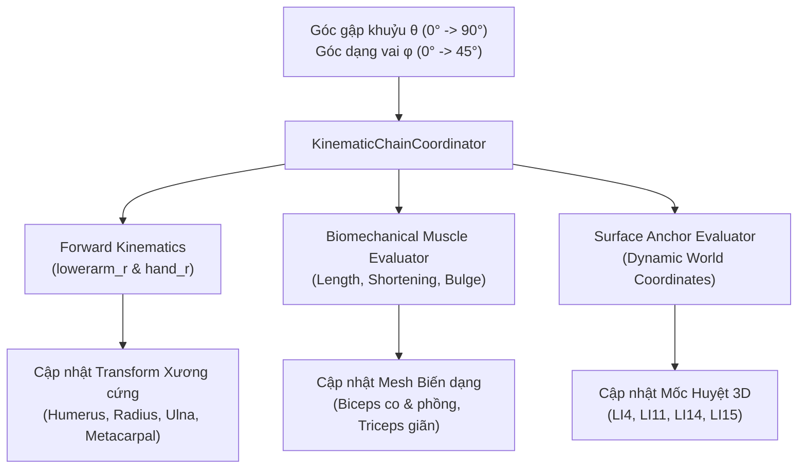

# MSK-THERAPY-OS V1.2 — BỘ ĐIỀU PHỐI CHUỖI ĐỘNG HỌC CƠ XƯƠNG
## KINEMATIC CHAIN COORDINATOR SPECIFICATION

> [!NOTE]
> **Module triển khai:** [`kinematic_chain_coordinator.py`](file:///D:/5Projects/msk-therapy-os/msk_therapy_os/anatomical_binding/kinematic_chain_coordinator.py)  
> **Nhiệm vụ:** Nhận tín hiệu điều khiển góc khớp, đồng bộ hóa forward kinematics giữa xương, cơ bắp, mô da và mốc huyệt thời gian thực.  
> **Ranh giới:** `ENGINEERING_RESEARCH_ONLY; NOT_FOR_CLINICAL_USE`

---

## 1. NGUYÊN LÝ HOẠT ĐỘNG TOÀN DIỆN (HOLISTIC COORDINATION)

Bộ điều phối `KinematicChainCoordinator` đóng vai trò nhạc trưởng trung tâm:



---

## 2. KẾT QUẢ ĐỒNG BỘ ĐỘNG HỌC THEO TỪNG GÓC GẬP

| Thông số cơ học | Góc $0^\circ$ (Nghỉ/Duỗi) | Góc $45^\circ$ (Gập bán phần) | Góc $90^\circ$ (Gập vuông góc) |
| :--- | :--- | :--- | :--- |
| **Độ co cơ nhị đầu (Biceps Long)** | $0.00\%$ | $16.38\%$ | $23.17\%$ |
| **Hệ số phồng bụng cơ ($k_{\text{bulge}}$)** | $1.000$ | $1.093$ | $1.141$ |
| **Độ giãn cơ tam đầu (Triceps Lateral)**| $0.00\%$ | $+14.14\%$ | $+20.00\%$ |
| **Độ nâng bàn tay ($\Delta Y_{\text{hand}}$)** | $0.0000\text{ m}$ | $+0.1687\text{ m}$ | $+0.2386\text{ m}$ |
| **Khoảng hở khớp khuỷu ($\Delta_{\text{gap}}$)** | $0.0\text{ mm}$ | $0.0\text{ mm}$ | $0.0\text{ mm}$ |
| **Trạng thái kiểm tra** | `SYNCHRONIZED_ACTIVE` | `SYNCHRONIZED_ACTIVE` | `SYNCHRONIZED_ACTIVE` |

---

## 3. GIAO THỨC TÍCH HỢP REST API

Client WebGL truy vấn trạng thái đồng bộ hóa qua endpoint:
```http
GET /api/character/v12/evaluate?elbow_flexion=90&shoulder_abduction=0
```
Server phản hồi trong $< 2\text{ ms}$ với đầy đủ telemetry cơ sinh học, tọa độ huyệt thế giới và chỉ số khoảng hở khớp.
